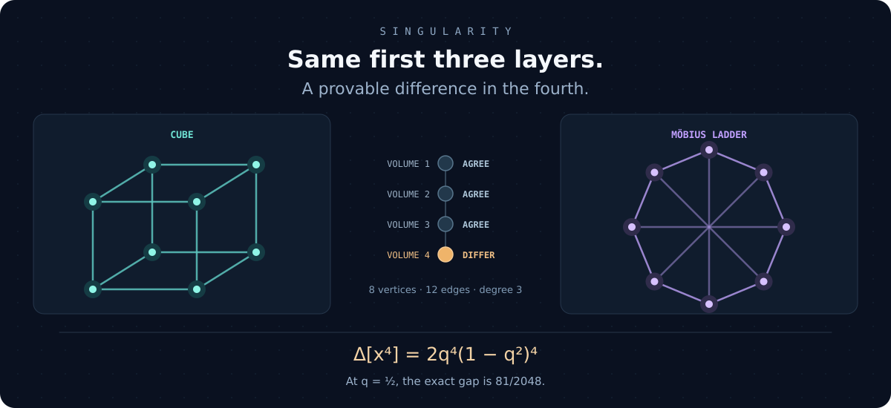
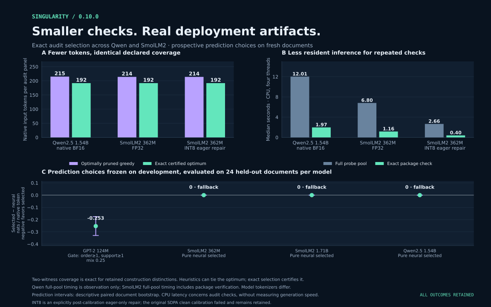
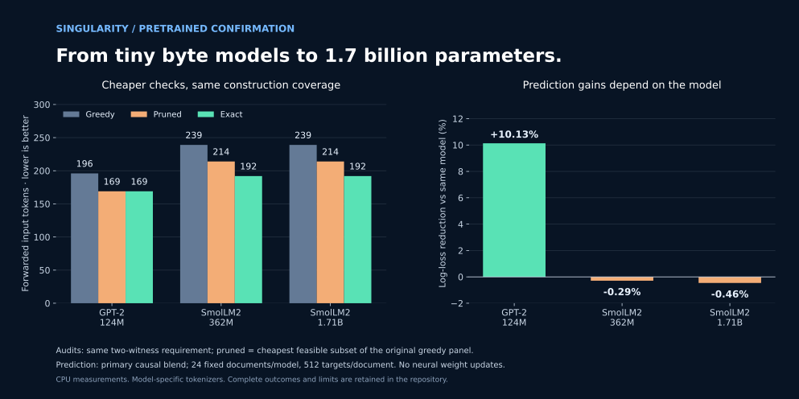
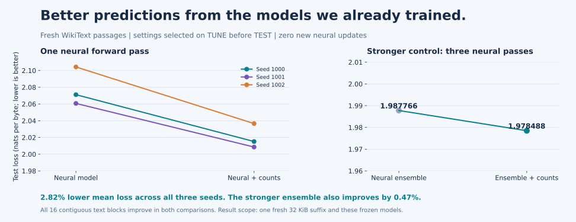
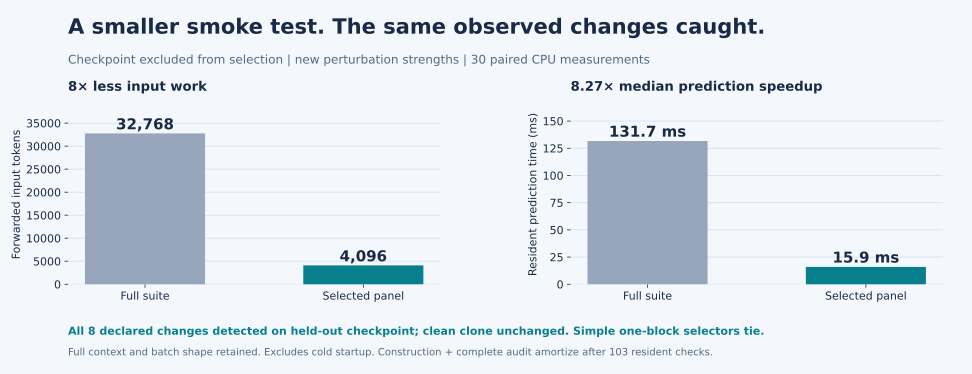
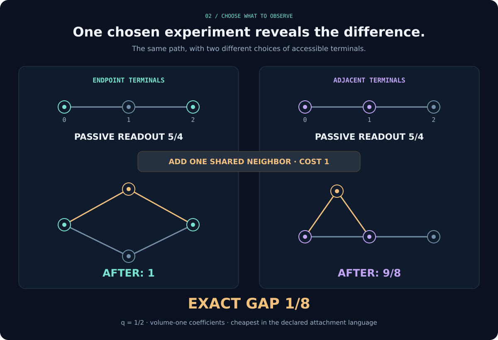
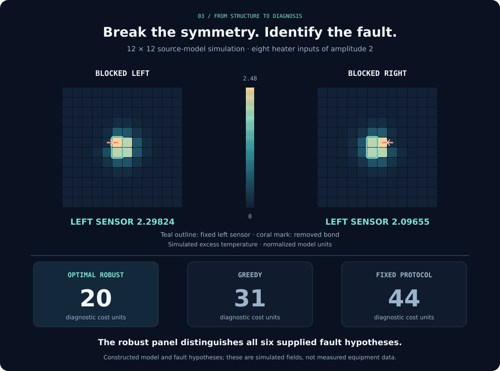
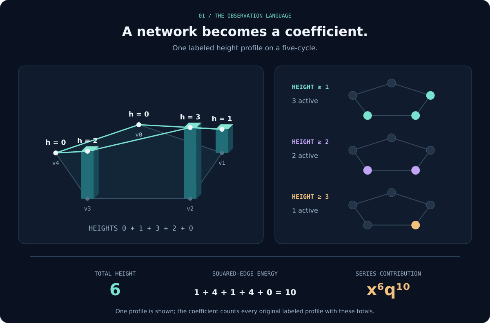

# Singularity

**How much of a hidden structure can observation reveal?**

Singularity turns that question into exact mathematics. It counts the configurations a network makes possible, finds the first observation that exposes a difference, and designs experiments that reveal more for less. It can also prove when an entire language of experiments will remain blind.



[**Read the monograph**](output/pdf/monograph.pdf) · [**Explore the discoveries**](docs/papers/locality.md) · [**Deployment evidence**](applications/training_lab/DEPLOYMENT_RESULTS.md) · [**See the pretrained results**](applications/training_lab/PRETRAINED_RESULTS.md) · [**Audit your model**](applications/training_lab/AUDIT_TOOLKIT.md) · [**See the applied experiment**](applications/thermal_diagnostics/README.md)

**GPU audit v3 now tested on T4:** the [actual Qwen2.5-1.5B result](applications/training_lab/results/gpu_deployment_audit/v3_t4_qwen2.5-1.5b/summary.md) confirms a unique **379-token** panel covering all six construction faults twice and supplying two conditional shape witnesses for every cap **1–127**, with no flags in four clean configurations. Exact ties optimally pruned greedy; ordinary greedy costs 557. The invariant-logit-shift control has a small numerical flag, reported separately from the two destructive new faults. Frozen v2 is unchanged; standalone-panel timing and A100 transfer remain open.

<!-- BEGIN deployment-transfer -->
## Make every model check count.

**New in 0.10.0: real deployment artifacts and an untouched model family.** On Qwen2.5-1.5B, a certified panel uses **192 input tokens instead of 215** for optimally pruned greedy selection, while a resident audit takes **1.97s instead of 12.01s**. The deployment study then checks actual Safetensors reloads, an executable TorchScript graph, dynamic INT8 modules, SDPA attention and KV caches. FP32 clean graph/cache/backend controls pass, and exact selection retains two witnesses for every covered construction distinction.



**7.45% lower GPT-2 loss on fresh held-out text.** A protected repetition gate, selected on 12 development documents before evaluation, improves 18/24 held-out documents. The same selection rule retains pure neural for SmolLM2 362M, SmolLM2 1.71B, Qwen2.5 1.54B. All **73,728 evaluated targets**, clean-transfer limits and missed fault variants are retained. The original INT8 SDPA calibration fails; a separately frozen post-calibration eager-only contract provides the bounded deployment package. Read the [**complete 0.10.0 evidence**](applications/training_lab/DEPLOYMENT_RESULTS.md) or [**check a saved deployment artifact**](applications/training_lab/DEPLOYMENT_GUIDE.md).
<!-- END deployment-transfer -->

## Real pretrained models. Exact checks. Evidence you can replay.

**New in 0.9.0: tested from GPT-2 to SmolLM2 at 1.7 billion parameters.** Exact audit selection uses **13.8–19.7% fewer input tokens than basic greedy** under the same two-witness requirement. A stronger post-hoc comparison optimally prunes every greedy output: both SmolLM2 models still give a **10.28% exact-selection saving**, while GPT-2 ties that stronger baseline. Separate exhaustive scans confirm the optima. On the 1.7B model, a resident package check takes **1.90 seconds instead of 12.00 seconds** for the full probe pool—a measured **6.32× speedup**. Every construction distinction included in its guarantee survives any one missing probe result; clean resident and fresh-process checks pass.



**The prediction advantage is model-specific.** A causal neural/count blend reduces GPT-2's average next-token log loss by **10.13%**, improving every one of 24 fixed documents. A separate post-hoc check giving the neural model the entire available document prefix retains **10.05%**. The stronger SmolLM2 models favor the neural model alone on this workload. All six arms, individual losses, tokenizer identities, fault coverage gaps and execution receipts are retained. An optional conservative prior gives a separate mathematical ceiling on adaptation cost: at most **0.0513 extra nats per document** over the neural model in exact arithmetic. This refinement is explicitly a post-hoc analysis, separate from the frozen confirmation. Read the [**complete pretrained study and reproduction commands**](applications/training_lab/PRETRAINED_RESULTS.md).

## Audit your own model. Survive missing results. Blend faster.

**New in 0.8.0: a portable audit tool.** `singularity.model_audit` turns a resident PyTorch callable, one of our byte transformers or a Hugging Face causal model into a self-contained audit package. The package holds only the chosen probe inputs, the expected observations, tolerances frozen from clean reruns and the declared execution contract. A deployment is then checked against that file alone: no dataset download and no second reference pass. Observations are sensitive to probability as well as to the winning token, so a temperature change that leaves every argmax intact is still caught.

**Exact robust coverage.** Every declared fault must be separated by two probes, so one missing result cannot hide it. Across seven realistic silent faults (padding mask, position offsets, truncation, Unicode handling, temperature and localized quantization), the exact panel costs **195 of 961 pool tokens**; greedy selection costs 224. On a checkpoint excluded from selection, the frozen panel separates every construction fault twice and detects all five held-out faults, including an excluded CRLF family, with **no false alarms** in twelve clean controls. A conventional panel of typical sentences misses half of these faults. A resident check takes **4.7 ms**.

**Same predictions, 9.2× faster blending.** The causal Bayesian blend is now vectorized. It reproduces the 0.7.0 loop to 10⁻¹⁰ nats, gives bit-identical results for any chunk size, saves and resumes exactly, and keeps its log(21) bound. A prospectively frozen confirmation on new prose, legal text and Python source shows online blending beating the small byte neural models on every document–seed pair, with **7.5–19.7% domain-averaged loss reductions**. It also shows something more useful: a simple adaptive in-document count model beats all of these neural arms on such out-of-domain text, and blending with it is best everywhere. Read the [**0.8.0 audit toolkit guide**](applications/training_lab/AUDIT_TOOLKIT.md).

## Better predictions. Smaller checks. Measured results.

The **0.7.0 confirmation release** connected exact observation mathematics to trained AI models. It improves fresh-text predictions, builds economical behavioral smoke tests, and supplies a causal probability-combination API with a proved finite-grid log-loss bound.



**Improve the models already trained.** A blend of our frozen byte transformer and TRAIN-only text counts reduces mean fresh TEST loss by **2.82%**, with improvements in all three seeds and all sixteen text blocks. Mean next-byte accuracy rises from **41.35% to 42.20%**. The stronger three-model ensemble also improves by **0.47%** in loss. Settings were selected on separate TUNE text before TEST; the new study performs **zero neural training updates**. These are small, real WikiText-2 byte-model results, with saved per-target losses and complete comparators.

**Adapt a blend without calibrating its weight.** A separate causal Bayesian blend improves loss by **2.87%** over the neural model on another fresh passage. Its cumulative log loss stays within **log(21) nats** of the best declared fixed grid mixture. Predictions precede the current target; only earlier targets update the blending weights. This standard aggregation guarantee is implemented and independently replayed. Count smoothing still uses earlier TUNE, and online bookkeeping adds runtime.



**Check executed behavior with less inference.** A frozen panel uses **4,096 instead of 32,768 input tokens**, retaining full contexts. It detects all eight declared output changes on a checkpoint excluded from selection, including perturbation strengths absent from construction. Thirty paired CPU measurements show **131.7 ms to 15.9 ms median resident prediction**, an **8.27× speedup**. Construction and the complete development audit amortize after **103 checks**. The runtime demonstration catches changed predictions even when the weight file and every state tensor remain identical. Cold CLI setup is separate; simple one-block selectors match the exact optimum in this example.

Use the [**confirmation guide and commands**](applications/training_lab/CONFIRMED_ADVANTAGES.md), read the [**new research companion**](output/pdf/confirmed_advantages.pdf), or inspect the [**independent result audit**](applications/training_lab/results/confirmed_advantages_audit.json). The [training lab](applications/training_lab/README.md) retains the original 63 training runs, checkpoints, compressed logs, and earlier outcomes. The guarantees concern the stated finite workloads and observation languages; all source, cost and transfer boundaries remain explicit.

## A small difference with a long reach

The two networks above each have eight vertices, twelve edges, and three neighbors at every vertex. Give their vertices nonnegative integer heights, and measure the squared height difference along every edge. Count the resulting profiles by their total height. The first three layers agree exactly. The fourth reveals the difference.

Singularity proves where that distinction comes from: the cube has six squares; the Möbius ladder has four. More generally, for regular graphs with no shorter cycles, the first visible cycle count determines an exact discrepancy coefficient. There are also infinite families whose differences hide beyond any prescribed finite depth. Observation has a structure of its own—and we can calculate it.

The arithmetic connection goes further. Feed these local counts into a product over the primes, and the first different coefficient controls a singularity at a precise reciprocal depth. A finite combinatorial distinction becomes a measurable feature of an infinite arithmetic object. The [arithmetic visibility paper](docs/papers/visibility.md) develops that bridge; the [Lean analysis project](formal-analysis/README.md) checks the positive-real factorization and boundary asymptotic.

## Recover structure. Choose the experiment. Know the limit.

**Recover a network from its possibilities.** Singularity reconstructs every simple 2-regular graph of known order from a sharp finite observation budget. Retaining squared height as an additional marker gives a complete graph invariant at every fixed parameter between zero and one. That completeness proof can require enormous observation depths; efficient general reconstruction remains an open frontier. The [observation-depth paper](docs/papers/locality.md) explains the results and their boundaries.

**Find the experiment that makes the difference.** Attachments to a graph become operators on an exact interface. The engine discovers everything the allowed operators can reveal, preserves the information needed for every future attachment sequence, and returns a cheapest distinguishing experiment under the declared costs. It also searches for robust shared panels when observations carry bounded uncertainty. The [operator chapter](docs/chapters/15_operators_experiments.md) connects these guarantees to runnable algorithms.



**Count enormous populations through their structure.** A retained experiment on a 96-vertex path counts **2,506,262,962,660,245 labeled height profiles** under its stated bounds. Locality, separator methods, and exact generating functions make those populations accessible without listing each profile. The [implementation guide](docs/IMPLEMENTATION.md) describes which method fits which problem.

**Prove when observation cannot succeed.** Symmetry and invisible interface directions can make two states indistinguishable under every experiment in a specified language. Singularity returns the invisible space and the observable quotient. That turns a failed search into an explanation of what information is missing—and what kind of new observation is needed.

## From a theorem to a better diagnostic

Consider a heated plate with six possible fault hypotheses. A symmetric sensor cannot distinguish two reflected faults, however long the original heater protocol runs. Changing the observations breaks the symmetry. Singularity then chooses a diagnostic panel robust to the declared reset and sensor errors.



On the exact 144-state model, its optimal robust panel costs **20**, compared with **31** for greedy selection and **44** for a fixed protocol. An independent heat-flux simulator checks all 672 candidate predictions, and a separate optimization confirms the minimum. These are constructed faults and normalized model costs, not field measurements. The [thermal diagnostic example](applications/thermal_diagnostics/README.md) gives the complete model, uncertainty assumptions, and reproduction command.

## Replay physical sensor measurements offline

The [physical sensor replay study](applications/sensor_replay/README.md) evaluates the complete 2,205-cycle hydraulic corpus and 42 synchronized microphone/accelerometer recordings across two frozen audio phases. A six-sensor hydraulic panel reaches 86.33% mean component balanced accuracy on held-out fault combinations, versus 81.03% for the same additive model with all fourteen sensors; a stronger full-feature reference reaches 89.50%. The minimum two-sensor panel loses accumulator accuracy, and the audio reductions fail their held-out preservation margins. Exact selection ties optimally pruned greedy. The [illustrated report](applications/sensor_replay/Sensor_Design_Research.html), source manifests, all-mask tables and independent checkers retain both positive and negative results. These are same-rig measurement replays, not new hardware interventions or universal sensor guarantees.

The new [eight-channel MIMII study](applications/sensor_replay/mimii_v1/README.md) adds 1,536 recordings with entire machine IDs held out. Its advantage is a complete, independently checked 255-panel robustness audit: requiring preservation within nominal noise conditions changes the selection minimum from two microphones to all eight, and no erasure-safe panel exists under the frozen contract. The nominal exact pair scores 50.26% on protected machines versus 52.86% for all eight, failing its margin; an equally cheap predeclared greedy/pruned pair scores 55.47%, meeting the nominal protected per-type margin with 75% fewer prerecorded input streams, while the fixed mic-1 baseline scores 57.03%. The reduced pair still fails noise/class requirements. These weak scores do not establish a reliable detector or a general sensor reduction. The [illustrated findings](applications/sensor_replay/mimii_v1/MIMII_Array_Research.html), [compact PDF](output/pdf/mimii_array_research.pdf) and expanded monograph preserve every negative result and the unchanged MAFAULDA studies.

## The mathematics underneath



One series starts the story:

$$
L_G(x,q)=\sum_{h\in\mathbb N^{V(G)}}x^{\sum_vh_v}\,q^{\sum_{uv\in E(G)}(h_u-h_v)^2}.
$$

Here **x records how much height we use**, while **q records the disagreement across edges**. Each coefficient counts original labeled assignments. From this common language come connected-support expansions, cycle and overlap formulas, boundary-charge interfaces, exact observation operators, reconstruction theorems, and arithmetic visibility.

The evidence is part of the project. The [result index](docs/THEOREM_INDEX.md) and [claim registers](docs/papers/visibility_claims.md) distinguish mathematical proofs from finite computations. The [core Lean project](formal/README.md) and separate [Mathlib analysis project](formal-analysis/README.md) state exactly what is kernel-checked. General completeness of the ordinary fixed-pinning invariant remains open.

## Try an exact comparison

Python **3.10+**, using the standard library. From a source checkout:

```sh
PYTHONPATH=src python -m singularity compare binary_g binary_h --max-volume 3 --q 1/2
```

This compares two seven-vertex graphs with the same complete binary cut census and reveals their first height-series difference at volume three. For the full command interface, run `PYTHONPATH=src python -m singularity --help`. On Windows PowerShell, first set `$env:PYTHONPATH='src'`, then run the Python command without the prefix.

## Go deeper

The [**research monograph**](output/pdf/monograph.pdf) develops the original theory. The [**frontier companion**](output/pdf/frontier_companion.pdf) extends reconstruction and analytic structure. The [**NX36 implementation companion**](output/pdf/nx36_implementation.pdf) connects experiment design, uncertainty, arithmetic observations, physical transport, and measured application pilots. Each has editable sources and accompanying evidence in the [reading and project reference](docs/PROJECT_REFERENCE.md).

For developers and researchers, that reference also preserves the complete engine catalogue, reproduction commands, release history, handoff ledgers, proof audits, and [validation results](results/nx36_validation.json). The packaged release is a versioned snapshot; [download current main](https://github.com/towre676-cloud/singularity/archive/refs/heads/main.zip) for subsequent work.

**The next question is yours:** which hidden structures can your observations distinguish, what will they always miss, and what is the best experiment to perform next?


## Reusable GitHub CI audit

Developers can now gate local Hugging Face deployments with the [certified model-audit composite action and complete small-model example](examples/model_audit/README.md). It pins a reviewed reference digest, verifies finite coverage before loading, compares exact snapshot/tokenizer contracts, uploads certificates and readable failure diagnostics, and supports model-free replay. The tiny example requires no model download; a separately measured GPT-2 124M run and optional small pretrained acquisition recipe are included. Passing covers only declared observations and frozen tolerances, not general model equivalence or quality.
