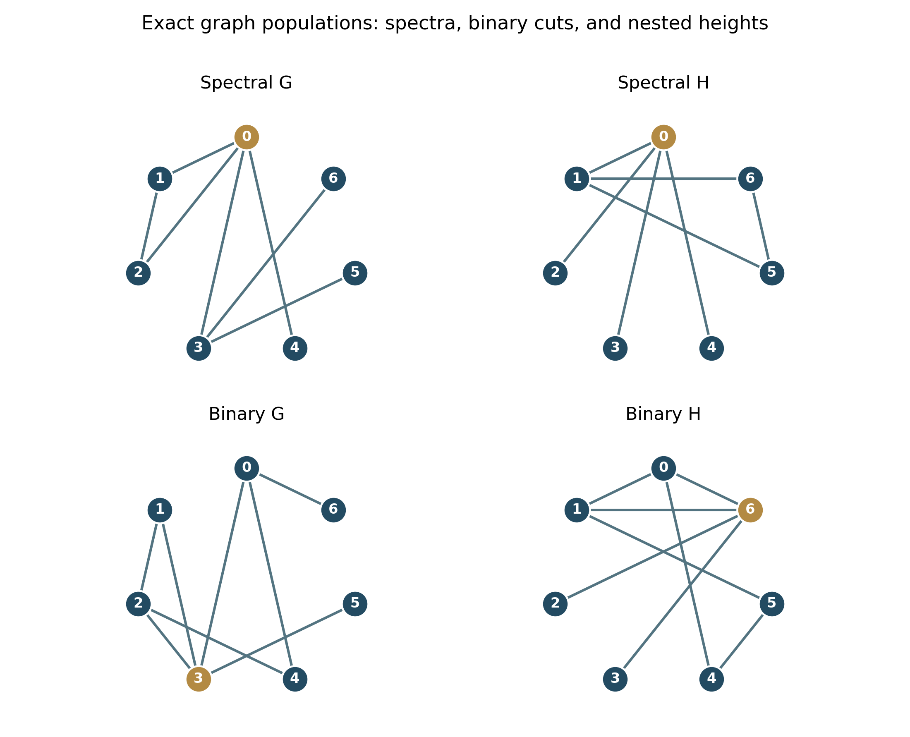

# Reading guide {.unnumbered}

This monograph develops a precise question: how much of a relation structure can be recovered from integer-height populations, and where does its first hidden difference appear in arithmetic? Chapters 1-4 establish the objects and finite observation hierarchy. Chapters 5-8 develop primewise assembly, local analytic comparison and singular synchronization. Chapters 9-11 give exact examples, inverse questions and the bridges to earlier work. Chapters 12-14 develop computational methodology, the research program and the literature. The implementation appendix states what version 0.1.0 actually executes. The final roadmap defines thirty-six subsequent development pushes.

The central distinction is between an observation and the correspondence it forgets. A binary census can agree for every subset size and boundary size while a nested-height census differs. The arithmetic lift retains these local distinctions and turns the first discrepancy into a controlled ratio singularity. It adds analytic structure rather than new graph information. The full marked hierarchy explicitly contains the binary sector; complete graph reconstruction remains a research question.

Definitions and theorems are supplied with hypotheses and proofs. Finite graph calculations have explicit inputs and independently replayable outputs. Established antecedents are attributed in the literature chapter and bibliography. The book is a research foundation and executable companion, not a claim of a completed priority search or unrestricted reconstruction.

# What the population observes

## A relation before a prediction

This book begins with a finite graph and a deliberately restricted experiment. Each vertex receives a nonnegative integer height. An edge pays the square of the difference between its endpoint heights. We count all height assignments having a specified total height and a specified energy. We then ask how much of the original relation between vertices survives in those counts. The question concerns the information contained in an exact mathematical observation. It does not require interpreting vertices as people, particles, assets, or physical locations.

The restriction is essential. If an experiment reports every vertex height and every labeled edge contribution, the graph can be read directly from the report. The interesting problem begins after that correspondence is removed. A histogram may tell us how many assignments have a certain energy without telling us which assignments they were. The resulting observation can preserve information that a familiar spectrum loses, while still losing information of its own. Establishing either possibility requires a proof or a concrete exact comparison.

There are consequently two distinct tasks. The forward task computes the population produced by a supplied graph. The inverse task decides what a population determines about its source. An efficient and correct forward computation does not settle the inverse question. Nor does a pair of distinguishable examples establish that every pair is distinguishable. Throughout the manuscript, reconstruction is a question to investigate, not an advertised theorem.

## Objects, assignments, and the meaning of a coefficient

Let \(G=(V,E)\) be a finite simple undirected graph with labeled vertex set
\[
V=\{0,1,\ldots,k-1\},\qquad k\ge1.
\]
An edge is an unordered pair of distinct vertices, and each unordered pair occurs at most once. Write \(d_i\) for the degree of vertex \(i\), and \(A_{ij}\in\{0,1\}\) for the adjacency matrix. Connectedness will be required explicitly when needed. The basic formal counting series itself is defined for disconnected graphs as well.

A height profile is a vector \(a=(a_0,\ldots,a_{k-1})\in\mathbb Z_{\ge0}^k\). Its volume, energy, and span are
\[
|a|=\sum_i a_i,\qquad
E_G(a)=\sum_{\{i,j\}\in E}(a_i-a_j)^2,\qquad
h(a)=\max_i a_i-\min_i a_i.
\]
The word **volume** always means total integer height. It is not a Euclidean volume, a determinant, the number of occupied vertices, or the number of nonzero levels. A profile of volume four might put height four at one vertex, height two at two vertices, or height one at four vertices. These assignments generally have different energies.

Define the local series
\[
L_G(x,q)=\sum_{a\in\mathbb Z_{\ge0}^k}x^{|a|}q^{E_G(a)}
=\sum_{m\ge0}C_{G,m}(q)x^m.
\]
The coefficient \([x^m q^e]L_G\) is the number of original labeled assignments of volume \(m\) and energy \(e\). It does not count graph automorphism orbits. If a symmetry exchanges two assignments, both remain in the population. This convention makes coefficients directly comparable to enumeration and avoids inserting unannounced symmetry factors.

**Theorem SNG-F01 (finite local coefficients).** For every finite graph on \(k\ge1\) vertices and every \(m\ge0\), \(C_{G,m}(q)\) is a polynomial in \(q\) with nonnegative integer coefficients. Its coefficient sum is
\[
C_{G,m}(1)=\binom{m+k-1}{k-1}.
\]
If \(\Delta=\max_i d_i\), its degree is at most \(\Delta m^2\).

*Proof.* The nonnegative integer solutions of \(a_0+\cdots+a_{k-1}=m\) are the weak compositions of \(m\) into \(k\) parts. The usual separator construction gives their number as the displayed binomial coefficient. In particular, there are finitely many terms in \(C_{G,m}\). Every energy is a nonnegative integer. Moreover,
\[
E_G(a)=\sum_i d_i a_i^2-2\sum_{\{i,j\}\in E}a_i a_j
\le\Delta\sum_i a_i^2\le\Delta\Bigl(\sum_i a_i\Bigr)^2.
\]
The first inequality uses nonnegativity of all heights; the second follows by expanding the square. This proves all assertions. \(\square\)

Thus \(L_G\) is well defined as an element of \(\mathbb Z[q][[x]]\). This assertion is formal: no choice of numerical \(x\) or \(q\), and no convergence argument, is required. Later analytic interpretations must separately state the region in which a formal identity can be evaluated.

## Removing a repetition that carries no relational information

Adding the same integer to every height leaves every edge difference unchanged:
\[
E_G(a+t\mathbf1)=E_G(a),\qquad |a+t\mathbf1|=|a|+kt.
\]
Every nonnegative profile has a unique decomposition
\[
a=b+t\mathbf1,\qquad t=\min_i a_i,\qquad \min_i b_i=0.
\]
We therefore retain the normalized series
\[
B_G(x,q)=\sum_{\substack{b\ge0\\\min b=0}}x^{|b|}q^{E_G(b)}.
\]
The normalization removes the common-height tower, not an assignment-specific ambiguity. It retains one explicitly specified representative of each integer profile modulo common translation.

To distinguish assignments with one nonzero level from assignments with several levels, introduce the full marked series
\[
\mathcal B_G(x,q,z)
=\sum_{\substack{b\ge0\\\min b=0}}
x^{|b|}q^{E_G(b)}z^{\max b}.
\]
The symbol \(B_G(x,q,z)\) may be used for this same three-variable object when its arguments are displayed. In these foundational chapters, \(\mathcal B_G\) makes the extra mark visually explicit, while \(B_G(x,q)=\mathcal B_G(x,q,1)\). On normalized profiles, maximum height equals span. Consequently \(z\) records a property that common translation does not change.

**Theorem SNG-F02 (normalization and span marking).** For every finite graph on \(k\ge1\) vertices,
\[
B_G(x,q)=(1-x^k)L_G(x,q).
\]
More generally, if
\[
\widetilde L_G(x,q,z)=\sum_{a\ge0}x^{|a|}q^{E_G(a)}z^{h(a)},
\]
then
\[
\mathcal B_G(x,q,z)=(1-x^k)\widetilde L_G(x,q,z).
\]
Both normalized series have nonnegative integer coefficients despite the subtraction in these formulas.

*Proof.* Use the unique decomposition \(a=b+t\mathbf1\). Energy and span are unchanged, whereas volume increases by \(kt\). Hence \(\widetilde L_G=\mathcal B_G\sum_{t\ge0}x^{kt}=\mathcal B_G/(1-x^k)\). Specializing \(z=1\) gives the first identity. Each coefficient of \(\mathcal B_G\) counts an explicitly defined finite set, proving nonnegativity without relying on cancellation. \(\square\)

Keeping \(k\) fixed, \(B_G\) and \(L_G\) contain exactly the same formal information: either is recovered from the other by multiplication or division by \(1-x^k\). The span mark is a different matter. Specializing \(z=1\) merges populations of different spans. We do not assume that this merging can be inverted.

| Observation | Coefficient meaning | Correspondence deliberately removed |
|---|---|---|
| \(L_G(x,q)\) | All profiles by total height and energy | Identity of each profile |
| \(B_G(x,q)\) | Translation-normalized profiles by total height and energy | Identity of each normalized profile |
| \(\mathcal B_G(x,q,z)\) | Normalized profiles by total height, energy, and span | Identity of each profile within a marked cell |
| \([z]\mathcal B_G\) | Binary profiles, excluding the two constant profiles | Identity of the vertex subset |
| \(B_G(1,q)\), when defined | Translation classes by energy alone | Total height and span |

## Labeled populations can define unlabeled observations

Labels specify the population being counted, but the aggregate series does not privilege a particular labeling. Let \(\sigma:V(G)\to V(H)\) be a graph isomorphism. Transport a profile by \(a'_{\sigma(i)}=a_i\). This operation permutes the coordinates; it does not merge assignments.

**Theorem SNG-F03 (isomorphism invariance with original multiplicity).** Graph isomorphisms preserve \(L_G\), \(B_G\), and \(\mathcal B_G\).

*Proof.* Coordinate permutation is a bijection on profiles and on normalized profiles. It preserves the sum, minimum, and maximum of their coordinates. Since it is a bijection on edges, it preserves the sum of squared differences. Each coefficient population is therefore carried bijectively to the corresponding population for \(H\). \(\square\)

The theorem proves one implication: isomorphic graphs have equal observations. It does not prove the converse. An invariant is allowed to identify nonisomorphic graphs. The inverse program investigates whether this particular invariant does so, and, if it does, which features remain recoverable despite that blindness.

For example, a single edge has energy \((a_0-a_1)^2\). A normalized nonzero profile is either \((h,0)\) or \((0,h)\), so
\[
\mathcal B_{K_2}(x,q,z)=1+2\sum_{h\ge1}x^h q^{h^2}z^h.
\]
The coefficient two records the two original assignments. It is not replaced by one because the edge has an endpoint-exchanging symmetry. This elementary example is a useful check on every later convention.

For a slightly richer example, take the three-vertex path \(0-1-2\). Its degrees are \((1,2,1)\), and direct enumeration gives
\[
[x]B_G=2q+q^2,
\qquad
[x^2]B_G=2q+q^2+2q^4+q^8.
\]
At volume two, placing both units at an endpoint contributes \(q^4\), placing both at the middle contributes \(q^8\), and placing one unit at each of two vertices contributes the remaining terms. The full mark separates the two mechanisms:
\[
[x^2]\mathcal B_G
=z(2q+q^2)+z^2(2q^4+q^8).
\]
The span-one term consists of three binary subsets. The span-two term consists of three profiles concentrated at one vertex. Setting \(z=1\) adds these two populations without recording which mechanism produced each contribution.

At volume three, the unnormalized count contains the all-one profile, whose energy is zero. The normalized coefficient removes that one translation of the zero profile:
\[
[x^3]B_G=2q^2+4q^5+2q^9+q^{18}.
\]
Its coefficient sum is nine, compared with ten weak compositions of three into three parts. Thus normalization changes an original population by a precisely specified quotient rule; it does not arbitrarily discard an inconvenient solution. A useful calculation record should make this distinction visible whenever normalized and unnormalized outputs appear together.

For comparison, the triangle has
\[
[x]B_{K_3}=3q^2,
\qquad [x^2]B_{K_3}=3q^2+3q^8.
\]
Already the first coefficient distinguishes the two graphs because their degree histograms differ. Such an example checks conventions but is not a demanding test of an inverse method. Later comparisons should deliberately match the simpler observations before attributing a discrepancy to a deeper mechanism.

## What a result in this book means

Several mathematical activities appear together, and their conclusions should not be conflated. A proved identity between formal series applies coefficientwise to every allowed input. An exact finite computation establishes the cells actually enumerated. A comparison through volume \(M\) establishes equality or discrepancy through that volume. A numerical graph search may suggest a pattern without proving that no later counterexample exists. An analytic theorem requires its own convergence and continuation hypotheses even when its starting Euler factors have exact coefficients.

The book therefore separates mathematical propositions, software behavior, finite examples, and research targets. The numbered foundational statements below are proved from their displayed hypotheses. They are mathematical statements, not assertions that a proof assistant checked the implementation. Software validation supplies another kind of evidence: it tests whether a program realizes the stated mathematics on the cases examined.

| Type of statement | Appropriate evidence | Scope of conclusion |
|---|---|---|
| Exact forward coefficient | Enumeration, recurrence, or an exact algebraic identity | The stated coefficient or family |
| Prefix agreement | Equal coefficient dictionaries through a declared volume | That finite prefix |
| Strict separation | One exact unequal coefficient | The two observations differ |
| Reconstruction theorem | A proof recovering isomorphism from equality | Every graph in the proved class |
| Reconstruction conjecture | A precise proposed implication | A question, not an established result |
| Analytic continuation | A convergent factorization on a stated domain | That domain and chosen branches |

There is also a useful distinction between a new question for this project and a historically new mathematical construction. Integer graph lattices, Ising-type observations, graph partition functions, and inverse problems all have substantial literatures. The graph cut-lattice viewpoint belongs to established background, including [BHN1997]. Binary energy populations overlap directly with graph Ising polynomials with an external field; [AM2009] is relevant background. General graph reconstruction from families of observations must be compared carefully with the much richer families studied in [Lovasz2012]. No historical priority claim is needed to make the present calculations worthwhile.

The particular program here is to track exactly which relational information survives a succession of increasingly marked arithmetic height observations. Its central difficulty is **lost correspondence**. Counts can be exact while the identities responsible for them are absent. An inverse theorem must recover what that loss hides; an impossibility theorem must demonstrate that the lost information cannot be recovered from the declared observation. Both are substantive mathematical outcomes.

The next chapter puts the translation quotient on an integral lattice. The third chapter explains why multiple nested boundaries retain more information than a single binary cut and why repeated levels cannot be omitted. The fourth chapter turns coefficient order into a precise hierarchy of visibility, beginning with degrees and degree mixing and ending with the open reconstruction question.

# Graphs, integral cut lattices, and the height mark

## The quadratic form and its kernel

Let \(G\) have adjacency matrix \(A\), degree matrix \(D=\operatorname{diag}(d_i)\), and combinatorial Laplacian \(\Delta_G=D-A\). Expanding each square in the definition of energy gives
\[
E_G(a)=a^\top\Delta_Ga
=\sum_i d_i a_i^2-2\sum_{\{i,j\}\in E}a_i a_j.
\]
The Laplacian is symmetric and positive semidefinite. This is stronger than a numerical spectral observation: the displayed edge-sum expression proves positivity for every real vector.

**Theorem SNG-F04 (zero energy and component constants).** For \(a\in\mathbb R^k\), \(E_G(a)=0\) if and only if \(a\) is constant on each connected component. In particular, for connected \(G\), \(\ker\Delta_G=\mathbb R\mathbf1\).

*Proof.* A finite sum of nonnegative squares vanishes precisely when every summand vanishes. Thus adjacent vertices must have equal coordinates. Equality propagates along paths, proving constancy on every component. The converse follows because every edge lies within a component. Finally, \(\Delta_Ga=0\) implies \(a^\top\Delta_Ga=0\); component constancy also directly implies \(\Delta_Ga=0\). \(\square\)

For connected graphs, the zero direction is common translation. For disconnected graphs there are additional zero directions: different components can be shifted independently. This difference matters when a formal series is evaluated without its height mark. Quotienting only by global translation does not remove all zero modes of a disconnected graph.

## An orientation is a bookkeeping choice

Choose an arbitrary orientation of every edge. Let \(\partial\) be the \(|E|\)-by-\(k\) matrix whose row for an oriented edge \(i\to j\) has \(-1\) in column \(i\), \(+1\) in column \(j\), and zero elsewhere. Then
\[
(\partial a)_{i\to j}=a_j-a_i,
\qquad \partial^\top\partial=\Delta_G.
\]
The image
\[
\mathcal C(G)=\partial\mathbb Z^k\subseteq\mathbb Z^E
\]
is the integral cut, or tension, lattice in this convention. It consists of edge differences produced by integer vertex potentials. An arbitrary integer edge vector need not lie in this image: differences around every oriented cycle must sum to zero.

Reversing an edge orientation multiplies the corresponding coordinate by \(-1\). This is an integral orthogonal transformation of \(\mathbb Z^E\). It preserves inner products, squared lengths, and every energy count. An orientation is therefore needed to write vectors, but none of the observations depends on it.

**Theorem SNG-F05 (integer quotient and cut-lattice coordinates).** If \(G\) is connected, \(a\mapsto\partial a\) induces an isomorphism of abelian groups
\[
\mathbb Z^k/\mathbb Z\mathbf1\ \cong\ \mathcal C(G).
\]
Under this isomorphism, squared lattice length is \(E_G(a)\). If a root vertex \(r\) is fixed and \(\Delta_G^{(r)}\) is obtained by deleting row and column \(r\), the energy in rooted coordinates is the positive-definite integral form
\[
u^\top\Delta_G^{(r)}u,\qquad u\in\mathbb Z^{k-1}.
\]

*Proof.* The map is surjective onto its stated image. Its integer kernel consists of constant integer vectors by Theorem SNG-F04. The first isomorphism theorem gives the quotient description. The equality of squared length and energy follows from \(\partial^\top\partial=\Delta_G\). Every integer translation class has a unique representative with coordinate \(a_r=0\), obtained by subtracting \(a_r\mathbf1\). Substitution gives the reduced quadratic form. If that form vanishes, its full representative is constant and has root coordinate zero, so it is zero. The form is therefore positive definite. \(\square\)

The root-zero representative is particularly convenient for linear algebra. It may have negative coordinates. The minimum-zero representative used by \(B_G\) is particularly convenient for a nonnegative height mark. These are two coordinate choices on the same quotient, not two different populations of translation classes.

## A determinant that counts trees

The determinant of the reduced Laplacian gives a useful consistency check connecting the integer form with ordinary graph structure. We include a proof because it makes clear which combinatorial data enter the lattice and because no floating-point eigenvalue calculation is needed.

**Theorem SNG-F06 (matrix-tree determinant).** For connected \(G\) on \(k\ge2\) vertices and any root \(r\),
\[
\det\Delta_G^{(r)}=\tau(G),
\]
where \(\tau(G)\) is the number of spanning trees of \(G\).

*Proof.* Delete column \(r\) of \(\partial\), obtaining \(M\). Then \(\Delta_G^{(r)}=M^\top M\). The Cauchy–Binet formula gives
\[
\det(M^\top M)
=\sum_{F\subseteq E,\ |F|=k-1}\det(M_F)^2,
\]
where \(M_F\) restricts \(M\) to the selected edge rows. If \((V,F)\) is disconnected, choose a component not containing \(r\). Its indicator vector, restricted to nonroot coordinates, is a nonzero vector killed by \(M_F\), so the determinant is zero. A connected graph with \(k\) vertices and \(k-1\) edges is a tree. For a tree, the determinant is \(\pm1\): repeatedly choose a nonroot leaf, expand in its column, and delete the leaf and its incident edge. Each expansion contributes a sign and an entry \(\pm1\); the final empty determinant is one. Thus exactly the spanning-tree subsets contribute one to the sum. \(\square\)

The theorem identifies a lattice determinant. It does not say that this determinant determines the lattice or the graph. Many nonisomorphic graphs have the same number of spanning trees. Even a complete list of real Laplacian eigenvalues describes the quadratic form only up to real orthogonal change of coordinates, whereas an integer height population depends on where the integer lattice sits inside that real space.

This distinction is elementary but decisive. A real orthogonal matrix preserves lengths of all real vectors. It need not map \(\mathbb Z^{k-1}\) to itself. An integral change of lattice basis must lie in \(\mathrm{GL}_{k-1}(\mathbb Z)\), a much more restrictive group. Consequently equal real spectra alone do not supply a bijection between integer height profiles.

## Unmarked theta and the extra information in a mark

For connected \(G\), the unmarked cut-lattice theta series is
\[
\Theta_G(q)=\sum_{u\in\mathbb Z^{k-1}}
q^{u^\top\Delta_G^{(r)}u}.
\]
Changing the root changes the integral coordinates but not the translation classes being counted. Likewise, an integral isometry of cut lattices preserves this series. Graph cut lattices and their relationship with graph structure have a substantial established theory; [BHN1997] provides relevant background. No converse classification from theta-series equality is assumed here.

**Theorem SNG-F07 (finite energy shells and convergence).** If \(G\) is connected and \(k\ge2\), every energy coefficient of \(\Theta_G\) is finite, and the series converges absolutely for \(|q|<1\). Moreover,
\[
\Theta_G(q)=B_G(1,q)
\]
as a coefficientwise formal energy series and, for \(|q|<1\), as a convergent sum.

*Proof.* In root-zero coordinates, join \(r\) to each vertex \(i\) by a simple path of length at most \(k-1\). The telescoping sum of edge differences and Cauchy–Schwarz give
\[
u_i^2\le(k-1)E_G(u),\qquad
\sum_{i\ne r}u_i^2\le(k-1)^2E_G(u).
\]
An energy shell \(E_G(u)=e\) therefore lies in a finite integer box. If \(0<\rho<1\), then
\[
\rho^{E_G(u)}
\le\rho^{\|u\|_2^2/(k-1)^2},
\]
and the sum of the right side is a product of convergent one-dimensional Gaussian sums. The case \(q=0\) is immediate. Finally, root-zero and minimum-zero profiles each select exactly one representative of every translation class and preserve energy. Their energy sums coincide. \(\square\)

For a disconnected graph with at least two nonempty components, \(B_G(1,q)\) generally diverges, even for \(0<q<1\): set one component to height zero and another to arbitrary common height. These are distinct normalized zero-energy profiles. The true cut lattice quotients by componentwise constants, while our normalization quotients by one global constant. Those constructions must not be silently identified.

The total-height mark retains a feature that the lattice norm alone does not name. For an arbitrary integer representative \(a\), define
\[
\mu([a])=\sum_i a_i-k\min_i a_i,
\qquad
\eta([a])=\max_i a_i-\min_i a_i.
\]
Both are well defined on translation classes. They equal volume and span on the minimum-zero representative. The marked theta population is therefore a lattice together with extra functions on its elements. An abstract norm-preserving lattice bijection need not preserve those functions.

## The height mark is an asymmetric gauge

The function \(\mu\) is not a linear functional on the quotient. A change in which vertex attains the minimum changes its formula. This nonlinearity is part of what the mark observes, rather than a defect in the normalization.

**Theorem SNG-F08 (gauge identities and complement reciprocity).** On \(\mathbb Z^k/\mathbb Z\mathbf1\), the functions \(\mu\) and \(\eta\) satisfy
\[
\mu(\alpha+\beta)\le\mu(\alpha)+\mu(\beta),
\qquad \mu(t\alpha)=t\mu(\alpha)\quad(t\in\mathbb Z_{\ge0}),
\]
\[
\mu(\alpha)+\mu(-\alpha)=k\eta(\alpha).
\]
For fixed span \(h\), put \(B_{G,h}(x,q)=[z^h]\mathcal B_G(x,q,z)\). This is a polynomial and obeys
\[
B_{G,h}(x,q)=x^{kh}B_{G,h}(x^{-1},q).
\]

*Proof.* For representatives \(a,b\), \(\min_i(a_i+b_i)\ge\min_i a_i+\min_i b_i\); subtracting \(k\) times this inequality from the coordinate sum proves subadditivity. Nonnegative integer homogeneity is immediate. Also \(\min(-a)=-\max(a)\), so adding the formulas for \(\mu([a])\) and \(\mu([-a])\) gives \(k(\max a-\min a)\). For reciprocity, every normalized span-\(h\) profile has coordinates in \(\{0,\ldots,h\}\), so the set is finite. The involution \(a\mapsto h\mathbf1-a\) preserves energy, exchanges minimum and maximum, and changes volume from \(m\) to \(kh-m\). Summing over the involution proves the identity. \(\square\)

The reciprocity is spanwise. After setting \(z=1\), profiles with many different \(h\) are merged, and there is no single factor \(x^{kh}\) applying to their sum. This is a concrete example of a relation visible with the full mark but not immediately expressible after that mark is forgotten.

| Structure retained | Natural coordinate change | Quantity necessarily preserved |
|---|---|---|
| Real quadratic space | Real orthogonal isometry | Real energy |
| Integral cut lattice | Integral lattice isometry | Integer energy shells |
| Height-marked lattice population | Bijection preserving energy and \(\mu\) | Joint volume-energy counts |
| Fully marked population | Bijection preserving energy, \(\mu\), and \(\eta\) | Joint volume-energy-span counts |

These rows are preservation requirements, not a claim that every bijection in a lower row arises from graph relabeling. The inverse problem asks precisely how much of the source graph is forced by increasingly restrictive observations.

## Two endpoint calculations

At \(q=1\), energy is forgotten completely. Every coordinate contributes its own geometric series, so
\[
L_G(x,1)=\frac1{(1-x)^k},\qquad
B_G(x,1)=\frac{1-x^k}{(1-x)^k}.
\]
No edge appears in these expressions. At \(q=0\), only zero-energy assignments remain. If the connected components have sizes \(k_1,\ldots,k_c\), Theorem SNG-F04 gives
\[
L_G(x,0)=\prod_{j=1}^c\frac1{1-x^{k_j}},
\qquad
B_G(x,0)=(1-x^k)\prod_{j=1}^c\frac1{1-x^{k_j}}.
\]
For connected graphs this reduces to \(L_G(x,0)=1/(1-x^k)\) and \(B_G(x,0)=1\). Thus both endpoints erase most graph structure: one ignores every edge energy, and the other retains only exact agreement within components. An inverse experiment must retain intermediate energy information rather than relying on these endpoint values alone.

## Disjoint unions and recoverable component sizes

The unnormalized series factors naturally over independent components. Normalization by one global minimum does not factor in the same way, because choosing the minimum of the combined profile couples the choice of representatives in its components. This is a useful instance in which an exact quotient must be carried through an otherwise simple product rule.

**Theorem SNG-F19 (component factorization and its endpoint inverse).** For graphs \(G,H\) on \(k,\ell\ge1\) vertices,
\[
L_{G\sqcup H}(x,q)=L_G(x,q)L_H(x,q),
\]
\[
B_{G\sqcup H}(x,q)
=\frac{1-x^{k+\ell}}{(1-x^k)(1-x^\ell)}B_G(x,q)B_H(x,q).
\]
Moreover, the zero-energy series \(L_G(x,0)\) determines the multiset of connected-component sizes.

*Proof.* A profile on a disjoint union is uniquely a pair of profiles on its components. Both volume and energy add, proving the first identity. Substituting \(L_G=B_G/(1-x^k)\), and the corresponding formulas for \(H\) and the union, proves the second identity in formal series. For the final assertion, let \(c_j\) be the number of components of size \(j\). Then
\[
L_G(x,0)=\prod_{j\ge1}(1-x^j)^{-c_j}.
\]
Formal logarithms are legitimate because the constant term is one. Expanding \(-\log(1-x^j)=\sum_{r\ge1}x^{jr}/r\), put \(b_n=n[x^n]\log L_G(x,0)\). Then
\[
b_n=\sum_{j\mid n}j c_j.
\]
Recover \(c_1=b_1\) and recursively
\[
c_n=\frac1n\left(b_n-\sum_{\substack{j\mid n\\j<n}}j c_j\right).
\]
This uniquely determines every component-size multiplicity. Only finitely many are nonzero. \(\square\)

The inverse statement is deliberately modest. Zero energy knows component sizes but not the edges within a component. A path and a complete graph on the same connected vertex set have identical zero-energy series. The formal logarithm extracts exactly the available component information without pretending that it contains finer internal structure.

There is a related warning about the full span mark. The span of a concatenated pair of arbitrary profiles depends on their relative vertical placement, not just on the two individual spans. Consequently one should not multiply \(\mathcal B_G\) and \(\mathcal B_H\) and declare the result to be \(\mathcal B_{G\sqcup H}\). A correct marked factorization would need enough additional data to retain minima, maxima, and their relative shifts. The scalar unnormalized product avoids that missing correspondence because it sums actual coordinates before applying a quotient.

The cut-lattice description clarifies why integer heights are a useful meeting point. They retain the arithmetic placement of a quadratic form, while their minimum-zero representatives supply a nonlinear order mark. The next chapter expresses that order mark through nested threshold sets. This reveals precisely what lies beyond a single binary cut.

# Nested heights and the interaction of boundaries

## A height profile is a stack of threshold sets

A binary profile chooses a subset of vertices: height one on the subset and zero outside. A general integer profile chooses several nested subsets. This description is exact, but only if consecutive threshold sets are allowed to be equal. A jump of three at one vertex crosses three integer levels even if the set of vertices above those levels never changes.

For a normalized profile \(a\ge0\) with \(\min a=0\) and \(\max a=h\), define
\[
S_t(a)=\{i\in V:a_i\ge t\},\qquad 1\le t\le h.
\]
Then
\[
\varnothing\ne S_h\subseteq S_{h-1}\subseteq\cdots\subseteq S_1\subsetneq V,
\qquad
a=\sum_{t=1}^h\mathbf1_{S_t}.
\]
The inclusions are weak. Replacing them by strict inclusions changes the population by discarding legitimate profiles.

**Theorem SNG-F09 (threshold-chain bijection).** Normalized profiles of span \(h\ge1\) are in bijection with weakly nested chains of \(h\) nonempty proper vertex subsets. The inverse map is \(a_i=\#\{t:i\in S_t\}\), and
\[
|a|=\sum_{t=1}^h|S_t|.
\]

*Proof.* Threshold sets of a profile have the stated nesting. Because some coordinate is zero, \(S_1\) is proper; because some coordinate is \(h\), \(S_h\) is nonempty. Conversely, nesting implies that, for each vertex, membership occurs at an initial segment of the thresholds. Thus the formula for \(a_i\) gives exactly the original membership sets when thresholds are taken again. A vertex outside \(S_1\) has height zero and a vertex in \(S_h\) has height \(h\), proving normalization and span. The volume identity follows by counting all incidences \((i,t)\) with \(i\in S_t\) in two orders. \(\square\)

The chain is not an auxiliary encoding with multiple extensions. It is uniquely determined by the original profile, and it reconstructs that profile uniquely. Consequently a chain-based counting algorithm preserves original assignment multiplicity without an additional correction factor.

## Squared differences do not add level by level

Write \(c_G(S)=|\partial S|\) for the number of edges with one endpoint in \(S\) and one outside. For disjoint vertex sets \(U,W\), write \(e_G(U,W)\) for the number of edges joining them. The ordinary integer coarea identity says
\[
\sum_{\{i,j\}\in E}|a_i-a_j|=\sum_{t=1}^h c_G(S_t).
\]
Our energy uses squares, so this identity alone is insufficient. An edge crossing two levels contributes four, not two. Cross terms record which nested boundaries are crossed by the same edge.

**Theorem SNG-F10 (nested-boundary energy formula).** For the threshold chain of a normalized profile,
\[
E_G(a)=\sum_{t=1}^h c_G(S_t)
+2\sum_{1\le r<t\le h}e_G(S_t,V\setminus S_r).
\]
Equivalently,
\[
E_G(a)=\sum_{r,t=1}^h
e_G\bigl(S_{\max(r,t)},V\setminus S_{\min(r,t)}\bigr).
\]

*Proof.* Use the oriented edge-difference matrix \(\partial\) from Chapter 2 and substitute \(a=\sum_t\mathbf1_{S_t}\) into \(E_G(a)=\|\partial a\|_2^2\). Diagonal inner products equal \(c_G(S_t)\). If \(S_t\subseteq S_r\), an edge contributes to both gradients exactly when it joins \(S_t\) to \(V\setminus S_r\). On such an edge the two gradient signs agree, irrespective of the chosen orientation; otherwise at least one gradient is zero. Their inner product is therefore \(e_G(S_t,V\setminus S_r)\). Expanding the squared norm proves the first formula, and pairing the two orders of each off-diagonal term proves the second. \(\square\)

An edgewise proof gives the same mechanism. If endpoint heights are \(u<v\), the edge crosses exactly \(v-u\) thresholds. The ordered pairs of crossed thresholds number \((v-u)^2\). The double sum counts those pairs edge by edge. This argument also explains why repeated threshold sets must remain: an edge can cross several numerically different thresholds whose vertex subsets happen to coincide.

The formula concerns pairwise edge energies throughout. The cross terms are interactions between observations of nested boundaries; they do not turn the graph Hamiltonian into a new three-body or higher-body edge law. Several boundaries can jointly reveal information that isolated boundary histograms lose, even though the underlying energy remains a sum over edges.

## Two examples where repetition matters

Consider the path \(0-1-2\). For \(a=(0,2,2)\), the threshold chain is
\[
S_1=S_2=\{1,2\}.
\]
Each set has cut size one. The sum of the two cut sizes is two, but the actual energy is \((0-2)^2+(2-2)^2=4\). The cross term contributes the missing two, because one edge joins \(S_2\) to \(V\setminus S_1\). A strict-chain enumeration would omit this profile entirely.

For \(a=(0,1,3)\), the same path gives
\[
S_1=\{1,2\},\qquad S_2=S_3=\{2\}.
\]
The diagonal cut sum is three. The boundaries of \(S_1\) and \(S_2\) lie on different edges, so their overlap term is zero; the same holds for \(S_1,S_3\). The repeated pair \(S_2,S_3\) contributes two. The total is five, agreeing with \(1^2+2^2\).

| Path profile | Volume | Span | Diagonal cut sum | Cross-term contribution | Energy |
|---|---:|---:|---:|---:|---:|
| \((0,1,1)\) | 2 | 1 | 1 | 0 | 1 |
| \((0,2,2)\) | 4 | 2 | 2 | 2 | 4 |
| \((0,1,3)\) | 4 | 3 | 3 | 2 | 5 |
| \((0,1,2)\) | 3 | 2 | 2 | 0 | 2 |

The last row is also useful. Distinct boundaries can have no overlap, making the squared energy equal the coarea sum. There is no universal rule replacing the cross terms by a fixed function of the individual cut sizes. Their value depends on how the boundaries sit together in the same graph.

A four-cycle makes this failure especially explicit while holding both individual sizes and individual cut counts fixed. Let the cycle be \(0-1-2-3-0\), and let \(S=\{0,1,2\}\). Consider either \(T=\{0\}\) or \(T'=\{1\}\) as the inner threshold set. Both chains have outer size three, inner size one, and cut counts two and two. However,
\[
e_G(T,V\setminus S)=1,
\qquad e_G(T',V\setminus S)=0.
\]
The two profiles are \((2,1,1,0)\) and \((1,2,1,0)\); both have volume four and span two. Their energies are respectively six and four. Thus even the ordered list of threshold sizes and cut counts does not determine the height energy. One must also retain which boundary edges are shared.

This example does not prove that two graphs with equal complete binary cut polynomials must have different height series. Both profiles occur in the same graph, and a global inverse implication could in principle use information unavailable in this two-boundary summary. What the example proves is the narrower and useful fact that the displayed chain energy cannot be computed from its separate boundary marginals alone.

## An exact chain expansion of the marked series

Combining the bijection and energy formula gives
\[
\mathcal B_G(x,q,z)=1+
\sum_{h\ge1}z^h
\sum_{\varnothing\ne S_h\subseteq\cdots\subseteq S_1\subsetneq V}
x^{\sum_t|S_t|}
q^{\sum_t c_G(S_t)+2\sum_{r<t}e_G(S_t,V\setminus S_r)}.
\]
This is an identity of formal series. At a specified total volume \(m\), only chains of length at most \(m\) can contribute, so the coefficient remains a finite sum. The expression is also a useful specification for an independent implementation: direct weak-composition enumeration and threshold-chain enumeration must return the same marked cells.

**Proposition SNG-F21 (volume-pruned chain enumeration).** Fix \(M\ge0\). The following search visits every normalized profile of volume at most \(M\) exactly once: emit the empty chain; for every nonempty proper \(S_1\subsetneq V\) with \(|S_1|\le M\), emit \((S_1)\) and recursively extend a chain \((S_1,\ldots,S_t)\) by every nonempty \(S_{t+1}\subseteq S_t\), equal sets included, with \(\sum_{r\le t+1}|S_r|\le M\). If each appended level is charged \(c_G(S_{t+1})+2\sum_{r\le t}e_G(S_{t+1},V\setminus S_r)\), the accumulated charge is the energy of the profile, the accumulated size is its volume and the chain length is its span.

*Proof.* Every emitted sequence is a weakly nested chain of nonempty sets with proper first set, so SNG-F09 maps it to a normalized profile of span equal to its length and volume equal to its total size. Conversely the threshold chain of a normalized profile of volume at most \(M\) satisfies these constraints, and each of its prefixes has total size at most \(M\), because sizes are positive; the search therefore reaches it through its prefixes. Distinct emitted chains differ in some level and hence give distinct profiles, since SNG-F09 is a bijection; and the search emits each chain once, because the chain determines the sequence of choices that produced it. Termination follows because each level has size at least one, so the length is at most \(M\). The charge identity is SNG-F10 grouped by the later index \(t\) of each pair \(r<t\): appending \(S_{t+1}\) adds its own cut and twice its overlap with every earlier level, and with no other pair. \(\square\)

Repetitions are essential. Forbidding \(S_{t+1}=S_t\) removes exactly the profiles in which some height between \(0\) and the span is unused, for instance \((0,2,2)\) and \((0,1,3)\) on the path. The search is implemented in `src/singularity/chains.py`. It shares neither its generator nor its energy evaluation with the weak-composition engine, so agreement of the two on complete marked histograms is a genuine cross-check. For every labeled simple graph on at most five vertices and every volume at most six, the two engines agree on all 142,416 marked cells and 479,963 profiles (`results/chain_agreement.json`). This is a finite computation on that declared population, not a proof beyond it.

The expansion shows exactly what a binary observation omits. The binary sector reports one subset at a time, through its size and cut. A chain term refers to several nested subsets in the same graph and additionally uses their boundary-overlap counts. Separate histograms of subset sizes and cuts do not retain the correspondence needed to form these overlaps.

This statement is directional. The full marked series certainly contains the binary histogram because its span-one coefficient extracts it. It does not follow that the two-variable specialization \(B_G(x,q)=\mathcal B_G(x,q,1)\) permits that same extraction. After span is forgotten, a cell of given volume and energy can receive both binary and nonbinary contributions. No inversion of that mixture is proved here.

## The binary sector and its reciprocity

Define the binary cut polynomial
\[
I_G(x,q)=\sum_{S\subseteq V}x^{|S|}q^{c_G(S)}.
\]
Its height interpretation overlaps the external-field Ising polynomial studied in [AM2009], subject to the stated normalization of the energy and spin variables. The present definition is explicit, so no external convention is needed to compute it.

**Theorem SNG-F11 (binary sector extraction).** For \(k\ge2\),
\[
[z]\mathcal B_G(x,q,z)=I_G(x,q)-1-x^k.
\]
Also \(I_G(x,q)=x^kI_G(x^{-1},q)\).

*Proof.* A minimum-zero span-one profile takes values zero and one and contains both values. It is uniquely the indicator of a nonempty proper subset. Its volume is subset size and its energy is cut size. The omitted empty and full subsets give \(1\) and \(x^k\). Complementation preserves cut size and sends subset size to \(k-|S|\), proving reciprocity. \(\square\)

The symmetry pairs the two sides of a cut. We count both sides as different profiles. A side of size \(r\) and its complement of size \(k-r\) appear at their respective powers of \(x\); when the sizes are equal they still contribute two unless other multiplicities happen to coincide.

## Minimum cuts are the first positive energy shell

For a connected graph on \(k\ge2\) vertices, define edge connectivity by
\[
\lambda(G)=\min_{\varnothing\ne S\subsetneq V}c_G(S)>0.
\]
This definition suffices here; no equivalence with a disjoint-path formulation is needed.

**Theorem SNG-F12 (minimum-energy shell).** Every nonzero normalized profile of span \(h\) obeys
\[
E_G(a)\ge\lambda(G)h.
\]
The smallest positive energy is \(\lambda(G)\), and its full marked population is
\[
[q^{\lambda(G)}]\mathcal B_G(x,q,z)
=z\sum_{\substack{\varnothing\ne S\subsetneq V\\c_G(S)=\lambda(G)}}x^{|S|}.
\]

*Proof.* For every nonnegative integer \(d\), \(d^2\ge d\). Hence the energy is at least the absolute-difference sum, which by coarea is \(\sum_t c_G(S_t)\). Every threshold set is nonempty and proper, so each cut is at least \(\lambda(G)\). This gives the bound. An indicator of a minimum cut has energy \(\lambda(G)\), so the bound is attained. If a nonzero profile has that energy, the bound forces \(h=1\), and then its subset must be a minimum cut. \(\square\)

For a path, \(\lambda=1\), so the first positive shell consists of the two orientations of every bridge cut. For a triangle, \(\lambda=2\), and its six nonempty proper subsets give
\[
[q^2]\mathcal B_{K_3}(x,q,z)=3z(x+x^2).
\]
These formulas identify the very first nonconstant energy sector. They do not recover arbitrary boundary overlaps at higher energy.

## Support restrictions useful for exact computation

Several finite bounds follow directly from the profile interpretation. They identify impossible marked cells before any enumeration and provide consistency checks afterward.

**Theorem SNG-F13 (volume, span, and extreme energy).** Let \(k\ge2\), and let \(a\) be a nonzero normalized profile of volume \(m\) and span \(h\). Then
\[
h\le m\le(k-1)h.
\]
If \(G\) is connected,
\[
E_G(a)\ge\max\left\{\lambda(G)h,
\left\lceil\frac{h^2}{\operatorname{diam}(G)}\right\rceil\right\}.
\]
For any graph with maximum degree \(\Delta>0\), the largest energy among normalized volume-\(m\) profiles is \(\Delta m^2\), attained exactly by \(a=m e_i\) at maximum-degree vertices.

*Proof.* Some coordinate equals \(h\), so the sum is at least \(h\). At least one coordinate is zero and every other coordinate is at most \(h\), giving the upper bound. The minimum-cut bound was proved above. Choose a shortest path between a minimum-height and a maximum-height vertex. If its length is \(\ell\), telescoping and Cauchy–Schwarz give \(h^2\le\ell\sum_{e\text{ on path}}(\partial a)_e^2\le\operatorname{diam}(G)E_G(a)\). Energy is integral, giving the ceiling. Finally, the bound \(E_G(a)\le\Delta\sum_i a_i^2\le\Delta m^2\) was proved in Chapter 1. The profile \(m e_i\) at a maximum-degree vertex attains it. If equality holds and \(\Delta>0\), then \(\sum_i a_i^2=m^2\). Expanding \(m^2\) shows that all products \(a_i a_j\), \(i\ne j\), vanish; exactly one coordinate is nonzero. Its degree must be \(\Delta\). \(\square\)

Thus only
\[
\left\lceil\frac{m}{k-1}\right\rceil\le h\le m
\]
can occur in a nonzero volume-\(m\) normalized population. For fixed \(h\), complementation from Chapter 2 pairs volumes \(m\) and \(kh-m\). A computation violating either restriction has lost a normalization condition or a multiplicity.

Nested thresholds provide the human explanation for the hierarchy studied next. One occupied unit reveals a degree. Two units reveal degree mixing. Several units can occupy different heights and thereby test several linked boundaries. The information comes from their shared placement in one relation, not from replacing the original edge law with an unrelated interaction.

## Primitive height scale and exact dilation

Repeated sets also encode a common integer scale. If every nonzero coordinate of a normalized profile is divisible by \(d\), division by \(d\) gives another normalized profile. Volumes and spans divide by \(d\), while energy divides by \(d^2\). This is an exact quadratic scaling law, not an approximation valid only at large height.

Call a nonzero normalized profile primitive when the greatest common divisor of its coordinates is one; zeros do not change that greatest common divisor. Let
\[
\mathcal P_G(x,q,z)
=\sum_{\substack{a\ge0,\ \min a=0\\a\ne0,\ \gcd(a_0,\ldots,a_{k-1})=1}}
x^{|a|}q^{E_G(a)}z^{\max a}.
\]
The zero profile is excluded because its common divisor is not a positive scale.

**Theorem SNG-F20 (primitive-height decomposition).** For every graph on \(k\ge2\) vertices,
\[
\mathcal B_G(x,q,z)-1
=\sum_{d\ge1}\mathcal P_G(x^d,q^{d^2},z^d).
\]
If \(\mu\) is the arithmetic Möbius function, characterized by \(\sum_{d\mid n}\mu(d)=1\) for \(n=1\) and zero otherwise, then
\[
\mathcal P_G(x,q,z)
=\sum_{d\ge1}\mu(d)
\bigl(\mathcal B_G(x^d,q^{d^2},z^d)-1\bigr).
\]
Both identities are coefficientwise finite in every positive volume.

*Proof.* Every nonzero integer profile has a unique positive greatest common divisor \(d\), and a unique primitive quotient \(b=a/d\). Normalization is preserved. Direct substitution gives \(|a|=d|b|\), \(E_G(a)=d^2E_G(b)\), and \(\max a=d\max b\), proving the first identity. For inversion, write \(T_dF=F(x^d,q^{d^2},z^d)\); then \(T_dT_e=T_{de}\). Substitute the first identity in the proposed inverse. The coefficient multiplying \(T_n\mathcal P_G\) is \(\sum_{d\mid n}\mu(d)\), leaving only \(n=1\). At volume \(m>0\), only \(d\mid m\) can contribute, so the rearrangement is finite coefficientwise. \(\square\)

For the path example \((0,2,2)\), the primitive quotient is \((0,1,1)\): volume two becomes four, energy one becomes four, and span one becomes two. This decomposition distinguishes a genuinely new shape of height profile from an integral dilation of an earlier shape. It provides another exact observation hierarchy that can be implemented independently of threshold-chain enumeration.

Primitive height here refers only to common divisibility of integer coordinates. It does not mean a primitive graph, a primitive conductor phase, or an element primitive in a different lattice. Those notions may interact in later calculations, but their definitions must not be merged because they share a word. The decomposition itself uses no connectedness assumption, so it also applies when nonconstant componentwise profiles have zero energy.

# Visibility depth and the loss of correspondence

## Increasing volume as an observation hierarchy

The coefficient \(C_{G,m}(q)=[x^m]L_G(x,q)\) reports every energy attainable with exactly \(m\) units of nonnegative integer height, together with original assignment multiplicities. Increasing \(m\) enlarges the set of placements that can be tested. It does not simply increase numerical precision in an unchanged observation. New occupancy patterns become available: repeated occupation of one vertex, occupation of several vertices, and different heights on linked supports.

For equal-order graphs, normalization does not change the first place at which their scalar-height observations differ. If \(k\) is fixed, multiplication by \(1-x^k\) has constant term one. A first nonzero coefficient cannot be removed by that multiplication because no earlier nonzero coefficient exists to cancel it.

The hierarchy must be specified before it is interpreted. A volume prefix of the two-variable series is one hierarchy; a span prefix of the fully marked series is another. The binary sector is one span layer, not one volume layer: a binary subset of size ten has volume ten and span one. Conversely, a one-vertex profile of height ten has the same volume and span ten. Keeping those distinctions prevents an observation about a binary cut polynomial from being silently transferred to an unmarked height specialization.

## The first coefficients can be read by hand

Write \(e_i\) for the unit profile at vertex \(i\). At volume one the only profiles are \(e_i\), and
\[
E_G(e_i)=d_i.
\]
At volume two the profiles are \(2e_i\) and \(e_i+e_j\), \(i<j\). The latter subtracts two from the sum of endpoint degrees precisely when the endpoints are adjacent. This is the first layer that couples local degrees to a relation between vertices.

**Theorem SNG-F14 (coefficients through volume three).** For every simple graph,
\[
C_{G,0}(q)=1,
\qquad C_{G,1}(q)=\sum_iq^{d_i},
\]
\[
C_{G,2}(q)=\sum_iq^{4d_i}
+\sum_{i<j}q^{d_i+d_j-2A_{ij}},
\]
and
\[
\begin{aligned}
C_{G,3}(q)={}&\sum_iq^{9d_i}
+\sum_{i\ne j}q^{4d_i+d_j-4A_{ij}}\\
&+\sum_{i<j<\ell}q^{d_i+d_j+d_\ell-2e_G(\{i,j,\ell\})}.
\end{aligned}
\]
Here \(e_G(S)\) denotes the number of edges induced by \(S\). Empty index sums are zero. For normalized coefficients,
\[
[x^m]B_G=C_{G,m}-C_{G,m-k},
\]
where \(C_{G,t}=0\) for \(t<0\).

*Proof.* Partition the weak compositions of one, two, and three by their positive parts. The possibilities are respectively \(1\); \(2\) or \(1+1\); and \(3\), \(2+1\), or \(1+1+1\). Substitute each profile in
\[
E_G(a)=\sum_i d_i a_i^2-2\sum_{\{i,j\}\in E}a_i a_j.
\]
The pattern \(2e_i+e_j\) is indexed by ordered distinct vertices because the heights distinguish the two positions. The three-unit pattern is indexed by unordered triples. These are disjoint exhaustive cases, giving the formulas without missing multiplicities. The normalized identity is coefficient extraction from Theorem SNG-F02. \(\square\)

The classification can be read as a table. Write \(N_d\) for the number of vertices of degree \(d\), \(P_{a,b}^{\epsilon}\) for the number of **ordered** pairs \((i,j)\), \(i\ne j\), with \(d_i=a\), \(d_j=b\), \(A_{ij}=\epsilon\), and \(T_{s,t}\) for the number of unordered triples with degree sum \(s\) spanning \(t\) edges. These statistics are defined from degrees and adjacency alone.

| Volume | Pattern | Index set | Support | Span | Energy | Contribution |
|---:|---|---|---:|---:|---|---|
| 1 | \(e_i\) | vertices | 1 | 1 | \(d_i\) | \(\sum_dN_dq^d\) |
| 2 | \(2e_i\) | vertices | 1 | 2 | \(4d_i\) | \(\sum_dN_dq^{4d}\) |
| 2 | \(e_i+e_j\) | unordered pairs | 2 | 1 | \(d_i+d_j-2A_{ij}\) | \(\tfrac12\sum P_{a,b}^{\epsilon}q^{a+b-2\epsilon}\) |
| 3 | \(3e_i\) | vertices | 1 | 3 | \(9d_i\) | \(\sum_dN_dq^{9d}\) |
| 3 | \(2e_i+e_j\) | ordered pairs | 2 | 2 | \(4d_i+d_j-4A_{ij}\) | \(\sum P_{a,b}^{\epsilon}q^{4a+b-4\epsilon}\) |
| 3 | \(e_i+e_j+e_k\) | unordered triples | 3 | 1 | \(d_i+d_j+d_k-2e_G(\{i,j,k\})\) | \(\sum T_{s,t}q^{s-2t}\) |

A pattern lies in the normalized population exactly when its support is smaller than \(k\); then its span is the displayed value. For \(k\le3\) some patterns cover every vertex and are translations instead: the profile \((1,1)\) on two vertices, \((2,1)\) and \((1,2)\) on two vertices, and \((1,1,1)\) on three. The normalized identity removes exactly these. The table is implemented without profile enumeration in `src/singularity/lowvolume.py`. `tests/test_low_volume.py` compares its local, normalized and marked outputs with both the weak-composition and the level-chain enumerators on all 75 labeled graphs with at most four vertices, on the fixed pairs, and on regular graphs including the cube, the Möbius ladder, the Petersen graph, \(K_4\), \(K_{3,3}\), \(C_5\) and two disjoint triangles, where the closed form in terms of order, degree and triangle count (Proposition SNG-I008) is also checked.

For example, \(C_{G,1}\) determines the degree histogram exactly: its coefficient of \(q^d\) is the number of vertices of degree \(d\). It does not identify which vertex has each degree, because coordinate labels have been summed out. That missing assignment of degrees to positions is already a small instance of lost correspondence.

Normalization matters at low volume in small graphs. For \(k=2\), \([x^2]B_G=C_{G,2}-1\), removing the constant profile \((1,1)\). For \(k=3\), the corresponding first subtraction occurs at volume three. The uniform formula is safer than assuming that normalized and unnormalized coefficients agree at every displayed low order.

## What the second coefficient adds

Define the edge degree-sum polynomial
\[
J_G(q)=\sum_{\{i,j\}\in E}q^{d_i+d_j}.
\]
This is one measure of how degrees mix across edges. It is coarser than the full joint degree matrix because different degree pairs can have the same sum, but it is already more relational than the degree histogram alone.

**Theorem SNG-F15 (second-layer degree mixing).** For every graph,
\[
C_{G,2}(q)=\sum_iq^{4d_i}
+\sum_{i<j}q^{d_i+d_j}
+(q^{-2}-1)J_G(q).
\]
The expression is a polynomial: every edge has \(d_i+d_j\ge2\). For graphs \(G,H\) with the same degree histogram,
\[
C_{G,2}=C_{H,2}\quad\Longleftrightarrow\quad J_G=J_H.
\]

*Proof.* Separate the pair sum in Theorem SNG-F14 into edges and nonedges. Start by assigning \(q^{d_i+d_j}\) to every pair; on an edge replace it by \(q^{d_i+d_j-2}\). The change is the displayed correction. If degree histograms agree, both of the first two sums agree, so the difference of second coefficients is \((q^{-2}-1)(J_G-J_H)\). A nonzero Laurent polynomial cannot annihilate another nonzero Laurent polynomial over the integers. Thus the difference vanishes exactly when \(J_G-J_H\) does. \(\square\)

This proposition prevents overinterpreting an attractive example. Suppose an exact comparison gives
\[
C_{G,2}-C_{H,2}=2q^2(1-q)^3(1+q).
\]
If the graphs have the same degree histogram, then
\[
J_G-J_H=2q^4(1-q)^2.
\]
The observation has detected a difference in degree mixing. That is a valid strict separation from any matched invariants, but it is not evidence that a genuinely high-order height interaction was needed. A stronger next example should first match \(J_G\), then look for a later discrepancy.

| Volume | Allowed positive height patterns | Direct information visible in the formula |
|---:|---|---|
| 0 | Empty support | One zero profile |
| 1 | \(1\) | Degree histogram |
| 2 | \(2\), \(1+1\) | Degree data and edge degree-sum mixing |
| 3 | \(3\), \(2+1\), \(1+1+1\) | Ordered degree-adjacency weights and degree-decorated triple edge counts |
| \(m\) | Integer partitions of \(m\) placed on vertices | Aggregated degree-decorated supports of size at most \(m\) |

The final row deliberately says “aggregated.” It is not a claim that every decorated induced-subgraph count can be independently recovered from one coefficient polynomial. Different patterns can contribute the same power of \(q\), and their multiplicities are then added.

## A precise finite-depth comparison

For graphs \(G,H\) of the same order, define their scalar-height visibility depth by
\[
r(G,H)=\min\{m\ge0:C_{G,m}(q)\ne C_{H,m}(q)\},
\]
with \(r=\infty\) when no discrepancy exists. The same definition using \([x^m]B_G\) gives the same value. A depth records how much total height is required to separate the two exact observations. It is not a claim about computation time, and it is not automatically a graph-theoretic reconstruction radius.

**Theorem SNG-F16 (prefix equivalence and an ultrapseudometric).** For each \(M\ge0\), agreement of \(C_{G,m}\) for all \(m\le M\) is an equivalence relation on graphs of fixed order. Visibility depths satisfy
\[
r(G,H)\ge\min\{r(G,K),r(K,H)\}.
\]
Consequently \(d(G,H)=2^{-r(G,H)}\), with \(2^{-\infty}=0\), is an ultrapseudometric. It is a metric on the quotient obtained by identifying graphs with identical full scalar-height series.

*Proof.* Equality of finite coefficient lists is reflexive, symmetric, and transitive. If both pairs \((G,K)\) and \((K,H)\) agree below an index \(r_0\), then \(G,H\) agree below that index as well. This gives the displayed inequality, including infinite depths. Exponentiating reverses the inequality and gives \(d(G,H)\le\max\{d(G,K),d(K,H)\}\). Zero distance means equality of the full series, which is exactly the relation used in the stated quotient. \(\square\)

**Proposition SNG-F33 (finite visibility filtration).** Fix a domain \(\mathcal D\): the symbolic coefficients in \(\mathbb Z[q]\), the span-marked counts, or the values at a parameter \(q_0\) that is rational or an isolated real algebraic number. For a finite family of series with common prefix through \(R\), let \(\sim_v\) be agreement in \(\mathcal D\) of every coefficient at volumes \(0,\ldots,v\). Then (i) each \(\sim_v\) is an equivalence relation and \(\sim_{v+1}\) refines \(\sim_v\); (ii) if two series are \(\sim_{v-1}\)-equivalent and differ at \(v\), then \(v\) is their first difference in \(\mathcal D\), and the signed difference at \(v\) is a witness; (iii) symbolic equivalence implies equivalence at every parameter, and marked equivalence implies symbolic equivalence, while the converses can fail; (iv) a class that survives to \(R\) records agreement through \(R\) only.

*Proof.* (i) Agreement of finitely many values in a set with equality is an equivalence relation, and agreeing through \(v+1\) includes agreeing through \(v\). (ii) follows from the definition of \(\sim_{v-1}\). (iii) Evaluation at \(q_0\) and forgetting the span mark are functions of the finer data, so they preserve equality. The converses fail: at \(q=1\) every series on \(n\) vertices has coefficients \(\binom{m+n-1}{n-1}\), so the spectral and binary pairs merge there although they differ symbolically. (iv) The data beyond \(R\) were not examined. \(\square\)

`src/singularity/visibility.py` computes these partitions with deterministic class identifiers, memberships at every volume, and a signed witness for every split. For an algebraic parameter it decides equality exactly through SNG-F31's gcd test. It refuses a bound beyond the common prefix, and a marked dictionary must be given the bound it was computed through, since it carries no length of its own. On the census of CENSUS-v1, the symbolic and marked class counts at each volume equal those of `results/small_census.json`. Every connected graph with at most six vertices is separated from every other by volume six (`results/visibility_filtration.json`). This is a finite statement about that population, not a separation bound for larger graphs.

Calling this a pseudometric is substantive caution. If nonisomorphic graphs share the entire series, their distance is zero. Proving that this cannot happen in a graph class would be a reconstruction theorem for that class. The present definitions do not assume it.

## What an occupancy coefficient can depend on

A profile of volume \(m\) has at most \(m\) occupied vertices. Its energy depends on the induced adjacency among those vertices and on their ambient degrees. Edges from an occupied vertex to an unoccupied vertex contribute through its degree; no further structure among unoccupied vertices enters that profile's energy.

To state this precisely, regard the induced graph \(G[S]\) as decorated by the ambient degree \(d_i\) at every vertex of \(S\). Two decorated induced graphs are isomorphic when a graph isomorphism also matches those degree labels. Let the decorated \(t\)-deck record how many subsets of size \(t\) have each such type.

**Theorem SNG-F17 (decorated-deck sufficiency for a prefix).** If two graphs of the same order have equal decorated \(t\)-decks for every \(t\le M\), then their scalar-height coefficients agree for every \(m\le M\). Their fully marked coefficients agree at those volumes as well.

*Proof.* Fix a nonempty support \(S\) of size \(t\le m\). Profiles with that exact support assign positive integers \(b_i\) to its vertices, summing to \(m\). Their energies are
\[
\sum_{i\in S}d_i b_i^2
-2\sum_{\{i,j\}\in E(G[S])}b_i b_j.
\]
A degree-preserving induced-graph isomorphism gives a coordinate-permutation bijection on these positive assignments, preserving volume, energy, and span. For normalized profiles, exact supports are proper subsets; the full-support case is excluded on both graphs because their common order is the same. Summing over matching decorated support types proves equality at each \(m\le M\). The zero profile contributes equally. \(\square\)

This is a one-way implication. The coefficient hierarchy can be coarser than the decorated decks because it aggregates different supports and positive assignments into the same energy cells. The proposition identifies a sufficient source of indistinguishability and explains the local nature of a bounded-volume experiment without asserting an unproved inversion.

It suggests several distinct research questions. Can nonisomorphic graph families have arbitrarily large finite visibility depth? Which natural graph classes admit a uniform depth bound? Can decorated-deck constructions produce exact equal-series examples, or do higher heights eventually distinguish them? These are precise targets. Finite searches can provide examples and exclusions within their declared range, but cannot settle the unrestricted questions merely by growing a table.

## Why labeled probes make reconstruction easy

Consider instead the fully vertex-marked series
\[
\mathscr L_G(z_0,\ldots,z_{k-1};q)
=\sum_{a\ge0}\Bigl(\prod_i z_i^{a_i}\Bigr)q^{E_G(a)}.
\]
The variables now identify where each unit was placed. This is a much stronger observation than scalar total height.

**Theorem SNG-F18 (labeled reconstruction at degree two).** The coefficients of \(\mathscr L_G\) through total \(z\)-degree two determine the labeled adjacency matrix of \(G\).

*Proof.* The coefficient of \(z_i\) is the single monomial \(q^{d_i}\), recovering \(d_i\). For distinct \(i,j\), the coefficient of \(z_i z_j\) is \(q^{d_i+d_j-2A_{ij}}\). Its exponent, together with the two recovered degrees, gives
\[
A_{ij}=\frac{d_i+d_j-\deg_q([z_i z_j]\mathscr L_G)}2.
\]
Every coefficient used is a single monomial with coefficient one, so its exponent is unambiguous. \(\square\)

Thus a theorem saying that arbitrary vertex-marked probes determine the graph would not resolve the difficult scalar-height inverse problem. The correspondence that makes reconstruction easy has been retained explicitly. The interesting restriction is the specialization \(z_i=x\) for all \(i\), which merges those individually identifiable monomials into common volume cells.

This is the same reason that general graph-observation frameworks must be compared with their actual permitted test families. Results for all graph homomorphism counts, as discussed in [Lovasz2012], concern an enormously rich set of probes. One particular partition function or one particular family of height weights does not acquire the same reconstruction power by resemblance.

## Marks, specializations, and the conclusions they permit

For any observation, forgetting a mark is a deterministic map on its data. Equality before forgetting implies equality afterward. A discrepancy afterward also proves a discrepancy beforehand. The reverse implications need not hold. In particular, full span-marked equality implies binary-profile equality by Theorem SNG-F11; scalar-height equality alone is not presently proved to imply it.

Numerical specialization of \(q\) can lose information as well. The endpoints are extreme examples: at \(q=1\) every graph of the same order has the same scalar-height series, while at \(q=0\) every connected graph has \(B_G=1\). More generally, a nonzero polynomial discrepancy can vanish at a selected algebraic value of \(q\). Exact polynomial comparison is stronger than comparison at one such value. If \(q_0\) is transcendental, no nonzero integer polynomial vanishes there, so an exact evaluation would preserve coefficient distinctions; that logical observation does not provide an effective exact arithmetic method for an arbitrary transcendental input.

| Established implication | Reason | Converse available here? |
|---|---|---|
| Graph isomorphism \(\Rightarrow\) full marked equality | Coordinate-permutation bijection | Not proved |
| Full marked equality \(\Rightarrow\) scalar-height equality | Set \(z=1\) | Not proved |
| Full marked equality \(\Rightarrow\) binary-profile equality | Extract \([z]\) | Not proved |
| Connected scalar-height equality \(\Rightarrow\) unmarked theta equality | Sum finite energy shells | Not proved |
| Same decorated decks through size \(M\) \(\Rightarrow\) height-prefix equality through volume \(M\) | Support decomposition | Not proved |
| Exact coefficient discrepancy \(\Rightarrow\) different graph observations | Definition of equality | Yes, at some coefficient if the formal series differ |

Finally, a later primewise Euler lift of \(L_G\) should be understood as an analytic reorganization. Its coefficient at a prime power recovers the corresponding local coefficient, and the local coefficients specify every Euler factor. That lift can expose useful singularities and arithmetic asymptotics, but it does not restore correspondence already discarded by the local histogram. The forward computation, the observation hierarchy, and the inverse reconstruction problem remain distinct throughout.

The resulting program is deliberately open in the right place. We can prove what the first layers observe, identify exact sources of finite-depth agreement, and formulate complete-series reconstruction as a concrete question. We can also search for persistent blindness and treat an exact counterexample as a mathematical result. What we cannot do is promote a successful prefix calculation into a conclusion about every unseen layer. The hierarchy provides the language for making the next calculation precise.

# Prime arithmetic: assembling relational height populations

The height population becomes an arithmetic object when one integer height is assigned to every prime valuation. This step has a precise meaning. A vertex is no longer assigned one nonnegative integer; it is assigned a positive integer, whose exponent at each prime supplies a local height. The graph compares those exponents independently at each prime. Unique factorization then assembles the comparisons into an Euler product. No relation of the form \(n_u+n_v=n_w\) is imposed, and numerical closeness of two ordinary integers is not the quantity being measured. The construction records multiplicative disagreement, prime by prime.

Throughout this chapter, \(G=(V,E)\) is a finite loopless simple graph with \(k\ge2\) vertices. Connectedness is stated where needed. For a nonnegative height vector \(a\), write

\[
 |a|=\sum_{v\in V}a_v,\qquad
 E_G(a)=\sum_{\{u,v\}\in E}(a_u-a_v)^2,
 \qquad
 L_G(x,q)=\sum_{a\ge0}x^{|a|}q^{E_G(a)}.
\]

The coefficient of every fixed power of \(x\) is a polynomial in \(q\) with nonnegative integer coefficients. Thus this definition is meaningful formally before convergence is discussed. For numerical analysis we take \(0\le q\le1\), use \(0^0=1\), and initially require \(|x|<1\). At fixed volume \(n\), there are exactly \(\binom{n+k-1}{k-1}\) labeled profiles. Consequently

\[
 |L_G(x,q)|\le(1-|x|)^{-k}\qquad(|q|\le1).
\]

This elementary majorant will support every exchange of sums made below. The number of vertices, rather than the number of edges, controls this convenient uniform bound. Graph structure remains in the distribution of energy among profiles of the same volume.

## The arithmetic weight and its exact assembly

For a positive integer tuple \(n=(n_v)_{v\in V}\), define its relational valuation energy by

\[
 \mathcal E_G(n)=\sum_{p\ {
m prime}}
 E_G\bigl((v_p(n_v))_{v\in V}\bigr).
\]

Only finitely many terms are nonzero. The definition is invariant under simultaneously multiplying all coordinates by the same positive integer: this adds the same prime valuation to every local height and does not change any difference. Such multiplication does change the product \(\prod_vn_v\), so energy and size remain separate statistics. Define

\[
 Z_G(s,q)=\sum_{n_v\ge1}
 \frac{q^{\mathcal E_G(n)}}{(\prod_vn_v)^s}.
\]

**Theorem SNG-A01 — valuation assembly.** For \(0\le q\le1\) and \(\Re s>1\), the preceding Dirichlet series is absolutely convergent and

\[
 Z_G(s,q)=\prod_pL_G(p^{-s},q).
\]

**Proof.** Absolute values of the summands are bounded by \(\prod_vn_v^{-\sigma}\), where \(\sigma=\Re s\). Their sum is \(\zeta(\sigma)^k<\infty\). Restrict first to tuples supported on a finite set of primes. Unique factorization identifies such a tuple with one height vector for each of those primes. Its denominator factors as \(\prod_pp^{s|a(p)|}\), and its weight factors as \(\prod_pq^{E_G(a(p))}\). Multiplication of the finitely many absolutely convergent local series gives the finite Euler product. Increasing the finite prime set exhausts all tuples. Dominated convergence, or monotone convergence for real positive \(s\), proves the identity. The local estimate \(L_G(p^{-s},q)=1+O_G(p^{-\sigma})\) also establishes absolute convergence directly. \(\square\)

The theorem does not claim that arithmetic assembly creates extra information about the graph. The complete local series determines the Euler product. Its value is that it transfers a local relational statistic into an analytic language in which the first surviving distinction has a sharply identifiable singularity. Subsequent chapters prove that transfer rather than treating the Euler product as decoration.

Consider a single edge with heights \(a,b\). Its energy is \((a-b)^2\). At a prime dividing only one coordinate to exponent one, the local penalty is \(q\). A common factor at that prime contributes no penalty. A quotient with valuation difference two contributes \(q^4\), not \(q^2\). Thus the energy is more sensitive to repeated unequal valuation than a simple count of unmatched prime factors. The quadratic choice is part of the definition, not a claim that it is uniquely natural. Other edge costs can be studied, but their theorems require separate hypotheses.

## Removing the common factor exactly

Translation invariance of energy has a local and a global consequence. Locally it removes the common minimum height. Globally it removes the greatest common divisor of all coordinates. These are the same operation viewed through prime valuations.

**Theorem SNG-A02 — common-shift factorization.** Put

\[
 B_G(x,q)=\sum_{\substack{a\ge0\\\min_va_v=0}}x^{|a|}q^{E_G(a)}.
\]

Then, as a formal power series and for \(|x|<1\),

\[
 L_G(x,q)=\frac{B_G(x,q)}{1-x^k}.
\]

Equivalently, on the quotient lattice \(\mathbb Z^k/\mathbb Z\mathbf1\), define

\[
 \nu([a])=\sum_va_v-k\min_va_v.
\]

This function is well defined, and

\[
 B_G(x,q)=\sum_{[a]\in\mathbb Z^k/\mathbb Z\mathbf1}
 x^{\nu([a])}q^{E_G(a)}.
\]

**Proof.** Every nonnegative profile has a unique decomposition \(a=b+m\mathbf1\), with \(m=\min a\) and \(\min b=0\). Its energy equals \(E_G(b)\), and its volume is \(|b|+km\). Summing \(x^{km}\) over \(m\ge0\) gives the geometric factor. Every integer profile has a unique translate with minimum zero, which proves the quotient-lattice formula. \(\square\)

The quotient formula explains what the volume mark retains. The quadratic form \(E_G\) measures distances transverse to the constant direction. The function \(\nu\) additionally remembers the distinguished positive cone supplied by vertex coordinates. An abstract isometry of quadratic lattices need not preserve that function. Removing common shifts does not discard the order information; it records it on a canonical representative. This distinction is central when two unmarked energy distributions agree but their volume-marked distributions differ.

**Corollary SNG-A03 — primitive tuple factorization.** For \(\Re s>1\),

\[
 \frac{Z_G(s,q)}{\zeta(ks)}
 =\sum_{\substack{n_v\ge1\\\gcd(n_v:v\in V)=1}}
 \frac{q^{\mathcal E_G(n)}}{(\prod_vn_v)^s}
 =\prod_pB_G(p^{-s},q).
\]

**Proof.** Write every integer tuple uniquely as \(n_v=d\,m_v\), where the coordinates of \(m\) have common gcd one. Its energy is unchanged, and its denominator gains \(d^{ks}\). Alternatively, common gcd one says that at every prime the minimum coordinate valuation is zero, exactly the defining local condition for \(B_G\). Absolute convergence justifies both factorizations. \(\square\)

Here “primitive” means a common gcd of one. It does not mean pairwise coprime coordinates. A tuple can share a factor between two vertices while having no factor common to every vertex. Confusing these conditions would change the local population and invalidate the shift factor.

## Synchronization and independence as exact endpoints

At \(q=1\), all energy penalties disappear. At \(q=0\), only zero-energy profiles survive. For a connected graph these are precisely the constant profiles. Thus the same family interpolates between independent coordinates and complete synchronization, in an exact combinatorial sense.

**Theorem SNG-A04 — endpoint identities.** If \(G\) is connected, then

\[
 \begin{array}{c|c|c|c}
 q&L_G(x,q)&B_G(x,q)&Z_G(s,q)\\\hline
 1&(1-x)^{-k}&(1-x^k)(1-x)^{-k}&\zeta(s)^k\\
 0&(1-x^k)^{-1}&1&\zeta(ks).
 \end{array}
\]

The Euler products converge respectively for \(\Re s>1\) and \(\Re s>1/k\). If the graph has connected component sizes \(k_1,\ldots,k_c\), the synchronized endpoint is instead \(\prod_j\zeta(k_js)\).

**Proof.** Independence gives a geometric series for each vertex. At zero energy every edge has equal endpoint heights, and therefore heights are constant on each connected component. The arithmetic tuple is correspondingly constant on each component. The indicated geometric and zeta factors follow. \(\square\)

These endpoint identities require no limiting argument. A limit involving both \(q\) and \(s\) is a different problem because the singularity at \(s=1\) can amplify a small nonzero energy weight. Chapter 8 proves a uniform estimate that makes this distinction quantitative.

## Minimum cuts are the first arithmetic correction

Assume now that the graph is connected, and let \(\lambda(G)\) be its edge connectivity. A minimum cut is a nonempty proper vertex set whose edge boundary has size \(\lambda\). We count both sides: \(S\) and \(V\setminus S\) are separate height profiles and generally have different volumes.

**Theorem SNG-A05 — first positive energy.** Among nonconstant integer profiles, the least energy is \(\lambda\). Among minimum-zero profiles, the profiles of energy \(\lambda\) are exactly \(\mathbf1_S\) for minimum cuts \(S\). Consequently

\[
 [q^\lambda]B_G(x,q)=
 \sum_{\substack{\varnothing\ne S\subsetneq V\\|\partial S|=\lambda}}x^{|S|},
 \qquad [q^e]B_G=0\quad(0<e<\lambda).
\]

**Proof.** For an integer difference \(d\), \(d^2\ge|d|\). If \(a\) has minimum zero and span \(h\), then the discrete coarea identity gives

\[
 \sum_{\{u,v\}}|a_u-a_v|
 =\sum_{t=0}^{h-1}|\partial\{v:a_v>t\}|.
\]

Every level set in that sum is nonempty and proper, so \(E_G(a)\ge\lambda h\). A nonzero minimum-zero profile has \(h\ge1\). A binary minimum-cut profile attains energy \(\lambda\). If energy equals \(\lambda\), the bound forces \(h=1\), and the profile is the indicator of a minimum cut. \(\square\)

Write \(P(z)=\sum_pp^{-z}\) for the prime zeta function on its initial half-plane. The first positive energy coefficient now has an exact analytic description.

**Theorem SNG-A06 — minimum-cut prime-zeta coefficient.** Initially for \(\Re s>1\),

\[
 [q^\lambda]\log\frac{Z_G(s,q)}{\zeta(ks)}
 =\sum_{\substack{\varnothing\ne S\subsetneq V\\|\partial S|=\lambda}}
 P(|S|s).
\]

**Proof.** The constant coefficient in \(q\) of \(B_G\) is one, and there are no positive coefficients below degree \(\lambda\). Hence its first positive coefficient is unchanged by the formal logarithm. Apply Theorem SNG-A05 to \(\log B_G(p^{-s},q)\), and sum over primes. Absolute convergence on \(\Re s>1\), uniformly for \(q\) in a sufficiently small complex disk, justifies coefficient extraction. This uniformity also follows from the local majorant and the fact that each normalized factor equals one at \(q=0\). \(\square\)

A cut with a large side contributes at a different scaled argument than a cut with a small side. The coefficient therefore contains the sizes of oriented minimum-cut sides, not merely their number. It also identifies the scope of this first correction: it sees minimum cuts only. Higher energy coefficients mix larger cuts with profiles having several height levels. Extracting those sectors requires retained marks or additional identities; the first coefficient alone does not reconstruct the graph.

## Two small models that expose the retained information

For the graph consisting of a single edge, a minimum-zero profile is either \((0,0)\), \((h,0)\), or \((0,h)\), with \(h\ge1\). Thus there is a closed local formula

\[
 B_{K_2}(x,q)=1+2\sum_{h\ge1}q^{h^2}x^h,
 \qquad
 L_{K_2}(x,q)=\frac{1+2\sum_{h\ge1}q^{h^2}x^h}{1-x^2}.
 \tag{5.1}
\]

The exponent \(h^2\) records a genuinely unequal-height sector. Replacing it by \(h\) would give a different model even though the first positive-energy coefficient would agree. The first minimum-cut correction is \(2P(s)\): either coordinate can be the raised endpoint. At volume two the three original profiles are \((2,0),(1,1),(0,2)\), with energy histogram \(1+2q^4\). Normalization removes the common-shift profile \((1,1)\), leaving \(2q^4\). This small calculation separates labeled population counting, common-factor removal, and energy weighting without relying on a large graph example.

For the path on three vertices, choose its middle vertex as a root and write the edge differences as \(u=a_1-a_0\) and \(v=a_2-a_0\). There is one integer profile modulo common translation for every pair \((u,v)\in\mathbb Z^2\). Its minimum-zero volume is

\[
 \nu=u+v-3\min(0,u,v),
 \qquad E=u^2+v^2.
\]

Consequently

\[
 B_{P_3}(x,q)=\sum_{u,v\in\mathbb Z}
 q^{u^2+v^2}x^{u+v-3\min(0,u,v)}.
 \tag{5.2}
\]

The energy has independent coordinates, but the volume does not. The minimum couples them through which vertex is lowest. This is a direct elementary instance of metric information being simpler than order information. It also illustrates why a factorization of an unmarked theta series does not automatically factor its volume-marked refinement.

**Theorem SNG-A19 — all trees share the unmarked energy theta.** Let \(T\) be any tree with \(k\) vertices, and let

\[
 \vartheta(q)=\sum_{h\in\mathbb Z}q^{h^2}.
\]

For \(0\le q<1\),

\[
 B_T(1,q)=\vartheta(q)^{k-1}.
 \tag{5.3}
\]

**Proof.** Choose a root and orient every edge away from it. Sending a vertex profile modulo common integer translation to its \(k-1\) oriented edge differences is a bijection with \(\mathbb Z^{k-1}\). Injectivity follows by propagating equal differences along the unique root-to-vertex paths. Surjectivity follows by starting the root at zero and integrating the prescribed integer differences along those paths. Energy becomes the sum of squares of the independent edge differences. At \(x=1\), the minimum-zero representative introduces no extra weight, so the sum factors into \(k-1\) copies of \(\vartheta\). Absolute convergence follows from the convergent one-dimensional Gaussian series. \(\square\)

This is a useful family of exact collisions, not merely a single searched pair. Every tree of a fixed order has the same unmarked energy distribution. The marked series can already distinguish a four-vertex path from a four-vertex star at volume one: the first has degree polynomial \(2q+2q^2\), the second \(3q+q^3\). Their unmarked quadratic lattices agree, yet the coordinate cone places the lattice vectors into different volume layers. More demanding matched examples must remove this elementary degree explanation, but the family makes the logical source of the restored information unmistakable.

Connectedness matters to an unmarked specialization. If the graph has several components, removing one global common shift leaves independent relative component shifts of zero energy. The sum \(B_G(1,q)\) then diverges, even when \(q<1\). The local series at \(|x|<1\) remains perfectly well defined. On disconnected graphs it is preferable to normalize one common shift per component before setting the volume variable to one. Ordinary component factorization gives

\[
 L_G(x,q)=\prod_{j=1}^cL_{G_j}(x,q),
\]

while the single-shift normalized series is

\[
 B_G(x,q)=
 \frac{1-x^k}{\prod_j(1-x^{k_j})}\prod_jB_{G_j}(x,q).
\]

The remaining denominator is the exact record of those unconstrained relative shifts. This is an example where checking the meaning of a normalization prevents a misleading finite theta interpretation.

# Euler analysis: formal coordinates and controlled analytic factors

An Euler product has two distinct kinds of structure in this project. Its coefficients are exact finite polynomials, so logarithms and Euler transforms can be manipulated formally. Its values are infinite products, so analytic conclusions additionally require convergence and choices of branches. The distinction is useful rather than restrictive. Formal calculations reveal which factor ought to be removed; a remainder estimate proves where that removal has analytic meaning. The results below keep those two steps explicit.

Fix a graph with \(k\) vertices, write

\[
 L(x,q)=1+\sum_{n\ge1}\ell_n(q)x^n,
 \qquad
 \ell_n(q)=\sum_{|a|=n}q^{E(a)},
\]

and initially regard \(q\) as an indeterminate. Every \(\ell_n\) belongs to \(\mathbb Z_{\ge0}[q]\). Formal logarithms belong to \(\mathbb Q[q][[x]]\), because division by positive integers enters the logarithm expansion. No numerical approximation to \(q\), the coefficients, or the graph enters this part of the theory.

## Logarithmic coordinates from finite data

Put \(\log L=\sum_{n\ge1}c_n(q)x^n\). The identity \(L'=L(\log L)'\) gives a triangular recurrence that computes each logarithmic coefficient using only the local coefficients through the same volume:

\[
 c_n=\ell_n-\frac1n\sum_{j=1}^{n-1}j\,c_j\ell_{n-j}.
 \tag{6.1}
\]

In particular,

\[
 c_1=\ell_1,\quad
 c_2=\ell_2-\ell_1^2/2,\quad
 c_3=\ell_3-\ell_1\ell_2+\ell_1^3/3.
\]

The recurrence is a coefficient identity, not a fitted model. If two graphs agree through volume \(r-1\), they also agree in logarithmic coordinates through that volume, and their difference at volume \(r\) is unchanged. This triangular property is the reason first-discrepancy singularities can be read directly from the original local coefficients.

**Theorem SNG-A07 — rational polynomial Euler transform.** There is a unique sequence \(b_m(q)\in\mathbb Q[q]\) such that, formally in \(x\),

\[
 L(x,q)=\prod_{m\ge1}(1-x^m)^{-b_m(q)}.
 \tag{6.2}
\]

It is given by

\[
 b_m(q)=\sum_{d\mid m}\frac{\mu(d)}d\,c_{m/d}(q).
 \tag{6.3}
\]

Only factors with \(m\le N\) affect coefficients through volume \(N\).

**Proof.** Taking formal logarithms of the proposed product gives

\[
 c_n=\frac1n\sum_{m\mid n}m b_m.
\]

Ordinary Möbius inversion gives (6.3). Conversely those coefficients satisfy the displayed logarithmic identity, and formal exponential recovers \(L\). Uniqueness follows from the same triangular relation. Rational polynomial exponents are meaningful through the formal exponential definition of \((1-x^m)^{-b_m}\). \(\square\)

The first exponents are

\[
 b_1=\ell_1,\qquad
 b_2=\ell_2-\frac{\ell_1^2+\ell_1}{2},
\]

\[
 b_3=\ell_3-\ell_1\ell_2+\frac{\ell_1^3-\ell_1}{3}.
\]

The implementation follows these identities literally and keeps them independent. `series_log` uses the recurrence (6.1); `euler_exponents` solves \(nc_n=\sum_{d\mid n}db_d\) upward; `euler_exponents_mobius` applies (6.3); and `recompose_euler` rebuilds \(L\) by multiplying the generalized binomial series \((1-x^m)^{-b_m}=\sum_j\binom{b_m+j-1}{j}x^{mj}\), without any logarithm. All arithmetic is in \(\mathbb Q[q]\) with reduced fractions, and a prefix through volume \(N\) determines exactly the exponents \(b_1,\ldots,b_N\). Tests check the triangular identity on a seven-vertex graph series, the single-edge values (6.10), recomposition of every retained certificate's exponents, nonconstant rational exponents and a symbolic discrepancy that vanishes at \(q=1\), so that the specialized first difference moves to a later volume.

These formulas are economical coordinates for local information. They do not make every exponent nonnegative or integral as a polynomial in \(q\). Such claims would be false for general integer-coefficient series. The existence theorem is over \(\mathbb Q[q]\), where the necessary divisions are legitimate.

Common-shift removal has an especially simple Euler-coordinate description. If \(B=(1-x^k)L\), then

\[
 b_m(L)=b_m(B)+\mathbf1_{m=k}.
\]

At the connected synchronized endpoint the only nonzero exponent is \(b_k=1\). At the independent endpoint the only nonzero exponent is \(b_1=k\). These are useful exact consistency checks, but they do not determine intermediate exponents from the endpoints.

## A different transform keeps integral bidegrees

There is a second, genuinely different product decomposition. Instead of putting a polynomial exponent on \(1-x^m\), retain energy inside the individual factors:

\[
 L(x,q)=\prod_{m\ge1}\prod_{e\ge0}
 (1-x^m q^e)^{-N_{m,e}}.
 \tag{6.4}
\]

At each fixed \(m\), only finitely many \(N_{m,e}\) are nonzero. The exponents can be negative. This is a formal decomposition and does not identify an actual population of positive “atoms” without a separate positivity theorem.

**Theorem SNG-A08 — integral bidegree transform.** For every series \(L\in1+x\mathbb Z[q][[x]]\), there are unique integers \(N_{m,e}\) satisfying (6.4). Their generating series is the plethystic logarithm

\[
 \sum_{m,e}N_{m,e}x^m q^e
 =\sum_{d\ge1}\frac{\mu(d)}d\log L(x^d,q^d).
 \tag{6.5}
\]

**Proof.** Suppose all factors of volume below \(m\) have been removed. The remaining series has the form \(1+x^mP_m(q)+O(x^{m+1})\), with integral polynomial \(P_m\). For every coefficient \(N_{m,e}=[q^e]P_m\), multiply by \((1-x^mq^e)^{N_{m,e}}\). This removes volume \(m\) and preserves integrality. Induction gives existence and uniqueness. Taking logarithms of (6.4), and applying Möbius inversion to the simultaneous substitutions \((x,q)\mapsto(x^d,q^d)\), gives (6.5). Thus the apparently rational expression in (6.5) has integral coefficients. \(\square\)

The substitution \(q\mapsto q^d\) is essential. Omitting it computes the transform in Theorem SNG-A07 rather than the bidegree transform. The two descriptions organize the same formal series differently. For example, a factor \((1-xq)^{-1}\) has one bidegree atom, yet its ordinary exponents \(b_m(q)\) are generally nontrivial polynomials. Coefficient-level equality permits conversion; the interpretations should remain distinct.

The corresponding weighted arithmetic factor is

\[
 \mathcal Z_{m,e}(s,q)=\prod_p(1-q^ep^{-ms})^{-1},
\]

with logarithm, on its absolutely convergent domain,

\[
 \log\mathcal Z_{m,e}(s,q)
 =\sum_{j\ge1}\frac{q^{ej}}jP(mjs).
\]

It is not equal to \(\zeta(ms)^{q^e}\). Replacing one expression by the other discards all the terms involving \(q^{ej}\) for \(j>1\). The ordinary rational-exponent transform and the integral bidegree transform therefore lead to different useful analytic factorizations.

## Leading divergence and what it forgets

The first local coefficient has a simple graph formula:

\[
 \alpha_G(q)=\ell_1(q)=\sum_{v\in V}q^{d_v}.
\]

Only one vertex has height one in a volume-one profile. Its energy is the number of incident edges. Thus the dominant singularity records the degree multiset and no finer graph information.

**Theorem SNG-A09 — leading real singularity.** For fixed \(0\le q\le1\), define

\[
 H_G(s,q)=\prod_p(1-p^{-s})^{\alpha_G(q)}L_G(p^{-s},q).
 \tag{6.6}
\]

The product is holomorphic for \(\Re s>1/2\), using the analytic logarithm of \(1-p^{-s}\) defined by its convergent power series on \(\Re s>0\). It is positive at the real point \(s=1\) and holomorphic and nonzero in a complex neighborhood of that point. Initially for \(\Re s>1\),

\[
 Z_G(s,q)=\zeta(s)^{\alpha_G(q)}H_G(s,q).
\]

Along the positive real axis,

\[
 Z_G(1+\varepsilon,q)
 \sim H_G(1,q)\varepsilon^{-\alpha_G(q)}
 \qquad(\varepsilon\downarrow0).
 \tag{6.7}
\]

**Proof.** Locally \(L=1+\alpha x+O(x^2)\), uniformly for \(q\in[0,1]\). Multiplication by \((1-x)^\alpha\) cancels the linear coefficient, leaving \(1+O(x^2)\). The prime sum of the remainder converges normally on compact subsets of \(\Re s>1/2\). Each individual factor is holomorphic there; \(L\) is analytic on \(|x|<1\), and the chosen power is holomorphic on \(\Re s>0\). For real positive \(s\), all factors are positive. The infinite tail is nonzero by absolute convergence of its logarithm; finitely many remaining factors are nonzero in a neighborhood of \(s=1\). The factorization follows on the original domain from the usual zeta Euler product. Finally \(\zeta(1+\varepsilon)\sim1/\varepsilon\). \(\square\)

The word “holomorphic” in the theorem does not assert that \(H_G\) is zero-free throughout its half-plane. A finite local factor can have complex zeros. Nonvanishing is asserted near the positive real point where it is proved. Similarly, fractional powers of zeta are unambiguous on the original half-plane but need branch choices if continued around zeros or poles elsewhere.

## Finite-order zeta factorization

**Theorem SNG-A10 — controlled finite Euler extraction.** Fix an integer \(M\ge1\) and a numerical \(q\in[0,1]\). Put

\[
 H_{G,M}(s,q)=\prod_p L_G(p^{-s},q)
 \prod_{m=1}^{M}(1-p^{-ms})^{b_m(q)}.
 \tag{6.8}
\]

This product is holomorphic on \(\Re s>1/(M+1)\). It is positive for real \(s>1/(M+1)\), and nonzero in a neighborhood of every point on that positive real interval. On the initial half-plane,

\[
 Z_G(s,q)=
 \left(\prod_{m=1}^{M}\zeta(ms)^{b_m(q)}\right)H_{G,M}(s,q).
 \tag{6.9}
\]

**Proof.** Theorem SNG-A07 implies

\[
 L_G(x,q)\prod_{m=1}^M(1-x^m)^{b_m(q)}=1+O(x^{M+1})
\]

near zero. For primes sufficiently large, this estimate is uniform on any compact subset of the indicated half-plane, and its prime sum converges. The finitely many small-prime factors are holomorphic on \(\Re s>0\); the powers use the logarithms specified above. Positivity on the real axis follows directly from (6.8), and absolute logarithmic convergence proves local nonvanishing there. Equation (6.9) follows by finite multiplication of zeta Euler products on \(\Re s>1\). \(\square\)

This theorem removes any need to assume convergence of the infinite product over all \(m\) in an analytic setting. Formal identity (6.2) does not by itself license an unrestricted exchange of its two infinite products, over primes and over volumes. Small-prime local zeros can limit the radius of the logarithmic power series, and the exponents can grow. Keeping \(M\) finite is both sufficient for a prescribed visibility calculation and analytically safer.

Equation (6.9) supplies local continuations after branches have been chosen in regions avoiding relevant zeta zeros and poles. It is not a blanket meromorphic-continuation theorem. Nonintegral exponents generally produce branched functions. Even on the positive real axis below one, separate zeta factors can be negative, so assigning real fractional powers independently does not reproduce an automatically positive partition function. The positive quantity directly defined there is the remainder product (6.8); its relation to a continued \(Z_G\) must respect the chosen branches.

## Why ratios are cleaner than individual continuations

If two graphs have identical low-volume coefficients, their low-order zeta exponents cancel before any continuation is attempted. The quotient Euler product can consequently converge farther left as a positive real product. Its first remaining zeta factor has argument approaching one from above. No lower-argument zeta powers are needed to state the resulting real asymptotic. This is the analytic advantage of comparing matched structures rather than interpreting every formal singularity of an individual object as an independently observable feature.

The hierarchy is exact but limited. It proves where a known local distinction appears arithmetically. It does not prove that a distinction always exists between nonisomorphic graphs, nor that all formal exponent locations are actual singularities after every cancellation. If the local series agree, every arithmetic lift in this chapter agrees. If the first discrepancy vanishes at a special numerical \(q\), the visibility order at that parameter must be recomputed. These qualifications identify the genuine inverse problem rather than weakening a theorem that never claimed more.

## A complete low-order transform example

The single-edge model makes the difference between polynomial exponents and positive constituent populations concrete. Its first coefficients are

\[
 \ell_1=2q,\qquad
 \ell_2=1+2q^4,\qquad
 \ell_3=2q+2q^9.
\]

Substitution into the rational Euler transform gives

\[
 \begin{aligned}
 b_1(q)&=2q,\\
 b_2(q)&=1+2q^4-2q^2-q,\\
 b_3(q)&=2q^9-4q^5+(8q^3-2q)/3.
 \end{aligned}
 \tag{6.10}
\]

At \(q=1/2\), these are \(1,1/8,-31/256\). Thus a valid finite extraction reads

\[
 Z_{K_2}(s,1/2)=
 \zeta(s)\zeta(2s)^{1/8}\zeta(3s)^{-31/256}
 H_{K_2,3}(s,1/2)
 \qquad(\Re s>1).
 \tag{6.11}
\]

The negative third exponent is not a negative number of arithmetic objects. It is a subtraction introduced by logarithmic and Möbius coordinates. Likewise, the exponent one eighth does not describe one eighth of an independent integer coordinate. Those are exact algebraic coordinates on a positive local series. They are useful precisely because they can cancel lower-order contributions, not because each factor has a separate population interpretation.

At the endpoints the same formulas reduce correctly: at \(q=0\), the second exponent is one and the other displayed exponents are zero; at \(q=1\), the first exponent is two and the next two are zero. Agreement at both endpoints therefore places only weak restrictions on the intermediate polynomial behavior. The coefficient recurrence supplies the actual intermediate values. A numerical plot interpolating only the endpoints would have no authority to invent them.

The bidegree decomposition has a different bookkeeping purpose. Its first volume layer contains the atom count \(N_{1,1}=2\). Removing \((1-xq)^{-2}\) from the single-edge series leaves, at volume two, the polynomial \(1-3q^2+2q^4\). Hence the second bidegree layer already contains a negative exponent, \(N_{2,2}=-3\). Even integral bidegree exponents are therefore not automatically positive atoms. The notation “plethystic” supplies a formal inversion rule; it does not establish a free-generation theorem for an underlying combinatorial class.

## Uniformity and the boundary of the weight parameter

For each fixed extraction order \(M\), the remainder product in Theorem SNG-A10 is jointly continuous in real \(q\in[0,1]\) and real \(s>1/(M+1)\). On compact subsets of that parameter region its large-prime logarithmic tail converges uniformly. To see this, the finitely many polynomials \(b_m(q)\) are bounded on the compact weight interval, and the coefficient majorant bounds the Taylor remainders uniformly for \(x\) in a small fixed disk. The canceled coefficients through order \(M\) are identically zero as polynomials, so the remaining estimate is uniformly \(O(x^{M+1})\). A convergent prime-power sum dominates the tail. Finitely many positive real local factors then preserve continuity and local nonvanishing.

This continuity statement is often enough to pass a weight limit through a regularized product. It does not mean that the unregularized Euler product converges uniformly as \(s\downarrow1\). The leading zeta factor carries the obstruction to that stronger statement. Chapter 8 isolates it in a quantitative estimate rather than suppressing it through a formal exchange of limits.

The chosen weight range also has a mathematical boundary. Suppose the graph has an edge, choose a vertex of positive degree \(d_v\), and fix \(0<x<1\). The terms coming from profiles \(ne_v\) are \(q^{d_vn^2}x^n\). For every real \(q>1\), these terms fail even to tend to zero as \(n\to\infty\). Thus the unbounded local height series diverges. The restriction \(q\le1\) cannot simply be removed by calling the series a partition function. A finite height cutoff would define a different object and would require its own limiting argument.

For \(|q|<1\), the local series is analytic in the complex weight parameter. At a boundary value such as \(q=1\), derivatives from the allowed real side can still exist to every finite order, because each derivative introduces only polynomial energy factors and the geometric volume decay dominates them. Such smooth one-sided behavior should not be mistaken for an unrestricted analytic extension beyond the unit disk. These domain distinctions matter especially when symbolic exponents are evaluated numerically: exact polynomial coefficients can be evaluated anywhere, while the infinite series from which they were extracted has the domain proved for it.

# Visibility singularities: the first distinction survives arithmetic assembly

A comparison is strongest when simpler explanations have been removed explicitly. Two graphs can have the same degree multiset and therefore the same leading divergence. They can agree on additional finite invariants and still differ in a later local height coefficient. The arithmetic question is then not whether an Euler product can be attached to each graph: that is already automatic. The useful question is where the first unmatched local observation becomes analytically visible.

For \(0\le q\le1\), put \(\ell_{G,n}(q)=[x^n]L_G(x,q)\). In this chapter, \(q\) is fixed before an analytic comparison is made. Polynomial equality in \(q\) is stronger than numerical equality at a selected parameter. A polynomial discrepancy can vanish at an endpoint or an interior root, in which case the first visible volume at that numerical parameter can change.

## A precise first-discrepancy theorem

**Theorem SNG-A11 — first-discrepancy ratio law.** Let \(G,H\) have the same finite number \(k\) of vertices. Fix \(q\in[0,1]\). Suppose

\[
 \ell_{G,n}(q)=\ell_{H,n}(q)\quad(0\le n<r),
 \qquad
 \delta=\ell_{G,r}(q)-\ell_{H,r}(q)\ne0.
 \tag{7.1}
\]

For real \(s>1/r\), the ratio product

\[
 R_{G,H}(s,q)=\prod_p
 \frac{L_G(p^{-s},q)}{L_H(p^{-s},q)}
 \tag{7.2}
\]

converges absolutely to a positive number. It agrees with \(Z_G/Z_H\) on the original domain \(s>1\). Define

\[
 K_{G,H}(s,q)=\prod_p
 (1-p^{-rs})^\delta
 \frac{L_G(p^{-s},q)}{L_H(p^{-s},q)}.
 \tag{7.3}
\]

The latter product converges absolutely and is positive for real \(s>1/(r+1)\). It is holomorphic and nonzero in a complex neighborhood of \(s_0=1/r\). For real \(s>s_0\),

\[
 R_{G,H}(s,q)=\zeta(rs)^\delta K_{G,H}(s,q),
 \qquad
 R_{G,H}(s,q)\sim
 C(q)(rs-1)^{-\delta},
 \tag{7.4}
\]

where \(C(q)=K_{G,H}(1/r,q)>0\).

**Proof.** Condition (7.1) gives

\[
 \frac{L_G(x,q)}{L_H(x,q)}
 =1+\delta x^r+O(x^{r+1})
\]

near zero, because the denominator has constant term one. The prime sum of the deviation converges for \(rs>1\). No local denominator vanishes on the positive real axis: both local series have nonnegative coefficients and constant term one. Thus the product is positive, and its logarithm converges absolutely. Multiplication by \((1-x^r)^\delta\) cancels the first discrepancy, leaving \(1+O(x^{r+1})\). This proves convergence of (7.3) on the stated real interval.

To obtain a complex neighborhood, separate finitely many small primes from the normally convergent tail. Every small-prime denominator is positive at \(s_0\), hence nonzero in a sufficiently small disk about that point. The tail is analytic and nonzero there by its convergent logarithm. The factors \((1-p^{-rs})^\delta\) use the analytic logarithm defined on \(\Re s>0\). This gives the asserted local holomorphic nonzero function. On \(s>1/r\), the ordinary zeta Euler product yields the factorization. Finally \(\zeta(1+t)\sim1/t\) with \(t=rs-1\). \(\square\)

A positive discrepancy makes the ratio diverge at its visibility point; a negative discrepancy makes it tend to zero. Interchanging the graphs reverses that interpretation. If \(\delta\) is nonintegral, the complex singularity is a fractional-power branch singularity. It should not be called a pole. The theorem supplies a local branch and a positive-real asymptotic, not a globally single-valued meromorphic function.

There is also no requirement that the original partition functions converge separately at \(s_0\). Their common low-order divergences have been canceled in the ratio product before the limit is taken. This cancellation is the main analytic mechanism. It makes a comparison meaningful farther left without pretending that either original positive Dirichlet series has acquired an absolutely convergent definition there.

## A volume-two calculation and its actual meaning

At volume two there are only two kinds of profile: \(2e_v\), and \(e_u+e_v\) with \(u<v\). Their energies give the identity

\[
 \ell_{G,2}(q)=\sum_vq^{4d_v}
 +\sum_{u<v}q^{d_u+d_v-2A_{uv}}.
 \tag{7.5}
\]

For graphs with the same degree multiset, define the edge degree-sum polynomial

\[
 M_G(q)=\sum_{\{u,v\}\in E}q^{d_u+d_v}.
\]

Then

\[
 \ell_{G,2}-\ell_{H,2}
 =(q^{-2}-1)(M_G-M_H).
 \tag{7.6}
\]

Although written with \(q^{-2}\), the right side is a polynomial: every edge has degree sum at least two. Formula (7.6) follows by starting with the sum over all unordered vertex pairs and correcting the exponent by minus two precisely on edges.

**Calculation SNG-A12 — first reference pair.** On vertices \(0,\ldots,6\), take

\[
 \begin{aligned}
 E(G)&=\{01,02,03,04,12,35,36\},\\
 E(H)&=\{01,02,03,04,15,16,56\}.
 \end{aligned}
\]

Both have degree multiset \(\{4,3,2,2,1,1,1\}\). Exact profile enumeration gives equality at volume one and

\[
 \delta_2(q)=\ell_{G,2}-\ell_{H,2}
 =2q^2-4q^3+4q^5-2q^6
 =2q^2(1-q)^3(1+q).
 \tag{7.7}
\]

It is positive on \(0<q<1\), so Theorem SNG-A11 applies with \(r=2\). At \(q=1/2\),

\[
 R_{G,H}(s,1/2)\sim C_2(2s-1)^{-3/32}.
\]

The arithmetic conclusion is exact. Its local source is also elementary: \(M_G-M_H=2q^4(1-q)^2\). Thus this example illustrates arithmetic visibility of degree-assortativity information. It does not demonstrate that volume two captures a fundamentally higher-order graph relation. Matching more demanding invariants is a separate task, and the interpretation of a collision should state precisely which invariants were matched.

## A volume-three witness beyond the binary census

At volume three, the profile types are \(3e_v\), \(2e_u+e_v\) with \(u\ne v\), and indicators of three-element subsets. Hence

\[
 \ell_{G,3}(q)=\sum_vq^{9d_v}
 +\sum_{u\ne v}q^{4d_u+d_v-4A_{uv}}
 +\sum_{|S|=3}q^{|\partial S|}.
 \tag{7.8}
\]

This identity keeps the explanation transparent. The last term is binary. The middle term tests unequal heights at two vertices. It can distinguish a joint degree-mixing pattern that the degree-sum polynomial merges. Every energy remains a sum of pairwise edge terms; a later observation order does not introduce a new three-body interaction.

**Calculation SNG-A13 — binary-census reference pair.** Take

\[
 \begin{aligned}
 E(G)&=\{03,04,06,12,13,23,24,35\},\\
 E(H)&=\{01,04,06,15,16,26,36,45\}.
 \end{aligned}
\]

Both have degree multiset \(\{4,3,3,2,2,1,1\}\). The exact finite binary census agrees for every subset size and cut size. The local coefficients agree through volume two, but their volume-three difference is

\[
 \begin{aligned}
 \delta_3(q)={}&q^3-q^4-2q^6+2q^8+q^9+3q^{10}
 -3q^{11}-q^{12}-2q^{13}\\
 &+2q^{15}+q^{17}-q^{18}\\
 ={}&q^3(1-q)^5(1+q)^2
 (1+2q+5q^2+6q^3+8q^4\\
 &\hspace{38mm}+6q^5+5q^6+2q^7+q^8).
 \end{aligned}
 \tag{7.9}
\]

The factorization proves positivity throughout \(0<q<1\); it is not a numerical sign test. At \(q=1/2\), the discrepancy is \(11025/262144\). Therefore

\[
 R_{G,H}(s,1/2)
 \sim C_3(3s-1)^{-11025/262144}
 \qquad(s\downarrow1/3).
 \tag{7.10}
\]

The finite calculation can be reproduced without a symbolic algebra system. Generate every weak composition of volumes zero through three into seven labeled coordinates, evaluate the integer energy from the supplied edges, and accumulate multiplicities by energy. There are only \(1,7,28,84\) profiles at those volumes. Subtract the two energy histograms. Multiplication of the explicit factors in (7.9) independently checks the polynomial identity. The full binary claim requires the separate exhaustive census of \(2^7\) subsets; it is not inferred from the first four height coefficients.

This pair does not match the full joint degree table on edges. Its degree-sum polynomial agrees, but the more refined table does not. Consequently the witness proves that the unequal-height sector carries information beyond the aggregated binary census. It does not prove survival after every degree-assortativity statistic has been matched. A stronger search should match that full table as well and seek discrepancies at volume four or later. The first-discrepancy theorem will still apply; the difficult new work is finding and interpreting the local witness.

## Effective control of the finite-prime approximation

A singularity law is more useful when its regular factor can be bounded rather than merely named. The following bounds require only local coefficient estimates and ordinary convergent sums. They do not require assumptions about prime gaps or an unproved asymptotic formula for primes.

For an integer cutoff \(P\ge2\), define \(Z_{\le P}\) by retaining primes at most \(P\). For real \(s>1\), put \(\rho=P^{-s}<1\). Since

\[
 0\le\log L(t,q)\le L(t,q)-1
 \le\frac{kt}{(1-\rho)^{k+1}}
 \qquad(0\le t\le\rho),
\]

we obtain the explicit interval

\[
 0\le\log Z_G(s,q)-\log Z_{\le P}(s,q)
 \le\frac{k}{(1-\rho)^{k+1}}
 \frac{P^{1-s}}{s-1}.
 \tag{7.11}
\]

Here the tail over primes was bounded by the tail over all integers, followed by the integral test. Exponentiating gives a multiplicative enclosure. The bound is deliberately conservative near \(s=1\), where raw Euler products converge slowly.

For the regularized ratio factor a faster bound is available. Set \(A_n=\binom{n+k-1}{k-1}\), choose \(0<\rho<1\), and define the explicit nonnegative constants

\[
 D=\frac{(1-\rho)^{-k}-1}{\rho},\qquad
 T=\frac{2}{\rho^{r+1}}
 \left((1-\rho)^{-k}-\sum_{n=0}^{r}A_n\rho^n\right),
\]

\[
 C=T+|\delta|D+
 \frac{|\delta|\rho^{r-1}}{2(1-\rho^r)}.
 \tag{7.12}
\]

**Theorem SNG-A14 — computable regularized tail.** Under the assumptions of Theorem SNG-A11, if real \(s>1/(r+1)\) and \(P^{-s}\le\rho\), then

\[
 \left|\log K_{G,H}(s,q)-\log K_{G,H,\le P}(s,q)\right|
 \le C\frac{P^{1-(r+1)s}}{(r+1)s-1}.
 \tag{7.13}
\]

**Proof.** Write \(A=L_G(t,q)\), \(B=L_H(t,q)\), and \(D_t=A-B\). Matching the coefficients below \(r\) gives

\[
 |D_t-\delta t^r|\le Tt^{r+1},\qquad
 \max(A-1,B-1)\le Dt.
\]

Because \(A,B\ge1\),

\[
 \log A-\log B=\int_0^1\frac{D_t}{B+uD_t}\,du.
\]

The denominator is at least one. Subtracting \(\delta t^r\) therefore gives an error at most \((T+|\delta|D)t^{r+1}\). Finally

\[
 |\log(1-t^r)+t^r|
 \le\frac{t^{2r}}{2(1-\rho^r)}
 \le\frac{\rho^{r-1}t^{r+1}}{2(1-\rho^r)}.
\]

Adding these estimates bounds the absolute logarithm of one regularized factor by \(Ct^{r+1}\). Sum over primes beyond \(P\), enlarge to all integers, and apply the integral test. \(\square\)

The constant (7.12) is implemented exactly as `regularized_tail_constant` in `src/singularity/arithmetic.py`. Its proof uses only \(0\le\ell_n(q)\le A_n\), valid for \(q\in[0,1]\), and \(t\le\rho<1\). The older routine `normalized_ratio_tail_constant` bounds the same quantity through the coefficient \(\ell^1\) norm of the logarithm. It requires \(U=(1-\rho)^{-k}-1<1\) and is far weaker: for the binary pair at \(q=1/2\) and \(\rho=1/32\) it gives about \(6.9\times10^5\), against about \(451\) from (7.12). Both are retained, and (7.12) is preferred. For rational \(s=a/b\) the cutoff is taken as \(P=N^b\), so the tail bound \(CP^{1-(r+1)s}/((r+1)s-1)\) and the radius condition \(P^{-s}=N^{-a}\le\rho\) are exact rational statements. Primes \(p\le P\) are kept exactly in the finite product, and those beyond it satisfy \(p^{-s}<\rho\). At \(s=1/r\) the bound is \(Cr/N\). The function `certified_tail_record` recomputes \(r\) and \(\delta\) from the two supplied coefficient prefixes at the chosen \(q\) before it produces a bound. It records the remaining hypotheses explicitly, refuses a prefix that ends before the discrepancy, and refuses a parameter such as \(q=1\) at which the discrepancy vanishes. The retained records for the three reference pairs at \(q=1/2\) are in `results/tail_records.json`. A test also checks the local inequality for the spectral pair at three rational points \(t\le\rho\), using rigorous rational enclosures of both local series by (7.14) and of \((1-t^r)^\delta\) by Bernoulli's inequalities, with no floating point.

**Theorem SNG-F35 (an explicit complex disc around the visibility point).** Keep the hypotheses of SNG-A11 with \(q\in[0,1]\) fixed, and let \(s_0=1/r\), \(D_\eta=\{s:|s-s_0|\le\eta\}\) and \(\sigma=s_0-\eta\). Suppose
\[
\text{(a) }(r+1)\sigma>1,\qquad
\text{(b) }r\eta\le\tfrac14,\qquad
\text{(c) }\frac{\eta\,k}{e\,\sigma}\,(1-2^{-\sigma})^{-(k+1)}<1 .
\]
Then for every prime \(p\) and every \(s\in D_\eta\), the local factors \(L_G(p^{-s},q)\) and \(L_H(p^{-s},q)\) have positive real part, and so does \(1-p^{-rs}\). With principal logarithms, the function
\[
K(s)=\exp\sum_p\Bigl(\log L_G(p^{-s})-\log L_H(p^{-s})+\delta\log(1-p^{-rs})\Bigr)
\]
is holomorphic and nonzero on \(D_\eta\), the series converges uniformly there, and \(K\) equals the positive product (7.3) on \(D_\eta\cap\mathbb R\). On \(D_\eta\setminus[s_0-\eta,s_0]\),
\[
R(s)=(rs-1)^{-\delta}\bigl((rs-1)\zeta(rs)\bigr)^{\delta}K(s),
\]
with principal powers, continues the Euler-product ratio from \(s\in(s_0,s_0+\eta]\). For nonintegral \(\delta\), \(s_0\) is a branch point, not a pole. For integral \(\delta\), \(R\) is meromorphic on \(D_\eta\) with a pole of order \(\delta\) (or a zero of order \(-\delta\)) at \(s_0\).

*Proof.* Write \(t=p^{-s}\) and \(t_0=p^{-s_0}\). Then \(|t|=p^{-\Re s}\le p^{-\sigma}\), and \(|t-t_0|\le|s-s_0|\log p\max_{w\in[s_0,s]}|p^{-w}|\le\eta\log p\,p^{-\sigma}\). For a local series \(L=\sum\ell_nt^n\) with \(0\le\ell_n\le A_n\) (true for \(q\in[0,1]\)), \(|L(t)-L(t_0)|\le|t-t_0|\sup_{|u|\le p^{-\sigma}}|L'(u)|\le|t-t_0|\,k(1-p^{-\sigma})^{-k-1}\). Using \(\max_{u>1}u^{-\sigma}\log u=1/(e\sigma)\) and \(p\ge2\), condition (c) makes this less than \(1\le L(t_0)\), so \(\Re L(t)>0\), and the principal logarithm is holomorphic in \(s\). Also \(|p^{-rs}|<1\), so \(\Re(1-p^{-rs})>0\). Let \(h_p(s)\) be the summand. As a function of \(t\), \(h(t)=\log L_G(t)-\log L_H(t)+\delta\log(1-t^r)\) is holomorphic for \(|t|\le\rho\) when \(U(\rho)=(1-\rho)^{-k}-1<1\). By (7.1) it vanishes to order \(r+1\) at \(t=0\), and \(|h|\le M=2U/(1-U)+|\delta|\rho^r/(1-\rho^r)\) there, using \(|\log(1+z)|\le|z|/(1-|z|)\). Schwarz's lemma applied to \(h(t)/M\) gives \(|h(t)|\le M(|t|/\rho)^{r+1}\). This is the constant of `normalized_ratio_tail_constant`, which is therefore valid for complex \(t\), unlike (7.12), whose proof used positivity. For \(p>P\) with \(P^{-\sigma}\le\rho\) we get \(|h_p(s)|\le Mp^{-(r+1)\sigma}/\rho^{r+1}\). By (a) the tail converges uniformly on \(D_\eta\), and \(K\) is holomorphic and nonzero as the exponential of a uniform limit of holomorphic functions. For real \(s\) the principal logarithms are real, so \(K\) agrees with (7.3). Finally, with \(w=rs\) and \(|w-1|\le r\eta\le\frac14\), the representation \((w-1)\zeta(w)=w-w(w-1)\int_1^\infty\{u\}u^{-w-1}\,du\) for \(\Re w>0\) gives \(|(w-1)\zeta(w)-1|\le|w-1|\bigl(1+|w|/\Re w\bigr)\le\frac14\bigl(1+\frac{5/4}{3/4}\bigr)=\frac23\). The principal power \(((w-1)\zeta(w))^\delta\) is therefore holomorphic on \(D_\eta\). For real \(s>s_0\), the identity \(R=\zeta(rs)^\delta K\) of SNG-A11 holds with positive real powers. The displayed expression is that identity rewritten, and \((rs-1)^{-\delta}\) with the principal branch is holomorphic off the cut. \(\square\)

The disc is explicit and very small. `complex_disc_certificate` in `src/singularity/arithmetic.py` checks (a)–(c) exactly, using the rational bounds \(2^{-\sigma}\le2^{-1/r}(1+\eta)\) and \(e>27/10\). It admits \(\eta=10^{-5}\) for the spectral pair (\(k=7\), \(r=2\)), \(\eta=10^{-7}\) for the binary pair (\(r=3\)) and \(\eta=10^{-9}\) for the cube and Möbius ladder (\(k=8\), \(r=4\)), and it refuses \(\eta=10^{-4}\), \(10^{-6}\) and \(10^{-8}\) respectively. The radius is limited by the crude derivative bound at \(p=2\). It is not a claim that larger discs contain zeros. Nothing here concerns complex energy parameters \(q\), whose local factors need their own zero analysis, or a global continuation.

**Theorem SNG-F39 (normalized local factors are entire).** Let \(G\) be connected on \(n\ge2\) vertices with diameter \(D\), and fix \(0<q<1\). Then \(B_G(t,q)=(1-t^n)L_G(t,q)\) is an entire function of \(t\), and \(L_G(t,q)\) is meromorphic in \(t\), with poles at most at the \(n\)-th roots of unity. For every \(H\ge0\) and complex \(t\),
\[
\bigl|B_G(t,q)-B_{G,\le H}(t,q)\bigr|\le\sum_{h>H}N_n(h)\,\max(|t|^h,|t|^{(n-1)h})\,q^{\lceil h^2/D\rceil},\qquad N_n(h)=(h+1)^n-2h^n+(h-1)^n,
\]
where \(B_{G,\le H}\) sums over minimum-zero profiles of maximum at most \(H\).

*Proof.* A minimum-zero profile of maximum \(h\) has a vertex at height \(0\) and one at \(h\), joined by a path of at most \(D\) edges. Cauchy–Schwarz along that path gives \(h^2\le D\,E_G(a)\). Its volume lies in \([h,(n-1)h]\), and \(N_n(h)\) counts the profiles in \(\{0,\ldots,h\}^n\) with minimum \(0\) and maximum \(h\), by inclusion–exclusion. This proves the tail bound. A profile of volume \(m\) has \(h\ge m/(n-1)\), so \(|[t^m]B_G|\le\binom{m+n-1}{n-1}q^{m^2/((n-1)^2D)}\). Hence \(|[t^m]B_G|^{1/m}\to0\), and the radius of convergence is infinite. \(\square\)

For disconnected graphs the zero-energy profiles that are constant on components give \(B_G(t,0)\)-type poles at roots of unity of the component sizes (SNG-F19), so connectedness is necessary. The theorem concerns one local factor at fixed \(q\). It says nothing about continuation of the product over primes.

**Theorem SNG-F38 (certified enclosure of the regularized product).** Under SNG-A11 with \(G,H\) connected and \(q\in(0,1)\) rational, fix rational \(s=a/b\) with \((r+1)s>1\), an integer \(N\), the cutoff \(P=N^b\) and \(\rho=N^{-a}=P^{-s}\). Let \(\ell_n,m_n\) be the local coefficients of \(G\) and \(H\) at \(q\) for \(n\le M\), \(A_n=\binom{n+k-1}{k-1}\), and \(S_M=(1-\rho)^{-k}-\sum_{n\le M}A_n\rho^n\). Put
\[
T'=\sum_{r<n\le M}|\ell_n-m_n|\rho^{n-r-1}+\frac{2S_M}{\rho^{r+1}},\qquad
D'=\sum_{1\le n\le M}\max(\ell_n,m_n)\rho^{n-1}+\frac{S_M}\rho,\qquad
C'=T'+|\delta|D'+\frac{|\delta|\rho^{r-1}}{2(1-\rho^r)} .
\]
Then
\[
\Bigl|\log K_{G,H}(s,q)-\sum_{p\le P}\Bigl(\delta\log(1-p^{-rs})+\log B_G(p^{-s})-\log B_H(p^{-s})\Bigr)\Bigr|\le C'\,\frac{P^{1-(r+1)s}}{(r+1)s-1},
\]
and each finite summand is enclosed by rational intervals computed from: integer-root enclosures of \(p^{-a/b}\); monotonicity of \(B\) in \(t\ge0\); the height tail of SNG-F39; outward-rounded sums over a checked tree decomposition; and series enclosures of logarithms.

*Proof.* \(L_G/L_H=B_G/B_H\) because the orders agree. The bound for omitted primes repeats the proof of (7.12) with sharper majorants. For \(0\le t\le\rho\), \(|L_G(t)-L_H(t)-\delta t^r|\le\sum_{n>r}|\ell_n-m_n|t^n\le T't^{r+1}\), using \(|\ell_n-m_n|\le2A_n\) beyond \(M\). Likewise \(\max(L_G,L_H)-1\le\sum_{n\ge1}\max(\ell_n,m_n)t^n\le D't\), using \(0\le\ell_n,m_n\le A_n\). Hence one regularized logarithm is at most \(C't^{r+1}\). Primes \(p>P\) satisfy \(p^{-s}<\rho\). Summing \(C'p^{-(r+1)s}\) over all integers \(p>P\) and applying the integral test gives the displayed bound. The finite enclosures were justified above: \(B_G\) has nonnegative coefficients, so it is increasing on \(t\ge0\), and rounding every product of nonnegative fixed-point numbers down (respectively up) gives a lower (respectively upper) bound. \(\square\)

`src/singularity/certified.py` implements the theorem with 256 fractional bits. The minimum-zero condition is carried as a flag in the bag messages, so no subtraction of enclosures occurs. For \(t=p^{-a/b}\) the factor \((1-t^r)\) is exact when \(b\mid ra\), in particular at \(s=1/r\). The retained results, with exact dyadic endpoints, are in `results/certified_k.json`. All are at \(q=1/2\):

| Pair | \(s\) | Primes kept | Omitted-prime log bound | Enclosure of \(K(s,1/2)\) |
|---|---|---:|---:|---|
| spectral, \(r=2\), \(\delta=3/32\) | \(1/2\) | 1229 (\(\le10^4\)) | \(4.6\times10^{-3}\) | \([0.84973,\,0.85750]\) |
| spectral | \(3/5\) | 985 (\(\le6^5\)) | \(2.2\times10^{-4}\) | \([0.89931,\,0.89971]\) |
| spectral | \(1\) | 168 (\(\le10^3\)) | \(1.1\times10^{-7}\) | \([0.9678188,\,0.9678191]\) |
| binary census, \(r=3\), \(\delta=11025/262144\) | \(1/3\) | 2961 (\(\le30^3\)) | \(2.2\times10^{-2}\) | \([0.90084,\,0.94230]\) |

The local height tails total below \(4\times10^{-16}\) in every run, so the width comes almost entirely from the omitted primes; arithmetic rounding is below \(10^{-60}\). With \(R=\zeta(rs)^\delta K\), the tables exhibit the proved branch singularity \((rs-1)^{-\delta}\) with an explicitly enclosed positive constant \(K(1/r,1/2)\). The singularity exponent is proved by SNG-A11, not fitted. Narrowing the binary interval needs either more primes or a smaller constant \(C'\); the bound decays only like \(P^{-1/3}\) at \(s=1/3\). A separate test checks the following. A run at a smaller cutoff with 160-bit arithmetic overlaps the \(s=1/2\) enclosure. Reversing the pair negates the finite log enclosure. Identical graphs give a log ratio enclosing zero.

Local factors themselves can also be enclosed by finitely many height coefficients. If \(L_N(t,q)=\sum_{n=0}^N\ell_n(q)t^n\), choose any \(t<R<1\). Then

\[
 0\le L(t,q)-L_N(t,q)
 \le (t/R)^{N+1}(1-R)^{-k}.
 \tag{7.14}
\]

Indeed each omitted term gains at most \((t/R)^{N+1}\), and the complete series at \(R\) is bounded by \((1-R)^{-k}\). Since \(L_N\ge1\), its logarithmic error is at most the same bound. Finite-prime and finite-height errors can thus be propagated separately and added in logarithmic coordinates. A numerical implementation claiming a rigorous enclosure must also bound its arithmetic rounding; the inequalities alone do not certify an unchecked floating-point product.

These results establish controllable local witnesses, arithmetic visibility, and finite approximation. They leave a genuine open inverse question: which graph distinctions are invisible to the entire univariate volume-marked local series? The examples show strict separations from specified coarser observations. They do not answer that complete question or establish historical priority for the construction.

## The complete binary comparison and the remaining elementary distinction

For the second reference pair, the common binary polynomial at each side size is small enough to display completely. Let \(C_j(q)=\sum_{|S|=j}q^{|\partial S|}\). Complementation gives \(C_j=C_{7-j}\), and the common values are

| Side sizes | Common cut-energy polynomial |
|---|---|
| \(0,7\) | \(1\) |
| \(1,6\) | \(2q+2q^2+2q^3+q^4\) |
| \(2,5\) | \(2q^2+8q^3+5q^4+4q^5+2q^6\) |
| \(3,4\) | \(q^2+4q^3+13q^4+10q^5+5q^6+2q^7\) |

Evaluating a row at \(q=1\) gives respectively \(1,7,21,35\), the appropriate binomial subset counts. This check does not prove equality of the polynomials, but it catches a missing subset in a proposed census. The actual equality is coefficientwise, obtained by evaluating each labeled subset against the original edges.

The edge joint-degree table identifies information the common binary census has merged. Entries not displayed are zero in both graphs.

| Unordered endpoint degrees | Edges in \(G\) | Edges in \(H\) |
|---|---:|---:|
| \((1,3)\) | 1 | 0 |
| \((1,4)\) | 1 | 2 |
| \((2,2)\) | 0 | 1 |
| \((2,3)\) | 3 | 2 |
| \((2,4)\) | 1 | 0 |
| \((3,3)\) | 0 | 1 |
| \((3,4)\) | 2 | 2 |

Both columns total eight edges. Collapsing endpoint degrees to their sum makes the tables agree: sums four, five, six, seven occur with multiplicities one, four, one, two. This explains agreement at volume two. Unequal heights two and one weight the endpoint degrees differently, through \(4d_u+d_v\), so the collapse no longer hides the difference. The height witness can therefore be understood without asserting an unexplained new source of graph information.

The distinction also lies in a specific span sector. Volume-three profiles of the form \(3e_v\) have span three and agree because degrees agree. Binary profiles have span one and agree because the full binary census agrees. The entire discrepancy (7.9) is consequently in span two. Retaining a span mark would isolate that sector directly. After setting the span mark to one, the same discrepancy survives, but the proof that it came from that sector uses the separate matched observations.

## A secondary boundary layer at an endpoint

The first-discrepancy exponent itself can become small near an endpoint. This produces a second controlled scaling law, now for graph ratios rather than the original synchronized partition function.

**Theorem SNG-A20 — endpoint scaling of visibility.** Suppose the polynomial local coefficients of two graphs agree below volume \(r\) for every \(q\in[0,1]\). Let \(q_*\in[0,1]\) be a value where the entire local series agree, and write \(\delta(q)=\ell_{G,r}(q)-\ell_{H,r}(q)\). Let \(q_j\to q_*\), \(\varepsilon_j\downarrow0\), with

\[
 \delta(q_j)\log(1/\varepsilon_j)\longrightarrow\tau\in\mathbb R.
\]

Then

\[
 R_{G,H}((1+\varepsilon_j)/r,q_j)\longrightarrow e^\tau.
 \tag{7.15}
\]

**Proof.** The normalized local ratio in (7.3) has its first \(r\) nonconstant coefficients canceled identically in \(q\). Its \(O(x^{r+1})\) estimate can be chosen uniformly on the compact weight interval. Therefore the regularized prime product is jointly continuous near \((1/r,q_*)\), by uniform convergence of the large-prime logarithmic tail and positivity of the finitely many remaining factors. At \(q_*\), every local ratio is one and \(\delta(q_*)=0\), so \(K(1/r,q_*)=1\). Finally

\[
 \log R=\delta(q_j)\log\zeta(1+\varepsilon_j)+\log K.
\]

The second term tends to zero, while \(\log\zeta(1+\varepsilon)-\log(1/\varepsilon)\to0\) and \(\delta\) stays bounded. This proves the limit. \(\square\)

For the volume-two pair, \(\delta_2(q)\sim4(1-q)^3\) as \(q\uparrow1\). For the volume-three pair, \(\delta_3(q)\sim144(1-q)^5\), because the final polynomial factor in (7.9) has value 36 at one. Thus \((1-q)^5\log(1/\varepsilon)\to t\) yields the ratio limit \(e^{144t}\) for the second pair at \(s=(1+\varepsilon)/3\). Near zero the corresponding leading behaviors are \(\delta_2\sim2q^2\) and \(\delta_3\sim q^3\). These are proved parameter scales for particular exact witnesses. They do not establish a universal exponent for all graph pairs.

# Synchronization limits, uniform scaling, and exact contractions

Setting the energy weight to zero and letting the arithmetic size parameter approach its divergence point are different operations. At zero weight a connected graph forces every coordinate integer to agree, producing \(\zeta(ks)\). At any fixed positive weight the system has rare unequal valuations at every prime, and their combined contribution diverges at \(s=1\). There are infinitely many opportunities for a rare local event. A small penalty need not remain negligible when those opportunities accumulate. This chapter turns that intuition into a uniform theorem and then develops optional extensions that retain the same exact arithmetic meaning.

Assume first that \(G\) is connected with \(k\ge2\), minimum degree \(d\ge1\), and edge connectivity \(\lambda\ge1\). Write \(m_d\) for the number of vertices of degree \(d\), and \(\alpha(q)=\sum_vq^{d_v}\). All limits below use real positive parameters. No complex continuation is needed for the double-scaling statements.

## An explicit estimate uniform in the energy weight

We begin with constants that are intentionally simple rather than optimized. Define

\[
 D_k=2(2^k-1),\qquad
 C_k=4(2^k-1-k/2),\qquad
 A_k=C_k+D_k^2/2+k.
 \tag{8.1}
\]

Let

\[
 J_k=\sum_{n\ge2}\frac{\log n}{n^k}<\infty.
\]

This last constant is computable with an elementary integral remainder. For a cutoff \(N\ge2\), the omitted tail is at most

\[
 \int_N^\infty\frac{\log t}{t^k}\,dt
 =N^{1-k}\left(\frac{\log N}{k-1}+\frac1{(k-1)^2}\right).
 \tag{8.2}
\]

The summand is decreasing on \([2,\infty)\) for \(k\ge2\), so the integral bound applies directly.

**Theorem SNG-A15 — uniform synchronization estimate.** For \(0\le q\le1\) and \(\varepsilon>0\),

\[
 \begin{aligned}
 &\left|\log Z_G(1+\varepsilon,q)
 -\log\zeta(k)-\alpha(q)\log(1/\varepsilon)\right|\\
 &\hspace{12mm}\le
 A_kq^\lambda\bigl(\zeta(2)-1\bigr)
 +(kJ_k+k)\varepsilon.
 \end{aligned}
 \tag{8.3}
\]

**Proof.** Write \(B_G(x,q)=1+u(x,q)\). Every nonzero minimum-zero profile has energy at least \(\lambda\). Therefore, for real \(0\le x\le1/2\),

\[
 0\le u(x,q)\le q^\lambda D_kx,
\]

and, since the volume-one coefficient is \(\alpha(q)\),

\[
 0\le u(x,q)-\alpha(q)x\le q^\lambda C_kx^2.
\]

To verify the constants, bound each minimum-zero coefficient by the number of all weak compositions. At \(x\le1/2\), dividing the first bound by \(x\) and the second by \(x^2\) leaves geometric-composition sums bounded respectively by \(D_k\) and \(C_k\). These bounds discard graph information but retain the crucial factor \(q^\lambda\).

For \(u\ge0\), integration of \(1-1/(1+u)\) gives

\[
 0\le u-\log(1+u)\le u^2/2.
\]

Also \(|\log(1-x)+x|\le x^2/[2(1-x)]\), and \(\alpha(q)\le kq^\lambda\). Combining the estimates gives

\[
 |\log B_G(x,q)+\alpha(q)\log(1-x)|
 \le A_kq^\lambda x^2.
 \tag{8.4}
\]

Here \(q^{2\lambda}\le q^\lambda\) was used in the quadratic term. Substitute \(x=p^{-s}\), with real \(s\ge1\), and sum over primes. By common-shift factorization,

\[
 \log H_G(s,q)-\log\zeta(ks)
 =\sum_p\{\log B_G(p^{-s},q)+\alpha(q)\log(1-p^{-s})\}.
\]

Thus its absolute value is at most \(A_kq^\lambda(\zeta(2)-1)\). The derivative bound \(|(\log\zeta)'(t)|\le\sum_{n\ge2}(\log n)n^{-k}=J_k\) for \(t\ge k\) gives

\[
 |\log\zeta(k(1+\varepsilon))-\log\zeta(k)|\le kJ_k\varepsilon.
\]

Finally the integral test yields \(1/\varepsilon\le\zeta(1+\varepsilon)\le1+1/\varepsilon\). Hence

\[
 0\le\log\zeta(1+\varepsilon)-\log(1/\varepsilon)
 \le\varepsilon.
\]

Multiply by \(\alpha(q)\le k\), use the leading factorization, and add the three error bounds. \(\square\)

This proof provides more than continuity of a regular factor. It shows exactly which uniform estimate permits the two parameters to move together. The graph-dependent minimum-cut exponent controls the error in replacing the regular factor by its synchronized value. The minimum-degree exponent will control the rare unequal valuations that are amplified by the singular factor. Those exponents need not be equal, and they play different mathematical roles.

## The double-scaling law

**Theorem SNG-A16 — synchronization boundary layer.** Let \(q_j\to0\), \(\varepsilon_j\downarrow0\). If

\[
 \alpha(q_j)\log(1/\varepsilon_j)\longrightarrow\tau
 \quad\text{in }[0,\infty],
\]

then

\[
 Z_G(1+\varepsilon_j,q_j)
 \longrightarrow\zeta(k)e^\tau,
 \tag{8.5}
\]

where \(e^{+\infty}=+\infty\). In particular, if

\[
 q_j^d\log(1/\varepsilon_j)\longrightarrow t<\infty,
\]

then the limit is \(\zeta(k)e^{m_dt}\). If that product tends to infinity, the partition function tends to infinity.

**Proof.** The error in (8.3) tends to zero. Exponentiating gives the first statement, including the infinite case. For the second, use

\[
 \alpha(q)=m_dq^d+R(q),\qquad
 0\le R(q)\le(k-m_d)q^{d+1}.
\]

When \(q^d\log(1/\varepsilon)\) has a finite limit, the extra contribution \(R(q)\log(1/\varepsilon)\) tends to zero. In the infinite case, \(\alpha(q)\ge m_dq^d\) is enough. \(\square\)

The scaling variable is logarithmic in the distance to the arithmetic singularity. For a graph with minimum degree one, maintaining a nontrivial finite limit requires \(q\) of order \(1/\log(1/\varepsilon)\). With minimum degree two it requires order \(1/\sqrt{\log(1/\varepsilon)}\). This is a conclusion of the exact estimate, not a power-law ansatz chosen from numerical plots. The coefficient \(m_d\) counts the cheapest single-vertex disagreements.

The theorem also explains the noncommuting iterated limits. At fixed \(\varepsilon>0\), sending \(q\to0\) gives \(\zeta(k(1+\varepsilon))\), and then sending \(\varepsilon\to0\) gives \(\zeta(k)\). At fixed \(q>0\), sending \(\varepsilon\to0\) gives infinity, so subsequently shrinking \(q\) does not recover that finite iterated limit. A family can therefore look synchronized throughout a large finite range and still have a different limiting divergence. The double-scaling variable states how close to one the size parameter must be before that discrepancy matters.

## Optional extension: vertex masses

Positive integer vertex masses allow exact contraction without pretending that a merged vertex represents only one original coordinate. Assign a mass \(m_v\ge1\) to each vertex and let \(M=\sum_vm_v\). Define

\[
 L_{G,m}(x,q)=\sum_{a\ge0}q^{E_G(a)}x^{\sum_vm_va_v}.
\]

Its arithmetic counterpart weights an integer tuple by \(\prod_vn_v^{-m_vs}\). All coefficients remain finite, and a common shift increases weighted volume by \(M\).

**Theorem SNG-A17 — weighted endpoints and first divergence.** For connected \(G\),

\[
 L_{G,m}=\frac{B_{G,m}}{1-x^M},\quad
 Z_{G,m}(s,0)=\zeta(Ms),\quad
 Z_{G,m}(s,1)=\prod_v\zeta(m_vs).
\]

Let \(r=\min_vm_v\) and fix \(0<q\le1\). Put \(\gamma(q)=\sum_{m_v=r}q^{d_v}\). Then the first nonconstant local term is \(\gamma(q)x^r\), the Euler product converges for real \(s>1/r\), and

\[
 Z_{G,m}(s,q)=\zeta(rs)^{\gamma(q)}H_{G,m}(s,q),
\]

with a positive nonzero regular factor near \(s=1/r\). Therefore its leading real singular exponent there is \(\gamma(q)\).

**Proof.** The shift and endpoint arguments are unchanged after adding masses. The least positive weighted volume is \(r\), attained exactly by the profiles \(e_v\) with \(m_v=r\). Their energies are \(d_v\). Every remaining weighted volume is an integer at least \(r+1\). Multiplication by \((1-x^r)^{\gamma(q)}\) leaves \(1+O(x^{r+1})\), and the same proof as Theorem SNG-A11 gives the regular factor. At least one vertex has minimum mass and \(q>0\), so \(\gamma(q)>0\); logarithmic divergence at \(s=1/r\) also proves the sharp real convergence threshold. \(\square\)

This extension changes the arithmetic size observable while retaining the same graph energy. It need not be interpreted as adding physical masses. Its exact purpose is to remember how many original coordinates have been identified, or how strongly their integer sizes are weighted. Ignoring those weights after contraction would move the synchronized zeta factor to the wrong argument.

## Optional extension: partial edge synchronization

Allow one energy weight \(q_e\in[0,1]\) for every edge. The local weight is \(\prod_eq_e^{(a_u-a_v)^2}\). Setting a selected edge weight to zero imposes equality of its endpoint heights. Equality propagates through the connected components of the selected-edge subgraph.

**Theorem SNG-A18 — exact contraction under zero edge weights.** Let \(F\subseteq E\), and set \(q_e=0\) for \(e\in F\). Let \(C_1,\ldots,C_t\) be the components of \((V,F)\). Replace each component by one vertex of mass \(|C_i|\). An unselected edge between \(C_i\) and \(C_j\) contributes its original factor \(q_e^{(b_i-b_j)^2}\); an internal unselected edge contributes one. Then the resulting weighted, possibly multiple-edge local series equals the original specialized local series exactly. The equality also holds for the Euler products on every common domain of absolute convergence.

**Proof.** A profile survives the zero weights exactly when it is constant on each \(C_i\). Such profiles correspond bijectively to \(b\in\mathbb Z_{\ge0}^t\). Its original volume is \(\sum_i|C_i|b_i\). Internal edges have zero difference, and every remaining edge retains its stated difference and weight. This is equality term by term. Euler assembly follows on an absolutely convergent domain. \(\square\)

Parallel surviving edges can be combined: their weights multiply, since \(q_1^{d^2}q_2^{d^2}=(q_1q_2)^{d^2}\). Their presence is therefore supported mathematically even if the core graph class remains simple. The contraction description is an optional extended representation, not a request to accept duplicate edges silently in the ordinary constructor.

Contraction order does not matter. Applying zero constraints in stages produces the equivalence relation generated by all selected edges. Vertex masses add associatively, internal edges disappear, and external weights multiply associatively. This is a direct consequence of the termwise bijection, not an appeal to an unspecified categorical equivalence. If the selected edges connect the entire graph, the result is one vertex of mass \(k\), recovering \(\zeta(ks)\).

One can retain separate complex size parameters \(s_v\) as well. A synchronized component then has parameter \(s_{C_i}=\sum_{v\in C_i}s_v\). A sufficient domain before contraction is \(\Re s_v>1\) for every vertex; after contraction the less restrictive sufficient condition is \(\Re s_{C_i}>1\) for every component. The exact local identity remains valid wherever the relevant sums converge. This multivariate refinement records how contraction redistributes size exponents without claiming a complete several-variable continuation theory.

## Positive ordering and probabilistic derivatives

There is a further useful consequence of retaining positive weights. If \(G\subseteq H\) on the same vertex set, then \(E_H(a)\ge E_G(a)\). Hence, for \(q\in[0,1]\), every local coefficient and every real convergent arithmetic value satisfies \(L_H\le L_G\) and \(Z_H\le Z_G\). Adding constraints reduces the positive population weight. The corresponding ratio need not be monotone in \(s\), and no such stronger ordering is asserted.

For real \(s>1\) and \(q=e^{-\beta}\), normalize the integer-tuple weights by \(Z_G\). This defines an ordinary probability distribution. Its sufficient statistics are \(U(n)=\log\prod_vn_v\) and \(V(n)=\mathcal E_G(n)\). On compact parameter sets with \(s>1\) and \(\beta\ge0\), all their polynomial moments are finite. Differentiating gives

\[
 \partial_s\log Z=-\mathbb E[U],\qquad
 \partial_\beta\log Z=-\mathbb E[V],
\]

\[
 \nabla^2_{(s,\beta)}\log Z
 =\begin{pmatrix}\operatorname{Var}(U)&\operatorname{Cov}(U,V)\\
 \operatorname{Cov}(U,V)&\operatorname{Var}(V)\end{pmatrix}\succeq0.
 \tag{8.6}
\]

To justify finiteness, note that local energy is at most a graph-dependent constant times squared local volume, while the local geometric coefficient majorant has every polynomial volume moment at \(p^{-s}\). Summing their prime contributions and logarithmic size factors is uniformly convergent when \(s\) stays above one. Alternatively, global energy is bounded by a constant times \((\log\prod_vn_v)^2\), and products of powers of logarithms remain summable against \(\prod_vn_v^{-s}\). Dominated differentiation follows. The covariance identity is a general property of a normalized exponential family, used here with an explicitly defined arithmetic population.

These derivative identities supply rigorous sensitivity observations. They do not add a physical interpretation, empirical model, or claim of a thermodynamic phase transition. The proved limiting phenomenon is the uniform arithmetic boundary layer in Theorem SNG-A16. Its higher-order corrections, sharp graph-dependent constants, and possible multivariate visibility geometries remain separate analytic research questions.

## A worked contraction sequence

Take the four-vertex path \(0-1-2-3\), initially with mass one at every vertex and a common positive edge weight \(q\). Its leading exponent at \(s=1\) is \(2q+2q^2\), because its endpoint degrees are one and its internal degrees are two. Now set the weight on edge \(01\) to zero while retaining weight \(q\) on the other edges. The surviving local profiles are exactly \((a,a,b,c)\), and their local series is

\[
 \sum_{a,b,c\ge0}x^{2a+b+c}
 q^{(a-b)^2+(b-c)^2}.
 \tag{8.7}
\]

The contracted path has masses \(2,1,1\). Its light vertices have degrees two and one, so Theorem SNG-A17 gives leading exponent \(q^2+q\) at \(s=1\). The heavy vertex is still part of the graph energy, but it cannot occur in the lowest-volume profile. This is why simply counting contracted vertices would give the wrong answer.

Next synchronize edge \(23\) as well. The surviving profiles are \((a,a,b,b)\). There are two contracted vertices, each of mass two, joined by the original middle edge. The local factor is exactly \(L_{K_2}(x^2,q)\), and its arithmetic product is \(Z_{K_2}(2s,q)\). The first divergence moves to \(s=1/2\), with exponent \(2q\). Finally synchronize the middle edge; all four heights become equal and the product becomes \(\zeta(4s)\), whose first divergence is at \(s=1/4\).

The changes in threshold have a direct combinatorial explanation. A minimal positive shift of a synchronized block raises every original coordinate in that block. Its arithmetic denominator is therefore the corresponding power of an integer, rather than the first power associated with a single original vertex. The contraction operation preserves that information through its masses. The example also shows why a statement about an exactly zero coupling should not be inferred from small positive couplings without a uniform estimate: rare violations of the equality constraint can restore a divergence at a different location.

For the derivative identities (8.6), values at \(\beta=0\) mean derivatives from the allowed side \(\beta\ge0\). At an interior value \(\beta>0\), ordinary derivatives are available in a neighborhood. The one-sided convention is necessary because rewarding unbounded quadratic energy with \(\beta<0\) makes even a local height series diverge. This is a domain issue in the mathematical definition, not a numerical instability that can be fixed by increasing a cutoff.

# Exact examples: what the new population distinguishes

This chapter records the finite evidence on which the first release rests. The examples are deliberately small enough that their defining populations can be examined without numerical approximation. They serve a precise purpose: to show that integer heights retain relational information that certain familiar summaries discard. They do not establish that the resulting invariant determines every graph, that the Euler product adds information to its local factor, or that the construction has historical priority. The claims below distinguish direct arguments from exact finite computations. The computations can be repeated through the standard-library package accompanying this manuscript.

Throughout the chapter a graph is simple, undirected, and has the labeled vertex set \(V=\{0,1,\ldots,6\}\). Labels specify the input and the assignments being counted. The resulting polynomials are unchanged by relabeling the graph, because a permutation of vertices induces a bijection on all height assignments. An edge written \(03\) means the unordered pair \(\{0,3\}\). The height energy is

\[
E_G(a)=\sum_{\{i,j\}\in E(G)}(a_i-a_j)^2,
\qquad |a|=\sum_i a_i.
\]

The unnormalized local population and the normalized marked population are

\[
P_G(x,q)=\sum_{a\in\mathbb N^7}x^{|a|}q^{E_G(a)},
\]

\[
B_G(x,q,z)=\sum_{\substack{a\in\mathbb N^7\\\min_i a_i=0}}
x^{|a|}q^{E_G(a)}z^{\max_i a_i}.
\]

Volume means total integer height. The variable \(z\) records height span after the common minimum has been removed. Consequently \(B_G(x,q,1)=(1-x^7)P_G(x,q)\). For volumes below seven, the coefficients of the unmarked normalized and unnormalized series agree. Every assignment of such a volume already has a zero coordinate. This observation lets us discuss the first local coefficients and their span decomposition without changing normalization halfway through an argument.

## Two different comparisons

The first pair has equal Laplacian spectra. The second pair has equal complete binary cut-volume populations. These are separate examples, and keeping them separate prevents an unsupported inference about a single pair defeating every existing invariant.

| Name in this chapter | Package name | Edge set | Degrees in vertex order |
|---|---|---|---|
| \(G_{\mathrm{sp}}\) | `spectral_g` | \(01,02,03,04,12,35,36\) | \((4,2,2,3,1,1,1)\) |
| \(H_{\mathrm{sp}}\) | `spectral_h` | \(01,02,03,04,15,16,56\) | \((4,3,1,1,1,2,2)\) |
| \(G_{\mathrm{bin}}\) | `binary_g` | \(03,04,06,12,13,23,24,35\) | \((3,2,3,4,2,1,1)\) |
| \(H_{\mathrm{bin}}\) | `binary_h` | \(01,04,06,15,16,26,36,45\) | \((3,3,1,1,2,2,4)\) |

All four graphs are connected. Each spectral graph has one triangle and four bridges. Each binary graph has the same two-connected block, a theta graph with three internally disjoint paths of lengths one, two, and three, together with two attached bridges. The attachments differ. This distinction between a common block structure and different vertex attachments will matter when we compare the marked population with an ordinary cut-lattice theta series.

**Proposition SNG-E001: the spectral graphs are nonisomorphic.** Each graph has a unique vertex of degree four, namely vertex zero. In \(G_{\mathrm{sp}}\), that vertex lies in the triangle \(0,1,2\). In \(H_{\mathrm{sp}}\), the only triangle is \(1,5,6\), which excludes vertex zero. An isomorphism preserves vertex degrees and triangle membership. It would therefore have to send the degree-four vertex to the degree-four vertex while preserving a property that differs, which is impossible.

**Proposition SNG-E002: the binary graphs are nonisomorphic.** The unique degree-four vertex of \(G_{\mathrm{bin}}\) is vertex three, and its neighbors are \(0,1,2,5\). Exactly one of these neighbors, vertex five, is a leaf. The unique degree-four vertex of \(H_{\mathrm{bin}}\) is vertex six, with neighbors \(0,1,2,3\). Exactly two of those neighbors are leaves. The number of leaf neighbors of a specified degree class is invariant under isomorphism. The graphs are therefore nonisomorphic.

These short arguments are logically independent of the population computation. A differing graph invariant would also prove nonisomorphism, but an elementary structural witness makes the examples easier to inspect. It also guards against a mistaken interpretation in which a relabeling of one graph has merely been counted in a different order.

## The exact Laplacian comparison

The graph Laplacian has entries \(L_{ii}=d_i\) and \(L_{ij}=-\epsilon_{ij}\), where \(d_i\) is vertex degree and \(\epsilon_{ij}\) is the adjacency indicator. We use the characteristic-polynomial convention \(\chi_G(t)=\det(tI-L_G)\). The following values are exact finite computational results, obtained using integer arithmetic. They are not floating-point eigenvalue comparisons and are not described as proof-assistant-checked theorems.

| Graphs | Characteristic polynomial |
|---|---|
| Both spectral graphs | \(t^7-14t^6+73t^5-178t^4+209t^3-112t^2+21t\) |
| \(G_{\mathrm{bin}}\) | \(t^7-16t^6+98t^5-290t^4+430t^3-300t^2+77t\) |
| \(H_{\mathrm{bin}}\) | \(t^7-16t^6+98t^5-290t^4+432t^3-302t^2+77t\) |

The spectral pair is therefore Laplacian-cospectral. The binary pair is not. In particular, the second example must not be advertised as a simultaneous collision of the Laplacian spectrum and the binary cut polynomial. Its role is to isolate a different information gap. Both members of a pair have the same number of spanning trees: three for the spectral pair and eleven for the binary pair. These counts follow independently from the matrix-tree theorem or from the coefficient of \(t\), whose absolute value is seven times the spanning-tree count in these connected seven-vertex graphs.

An integer implementation can compute the characteristic polynomial through traces of powers and Newton identities. If \(p_j=\operatorname{tr}(L^j)\) and \(c_0=1\), the descending coefficients satisfy

\[
c_r=-\frac1r\sum_{j=1}^r c_{r-j}p_j.
\]

Every division is exact for a matrix characteristic polynomial. This supplies one transparent computational route, although a determinant calculation is equally legitimate. The manuscript's conclusion depends on the exact resulting polynomial, not on a choice of numerical eigensolver or an eigenvalue tolerance.

## All binary cut-volume profiles

For a subset \(S\subseteq V\), let \(\partial S\) be its edge boundary and define

\[
I_{G,r}(q)=\sum_{\substack{S\subseteq V\\ |S|=r}}q^{|\partial S|}.
\]

The full binary polynomial is \(C_G(x,q)=\sum_{r=0}^7x^rI_{G,r}(q)\). Its coefficients count every original subset. A graph automorphism does not reduce a coefficient by identifying subsets in the same orbit. Complementation gives \(I_{G,r}=I_{G,7-r}\), because the two sides of a cut have the same boundary. At \(q=1\), the row sum is \(\binom7r\). Both relations provide simple consistency checks on the tables.

| \(r\) | \(I_{G_{\mathrm{sp}},r}(q)\) | \(I_{H_{\mathrm{sp}},r}(q)\) |
|---:|---|---|
| 0 | \(1\) | \(1\) |
| 1 | \(3q+2q^2+q^3+q^4\) | \(3q+2q^2+q^3+q^4\) |
| 2 | \(6q^2+7q^3+3q^4+5q^5\) | \(4q^2+11q^3+3q^4+q^5+2q^6\) |
| 3 | \(q+q^2+8q^3+15q^4+7q^5+3q^6\) | \(q+3q^2+4q^3+15q^4+11q^5+q^6\) |
| 4 | \(q+q^2+8q^3+15q^4+7q^5+3q^6\) | \(q+3q^2+4q^3+15q^4+11q^5+q^6\) |
| 5 | \(6q^2+7q^3+3q^4+5q^5\) | \(4q^2+11q^3+3q^4+q^5+2q^6\) |
| 6 | \(3q+2q^2+q^3+q^4\) | \(3q+2q^2+q^3+q^4\) |
| 7 | \(1\) | \(1\) |

The spectral graphs already differ in the binary sector. Their local height distinction does not require heights above one. This is useful evidence beyond the spectrum, but it does not yet demonstrate a benefit from nested thresholds. The binary pair was selected to make that second issue explicit.

| \(r\) | Common value \(I_{G_{\mathrm{bin}},r}=I_{H_{\mathrm{bin}},r}\) | Row sum at \(q=1\) |
|---:|---|---:|
| 0 | \(1\) | 1 |
| 1 | \(2q+2q^2+2q^3+q^4\) | 7 |
| 2 | \(2q^2+8q^3+5q^4+4q^5+2q^6\) | 21 |
| 3 | \(q^2+4q^3+13q^4+10q^5+5q^6+2q^7\) | 35 |
| 4 | \(q^2+4q^3+13q^4+10q^5+5q^6+2q^7\) | 35 |
| 5 | \(2q^2+8q^3+5q^4+4q^5+2q^6\) | 21 |
| 6 | \(2q+2q^2+2q^3+q^4\) | 7 |
| 7 | \(1\) | 1 |

**Exact computation SNG-E003.** Enumeration of all \(2^7=128\) binary assignments gives the second table identically for both binary graphs. This is equality of the complete two-variable binary polynomial, not merely equality at a chosen value of \(q\), equality of a few moments, or equality of one minimum-cut statistic. Under the usual changes of variables it is the same binary information encoded by an Ising polynomial with a field. The connection to that established literature does not make the next height sector redundant: it identifies exactly what the example must improve upon.

## The first local coefficients and their span decomposition

The coefficients of \(P_G\) are easy to derive at small volume. A volume-two vector either puts height two at one vertex or height one at each of two vertices. A volume-three vector has one of the patterns \(3\), \(2+1\), or \(1+1+1\). Evaluating the edge energy on each pattern gives

\[
A_1(q):=[x]P_G=\sum_iq^{d_i},
\]

\[
A_2(q):=[x^2]P_G=
\sum_iq^{4d_i}+\sum_{i<j}q^{d_i+d_j-2\epsilon_{ij}},
\]

\[
\begin{aligned}
A_3(q):=[x^3]P_G={}&\sum_iq^{9d_i}
+\sum_{i\ne j}q^{4d_i+d_j-4\epsilon_{ij}}\\
&+\sum_{i<j<\ell}q^{d_i+d_j+d_\ell
-2(\epsilon_{ij}+\epsilon_{i\ell}+\epsilon_{j\ell})}.
\end{aligned}
\]

These identities are **Proposition SNG-E004**, valid for every finite simple graph. For the interpretation as separate normalized span sectors at these volumes, there must be a zero coordinate; seven vertices certainly suffice. In the marked population, the three summands of \(A_3\) belong respectively to \(z^3,z^2,z^1\). The middle sum is over ordered pairs: the vertex receiving height two is distinguished from the vertex receiving height one. Its population size at \(q=1\) is \(7\cdot6=42\). The other two populations have sizes seven and thirty-five, adding to the eighty-four weak compositions of three into seven parts.

For the spectral pair the common linear coefficient is

\[
A_1=3q+2q^2+q^3+q^4.
\]

The two quadratic coefficients are

\[
A_{2,G_{\mathrm{sp}}}=6q^2+7q^3+6q^4+5q^5+2q^8+q^{12}+q^{16},
\]

\[
A_{2,H_{\mathrm{sp}}}=4q^2+11q^3+6q^4+q^5+2q^6+2q^8+q^{12}+q^{16}.
\]

Subtracting and factoring gives the exact identity

\[
\boxed{[x^2](P_{G_{\mathrm{sp}}}-P_{H_{\mathrm{sp}}})
=2q^2(1-q)^3(1+q).}
\tag{SNG-E005}
\]

The height-two-at-one-vertex terms cancel because the degree multisets coincide. The difference is entirely in the binary span-one sector. It is positive for every real \(0<q<1\), with exact value \(3/32\) at \(q=1/2\). Thus the distinction is not a numerical coincidence at one parameter or a sign-sensitive coefficient observed only after rounding.

**Proof of SNG-E005 from degree pairs.** Volume zero contributes the zero profile to both graphs. Volume one contributes \(\sum_iq^{d_i}\), and volume two contributes \(\sum_iq^{4d_i}\) from the profiles \(2e_i\); these agree because both degree sequences are \(\{4,3,2,2,1,1,1\}\). The only remaining volume-two profiles are \(e_i+e_j\), \(i<j\), with energy \(d_i+d_j-2A_{ij}\). Summing \(q^{d_i+d_j}\) over all pairs again depends only on the degree sequence, so by SNG-F15 the difference is \((q^{-2}-1)(J_{G_{\mathrm{sp}}}-J_{H_{\mathrm{sp}}})\), where \(J\) sums \(q^{d_i+d_j}\) over edges. The edges are distributed over unordered endpoint-degree pairs as follows.

| Endpoint degrees | \(\{1,3\}\) | \(\{1,4\}\) | \(\{2,2\}\) | \(\{2,3\}\) | \(\{2,4\}\) | \(\{3,4\}\) |
|---|---:|---:|---:|---:|---:|---:|
| degree sum | 4 | 5 | 4 | 5 | 6 | 7 |
| \(G_{\mathrm{sp}}\) edges | 2 | 1 | 1 | 0 | 2 | 1 |
| \(H_{\mathrm{sp}}\) edges | 0 | 3 | 1 | 2 | 0 | 1 |

Hence \(J_{G_{\mathrm{sp}}}=3q^4+q^5+2q^6+q^7\), \(J_{H_{\mathrm{sp}}}=q^4+5q^5+q^7\), their difference is \(2q^4(1-q)^2\), and
\[
[x^2](P_{G_{\mathrm{sp}}}-P_{H_{\mathrm{sp}}})=q^{-2}(1-q)(1+q)\cdot2q^4(1-q)^2=2q^2(1-q)^3(1+q).
\]
Reversing the order of the pair reverses the sign. The degree-four vertex of \(G_{\mathrm{sp}}\) is joined to the two degree-two vertices, while in \(H_{\mathrm{sp}}\) it is joined to three leaves; this difference in degree mixing (degree assortativity) is the entire volume-two discrepancy. No higher-order phenomenon is involved: the pair is a cospectral example whose separation is already explained by adjacent-degree statistics. The closed formulas are implemented independently of enumeration in `src/singularity/lowvolume.py`, and `results/pair_acceptance.json` records their agreement with the weak-composition and level-chain enumerators and with the replayed certificate. \(\square\)

The binary pair has common first and second coefficients

\[
A_1=2q+2q^2+2q^3+q^4,
\]

\[
A_2=2q^2+8q^3+7q^4+4q^5+2q^6+2q^8+2q^{12}+q^{16}.
\]

The span-one part of its cubic coefficient agrees because the binary table agrees. Its span-three part also agrees, since it only depends on degree:

\[
[x^3z^3]B_{G_{\mathrm{bin}}}
=[x^3z^3]B_{H_{\mathrm{bin}}}
=2q^9+2q^{18}+2q^{27}+q^{36}.
\]

It remains to inspect exactly forty-two ordered height patterns in the span-two part. The complete nonzero energy profiles are as follows; omitted energies have multiplicity zero in both graphs.

| Energy | \(G_{\mathrm{bin}}\) multiplicity | \(H_{\mathrm{bin}}\) multiplicity | Difference |
|---:|---:|---:|---:|
| 3 | 1 | 0 | 1 |
| 4 | 1 | 2 | -1 |
| 5 | 2 | 2 | 0 |
| 6 | 4 | 6 | -2 |
| 7 | 6 | 6 | 0 |
| 8 | 2 | 0 | 2 |
| 9 | 5 | 4 | 1 |
| 10 | 5 | 2 | 3 |
| 11 | 1 | 4 | -3 |
| 12 | 3 | 4 | -1 |
| 13 | 4 | 6 | -2 |
| 14 | 2 | 2 | 0 |
| 15 | 4 | 2 | 2 |
| 17 | 1 | 0 | 1 |
| 18 | 1 | 2 | -1 |
| Total | 42 | 42 | 0 |

**Exact computation SNG-E006.** The difference polynomial obtained from this profile is

\[
\begin{aligned}
\Delta(q)={}&q^3-q^4-2q^6+2q^8+q^9+3q^{10}-3q^{11}\\
&-q^{12}-2q^{13}+2q^{15}+q^{17}-q^{18}\\
={}&\boxed{q^3(1-q)(1-q^3)^2(1-q^4)^2}.
\end{aligned}
\]

The factorization is an exact polynomial identity, checkable by multiplication. Enumeration over all ternary assignments in \(\{0,1,2\}^7\) independently reproduces the same \(x^3\) span-two difference. Therefore

\[
[x^3z^2](B_{G_{\mathrm{bin}}}-B_{H_{\mathrm{bin}}})
=[x^3](P_{G_{\mathrm{bin}}}-P_{H_{\mathrm{bin}}})=\Delta(q).
\]

**Accounting for every lower coefficient.** Volumes zero, one and two depend only on the degree sequence and on \(J_G\) (SNG-F14, SNG-F15). Both binary graphs have degree sequence \(\{4,3,3,2,2,1,1\}\) and \(J=q^4+4q^5+q^6+2q^7\), so these coefficients agree. At volume three, the \(3e_i\) sector is again a function of degrees and the \(e_i+e_j+e_k\) sector is the size-three binary row, equal by SNG-E003. Only the forty-two ordered \(2e_i+e_j\) profiles remain; their energy is \(4d_i+d_j-4A_{ij}\), so they record the ordered degree pair and the adjacency of the two positions together. The two graphs do not have the same joint degree matrix: \(G_{\mathrm{bin}}\) has edges of degree types \(\{1,3\},\{1,4\},3\times\{2,3\},\{2,4\},2\times\{3,4\}\), and \(H_{\mathrm{bin}}\) has \(2\times\{1,4\},\{2,2\},2\times\{2,3\},\{3,3\},2\times\{3,4\}\), with equal degree sums edge by edge in aggregate. Nor are they cospectral. The separation claimed here is specifically beyond the complete binary cut-volume census, through the nested chain \(S_1=\{i,j\}\supseteq S_2=\{i\}\), whose energy is \(c(S_1)+c(S_2)+2e(\{i\},V\setminus\{i,j\})\) by SNG-F10.

For every \(0<q<1\), this is strictly positive. At one half it is exactly \(11025/262144\). The factors at zero and one have straightforward meanings: zero eliminates all nonconstant heights on a connected graph, while one forgets energy and leaves the same number of assignments on seven coordinates. The additional factors at cube and fourth roots are an algebraic feature of this finite difference; no universal cyclotomic cancellation rule is inferred from them.

## What the analytic signatures see

For the primewise Euler lift, the singularity exponent at \(s=1\) is the common degree polynomial \(c_G(q)=\sum_iq^{d_i}\). Accordingly neither pair is distinguished by that leading exponent. The spectral pair shares

\[
c_{\mathrm{sp}}(q)=3q+2q^2+q^3+q^4,
\]

and the binary pair shares

\[
c_{\mathrm{bin}}(q)=2q+2q^2+2q^3+q^4.
\]

Both zero-parameter Euler products are \(\zeta(7s)\), because all four graphs are connected. The first minimum-cut correction also agrees within each pair. For the spectral graphs, the oriented minimum-cut side sizes occur with multiplicities three, one, one, three at sizes one, three, four, six. For the binary graphs only sizes one and six occur, each twice. If \(\mathcal P(s)=\sum_pp^{-s}\), the respective first corrections to \(\log(Z_G/\zeta(7s))\) are

\[
q\bigl(3\mathcal P(s)+\mathcal P(3s)+\mathcal P(4s)+3\mathcal P(6s)\bigr)
\]

and

\[
2q\bigl(\mathcal P(s)+\mathcal P(6s)\bigr).
\]

Those common signatures illustrate why a hierarchy is necessary. A graph can share degree data, a leading singular exponent, and its entire minimum-cut volume census with another graph while differing at a later local coefficient. After cancellation of the lower equal local coefficients, the first ratio singularity occurs at \(s=1/2\) for the spectral pair and \(s=1/3\) for the binary pair. Its exponent is respectively \(2q^2(1-q)^3(1+q)\) or \(\Delta(q)\). This is a local continuation statement on the positive-real branch for the ratio after cancellation; it is not a blanket meromorphic continuation of either original product.

The finite evidence supports a sharply bounded conclusion. The height-span marked invariant is strictly finer than its binary sector, and its unmarked specialization can distinguish a displayed Laplacian-cospectral pair. Both examples also distinguish vertex realizations with isometric ordinary cut lattices. The evidence does not prove completeness, does not show that the unmarked series always recovers the binary sector, and does not establish an efficient algorithm for general graph isomorphism. What has been established is a concrete, exact relational distinction and an analytic language that records where that distinction first appears.

## A regular calibration: the cube and the Möbius ladder

A third comparison tests the low-volume blindness of regular graphs proved in the inverse-problems chapter. Let \(Q_3\) be the cube graph on binary vertex labels \(0,\ldots,7\), with an edge whenever two labels differ in one binary digit. Let \(M_8\) be the eight-cycle together with the four opposite-vertex chords. Their edge sets are fixed here to make the computation reproducible.

| Graph | Edge set |
|---|---|
| \(Q_3\) | \(01,02,04,13,15,23,26,37,45,46,57,67\) |
| \(M_8\) | \(01,04,07,12,15,23,26,34,37,45,56,67\) |

Both graphs have eight vertices, twelve edges, degree three at every vertex, and no triangles. They are nonisomorphic for a simple reason. The cube is bipartite: the parity of the number of ones in the binary label changes across every edge. The ladder contains the five-cycle \(0,1,2,3,4,0\), using its opposite chord \(04\), and therefore is not bipartite. No spectral calculation is needed for that nonisomorphism witness.

The common local coefficients through volume three are

\[
A_0=1,\qquad A_1=8q^3,
\]

\[
A_2=12q^4+16q^6+8q^{12},
\]

\[
A_3=24q^5+24q^7+8q^9+24q^{11}+32q^{15}+8q^{27}.
\]

Their span decompositions also agree. This agreement is predicted by the theorem that order, regular degree and triangle count determine the marked coefficients through volume three. It is therefore a mathematically controlled delay, rather than an unexplained failure of the population calculation. At volume four the binary subsets already distinguish the graphs:

| Graph | Binary four-vertex cut polynomial | Number of subsets |
|---|---|---:|
| \(Q_3\) | \(6q^4+32q^6+30q^8+2q^{12}\) | 70 |
| \(M_8\) | \(4q^4+40q^6+18q^8+8q^{10}\) | 70 |

The six cube subsets of boundary size four are its six square faces. Its two four-vertex subsets of boundary size twelve are its bipartition classes, each containing no internal edges. The ladder has no such boundary-twelve four-subset, consistently with the absence of a bipartition into independent four-sets. The other coefficients count the remaining labeled subsets, rather than quotienting them by graph symmetries.

**Exact computation SNG-E007.** The first full local difference is

\[
[x^4](P_{Q_3}-P_{M_8})
=[x^4z](B_{Q_3}-B_{M_8})
=\boxed{2q^4(1-q^2)^4}.
\]

All other span sectors at volume four agree. The value at \(q=1/2\) is \(81/2048\). At the next volume the difference moves to span two:

\[
[x^5](P_{Q_3}-P_{M_8})
=[x^5z^2](B_{Q_3}-B_{M_8})
=\boxed{8q^9(1-q^2)^2(1-q^4)^2}.
\]

Its value at one half is \(2025/262144\). These identities were replayed using exact coefficient enumeration with the displayed edges. Their status is exact finite computation, followed by exact polynomial factorization. The first ratio singularity of this pair is at \(s=1/4\), with exponent \(2q^4(1-q^2)^4\), after the equal lower-volume terms are cancelled. The common leading exponent at \(s=1\) is \(8q^3\).

This pair is not another collision of the complete binary polynomial. It agrees only in the early coefficients and separates in a binary sector at volume four. The nonbinary discrepancy at volume five adds an example of how span information is distributed, but is not needed to distinguish the graphs once the binary four-subset census is available. Its role is calibration: it demonstrates a predicted limitation of very early coefficients and provides a positive check that the next level responds to a concrete structural difference.

## Reading the examples as a controlled experiment

The two pairs answer related but different objections. One might first suspect that the construction is simply a complicated way to reproduce the eigenvalues of a graph Laplacian. The spectral pair rules out that interpretation: the entire Laplacian characteristic polynomial agrees, while a positive difference appears at volume two for every interior real parameter. One might then suspect that the extra information is entirely the familiar information obtained by considering all binary cuts and remembering their side sizes. The binary pair rules out that second interpretation: every binary coefficient agrees, while a positive difference appears in the next height span. The experimental sequence is therefore a sequence of exact controls, not a ranking based on a few numerical scores.

The controls are intentionally strong within their stated scope. Both pairs have the same degree multiset, so a singleton degree statistic cannot explain either separation. Both also share their number of components, spanning-tree count, edge connectivity and minimum-cut volume census. Those equalities do not make the examples universally difficult. A simple neighborhood statistic separates each pair, and the second pair has different Laplacian spectra. The point is to identify a definite piece of information that the height population retains, not to pretend that no other mathematical description can retain it.

For the binary pair, the first additional statistic is particularly transparent. An ordered pair \((i,j)\) receives heights two and one. Its energy is \(4d_i+d_j-4\epsilon_{ij}\). A binary pair only sees \(d_i+d_j-2\epsilon_{ij}\), without distinguishing which endpoint is emphasized. The complete binary triple census adds many constraints, but it still does not force the displayed ordered-pair energy distribution. The table supplies a direct counterexample. The new information is a degree and adjacency mixing statistic that is visible through an asymmetric height pattern and is then aggregated without labels.

The analytic ratio does not create that statistic. It transports an already established local discrepancy into a location on the real singularity ladder. The spectral pair first differs at an exponent sum of two and therefore has its first ratio singularity at one half. The binary pair first differs at an exponent sum of three and therefore has its first ratio singularity at one third. This interpretation is helpful because it connects a combinatorial order of distinction to an analytic scale, while keeping the logical direction clear: the exact coefficient calculation comes first, and the analytic statement follows from it.

# Inverse problems and the depth of a height population

An invariant is a way of asking questions about an object while discarding its presentation. The inverse problem asks how much of the object can be recovered from the answers. For relational height populations, this question must be posed at several levels. A finite depth, the full marked series, an unmarked specialization, and a primewise Euler product are different data structures. Their relationships can be proved in some directions and remain open in others. Confusing them would replace a promising research question with an unsupported completeness claim.

The purpose of this chapter is to define those relationships and identify useful targets. The small examples show that the construction preserves some information absent from binary cut populations and the Laplacian spectrum. They do not tell us how many nonisomorphic graphs remain indistinguishable. In particular, a hierarchy can improve at one level and still stabilize long before it becomes complete. Determining whether that happens is a central mathematical task, rather than a detail to be deferred until after a universal reconstruction claim.

## Which equivalence is being studied?

Fix the number of vertices \(n\). Graphs are considered up to ordinary graph isomorphism, but every coefficient counts assignments on the original vertex set before relabeling. Let

\[
B_G(x,q,z)=\sum_{\min a=0}x^{|a|}q^{E_G(a)}z^{\max a}
\]

be the normalized marked series. We say that \(G\equiv_{\mathrm{mark}}H\) when these formal series agree. We say that \(G\equiv_{\mathrm{unmark}}H\) when their specializations at \(z=1\) agree. The latter is equivalent to equality of the unnormalized local series \(P_G\) for graphs of the same order, because \(B_G(x,q,1)=(1-x^n)P_G(x,q)\). These are definitions, not claims that either relation is graph isomorphism.

For an integer \(D\ge0\), define the depth-\(D\) population by

\[
B_G^{\le D}(x,q,z)=\sum_{h=0}^{D}z^h[z^h]B_G(x,q,z).
\]

Equality of these finite polynomials is written \(G\equiv_DH\). The depth is the largest height span retained; it is not the total volume and is not an iteration count in a numerical algorithm. For fixed \(D\), every coordinate lies between zero and \(D\), at least one coordinate is zero, and the number of assignments is exactly \((D+1)^n-D^n\). Thus each depth comparison is a finite exact question.

**Proposition SNG-I001: hierarchy implications.** Graph isomorphism implies marked equality. Marked equality implies equality at every finite depth and implies unmarked equality. Equality at depth \(D+1\) implies equality at depth \(D\). Conversely, equality at every finite depth implies equality of the full marked series, because every individual coefficient has a finite span. These statements follow directly from coefficient extraction and specialization. No converse from unmarked equality to marked equality is asserted.

The first depth is precisely the binary cut sector, after its two constant assignments are restored. If

\[
C_G(x,q)=\sum_{S\subseteq V}x^{|S|}q^{|\partial S|},
\]

then

\[
C_G(x,q)=1+x^n+[z]B_G(x,q,z).
\tag{SNG-I002}
\]

The term one is the empty subset and the term \(x^n\) is the full subset. Both have zero boundary. The normalized span-one population excludes them because a representative must attain both zero and one. The binary pair in the preceding chapter agrees at depth one and differs at depth two, proving that this particular hierarchy step is strict. This is a theorem about the defined hierarchy, supported by an exact counterexample to equality of its first two levels.

For two graphs define their first marked distinguishing depth by

\[
d_{\mathrm{span}}(G,H)=\min\{D:G\not\equiv_DH\},
\]

with value infinity when no finite depth distinguishes them. One may separately define a first distinguishing volume by the smallest \(r\) at which a coefficient of \(x^r\) differs. The two measures answer different questions. A large span can be concentrated on one vertex, while a low span can involve many vertices. The binary pair has distinguishing span two and distinguishing volume three. Its difference at volume three belongs specifically to span two; it is not evidence that every depth-two distinction must first occur at volume three.

## Why retaining labels makes reconstruction easy

The intended inverse problem is difficult because vertex labels have been summed out. It is important to explain why a seemingly stronger multivariate formulation would trivialize part of that question. Define the fully labeled local series

\[
\mathscr P_G(x_1,\ldots,x_n;q)
=\sum_{a\in\mathbb N^n}q^{E_G(a)}\prod_i x_i^{a_i}.
\]

Its singleton coefficient is \([x_i]\mathscr P_G=q^{d_i}\), so it determines the degree of every named vertex. Its coefficient at two distinct variables is

\[
[x_ix_j]\mathscr P_G=q^{d_i+d_j-2\epsilon_{ij}}.
\]

The exponent therefore reveals whether the named pair is an edge. This proves **Proposition SNG-I003**: the labeled formal series determines the entire labeled graph using coefficients of total degree at most two. A formal parameter avoids questions of numerical recognition. At a fixed exact real \(q\in(0,1)\), the distinct integer powers are also distinct, but a floating-point implementation should not be substituted for that exact statement without an error analysis.

This easy reconstruction is not the problem Singularity is claiming to solve. The specialization \(x_1=\cdots=x_n=x\) combines many assignments into one volume class. Individual pair identities disappear, and their relational distribution remains. The challenge is to recover a graph from that distribution without quietly reintroducing one coordinate variable per vertex. This distinction also explains why a large formal generating function need not supply an efficient isomorphism algorithm. One can encode the adjacency matrix in a generating function almost immediately; the mathematical question is what survives a specified loss of labels.

## Universal relations within each depth

Several identities are available before any difficult inverse problem is solved. They constrain every valid output and reveal how the hierarchy is organized. They also provide exact checks that are different from merely running the same enumeration twice.

**Proposition SNG-I004: span reflection.** Put \(B_{G,h}(x,q)=[z^h]B_G(x,q,z)\). Then

\[
B_{G,h}(x,q)=x^{nh}B_{G,h}(x^{-1},q).
\]

For a normalized assignment of span \(h\), the reflected assignment \(a'_i=h-a_i\) again has minimum zero and maximum \(h\). Every edge difference changes sign, so energy is unchanged, while volume becomes \(nh-|a|\). Reflection is an involution, proving the identity coefficient by coefficient. For \(h=1\), this is the usual complement symmetry of binary cuts. For the seven-vertex binary pair, its proved \(x^3z^2\) difference therefore also occurs at \(x^{11}z^2\), since \(14-3=11\). This second location follows from a bijection, not from a new empirical claim.

For \(h\ge1\), an assignment of exact span \(h\) has at least one coordinate zero and at least one equal to \(h\). Consequently its volume lies between \(h\) and \((n-1)h\). Its energy is an integer between zero and \(|E|h^2\). If the graph is connected and \(h>0\), the energy is positive. These bounds make \(B_{G,h}\) a finite polynomial with explicitly bounded support. The reflection center \(nh/2\) is consistent with the two volume bounds.

There is an inclusion-exclusion construction that does not require enforcing minimum and maximum conditions separately in a transfer algorithm. Define

\[
T_{G,h}(x,q)=\sum_{a\in\{0,\ldots,h\}^n}x^{|a|}q^{E_G(a)},
\qquad T_{G,-1}=0.
\]

For \(h\ge1\), shift invariance of energy gives

\[
B_{G,h}=T_{G,h}-(1+x^n)T_{G,h-1}+x^nT_{G,h-2}.
\tag{SNG-I005}
\]

Assignments missing the top height contribute \(T_{G,h-1}\). Assignments missing zero can be shifted down by one, contributing \(x^nT_{G,h-1}\). Assignments missing both endpoints have been subtracted twice and contribute \(x^nT_{G,h-2}\). The formula holds for every graph because only common-shift invariance was used. At \(q=1\), it reduces to a universal volume polynomial independent of graph edges. In particular,

\[
B_{G,h}(1,1)=(h+1)^n-2h^n+(h-1)^n.
\]

Summing through depth \(D\) gives \((D+1)^n-D^n\), as required. At unmarked \(q=1\), one obtains the further check

\[
B_G(x,1,1)=\frac{1-x^n}{(1-x)^n}.
\]

These identities explain why all examples coincide when energy is forgotten. A successful distinguishing polynomial must vanish at that specialization. They also clarify why a zero at \(q=1\) is a necessary population constraint, rather than evidence by itself of a special physical or cyclotomic mechanism.

## Connected components and exact recovery at zero parameter

Disconnected graphs require a different normalization argument from connected graphs. Energy zero means that height is constant on each connected component, not that all vertices share a common height. If the component sizes are \(n_1,\ldots,n_c\), then

\[
P_G(x,0)=\prod_{j=1}^c\frac1{1-x^{n_j}},
\qquad
Z_G(s,0)=\prod_{j=1}^c\zeta(n_js).
\tag{SNG-I006}
\]

This statement follows by assigning an arbitrary nonnegative common height to each component. It includes isolated vertices, whose factors are \((1-x)^{-1}\) and \(\zeta(s)\). It shows why the connected-graph claim that the zero-parameter value is finite at \(s=1\) cannot be copied unchanged to a graph with isolated vertices.

**Proposition SNG-I007: the zero-parameter local series determines the multiset of component sizes.** Let \(m_d\) be the number of components of size \(d\), and put \(b_r=r[x^r]\log P_G(x,0)\). Expanding the logarithm gives

\[
b_r=\sum_{d\mid r}d\,m_d.
\]

Möbius inversion yields

\[
m_n=\frac1n\sum_{d\mid n}\mu(n/d)b_d.
\]

All operations here are formal power-series operations; no analytic continuation is needed. This recovers component sizes, not the internal graph on each component. Within a fixed connected component size, all connected graphs have the same zero-energy population.

For unmarked populations, ordinary disjoint union gives \(P_{G\sqcup H}=P_GP_H\). The globally normalized marked population does not simply factor as \(B_GB_H\): the two components may be shifted by different heights before their common global minimum is removed, and the global span depends on those relative shifts. A depth algorithm must retain this information or work first with the bounded boxes \(T_{G,h}\), which do multiply over disjoint components, and then use the inclusion-exclusion formula. Treating marked disjoint union as an automatic product would erase legitimate assignments.

## Easy classes and the limits of degree information

The first local coefficient is the degree polynomial \(c_G(q)=\sum_vq^{d_v}\). It determines the degree multiset, because its coefficient of \(q^d\) is the number of degree-\(d\) vertices. This immediately resolves several inverse questions under explicit class assumptions. Such small results are useful calibration points; they must not be expanded into a claim about arbitrary graphs with the same degree sequence.

For a star \(K_{1,n-1}\),

\[
c_G(q)=(n-1)q+q^{n-1}.
\]

For a path \(P_n\) with \(n\ge3\),

\[
c_G(q)=2q+(n-2)q^2.
\]

The two polynomials differ for \(n\ge4\), while the three-vertex star and path are the same graph. A degree multiset consisting of one degree-\(n-1\) vertex and \(n-1\) leaves forces the star even without a prior star-family promise. A connected graph whose vertices all have degree two is a cycle, so the degree polynomial determines it within that connected class. If connectedness is omitted, a disjoint union of cycles has the same degree polynomial for every partition of the total order into allowed cycle lengths. The zero-parameter component-size series then resolves those different cycle decompositions.

A connected tree of maximum degree at most two is a path: there can be no branch and no cycle. Complete graphs and edgeless graphs are also forced by their degree multisets. Within the family of complete bipartite graphs, the polynomial \(a q^b+b q^a\) determines the unordered pair of part sizes \(\{a,b\}\). This last statement has a family restriction. Other graph families may share that degree sequence, so the polynomial by itself does not certify complete bipartiteness.

The early coefficients become less informative on regular graphs. If \(G\) is \(d\)-regular on \(n\) vertices with \(m=nd/2\), then

\[
A_2=nq^{4d}+m q^{2d-2}
+\left(\binom n2-m\right)q^{2d}.
\]

Thus no two \(d\)-regular graphs of the same order can be distinguished at volume two. At volume three, the ordered \(2+1\) sector is

\[
2m q^{5d-4}+\bigl(n(n-1)-2m\bigr)q^{5d}.
\]

The remaining binary triple sector depends on the numbers \(N_j\) of three-vertex subsets spanning exactly \(j\) edges. If \(T=N_3\) is the triangle count, then

\[
N_2+3T=n\binom d2,
\qquad N_1+2N_2+3T=m(n-2),
\]

\[
N_0+N_1+N_2+T=\binom n3.
\]

These identities count wedges, edge-containing triples, and all triples. They show that \(n,d,T\) determine every \(N_j\). Therefore **Proposition SNG-I008** states that regular graphs with the same order, degree and triangle count have identical marked coefficients through total volume three. This result supplies a useful negative prediction for searches. The heterogeneous degrees of the displayed binary pair are part of why an ordered height pattern can distinguish it so early.

There are also useful support bounds on the coefficients at arbitrary volume. Suppose the graph is connected on \(n\ge2\) vertices, with maximum degree \(d_{\max}>0\) and edge connectivity \(\lambda\). For a nonnegative assignment of volume \(r\),

\[
E_G(a)=\sum_i d_i a_i^2-2\sum_{ij\in E}a_ia_j
\le d_{\max}\sum_i a_i^2\le d_{\max}r^2.
\]

The upper bound is attained by placing all height \(r\) at a maximum-degree vertex. For \(r\ge1\), equality in \(\sum_i a_i^2\le r^2\) requires that only one coordinate be positive. Therefore the coefficient of the highest possible energy \(q^{d_{\max}r^2}\) in \([x^r]P_G\) is exactly the number of maximum-degree vertices. This is **Proposition SNG-I009**, an exact boundary constraint on every local population. It should not be mistaken for a new distinguishing statistic: it is already determined by the first coefficient's degree data.

For a normalized nonzero assignment, let \(h=\max a\). The threshold-cut identity and integrality give \(E_G(a)\ge\lambda h\). At least one coordinate is zero, so \(r\le(n-1)h\). Consequently every occupied coefficient of the normalized population at positive volume satisfies

\[
E_G(a)\ge\lambda\left\lceil\frac r{n-1}\right\rceil.
\]

This lower bound is easy to evaluate and does not require solving an optimization problem over all assignments. It is not asserted to be sharp at every volume. A spectral bound can be stronger at large volume: if \(\lambda_2\) is the first nonzero Laplacian eigenvalue, subtract the mean of \(a\) to obtain

\[
E_G(a)\ge\lambda_2\left(\sum_i a_i^2-\frac{r^2}n\right)
\ge\frac{\lambda_2r^2}{n(n-1)}.
\]

The last step follows because a zero coordinate leaves at most \(n-1\) nonzero coordinates and Cauchy's inequality gives \(\sum_i a_i^2\ge r^2/(n-1)\). These inequalities connect familiar spectral control to the support of the new population without equating the two objects. They help delimit an exact search region, while the examples show that knowledge of the spectrum does not determine the multiplicities within that region.

## A family with exactly controlled visibility depth

The decorated-deck criterion SNG-F17 asks whether nonisomorphic graphs can agree through arbitrarily large volume. They can, with an explicit discrepancy. For \(\ell\ge2\) and \(1\le j\le\ell\), let \(G_{\ell,j}\) be the cycle \(C_{2\ell}\) on \(0,\ldots,2\ell-1\) with a leaf \(u\) attached at vertex \(0\) and a leaf \(w\) attached at vertex \(j\). The graphs have \(n=2\ell+2\) vertices, the same degree sequence and the same multiset of endpoint-degree types on edges when \(j\ge2\). Their cut lattices are isometric: each is the cut lattice of \(C_{2\ell}\) orthogonally summed with \(\mathbb Z^2\) for the two pendant edges, whose differences are free. So the energy theta series that forgets volume is identical. They are not cospectral in general.

**Theorem SNG-F36 (exact visibility depth for pendant cycles).** For \(2\le p<\ell\), the graphs \(G_{\ell,p}\) and \(G_{\ell,\ell}\) have equal local, normalized and span-marked coefficients at every volume \(m\le p\), and
\[
[x^{p+1}]\bigl(L_{G_{\ell,p}}-L_{G_{\ell,\ell}}\bigr)=q^2(1-q)^2(1-q^2)^p .
\]
The discrepancy at volume \(p+1\) lies entirely in span one. More precisely, the complete binary-sector difference is
\[
\sum_{S\subseteq V}z^{|S|}\bigl(q^{c_{G_{\ell,p}}(S)}-q^{c_{G_{\ell,\ell}}(S)}\bigr)
=q^2(1-q)^2(1-q^2)^p\,z^{p+1}(1-z)^2\,U_{\ell-p}(z,q)^2,
\]
where \(U_0=0\), \(U_1=1\) and \(U_k=(1+z)U_{k-1}-z(1-q^2)U_{k-2}\). The binary formula holds for \(1\le p<\ell\).

*Proof.* **Binary sector.** Summing over the leaves first: if its attachment vertex is outside \(S\), a leaf contributes \(1+zq\); if inside, \(q+z=(1+zq)-(1-q)(1-z)\). Write \(\phi(s)=\phi_0-(1-q)(1-z)s\) for \(s\in\{0,1\}\). With \(N=2\ell\), \(T=\begin{pmatrix}1&q\sqrt z\\ q\sqrt z&z\end{pmatrix}\) and \(\Pi=\operatorname{diag}(0,1)\), the cycle part of the binary polynomial with both vertices \(0\) and \(j\) in \(S\) is \(\Gamma(j)=\operatorname{tr}(\Pi T^j\Pi T^{N-j})\). Terms with fewer marked vertices in \(S\) do not depend on \(j\), by rotation and reflection of the cycle. Hence the difference is \((1-q)^2(1-z)^2(\Gamma(p)-\Gamma(\ell))\). With orthonormal eigenvectors \(v_\pm\) and eigenvalues \(\lambda_\pm\) of \(T\),
\[
\Gamma(j)=\sum_{a,b\in\{\pm\}}(v_a)_2^2(v_b)_2^2\lambda_a^j\lambda_b^{N-j}.
\]
The diagonal terms do not depend on \(j\), and \((v_+)_2^2(v_-)_2^2=\beta^2/(\lambda_+-\lambda_-)^2\) for the off-diagonal entry \(\beta=q\sqrt z\). So
\[
\Gamma(p)-\Gamma(\ell)=\frac{q^2z}{(\lambda_+-\lambda_-)^2}\bigl(\lambda_+^p\lambda_-^{N-p}+\lambda_-^p\lambda_+^{N-p}-2(\lambda_+\lambda_-)^\ell\bigr)
=q^2z\,(\lambda_+\lambda_-)^pU_{\ell-p}^2,
\]
with \(\lambda_+\lambda_-=\det T=z(1-q^2)\) and \(U_k=(\lambda_+^k-\lambda_-^k)/(\lambda_+-\lambda_-)\). This satisfies the stated recurrence, since \(\lambda_++\lambda_-=1+z\). Since \(U_k=1+O(z)\), the lowest term is \(q^2(1-q)^2(1-q^2)^pz^{p+1}\).

**Decorated decks of size at most \(p\).** Let \(S\) have \(t\le p\) vertices. Each component of \(G_{\ell,j}[S]\) is either an isolated leaf whose attachment vertex is outside \(S\), or an arc of the cycle with the leaves of its marked vertices that lie in \(S\). An arc containing both marked vertices would need at least \(p+1\) cycle vertices for \(j=p\) and \(\ell+1\) for \(j=\ell\), so each arc contains at most one. The degree-decorated type of \(S\) is therefore a multiset of components of three kinds: free arcs, which contain no marked vertex and are recorded by their lengths; marked arcs, recorded by length, the offset of the degree-three vertex and whether its leaf is present; and isolated leaves. The two marked vertices are interchangeable, each having degree three and one leaf. Fix a type \(\tau\) and an assignment of its marked components to the two marked vertices; then the marked arcs are placed. The free arcs, of total length \(F\) in \(k\) blocks, must be placed pairwise non-adjacent, avoiding the marked vertices and non-adjacent to the marked arcs, in the two segments between the marked regions. Let \(\alpha_1,\alpha_2\) be the segment lengths after removing one obligatory gap next to each marked arc. Placing labeled blocks in one segment of effective length \(\alpha\) has \(k!\binom{\alpha-F+1}{k}\) solutions up to the labeling convention, so the two-segment count is a sum over splits of the blocks of products of binomials.

*Placement lemma.* This sum is a function of \(\alpha_1+\alpha_2\) alone whenever \(\alpha_1,\alpha_2\ge F-1\). Gluing the segments with one separator vertex identifies the count with placements in a line of length \(\alpha_1+\alpha_2+1\), which depends only on the sum, minus placements in which some block covers the separator. The latter decompose, block by block and offset by offset, into the same two-segment problem with one block fewer. By induction on \(k\), the count is a function of the sum once both lengths are at least \(F\). As a polynomial identity in \((\alpha_1,\alpha_2)\) it then holds everywhere. For \(\alpha_i\ge F-1\) every binomial \(\binom{\alpha_i-F_I+1}{|I|}\) has a nonnegative upper argument, so it equals the true count.

For \(G_{\ell,\ell}\) both segments come from arcs with \(\ell-1\ge p\) interior vertices. For \(G_{\ell,p}\) the short arc has \(p-1\) interior vertices, and the marked arcs remove at most \((t-F)\) of them together with their gaps, so \(\alpha_1\ge p-1-(t-F)\ge F-1\); the long arc is larger. The same counting shows that the marked arcs fit in both graphs whenever \(t\le p\). The sum \(\alpha_1+\alpha_2\) depends only on \(\tau\) and the assignment, so both graphs have the same number of subsets of each decorated type and size \(t\le p\).

**Conclusion.** SNG-F17 gives equality of local and marked coefficients through volume \(p\). At volume \(p+1\), its proof matches every profile whose support has at most \(p\) vertices. The remaining profiles have \(p+1\) support vertices and volume \(p+1\), so they are binary. Their difference is the \(z^{p+1}\) coefficient above, and these subsets are proper because \(p+1<n\). \(\square\)

Taking \(\ell=p+1\) gives \(n=2p+4\) and visibility depth \(p+1=(n-2)/2\), linear in the order. The theorem is unconditional and explicit, and it answers the first question raised after SNG-F17. It is not a uniform statement about all graph pairs of a given order.

**Theorem SNG-F37 (sign and monotonicity of the pendant discrepancy).** For real \(0<x<1\) and \(0<q<1\), and \(1\le j\le j'\le\ell\),
\[
L_{G_{\ell,j}}(x,q)\ge L_{G_{\ell,j'}}(x,q).
\]

*Proof.* Let \(f(h)=\sum_{b\ge0}x^bq^{(b-h)^2}\) be the leaf factor, bounded by \(1/(1-x)\). Let \(T\) be the operator on \(\ell^2(\mathbb Z_{\ge0})\) with kernel \(x^{(h+h')/2}q^{(h-h')^2}\). It is Hilbert–Schmidt, and it is positive semidefinite because \(q^{(h-h')^2}=e^{-c(h-h')^2}\) with \(c=-\log q>0\) is a positive-definite Gaussian kernel, and conjugating by the diagonal \(x^{h/2}\) preserves this. Summing over leaf heights and then over cycle heights gives \(L_{G_{\ell,j}}=\operatorname{tr}(FT^jFT^{N-j})\) with \(F=\operatorname{diag}(f)\). In an orthonormal eigenbasis, with \(\lambda_a\ge0\) and \(F_{ab}=\langle v_a,Fv_b\rangle\), the absolutely convergent expansion is
\[
L_{G_{\ell,j}}=\tfrac12\sum_{a,b}F_{ab}^2\bigl(\lambda_a^j\lambda_b^{N-j}+\lambda_b^j\lambda_a^{N-j}\bigr).
\]
For \(\lambda_a,\lambda_b\ge0\) the bracket \(\varphi(j)\) satisfies \(\varphi(j)-\varphi(j+1)=(\lambda_a\lambda_b)^j(\lambda_b^{N-2j-1}-\lambda_a^{N-2j-1})(\lambda_b-\lambda_a)\ge0\) for \(j<\ell\). \(\square\)

In particular \(L_{G_{\ell,p}}-L_{G_{\ell,\ell}}=\frac12\sum F_{ab}^2(\lambda_a\lambda_b)^p(\lambda_a^{\ell-p}-\lambda_b^{\ell-p})^2\) is a sum of squares, consistent with the positive leading coefficient. The arithmetic ratio of SNG-A11 therefore has exponent \(\delta=q^2(1-q)^2(1-q^2)^p>0\) at \(s=1/(p+1)\) for every \(q\in(0,1)\). This exponent is largest at the root \(q_p^*=2/(1+\sqrt{4p+9})\) of \(1-q-(p+2)q^2\), where \(q_p^*\sim p^{-1/2}\) and \(\delta_p(q_p^*)\sim1/(ep)\), whereas \(\delta_p(1/2)=3^p/4^{p+2}\) decays exponentially. Choosing the probe parameter thus turns an exponentially weakening signal into one of inverse-depth size.

The implementation is `src/singularity/families.py`. `tests/test_families.py` and `results/pendant_family.json` check the following: the first difference by weak-composition enumeration for all \(2\le p<\ell\le7\); the closed binary form against complete subset enumeration for \(1\le p<\ell\le7\); and equality of decorated decks for every size up to \(p\), with inequality at \(p+1\), on six pairs. They also check the optimal-probe equation exactly.

## Terminal kernels and the Whitney twist

A **block** is a graph \(G\) with an ordered tuple \(\mathbf s=(s_1,\ldots,s_k)\) of distinct terminal vertices. Write \(I=V\setminus\mathbf s\). Its **terminal kernel** is the family of series
\[
K_G(\mathbf b;x,q)=\sum_{a_I\ge0}x^{\sum_{i\in I}a_i}\,q^{E_G(a_I,\mathbf b)},\qquad\mathbf b\in\mathbb Z_{\ge0}^k,
\]
where \(E_G(a_I,\mathbf b)\) is the energy of the profile equal to \(\mathbf b\) on the terminals and to \(a_I\) inside. Kernels retain terminal heights and interior volume separately, so they compose.

**Theorem SNG-F41 (gluing and the Whitney twist).** Let \((G_1,\mathbf s)\) and \((G_2,\mathbf t)\) be blocks with \(k\) terminals that share no edge, and let \(G_1\cup_\pi G_2\) identify \(s_i\) with \(t_{\pi(i)}\) for a permutation \(\pi\). Then
\[
L_{G_1\cup_\pi G_2}(x,q)=\sum_{\mathbf b}x^{|\mathbf b|}K_{G_1}(\mathbf b)\,K_{G_2}(\pi\cdot\mathbf b).
\]
For \(k=2\), put \(A_j(b_1,b_2)=\frac12\bigl(K_{G_j}(b_1,b_2)-K_{G_j}(b_2,b_1)\bigr)\). Then the straight and twisted gluings satisfy
\[
L_{G_1\cup G_2}-L_{G_1\cup_{\mathrm{tw}}G_2}=2\sum_{\mathbf b}x^{|\mathbf b|}A_1(\mathbf b)A_2(\mathbf b).
\]
In particular the twist is invisible at every volume if either kernel is symmetric, for instance if a block has an automorphism exchanging its terminals.

*Proof.* A profile on the glued graph is a choice of terminal heights \(\mathbf b\) and independent interior profiles of the two blocks. Its volume is \(|\mathbf b|\) plus the two interior volumes. Each edge lies in exactly one block, so its energy is the sum of the two block energies. Summing gives the gluing formula. For \(k=2\) write \(K_j=S_j+A_j\) with \(S_j\) symmetric under exchanging the coordinates of \(\mathbf b\). The weight \(x^{|\mathbf b|}\) is symmetric, so \(\sum_{\mathbf b}x^{|\mathbf b|}F(\mathbf b)=0\) for every antisymmetric \(F\). Expanding \((S_1+A_1)(S_2+A_2)-(S_1+A_1)(S_2-A_2)=2S_1A_2+2A_1A_2\) and dropping the antisymmetric \(S_1A_2\) proves the identity, coefficient by coefficient in \(x\). \(\square\)

**Theorem SNG-F42 (twisting identical blocks).** Let \(G_1=G_2=G\) with terminals \((s,t)\). Write \(2A(\mathbf b)=\sum_vx^vP_{\mathbf b,v}(q)\) with \(P_{\mathbf b,v}\in\mathbb Z[q]\), and let \(v_{\mathbf b}\) be the least \(v\) with \(P_{\mathbf b,v}\ne0\). If \(A\not\equiv0\), the straight and twisted self-gluings first differ at volume
\[
\mu=\min_{\mathbf b}\bigl(|\mathbf b|+2v_{\mathbf b}\bigr),\qquad
[x^\mu]\bigl(L_{G\cup G}-L_{G\cup_{\mathrm{tw}}G}\bigr)=\tfrac12\sum_{|\mathbf b|+2v_{\mathbf b}=\mu}P_{\mathbf b,v_{\mathbf b}}^2\ne0 .
\]
For real \(0<x<1\) and \(0<q<1\), \(L_{G\cup G}\ge L_{G\cup_{\mathrm{tw}}G}\).

*Proof.* By SNG-F41 the difference is \(\frac12\sum_{\mathbf b}x^{|\mathbf b|}(2A(\mathbf b))^2\). A term \(x^{|\mathbf b|+v+v'}P_{\mathbf b,v}P_{\mathbf b,v'}\) is nonzero only if \(v,v'\ge v_{\mathbf b}\), so it has volume at least \(|\mathbf b|+2v_{\mathbf b}\ge\mu\). At volume \(\mu\) only \(v=v'=v_{\mathbf b}\) with \(|\mathbf b|+2v_{\mathbf b}=\mu\) survives. A finite sum of squares of nonzero real polynomials is not the zero polynomial. For real parameters in the unit square every kernel converges absolutely, being dominated by \(L_G\), so the difference is a convergent sum of squares of real numbers. \(\square\)

The pendant-cycle family is an instance. Let \(B_{m,k}\) be the path of length \(2m\) from \(s\) to \(t\) with a leaf at distance \(k<m\) from \(s\). Gluing it to itself gives \(C_{4m}\) with leaves \(2k\) apart, and the twist gives leaves \(2m\) apart. These are \(G_{2m,2k}\) and \(G_{2m,2m}\) of SNG-F36. SNG-F42 then gives depth \(2k+1\) and leading coefficient \(q^2(1-q)^2(1-q^2)^{2k}\), in agreement with SNG-F36, and its positivity is the even case of SNG-F37. The twist representation exists only for even \(p\): with leaves at distances \(a,c\) from \(s\) on the two arcs, the straight gluing gives distance \(a+c\) and the twist \(a+\ell-c\), and matching \((p,\ell)\) forces \(p=2a\). The kernel point of view separates the mechanism from the family. Visibility of a twist is decided by the asymmetry order of the block, the least volume at which the two terminals' decorated neighbourhoods differ, and the sign is always that of a sum of squares.

**Proposition SNG-F43 (marked composition).** For blocks as in SNG-F41, let \(K^{(H)}\) be the box kernel, with every height, terminals included, in \(\{0,\ldots,H\}\). The glued box histogram is \(C_H=\sum_{\mathbf b}x^{|\mathbf b|}K^{(H)}_{G_1}(\mathbf b)K^{(H)}_{G_2}(\pi\cdot\mathbf b)\), and the span-marked series of the glued graph is recovered from these by \(D_H=C_H-x^nC_{H-1}\) and exact span \(D_H-D_{H-1}\).

*Proof.* The gluing argument of SNG-F41 applies verbatim inside the box. SNG-F25 converts box histograms into minimum-zero and exact-span counts, using one global translation of the glued graph. \(\square\)

Global marks are not local: the minimum and maximum of a glued profile may sit in either block, so the marked series cannot be read from the unbounded kernels alone. The box kernels supply exactly the missing information. `marked_glue` in `src/singularity/terminals.py` implements this, and the tests compare it with direct marked enumeration for straight and twisted gluings and for a disconnected block.

**Proposition SNG-F44 (star probes determine a block).** Let \(G\) be a block with \(k\) terminals and \(R\ge0\). For \(\mathbf r\in\{0,\ldots,R\}^k\), let \(S_{\mathbf r}\) be the context with \(r_i\) pendant leaves on terminal \(i\). The series \(L_{G\cup S_{\mathbf r}}\) modulo \(x^{R+1}\), over all \((R+1)^k\) such \(\mathbf r\), determine \(x^{|\mathbf b|}K_G(\mathbf b)\) modulo \(x^{R+1}\) for every \(\mathbf b\), and this holds already after specializing \(q\) to any \(q_0\in(0,1)\). Consequently two \(k\)-terminal blocks satisfy \(L_{G\cup C}=L_{G'\cup C}\) for every edge-disjoint context \(C\) if and only if \(K_G=K_{G'}\).

*Proof.* A leaf on a terminal of height \(h\) contributes \(f(h)=\sum_{c\ge0}x^cq^{(c-h)^2}\), so \(L_{G\cup S_{\mathbf r}}=\sum_{\mathbf b}y_{\mathbf b}\prod_if(b_i)^{r_i}\) with \(y_{\mathbf b}=x^{|\mathbf b|}K_G(\mathbf b)\). Modulo \(x^{R+1}\) only \(|\mathbf b|\le R\) contributes, and in particular only \(b_i\le R\). In the ring \(\mathbb Q(q)[x]/(x^{R+1})\), or \(\mathbb Q[x]/(x^{R+1})\) after specializing \(q\), the differences \(f(h)-f(h')\equiv q^{h^2}-q^{h'^2}\pmod x\) are units for \(h\ne h'\), because their constant terms are nonzero (for \(0<q_0<1\) the numbers \(q_0^{h^2}\) are distinct). The tensor Vandermonde matrix \(\bigl(\prod_if(b_i)^{r_i}\bigr)_{\mathbf r,\mathbf b}\), with \(\mathbf b,\mathbf r\in\{0,\ldots,R\}^k\), is therefore invertible: its determinant is a product of powers of these differences. Solving recovers every \(y_{\mathbf b}\), including those with \(|\mathbf b|>R\), which vanish. The 'if' part of the consequence is the gluing formula; the 'only if' part follows from the star contexts. \(\square\)

So every distinction a block can make in any context is already made by star contexts. The kernel is the complete interface object for edge-disjoint gluing at its terminals. The count can be reduced to exactly \(\binom{R+k}{k}\), the number of unknowns \(y_{\mathbf b}\) with \(|\mathbf b|\le R\). The star probes with \(|\mathbf r|\le R\) suffice. Modulo \(x\), their matrix is monomial interpolation on the lower set \(\{|\mathbf r|\le R\}\) at the grid points \((q^{b_1^2},\ldots,q^{b_k^2})\), \(|\mathbf b|\le R\), and interpolation on a lower set with tensor-grid nodes of distinct coordinates is unisolvent, as the Newton form on lower sets shows. The matrix is therefore invertible over \(\mathbb Q[x]/(x^{R+1})\). The count is optimal in the following sense. The star blocks are themselves realizable \(k\)-terminal blocks, and by the same invertibility their kernels span the whole \(\binom{R+k}{k}\)-dimensional space of truncated \((y_{\mathbf b})\). A family of fewer contexts gives a linear map from that span with a nonzero kernel, so it cannot determine every element of the span. Swap-symmetric contexts are treated below (SNG-F47, SNG-F48); compression with proved savings remains open (P54). `recover_kernel_from_probes` in `src/singularity/terminals.py` carries out the inversion at a rational \(q_0\). The test recovers a two-terminal kernel through volume three from sixteen glued graphs counted by plain enumeration.

**Proposition SNG-F45 (rooted decks bound the asymmetry order).** For a block \(G\) with terminals \((s,t)\) and \(S\subseteq I\), regard \(G[S\cup\{s,t\}]\) as decorated by ambient degrees and by the roles of the two terminals. If for every \(j\le m\) the multiset of these types over \(|S|=j\) is unchanged when the roles of \(s\) and \(t\) are exchanged, then \(K_G(\beta,\gamma)\) and \(K_G(\gamma,\beta)\) agree in every cell of interior volume at most \(m\). Consequently twisting two copies of \(G\) is invisible below volume \(2m+3\), and more generally twisting blocks with rooted-deck symmetry through sizes \(m_1\) and \(m_2\) is invisible below volume \(m_1+m_2+3\).

*Proof.* As in SNG-F17, interior profiles of volume \(v\) with exact support \(S\) have energy determined by the decorated type of \(S\cup\{s,t\}\) and the terminal heights. The edges inside that set are read from the induced graph, and every other edge at a vertex \(u\) of the set contributes \(a_u^2\) times its number, which is fixed by the degree label. A role-respecting isomorphism between a type and the role-exchanged type of another support gives a bijection of positive interior assignments preserving volume and energy, carrying terminal heights \((\beta,\gamma)\) to \((\gamma,\beta)\). Summing over supports of size at most \(v\le m\) gives the equality of cells. In the pairing of SNG-F41 a term at terminal heights \(\mathbf b\) needs nonzero cells of both \(A_1(\mathbf b)\) and \(A_2(\mathbf b)\). These require \(\beta\ne\gamma\), so \(|\mathbf b|\ge1\), and interior volumes at least \(m_1+1\) and \(m_2+1\). Its volume is therefore at least \(m_1+m_2+3\). \(\square\)

In the exhaustive pairing of all 54 distinct asymmetric kernels of connected blocks with at most five vertices, no pairing vanished through volume six, and every twist was visible by volume three. Among blocks with at most six vertices and terminals of equal degree there are 104 distinct asymmetric kernels. None of their 5,460 pairings vanishes through volume six; the first visible volumes are \(3\), \(5\) and \(6\), the last attained by different blocks with \(m_1=1\), \(m_2=2\) as the bound allows. A cancelling pair of asymmetric kernels, which would make a twist invisible without a symmetry, has not been found. Its existence is open.

On every connected block with at most six vertices, with terminals \(0\) and \(1\) (27,474 blocks), the bound is sharp. Whenever the kernel is asymmetric, its least asymmetric interior volume equals the first size \(m+1\) at which the rooted decks lose their swap symmetry; this happens for 24,066 blocks. In the remaining blocks both are symmetric at every size. Whether this equality holds in general is open; it is a finite observation, not a theorem. The path blocks \(B_{m,k}\) attain it with first asymmetric size \(k\).

A systematic census of switches is retained in `results/whitney_switches.json`, produced by `scripts/whitney_switches.py` and checked in CI. Family A glues every connected block on three or four vertices to every such block without the terminal edge. Family B uses a first block on at most five vertices with terminals of equal degree, so that the twist preserves the degree sequence. For each of the 124 pairs kept after removing isomorphic duplicates, the receipt records simplicity, connectedness and cycle-matroid preservation, checked by comparing all circuits under the edge correspondence. It also records isomorphism by canonical code and the first local and marked differences through volume six, by weak compositions and level chains, together with the SNG-F41 prediction. In family A, 68 switches give isomorphic graphs and 28 separate at volume one, where the degree sequence changes. All 28 degree-preserving switches of family B separate at volume two: by SNG-F15 the difference is \((q^{-2}-1)(J_G-J_{G'})\), and the twist changes the edge degree-sum polynomial \(J\). No pair is unresolved at the bound. Deeper twists require blocks whose terminals agree in rooted decks to larger size (SNG-F45), and the path blocks show that the depth can be made arbitrarily large.

A twist changes the graph but preserves its cycle matroid, so the cut lattice and its energy theta series are unchanged. A block whose kernel is symmetric without an exchanging automorphism would therefore give two graphs with identical scalar height series. Among all connected blocks with at most six vertices and balanced terminals (7,456 at six vertices), the kernel through volume six is symmetric exactly when such an automorphism exists. This finite search does not decide the question in general. `src/singularity/terminals.py` computes kernels on a checked decomposition, with the terminals in every bag, and checks them against enumeration. `tests/test_terminals.py` verifies the gluing formulas for two and three terminals, the twist identity, invisibility for symmetric blocks, and the depth formula and identification above for \(B_{m,k}\) with \(m\le4\).

## Restricted contexts and interface rank under a volume budget

SNG-F44 identifies the kernel as the complete interface for unrestricted contexts. A natural restricted class consists of the contexts that cannot tell the two terminals apart. Call a two-terminal context \(C\) *swap-symmetric* if it has an automorphism exchanging its terminals. For terminal heights write an unordered orbit \(o=\{s,t\}\), \(|o|=s+t\), and put \(K^+_G(o)=K_G(s,t)+K_G(t,s)\) for \(s\ne t\) and \(K^+_G(o)=K_G(s,s)\).

**Proposition SNG-F47 (symmetric contexts see the symmetrized kernel).** If \(C\) is swap-symmetric and edge-disjoint from \(G\), then \(L_{G\cup C}=\sum_ox^{|o|}K^+_G(o)K_C(o)\). Hence blocks with \(K^+_G=K^+_{G'}\) are indistinguishable by every swap-symmetric context, in particular \(G\) with terminals \((s,t)\) and with terminals \((t,s)\).

*Proof.* The automorphism carries interior assignments with terminal heights \((s,t)\) to assignments with \((t,s)\), preserving volume and energy, so \(K_C(s,t)=K_C(t,s)\). Group the terms \(\mathbf b\) and its reversal in SNG-F41. \(\square\)

Whether swap-symmetric contexts see all of \(K^+\) is a question of rank. Fix a budget \(R\) and \(q_0\in(0,1)\), and let the unknowns be the coefficients \(Y_o[v]\) of \(Y_o=x^{|o|}K^+_G(o)(x,q_0)\), \(|o|\le v\le R\). The glued coefficient at volume \(w\) is \(\sum_o\sum_{j\le w}Y_o[j]\,K_C(o)[w-j]\), so the probe map is block lower triangular in the degree, and its diagonal blocks are the interior-volume-zero values \(K_C(o)[0]\).

**Theorem SNG-F48 (interface rank of symmetric contexts).** Let \(m_o=s^2+t^2\) and \(d_o=(s-t)^2\).

(a) If \(C\) is swap-symmetric and has no edge between its terminals, then \(K_C(o)[0]=q^{\delta m_o}\), where \(\delta\) is the common degree of the terminals in \(C\). Consequently every vector supported on the top degree, \(\sum_oc_oY_o[R]\) with \(\sum_{m_o=m}c_o=0\) for each \(m\), is invisible to all such contexts at budget \(R\). The rank defect at budget \(R\) is at least the number of orbits with \(|o|\le R\) minus the number of distinct values \(m_o\) among them. It is positive from \(R=7\) on, where \(\{0,5\}\) and \(\{3,4\}\) share \(m=25\).

(b) Let \(C_{\delta,\varepsilon}\) have \(\delta\) pendant leaves on each terminal and \(\varepsilon\in\{0,1\}\) terminal edges, and suppose \(G\) has no terminal edge. If no three orbits with \(|o|\le R\) share a value of \(m_o\), then the \(2M\) series \(L_{G\cup C_{\delta,\varepsilon}}\bmod x^{R+1}\), \(\delta<M\), where \(M\) is the number of distinct \(m_o\), determine every \(Y_o\) modulo \(x^{R+1}\). The hypothesis holds for every \(R\le24\); the first triple is \(325=1^2+18^2=6^2+17^2=10^2+15^2\).

*Proof.* (a) At interior volume zero all interior heights vanish. With no terminal edge the energy is \(\deg_C(s)s^2+\deg_C(t)t^2\), and the automorphism forces the two degrees to be equal. A coordinate \(Y_o[R]\) enters only the glued coefficient at volume \(R\), with coefficient \(K_C(o)[0]\), so the stated vectors give zero in every coordinate.

(b) Induct on \(v\). Once the \(Y_o[j]\), \(j<v\), are known, subtracting their contribution from the volume-\(v\) coefficients leaves \(\sum_{|o|\le v}Y_o[v]q_0^{\delta m_o+\varepsilon d_o}\) for all probes. Suppose a combination \(\sum_oc_oq_0^{\delta m_o+\varepsilon d_o}\) vanishes for \(\delta<M\) and both \(\varepsilon\). The numbers \(q_0^{m}\) are distinct, so the Vandermonde system in \(\delta\) gives \(\sum_{m_o=m}c_oq_0^{\varepsilon d_o}=0\) for each \(m\) and \(\varepsilon\). Two orbits with the same \(m\) and the same \(d\) have the same \(st\) and \(s+t\), so they coincide. A group of at most two orbits therefore has distinct values of \(d\), and the \(2\times2\) system forces \(c_o=0\). Hence the residual system is injective at every degree, and \(Y\) is determined. \(\square\)

Part (b) is constructive: `recover_symmetrized_kernel` in `src/singularity/contexts.py` solves the triangular system exactly. `scripts/symmetric_contexts.py`, checked in CI, replays the recovery at \(R=3\), \(q_0=1/2\), on all 15 connected blocks with at most four vertices and no terminal edge, against the symmetrized kernel computed by bag messages. For the family with \(\delta\) leaves per terminal, \(c\le R\) shared neighbours and an optional terminal edge, it also computes the exact rank of the probe map for \(R\le7\). With the edge the rank is full. Without it the rank equals the number of unknowns minus the top-degree defect of (a): full through \(R=6\), and \(69\) of \(70\) at \(R=7\). The same pattern holds at \(R=8\) (\(94\) of \(95\), full with the edge) and \(R=9\) (\(124\) of \(125\), full with the edge), computed once in the session that introduced it. Lower-degree collisions are thus resolved by the next volume, and the loss is confined to the top degree in the computed range. Whether this holds for all \(R\), and whether the edge-free class determines \(K^+\) without a budget, is open. For comparison, unrestricted contexts have full rank \(\binom{R+3}{3}\) on the ordered unknowns by SNG-F44. With the edge, symmetric contexts reach \(\sum_{v\le R}\#\{o:|o|\le v\}\), and the difference is exactly the information carried by the order of the terminals.

On the realizable side the quotient is no coarser than forced. Among the 12,753 connected blocks with at most six vertices and no terminal edge, grouped by \(K^+\) through volume four, no class contains two kernels unrelated by the terminal swap (451 classes; `--census` mode of the same script). On that population, swap-symmetric contexts lose exactly the order of the terminals. This is a finite statement about one population and one budget.

### The observable interface

Let \(V_R\) be the space of coefficients \(Y_o[v]\), \(|o|\le v\le R\), over \(\mathbb Q(q)\). For a class \(\mathcal C\) of contexts let \(I_{\mathcal C,R}=\bigcap_{C\in\mathcal C}\ker L_C\), where \(L_C\) sends the coefficients to the glued series modulo \(x^{R+1}\). The *observable interface* is \(\mathcal O_{\mathcal C,R}=V_R/I_{\mathcal C,R}\): two blocks have the same image exactly when every context in the class gives the same answer. Write \(\kappa=1\) for the simple swap-symmetric contexts without a terminal edge. Write \(\kappa=2\) for those that may use it, in which case the block has no terminal edge. Group the orbits of each degree by \(m_o\), and put \(y_o=q^{d_o}\) and
\[
\tau_o=q^{1-2s}+q^{1-2t}-q^{2-2(s+t)}.
\]

**Theorem SNG-F49 (the observable interface of simple symmetric contexts).**

(a) *Top degree.* Let \(N_R\) be the space of vectors supported on degree \(R\) whose restriction to each group is annihilated by \(y^e\), \(e<\kappa\). Then \(N_R\subseteq I_{\mathcal C,R}\), \(N_R\) is exactly the kernel of the degree-\(R\) diagonal block of the whole class, and \(\dim N_R=\sum_g\max(0,|g|-\kappa)\). For \(\kappa=2\) the first nonzero \(N_R\) occurs at \(R=25\). It is spanned by
\[
v=\bigl(q^{25}-q^{121},\;q^{289}-q^{25},\;q^{121}-q^{289}\bigr)
\]
on the orbits \(\{1,18\},\{6,17\},\{10,15\}\) of \(325\), whose \(d_o\) are \(289,121,25\).

(b) *Exactness.* Suppose that for every \(v<R\) and every group at degree \(v\) the functionals \(y^e\tau^i\), \(e<\kappa\), \(i\in\{0,1\}\), are linearly independent on the group. Then \(I_{\mathcal C,R}=N_R\). The interface has the explicit coordinates
\[
\mathcal O_{\mathcal C,R}\cong\bigl(Y_o[v]\bigr)_{v<R}\oplus\Bigl(\textstyle\sum_{o\in g}y_o^eY_o[R]\Bigr)_{g,\;e<\kappa}.
\]
The finitely many contexts with \(d\) pendant leaves per terminal, \(c\) shared neighbours and, when \(\kappa=2\), an optional terminal edge span every response of the class. The hypothesis holds for \(\kappa=1\) exactly when \(R\le25\), and for \(\kappa=2\) for every \(R\le91\).

(c) *Realizability.* Let a block have no terminal edge, and let its terminals have internal degrees \(a,b\). Then \(Y_o[|o|]=q^{as^2+bt^2}+q^{bs^2+at^2}\), or \(q^{(a+b)s^2}\) for \(s=t\), and \(Y_{\{0,1\}}[1]=q^a+q^b\) determines \(\{a,b\}\). Hence the difference of two blocks that no context in the class distinguishes vanishes in every coordinate with \(|o|=v\). Parts (a) and (b) hold for such differences with each group restricted to \(|o|<v\), and the exactness hypothesis then holds through \(R=26\) for \(\kappa=1\) and \(R=92\) for \(\kappa=2\). In particular:
- For \(\kappa=2\), simple swap-symmetric contexts separate the truncated symmetrized kernels of any two blocks for every \(R\le25\), and the blind direction \(v\) of (a) is not a difference of two blocks.
- At \(R=26\) the only possible invisible difference is a multiple of \(v\) placed at degree \(26\).
- For \(\kappa=1\), blocks are separated for \(R\le7\). At \(R=8\) the only possible invisible difference is a multiple of \(e_{\{0,5\}}[8]-e_{\{3,4\}}[8]\).

*Proof.* (a) At interior volume zero a context in the class has kernel \(q^{\delta m_o+ed_o}\), with \(\delta\) the common terminal degree and \(e\in\{0,1\}\) (\(e=0\) if \(\kappa=1\)), as in SNG-F48(a). A coordinate \(Y_o[R]\) enters only the volume-\(R\) coefficient, multiplied by this value. A top-degree vector \(c\) is therefore invisible exactly when \(\sum_oc_oq^{\delta m_o+ed_o}=0\) for every realized pair \((\delta,e)\). Leaves realize every \(\delta\ge0\), and the numbers \(q^m\) are distinct, so a Vandermonde system in \(\delta\) reduces this to \(\sum_{o\in g}c_oy_o^e=0\) for each group and \(e<\kappa\). Within a group the \(y_o\) are distinct (SNG-F48(b)). The \(\kappa\times|g|\) Vandermonde matrix therefore has rank \(\min(\kappa,|g|)\), which gives the dimension, and Cramer's rule gives the basis. For the triple with nodes \(q^{289},q^{121},q^{25}\) the cofactors are \(v\).

(b) Induct on \(v<R\), assuming every coordinate of degree below \(v\) is determined. A leaf on a terminal of height \(h\) contributes \(f(h)=q^{h^2}\bigl(1+xq^{1-2h}+O(x^2)\bigr)\), and a shared neighbour contributes \(q^{m}\bigl(1+xq^{2-2(s+t)}+O(x^2)\bigr)\). The context with \(d\) leaves per terminal, \(c\) shared neighbours and \(e\) terminal edges therefore has kernel
\[
q^{ed_o+(d+c)m_o}\bigl(1+x(d\sigma_o+c\pi_o)+O(x^2)\bigr),\qquad \sigma_o=q^{1-2s}+q^{1-2t},\ \pi_o=q^{2-2(s+t)}.
\]
After the known terms are removed, the volume-\(v\) coefficients give \(\sum_oq^{\delta m_o}y_o^eY_o[v]\). In the volume-\(v+1\) coefficient, \(Y[v+1]\) appears with the split-independent factor \(q^{ed_o+(d+c)m_o}\), and \(Y[v]\) with the factor \(q^{ed_o+(d+c)m_o}(d\sigma_o+c\pi_o)\). Subtracting the context \((d-1,c+1)\) from \((d,c)\) removes \(Y[v+1]\) and leaves \(\sum_oq^{\delta m_o}y_o^e\tau_oY_o[v]\), with \(\delta=d+c\ge1\). The Vandermonde system in \(\delta\) separates the groups. What remains on each group is the functionals \(y^e\tau^i\), which are independent by hypothesis, so degree \(v\) is determined. The induction reaches \(R-1\). At degree \(R\), (a) shows that exactly the group sums are determined, so \(I_{\mathcal C,R}=N_R\). The probes used and the whole class have the same annihilator \(N_R\), so the probes span every response.

For \(\kappa=1\) the hypothesis asks that \((1,\tau_o)\) separate each group. Two orbits of a group have different \(s+t\). Since \(1-2s\) is odd, the only even exponent of \(\tau_o\) is \(2-2(s+t)\), so the two \(\tau_o\) differ and groups of two pass. A group of three cannot be separated by two functionals; the first one is complete at degree \(25\). For \(\kappa=2\), after scaling column \(o\) by \(q^{2(s+t)}\) the four functionals are integer polynomials. Their matrix has full column rank modulo \(2^{61}-1\) at a fixed residue of \(q\) for every prefix, ordered by \(|o|\), of every group with \(s+t\le100\). A nonzero minor modulo \(p\) is nonzero over \(\mathbb Z[q]\). The first failure is the five-orbit group \(4225=0^2+65^2=16^2+63^2=25^2+60^2=33^2+56^2=39^2+52^2\) at degree \(91\).

(c) Interior volume zero is the single profile with every interior height \(0\), and its energy is \(as^2+bt^2\). By (b) at degree \(1\), where \(m=0,1\) are distinct, two indistinguishable blocks have the same \(q^a+q^b\), hence the same \(\{a,b\}\), and so the same coordinates \(Y_o[|o|]\). Repeating (a) and (b) on the remaining coordinates gives the restricted statements. \(\square\)

So the interface has a precise shape. Without the terminal edge, each budget loses the top-degree collision information and nothing else, through \(R=25\). With the edge, the formal interface is complete through \(R=24\) and loses one direction at \(R=25\), and this direction is not realized by blocks. Independently of the proof, the exact rank of the leaf-and-shared-neighbour probe map modulo \(2^{61}-1\) equals \(\dim V_R-\dim N_R\) for every \(R\le18\) without the edge. The values for \(R=8,\ldots,12\) are rechecked in CI. Beyond the stated budgets, whether the higher terms of the \(x\)-expansion keep resolving lower-degree collisions is open.

**Proposition SNG-F50 (weighted terminal coupling).** Let \(\mu_R\) be the largest number of orbits with \(|o|\le R\) that share \(m_o\). Allow contexts to carry a terminal edge of integer weight \(e\in\{0,\ldots,W\}\) with \(W+1\ge\mu_R\). Then the \(M(W+1)\) probes with \(\delta<M\) leaves per terminal and terminal weight \(e\) determine every \(Y_o\) modulo \(x^{R+1}\), at every budget \(R\).

*Proof.* The induction of SNG-F48(b) applies with the Vandermonde system \((q^{ed_o})_{e\le W,\,o\in g}\), whose nodes are distinct within a group. \(\square\)

The multiplicity grows slowly: \(\mu_R=2\) for \(7\le R<25\), \(3\) from \(R=25\), \(4\) from \(R=47\), where \(1105\) has four orbits, and \(5\) from \(R=91\). Weighted coupling therefore enlarges the experimental language by a small and explicit amount. It is the extra capability that removes the obstruction of SNG-F49(a). The script replays weighted recovery on real weighted gluings, counted by weak compositions, for all fifteen blocks with at most four vertices (\(R=3\), weights \(0,1,2\)). It also checks the degree-25 diagonal ranks modulo \(p\): \(181\) of \(182\) with simple contexts, \(169\) of \(169\) on the realizable coordinates, and \(182\) of \(182\) with weights up to \(2\).

*Reuse.* Rank reduction is not the only computational gain. A kernel is compiled once and then answers every attachment query by the contraction of SNG-F41. For a \(2\times6\) ladder with terminals at opposite corners and \(R=6\), compiling the kernel takes \(4.6\) s. Each of \(24\) symmetric-context queries then takes \(7.6\) ms by contraction, against \(1.33\) s for a fresh decomposition of the glued graph, with identical exact output. The compilation pays for itself after about \(3.5\) queries (`--benchmark`, wall-clock on the session machine, retained). A compression theorem with savings that grow along a family remains open (P54).

*Targeted realizability searches.* The following observation gives a route to a symmetric kernel without a swap automorphism. If two blocks \(A,B\) have \(K_A=K_B\), then joining \(A\) in series with the reversal of \(B\), at an internal middle vertex, gives a block with \(K(s,t)=\sum_wx^wK_A(s,w)K_A(t,w)\), which is symmetric. It has no swap automorphism unless such a map carries \(A\) onto the reversal of \(B\). The search for kernel-equal blocks found nothing. The 777 terminal-isomorphism classes of connected blocks with at most six vertices and no terminal edge have 777 distinct kernels through volume four. Among the 7,682 two-terminal trees with at most ten vertices, up to isomorphism, no kernel is symmetric without a swap automorphism. Five pairs of non-isomorphic trees on ten vertices agree through volume four, and all five separate at volume five. For cancelling twists, the pairing of two asymmetric kernels vanishes only if its leading coefficient at volume \(\mu=\min_{\mathbf b}(|\mathbf b|+v_{1,\mathbf b}+v_{2,\mathbf b})\) cancels, and this requires at least two orbits to reach \(\mu\). We tested this on the 1,522 distinct antisymmetric parts, through volume five, of balanced blocks: connected graphs with at most six vertices and two-terminal trees with at most ten vertices. Of the 1,159,003 pairs, self-pairings included, 12,112 have two or more leading orbits, and none has a vanishing leading coefficient. A cancelling pair, if one exists, must therefore come from a richer family or a deeper leading level.

## Every late census collision is separated by triangles

For connected graphs with at most six vertices, the symbolic coefficients separate every pair of nonisomorphic graphs by volume three (`results/visibility_filtration.json`). The pairs that survive volume two are fourteen pairs on six vertices; they are retained with their graphs in `results/late_collisions.json`. In each of them the ordered adjacent-degree sector \(2e_i+e_j\) of SNG-F14 also agrees, so the two graphs have the same ordered degree-and-adjacency statistics. The separation comes entirely from the induced-triple sector \(\sum T_{s,t}q^{s-2t}\), and in every pair the triangle counts differ, for example \(K_{3,3}\) against the prism. None of the fourteen pairs is related by a single Whitney twist at a two-vertex separator. Their separation is therefore not the twist mechanism of SNG-F41; it is the classical one of SNG-I008, a different number of triangles under the same degree data. This is a complete finite classification of the late collisions in that population, with an explicit separating pattern for each pair. It is not a statement about larger graphs, where the pendant-cycle and twist families show that collisions can persist to arbitrarily large volume.

The same population is measured across invariants in `results/collision_census.json`, produced by `scripts/collision_census.py` and checked in CI. Counts are of connected isomorphism classes, one representative each. On six vertices, 112 classes give 68 degree sequences and 110 Laplacian spectra (two cospectral pairs). Volume one of the height series also gives 68 classes and volume two gives 100. The binary cut profile, the nested-pair census, and the height prefix through volume three each separate all 112, both symbolically in \(q\) and at \(q=1/2\). Both cospectral pairs are separated by the volume-three height prefix. All ten nontrivial classes of the volume-two prefix are split by the binary profile and also by the spectrum. The report lists every nontrivial class with its graph codes, and the number of classes of each invariant split by every other. It gives a signed difference witness for each pair first separated at volume two or three, and a chain-recomputed sample. There are no unresolved classes at volume three in this population.

## What should be searched next?

The first inverse question is whether full marked equality implies graph isomorphism on any substantial class. Trees are an attractive target because the ordinary cut lattice of every tree is a standard integer lattice and therefore discards almost all attachment geometry. The marked volume population could preserve some of that geometry. Completeness on trees is a question, not a conclusion. A single pair of nonisomorphic trees with equal full marked series would refute it; a finite census without a collision would only establish a bounded result.

A second question is whether the full hierarchy eventually stops improving on a fixed graph order. Since there are finitely many isomorphism classes on \(n\) vertices, if the full marked invariant is complete on that order then some finite maximum distinguishing depth exists. This existence is purely finite and does not supply a useful bound. If the invariant has collisions, the same argument instead gives a finite depth at which its equivalence partition stabilizes to its final, possibly nontrivial partition. A search can record that stabilization for a finite census, while a theorem must control all higher depths.

A third question concerns the loss of the span marker. It is possible that the unmarked series is complete on a class where no simple proof recovers the binary sector. It is also possible that different marked populations collapse to the same unmarked series. Neither possibility is settled by the current examples. The appropriate experiment compares marked equality and unmarked equality separately, rather than assuming that agreement or disagreement of one automatically decides the other.

A useful search ledger should retain graph order, component sizes, degree polynomial, binary profile, first different volume, first different span, and exact difference polynomial. It should separate pairs selected to collide under a background invariant from arbitrary pairs that happen to be easy to distinguish. Regular graphs with equal triangle count offer controlled difficult cases after the easy volume-three obstructions have been removed. Trees offer a different challenge, in which lattice isometry is automatic but attachment structure varies. Graphs related by changes of attachment within a common block structure test whether the volume marker preserves the intended vertex realization.

These are falsifiable targets. The hypothesis that depth two distinguishes all binary-profile collisions can be rejected by one depth-two collision. The hypothesis that a finite volume cutoff suffices for all graphs of a stated order needs a census whose completeness is itself justified. The hypothesis that a coefficient depends only on a known motif census can be tested by deriving its assignment patterns before scanning data. Every negative result would locate an exact limit of the representation. Such a limit would still be useful mathematics, because it would say what relational information the population has actually retained.

# Archival bridges: what is inherited and what changes

Singularity did not arise from an empty mathematical landscape. PerfectPower, PerfectJet, the SOE program, and older conductor and lattice investigations already contain several of its ingredients. The appropriate historical claim is therefore narrow: the present project selects a different object and a different inverse question from a substantial existing toolkit. It does not claim to invent prime valuations, graph Laplacians, discrete Gaussian heights, cut lattices, binary Ising polynomials, or Euler products. Those established subjects are part of the mathematical background [BHN1997; AM2009; BPR2024]. The value of the new direction must be demonstrated through its precise marking, its exact examples, and the questions those examples make available.

This chapter explains the bridges in mathematical terms. A shared vocabulary such as population, shadow, quotient or phase is not enough to establish a bridge. There must be a defined map, a preserved quantity, an exact identity, or a specifically stated proposal. The distinction matters because the archives contain both successful computations and ambitious descriptions whose full objects were not implemented. Reusing a phrase should not silently upgrade the status of either the old claim or the new one.

## From multiplicative integers to relational exponent geometry

The oldest relevant arithmetic step is the valuation embedding

\[
n\longmapsto v(n)=(v_2(n),v_3(n),v_5(n),\ldots).
\]

Every positive integer gives a finitely supported nonnegative integer vector, and multiplication becomes addition: \(v(mn)=v(m)+v(n)\). The June collision work used this geometry to define

\[
\kappa(m,n)=\sum_pv_p(m)v_p(n).
\]

It related shared prime support to a dot product and represented divisors of an integer as a product of finite chains. Its analytic deformation rewarded or penalized shared exponents with \(e^{t\kappa(m,n)}\). The exact Euler factor was \(\sum_{a,b\ge0}e^{tab}p^{-s(a+b)}\). A positive real reward is unstable because the terms with \(a=b=N\) contain quadratic exponential growth against only a linear exponential penalty. This is a specific mathematical limitation, not a general failure of the valuation viewpoint [PJ2026].

The present construction uses exponent differences instead of that attractive dot product. For a graph \(G\), put

\[
\mathcal E_G(n_1,\ldots,n_k)
=\sum_p\sum_{ij\in E(G)}(v_p(n_i)-v_p(n_j))^2.
\]

The sum is finite for every tuple because only finitely many primes divide the product. For \(0\le q\le1\), the weight \(q^{\mathcal E_G}\) is bounded by one. The resulting series is therefore dominated by the independent tuple series in its elementary convergence domain. This change does more than repair a divergent sign. It creates a zero-energy relation: two adjacent integer positions must have equal valuations at every prime, hence equal integers. On a connected graph, zero energy means the entire tuple is constant.

**Proposition SNG-I020: exact synchronization at zero parameter.** For a connected graph on \(k\) vertices,

\[
\mathcal E_G(n_1,\ldots,n_k)=0
\quad\Longleftrightarrow\quad n_1=\cdots=n_k.
\]

The forward direction follows because each squared difference must vanish and equality propagates along graph paths. The reverse direction is immediate. For disconnected graphs, equality is required separately on each component. Thus the earlier multiplicative linearization now supports a relational arithmetic population. The graph specifies which exponent coordinates must agree; the primewise product turns that specification into a Dirichlet series.

There is no information gain in the Euler lift itself. Once \(P_G(x,q)\) is known, \(\prod_pP_G(p^{-s},q)\) is fixed in its convergence domain. Conversely, the coefficient of a prime power \(p^r\) in the Dirichlet series recovers \([x^r]P_G\), because a product equal to \(p^r\) forces every tuple entry to be a power of that single prime. The arithmetic series is an exact re-expression with useful analytic operations, not an additional sensor that distinguishes graphs whose full local factors agree.

## From exact populations to navigable height assignments

PerfectPower repeatedly studies a large finite population through counts, conditional counts, rankings and samples instead of explicitly listing every member. That approach transfers directly to bounded height populations [PP2026]. At depth \(D\), the original objects are vectors \(a\in\{0,\ldots,D\}^k\) with minimum zero. Their number is \((D+1)^k-D^k\). If energy, volume and span constraints are imposed, the retained population is smaller but remains a population of original assignments. A conditional count can determine how many completions remain after the first few coordinates have been fixed.

The released `HeightPopulation` supplies exact completion counts; lexicographic ranking and unranking follow from the usual branching identity. At a prefix \(u\), the total completion count is the sum of completion counts after each allowed next height. A rank selects the first branch whose cumulative count exceeds it. An original assignment receives a rank by adding all earlier branch populations. This supplies an exact navigation mechanism for height configurations without identifying assignments that merely share a profile. It also makes uniform sampling possible by drawing a uniform integer rank in the feasible population.

The distinction between counting assignments and counting profile types is essential. The energy-volume-span histogram may have relatively few occupied cells, but a cell's coefficient is its multiplicity. Replacing that coefficient by one changes the invariant. The seven-vertex span-two cubic sector has forty-two ordered assignments even when only a modest set of energies occurs. Its successful distinction depends on the distribution of those multiplicities. The population machinery is therefore relevant as an exact computational method, while its prior application domains need not be imported into the present mathematical target.

An exact residual decomposition also becomes possible. A partial assignment contributes the energy of edges whose endpoints are both processed. Edges crossing to unprocessed vertices remain symbolic functions of their boundary heights. Their contributions should not be guessed from the already accumulated scalar energy. Keeping the boundary state allows future assignments to complete the squared differences exactly. This is the natural finite-state interface for dynamic programming over a path or tree decomposition. For a fixed cutoff \(D\), a boundary of size \(b\) has at most \((D+1)^b\) raw height states before any further reduction. This is a conditional complexity observation about a chosen decomposition, not a universal small-state theorem.

## From all-future behavioral equivalence to weighted transfer states

The SOE program formalizes the principle that two partial states should be identified exactly when every allowed future continuation gives the same observable behavior [SOE2026]. A direct analog exists for a fixed finite height-transfer computation. The observation is now a polynomial population, and a continuation adds vertices, edges, weights, or terminal conditions according to a declared processing scheme. Two boundary states can be merged only when all continuations permitted by that scheme produce the same remaining generating polynomial.

That sentence is a proposed computational use of the SOE idea, not a claim that the previous Lean theorem has already verified this graph algorithm. Several details must be fixed before a formal transport is legitimate. The state must include any boundary heights required by future edges, the accumulated or deferred volume information, and sufficient data to enforce the global span convention. Polynomial weights must be handled over a specified coefficient structure. A quotient of a two-state partial machine does not automatically verify a family of graph transfers with arbitrarily many boundary states.

The proposal nevertheless has a concrete exact form. Let a processing alphabet encode the legal remaining transfer steps for a fixed decomposition. To a partial state \(s\), associate the function \(f_s(w)\) giving the remaining polynomial after continuation word \(w\). Define \(s\sim t\) when \(f_s(w)=f_t(w)\) for every permitted \(w\). This equivalence is correct by definition and is stable under a common legal next step. The research problem is to compute it efficiently and provide a finite certificate that the retained tests suffice. On a fixed finite continuation space, exhaustive comparison is available. Across unbounded decompositions, the finite characterization requires an additional argument.

The distinction connects usefully to PerfectJet's exact representation work. A vector of sufficient boundary quantities should remain closed under every declared transfer. If it does not, the missing interaction is part of the returned mathematical diagnosis. In the present examples the binary population is insufficient for a specific higher-height question, and the span-two population supplies an explicit witness. This is an actual object-level result, stronger than merely observing that a chosen summary might omit information.

## The relation to classical cut lattices

For a connected graph choose an orientation of its edges and write \(d\) for the vertex-to-edge incidence map. Then \(E_G(a)=\|da\|^2\), and \(\ker d\) consists of common constant shifts. The image of integer vertex heights under \(d\) is the integral cut lattice. Every integer height class modulo common shifts has a unique representative of minimum zero. Consequently

\[
B_G(1,q,1)=\sum_{a\in\mathbb Z^k/\mathbb Z\mathbf1}q^{\|da\|^2}
\]

is its ordinary theta series for \(0<q<1\). This is classical lattice territory. The relation between a cut lattice's minimum norm and graph edge connectivity is established background [BHN1997]. Singularity's elementary minimum-cut proof should be read as a proof in its chosen coordinates, not as a historical priority claim about that relationship.

The added volume and span markers retain the position of a height class relative to the vertex-height coordinate system. They are not invariants of an abstract Euclidean lattice by itself. An isometry of cut lattices need not preserve the minimum-normalized sum of vertex heights or their maximum. This is the precise sense in which the new object can distinguish vertex realizations that an ordinary theta series identifies.

The examples give a concrete instance. Gluing two graph blocks at a single vertex makes their cut lattices an orthogonal direct sum. To see this, independently choose integer heights on each block modulo constants, and shift their representatives so the common vertex agrees. The edge-energy sum splits into the two blocks, and the correspondence is bijective. A bridge contributes a one-dimensional standard integer lattice. Each spectral graph therefore has a cut lattice isometric to the triangle cut lattice plus four such bridge factors. Each binary graph has the cut lattice of its common theta block plus two bridge factors. The placement of those bridge attachments does not change this abstract lattice decomposition, but it does change the marked populations established in the preceding chapter.

This distinction also cautions against interpreting the construction as a new kind of Euclidean spectral statistic. The Laplacian spectrum, the abstract cut lattice, and the marked height population forget different information. Their comparison is valuable precisely because they are not interchangeable. The examples show a difference after some conventional data have been fixed; they do not prove a total ordering among every graph invariant.

## Finite conductors and the part that is already old

The conductor archive studied rational phases and exact residue closure. The same algebraic mechanism works for the present unmarked local factor. Let \(q=\zeta_L\) be an \(L\)-th root of unity. Changing a single coordinate by \(L\) changes energy by

\[
E_G(a+Le_i)-E_G(a)
=2L\sum_{j\sim i}(a_i-a_j)+L^2d_i,
\]

which is divisible by \(L\). The phase is therefore periodic in each height coordinate modulo \(L\). Splitting \(a_i=r_i+Lb_i\) gives the exact identity

\[
P_G(x,\zeta_L)=\frac{N_{G,L}(x)}{(1-x^L)^k},
\qquad
N_{G,L}(x)=\sum_{r\in\{0,\ldots,L-1\}^k}
\zeta_L^{E_G(r)}x^{|r|}.
\tag{SNG-I021}
\]

The equality holds as a formal series and analytically for \(|x|<1\). It is a finite cyclotomic calculation. The archive already used this kind of residue decomposition for collision and Cartan quadratic forms [PJ2026]. Its presence here is an inherited bridge, not the new claim. The difference is that a graph Laplacian has a common-shift null direction and the project retains coordinate-sensitive marks around that direction.

The marked span variable prevents one from copying the same numerator formula unchanged. Adding \(L\) to one coordinate can alter the common minimum and maximum, so its effect on the span marker is not determined by that coordinate's residue alone. One may specialize to \(z=1\), keep a finite height cutoff, or develop an additional boundary description. The unmarked rational formula does not establish a correspondingly simple rational formula for the full marked series.

There is a further exact bridge to spanning trees. For an odd prime \(p\), let

\[
\Gamma_G(p)=\sum_{a\in\mathbb F_p^k}
\exp\bigl(2\pi i E_G(a)/p\bigr).
\]

Fix one vertex height to zero and separate the free common shift. The remaining quadratic form has a reduced Laplacian matrix with determinant \(\tau(G)\), the spanning-tree count. If \(p\nmid\tau(G)\), the reduced form is nondegenerate. Standard finite-field diagonalization then gives

\[
\Gamma_G(p)=p\left(\frac{\tau(G)}p\right)g_p^{\,k-1},
\qquad
g_p=\sum_{u\in\mathbb F_p}e^{2\pi i u^2/p}.
\tag{SNG-I022}
\]

In particular its absolute value is \(p^{(k+1)/2}\). When \(p\) divides the spanning-tree count, the reduced quadratic form is singular and this nondegenerate formula must be replaced by its rank-sensitive version, which holds for every graph, connected or not.

**Theorem SNG-F30 (rank-sensitive Gauss sum).** Let \(p\) be an odd prime, \(\omega=e^{2\pi i/p}\), and \(g_p=\sum_{u\in\mathbb F_p}\omega^{u^2}\). Let \(P\in GL_k(\mathbb F_p)\) satisfy \(P^{\top}\Delta_GP\equiv\operatorname{diag}(\lambda_1,\ldots,\lambda_r,0,\ldots,0)\) with \(\lambda_i\not\equiv0\). Then \(r\) is the rank of \(\Delta_G\) over \(\mathbb F_p\), the class of \(D=\lambda_1\cdots\lambda_r\) modulo squares does not depend on \(P\), and
\[
\Gamma_G(p)=p^{\,k-r}\left(\frac Dp\right)g_p^{\,r},
\]
with the convention that the right side is \(p^k\) when \(r=0\).

*Proof.* Energy is the integer quadratic form \(a^\top\Delta_Ga\), so \(\omega^{E_G(a)}\) depends only on \(a\bmod p\). Every symmetric matrix over a field of odd characteristic is congruent to a diagonal one: if some diagonal entry is nonzero, move it to the pivot and clear its row and column by the substitutions \(e_j\mapsto e_j-(m_{kj}/m_{kk})e_k\); if all remaining diagonal entries vanish but \(m_{ij}\ne0\), replace \(e_i\) by \(e_i+e_j\), whose new diagonal entry is \(2m_{ij}\ne0\) because \(p\) is odd; if the remaining block is zero, stop. Since \(P\) is invertible, \(a=Pb\) is a bijection of \(\mathbb F_p^k\), so
\[
\Gamma_G(p)=\sum_b\omega^{\sum_i\lambda_ib_i^2}=\prod_{i\le r}\Bigl(\sum_{u}\omega^{\lambda_iu^2}\Bigr)\cdot p^{\,k-r}.
\]
Each zero diagonal entry is a singular direction and contributes a full factor \(p\); these include the constant vector of every connected component, and further directions at primes dividing invariant factors of the Laplacian. For \(\lambda\ne0\), substituting \(u\mapsto\lambda^{-1}u\) when \(\lambda\) is a square, and counting the solutions of \(u^2=v\) when it is not, gives \(\sum_u\omega^{\lambda u^2}=\left(\frac\lambda p\right)g_p\). Multiplicativity of the Legendre symbol gives the formula. Rank is a congruence invariant. The radical \(R=\ker\Delta_G\) is intrinsic, and the induced nondegenerate form on \(\mathbb F_p^k/R\) has Gram determinant \(D\) in the basis given by the images of the first \(r\) columns of \(P\). A change of basis multiplies it by a nonzero square, so the square class is well defined. \(\square\)

For a connected graph with \(p\nmid\tau(G)\), the rank is \(k-1\) and \(D\) has the square class of \(\tau(G)\), which recovers SNG-I022. The triangle at \(p=3\) is an exceptional prime: \(\tau=3\), and \(\Delta_{K_3}\equiv2J\pmod 3\) has rank one, with \(D=2\) a non-square. Hence \(\Gamma_{K_3}(3)=-9g_3=-9-18\omega\), whereas the nondegenerate formula would predict a multiple of \(g_3^2\). The implementation `src/singularity/gauss.py` returns the diagonalizing matrix as a witness and rechecks \(P^\top\Delta_GP\) and \(\det P\ne0\) exactly. It compares \(p^{k-r}(D/p)g_p^r\) with the direct residue-cube sum in \(\mathbb Z[t]/\Phi_p(t)\), with no square root of \(p\), on all labeled graphs with at most four vertices for \(p=3,5,7\) and all five-vertex graphs for \(p=3\). It rejects \(p=2\), composite moduli and prime powers, which this theorem does not cover. This provides a defined arithmetic role for discriminant primes: they signal additional modular degeneracy. It does not make every finite-conductor phase statistic complete for graph reconstruction.

## What the new direction actually adds

The archival programs often sought an invariant that survived a passage from a large object to a smaller representation. That ambition remains useful, but the present project asks a more relational inverse question: what is preserved when one counts every nested height pattern while forgetting which vertex carried it? A binary subset census counts one boundary at a time. A two-level height configuration simultaneously places two nested boundaries and records edges that cross both. The exact co-binary example proves that this added relation is not determined by the entire one-boundary census.

The difference should not be called a higher-body interaction in the energy. The energy remains a sum of pairwise edge terms. Higher relational information appears because the observation organizes those same pairwise terms across several nested threshold sets. This distinction matters both mathematically and historically. The project has changed what is retained about a population, rather than positing a new force or claiming a new physical realization.

The resulting research program is therefore internal to mathematics at this stage. It studies a hierarchy of marked populations, their inverse problems, exact computation, and arithmetic singularities after a precisely defined Euler lift. Older physical, commercial, or external ambitions neither prove its significance nor limit the objects it can now examine. The useful inheritance is the ability to calculate exact populations, distinguish insufficient representations, and move consistently between valuation, lattice and conductor descriptions. The new work must earn its further claims through theorems or explicit counterexamples about the height hierarchy itself.

One further lesson from the archive is that a change of coefficient domain and a change of question are separate moves. Exact cyclotomic arithmetic can certify a finite phase sum that floating-point recognition only suggests. Exact integer arithmetic can certify the histogram of a large finite population. Neither act automatically changes what the histogram measures. A perfectly certified binary census remains a binary census. The co-binary example makes that point without relying on measurement noise, numerical instability, unverified physical premises or imperfect training data: even exact binary information can be insufficient for an exact higher-height question.

Conversely, enlarging the question does not require abandoning the old exact arithmetic. The same graph can be studied through an integer coefficient table, a real parameter \(0<q<1\), a cyclotomic specialization, a cut-lattice theta series, or a Dirichlet series. Each view should carry an explicit account of the markers it retains. A statement about the full marked hierarchy cannot be replaced by a statement about one root-of-unity specialization. A statement about an Euler singularity cannot substitute for equality of every local coefficient. The creative move is the selection of the relational population, while the archival discipline supplies the maps that let its different views be compared honestly.

# Exact computation, certificates, and reproducible experiments

## What a computation is intended to establish

The computational object is a population of labeled integer assignments. For a simple graph \(G=(V,E)\), with \(V=\{0,\ldots,n-1\}\), an assignment \(a\in\mathbb N^n\) has volume \(v(a)=\sum_i a_i\), energy \(E_G(a)=\sum_{\{i,j\}\in E}(a_i-a_j)^2\), and span \(\max_i a_i-\min_i a_i\). The local series is \(L_G(x,q)=\sum_a x^{v(a)}q^{E_G(a)}\). Computing through volume \(R\) means computing every coefficient of every polynomial \([x^v]L_G\) for \(0\le v\le R\). It does not mean evaluating the series at a few floating-point points or recording only energies below a second cutoff. An additional energy cutoff is legitimate only when it is part of the declared output and its omitted region is explicit.

The distinction between labeled profiles and isomorphism classes is essential. Graph relabeling does not change the resulting polynomial, but assignments related by a graph automorphism remain distinct members of the population. Dividing counts by an automorphism-group order generally gives incorrect coefficients because stabilizers vary. Orbit enumeration can accelerate computation, provided each representative carries its exact orbit size. The first implementation should retain labeled assignments; a later orbit implementation should reproduce those counts before becoming a source of larger examples.

Finite coefficient equality is a finite claim. Equality through volume \(R\) is evidence about a truncation and proves equality of that truncation. It does not prove equality of the full local series. Conversely, a single differing coefficient is a complete witness that two full series differ. The software should make this asymmetry visible in its result types: a discrepancy record is conclusive, whereas an unresolved collision retains its tested bound. A graph pair may be cospectral, binary-census equivalent, or equal through a stated volume without being equivalent for the relational height population.

## A reference enumerator whose meaning is transparent

At a fixed volume \(v\), enumerate all weak compositions of \(v\) into \(n\) parts. There are exactly \(\binom{v+n-1}{n-1}\) such assignments when \(n>0\). For each tuple, calculate energy directly from the normalized edge list, then increment the corresponding integer histogram. Python integers suffice: coefficients are arbitrary-precision integers and no rounding is involved. A sparse dictionary indexed by energy is preferable to a dense array when the attainable energies occupy a small subset of their possible range. The mathematical definition, rather than an optimization, remains the specification of this enumerator.

An exact and useful bound is \(E_G(a)\le\Delta(G)v^2\) for nonnegative assignments of volume \(v\). Indeed, \((a_i-a_j)^2\le a_i^2+a_j^2\), so the energy is at most \(\sum_i d_i a_i^2\le\Delta\sum_i a_i^2\le\Delta v^2\). Concentrating all volume at a vertex of maximum degree attains the bound. The bound therefore checks both data validity and the maximum polynomial degree. It is not a reason to allocate every intermediate degree. At zero volume, the unique assignment is zero and contributes one at energy zero.

The reference cost through \(R\) is proportional to \(|E|\binom{R+n}{n}\), up to tuple-generation and integer-arithmetic costs. This follows from summing the weak-composition counts, not from an assumption that all energies are distinct. Memory is controlled by the number of nonzero histogram entries retained. Timings must report \(n\), \(|E|\), \(R\), the number of assignments visited, histogram support sizes, interpreter version, and hardware. An isolated runtime without these quantities cannot distinguish a better algorithm from an easier instance.

## Three independent representations of the same coefficients

Translation normalization supplies the first independent check. Write \(a=b+c\mathbf1\), where \(c=\min_i a_i\) and \(\min_i b_i=0\). Energy is unchanged and volume increases by \(nc\). Consequently \(B_G=(1-x^n)L_G\), where \(B_G\) counts minimum-zero profiles. A direct minimum-zero enumerator should agree with the coefficient subtraction \(B_v=L_v-L_{v-n}\), taking negative indices as zero. This tests a bijection and a polynomial operation against an independent predicate. It also catches the mistake of normalizing each connected component separately when the declared convention uses one global minimum.

The second representation uses nested level sets. For a normalized profile of span \(h\), put \(S_t=\{i:a_i\ge t\}\). Then \(\varnothing\ne S_h\subseteq\cdots\subseteq S_1\subsetneq V\), and repeated sets are permitted. Volume is \(\sum_t|S_t|\). Define \(Q(S,T)=\sum_{\{i,j\}\in E}(1_S(i)-1_S(j))(1_T(i)-1_T(j))\). For \(T\subseteq S\), this is the number of edges between \(T\) and \(V\setminus S\). Expanding a square gives

\[
E_G(a)=\sum_{t=1}^{h}|\delta S_t|+2\sum_{1\le u<t\le h}Q(S_u,S_t).
\]

A level-chain enumerator therefore has a genuinely different failure surface from a weak-composition enumerator. It should reconstruct the tuple as well as its three statistics and compare complete histograms. Omitting repetitions silently loses profiles with height gaps. Omitting the mixed terms silently replaces squared differences by absolute differences. These are mathematically different models, even when a few tiny examples happen to agree.

The fully marked series \(B_G(x,q,z)\) retains span. Its span-one sector is exactly the nonconstant binary population: \([z]B_G=\sum_{\varnothing\ne S\subsetneq V}x^{|S|}q^{|\delta S|}\). This identifies a direct check against a bit-mask cut enumerator. The empty and full subsets require separate treatment in an unnormalized binary census. The marked identity proves that the full marked series contains the binary sector; setting \(z=1\) mixes sectors and does not establish a method for recovering them.

## Exact polynomials before numerical evaluation

Each volume coefficient is stored as an integer polynomial in \(q\). Addition, multiplication, subtraction, and comparison use degree-indexed sparse maps. Rational coefficients are needed for logarithms, division of formal series, and Euler-factor extraction, so those operations use reduced fractions. A numerical value such as \(q=1/2\) is substituted only after the polynomial identity has been established. Equality at one rational point is weaker than polynomial equality; a discrepancy can also disappear at an exceptional specialization.

The two supplied graph pairs illustrate this discipline. The spectral pair has its first local discrepancy at volume two, with polynomial \(2q^2(1-q)^3(1+q)\). The binary-census pair agrees in its complete binary population but first differs at volume three, with polynomial \(q^3(1-q)(1-q^3)^2(1-q^4)^2\). The corresponding values at one half are \(3/32\) and \(11025/262144\). A release should retain expanded coefficient maps, factorizations, and exact substitutions. The factorization explains signs and exceptional endpoints; the expanded maps make recomputation straightforward. The factored expressions alone do not certify that every lower-volume coefficient was checked.

For connected graphs, the endpoint checks are particularly strong. At \(q=1\), the local series is \((1-x)^{-n}\); at \(q=0\), only constant profiles survive, giving \((1-x^n)^{-1}\). Thus the normalized series becomes \((1-x^n)(1-x)^{-n}\) and \(1\), respectively. A disconnected graph has additional zero-energy profiles, so the connected endpoint formula must not be used as a universal assertion. Empty-edge graphs and isolated vertices are useful tests precisely because they expose hidden connectedness assumptions.

## Ranking, unranking, and exact sampling

The finite population machinery can provide reproducible witnesses as well as totals. For fixed volume, order weak compositions lexicographically by labeled coordinates. Once a prefix is fixed, its unconstrained completion count is a binomial coefficient. Ranking sums counts of earlier possible next entries; unranking subtracts those counts until the selected branch is found. These operations establish an explicit bijection between assignments and integers in a known interval. A uniformly selected integer therefore gives an exactly uniform assignment, without floating-point probabilities.

Conditioning on energy or span requires completion counts for the conditioned population, not reuse of the unconstrained formula. A memoized state can retain the assigned boundary heights, remaining volume, accumulated energy, and any extrema required by the marking. Whenever an edge has both endpoints assigned, charge its energy once. The remaining state must retain every quantity on which future contributions depend. A compressed state justified only by empirical agreement is a heuristic until its completion-count equivalence is proved. Tree decompositions offer a principled route to smaller boundaries, but the correctness argument is still the same conditional partition of the original labeled population.

The released `HeightPopulation` implementation supports ranking for finite bounded classes whose completion counts are exact and independently checked. The round-trip identities \(\operatorname{unrank}(\operatorname{rank}(a))=a\) and \(\operatorname{rank}(\operatorname{unrank}(j))=j\) must hold over the complete small population. Sampling is useful for exploring typical profiles, but sampling cannot replace complete enumeration when the reported result is a full coefficient or an absence claim. Each sampled witness should include its rank, population size, seed provenance when applicable, and the exact conditioning predicate.

## Certificates and the trusted boundary

The implemented certificate format is `singularity.certificate/1`. It records the finite graph source and its digest, the maximum retained volume, local coefficients, minimum-zero coefficients, fully marked coefficients, total enumerated profile count, and formal Euler exponents. Local integer counts are JSON integers. Exact rational polynomial data use triples `[degree, numerator, denominator]` with integer entries and a positive denominator. The released Python reader preserves these integers exactly. A JavaScript transport should convert large counts to decimal strings or BigInt before arithmetic, because ordinary JavaScript numbers do not preserve integers beyond \(2^{53}-1\); that transport change is a future schema extension rather than a property of the current format.

A pair certificate adds the second graph and digest, its retained local coefficients, the first discrepancy within the common truncation, and an optional supplied factorization. Replay independently enumerates original labeled profiles, checks their energies against the nested-threshold identity, reconstructs all recorded sectors, and replays the formal Euler recomposition. The receipt records a total profile count rather than a separate count for every volume. It does not encode a q-specialization or assert an analytic continuation. Those conclusions belong to the separately stated mathematical theorem. A source digest identifies the declared graph bytes; correctness comes from the independent calculation and mathematical identities.

Replay first runs a structural parser. It rejects unknown or missing fields, non-integer or Boolean counts, negative degrees, duplicate or unsorted terms in any polynomial or marked row, rational coefficients not in lowest terms, invalid or non-canonical edges in either graph, and the superseded roadmap name `relational-height/1`. Only a well-formed packet reaches arithmetic. Recomputation then uses two routes, neither of which is the builder's weak-composition engine: a replay-local stars-and-bars generator, and the level-chain search of Proposition SNG-F21. Both must reproduce the marked cells, and the work budget counts both. A packet whose counts are altered is rejected even when its digest, identity flags and every other field are left untouched. The format name, field meanings and this decision are fixed in `docs/specifications/COEFFICIENTS-v1.md`.

There are several different assurance levels. Direct Python enumeration is an exact finite computation relative to the interpreter and implementation. Independent enumerators reduce common implementation risk. A proof-assistant theorem about the enumeration algorithm is stronger, but does not automatically verify a particular exported table. A kernel-checked replay of the concrete table crosses that remaining boundary. Documentation should state which level each claim has reached. A schema and a future formalization plan are not present proof-assistant verification.

## Analytic experiments and graph boundaries

For a first discrepancy at volume \(r\), a numerical prime product should evaluate the normalized ratio after extracting \(\zeta(rs)^\delta\), not multiply divergent raw products and interpret numerical overflow as evidence. The remainder product converges on the positive real region \(s>1/(r+1)\) under the stated local cancellation argument. A plot near \(1/r\) should therefore compare the normalized remainder with a certified tail bound. Finite prime cutoffs need their own error estimates. Exact local coefficients establish the exponent; a fitted slope does not establish it independently.

Graph isomorphism is a separate task. Degree sequences, Laplacian spectra, binary census, and truncated height populations are filters, not general isomorphism decision procedures. Small examples can be checked by exhaustive permutation with an explicit witness or exhaustive exclusion. Larger censuses should use a documented canonical-labeling implementation and preserve its version and generation parameters. A claim that an invariant separates every graph in a census requires an independently specified complete graph population. A claim that it reconstructs all finite graphs requires a theorem. Neither follows from many successful pair comparisons.

The reproducible unit is a command, its declared finite input population, a complete output artifact, and an explanation of what that artifact proves. Small deterministic fixtures belong in routine checks. Larger censuses belong in explicit experiment scripts with resumable checkpoints and resource limits. The reference enumerator should remain available even after faster methods are introduced: its value is interpretability and independent agreement. The project becomes stronger when a reader can reproduce a modest decisive computation in minutes and then understand exactly which larger statements remain mathematical questions.

# A mathematical research program with distinct proof routes

## The question that organizes the program

The program asks how much relational information survives when labeled integer height profiles are counted by volume and quadratic edge energy, and how a first finite discrepancy becomes visible in an arithmetic Euler product. It is a question about explicit combinatorial and analytic objects. It does not require a universal theory of every obstruction, a claim that all graph information has been recovered, or an interpretation of the Euler product as a source of additional graph data. The local series supplies the data; the arithmetic product changes where and how a discrepancy is expressed.

Three levels of progress should remain distinct. A structural theorem explains an entire graph class or a transformation law. An exact counterexample separates two stated invariants. A complete finite census establishes a bounded classification relative to a documented input population. Each can support a paper, but they answer different questions. The 36 pushes in `docs/development/PUSHES.md` are a dependency plan for obtaining these results, not a list of results already achieved. Negative outcomes are legitimate endpoints when they are recorded with the same precision as successful separations.

## Tree messages and separator geometry

Trees provide the first substantial algorithmic theorem target because conditioning on a vertex height separates the descendant subtrees. Root each component of a forest at its least original label and orient every edge from parent to child. For a vertex \(v\), write \(T_v\) for the set of descendants of \(v\), including \(v\), and \(E(T_v)\) for the edges with both endpoints in \(T_v\). Fix a height bound \(H\ge0\). For \(0\le t\le H\) define the **message**
\[
F_v(t;x,q)=\sum_{\substack{b\in\{0,\ldots,H\}^{T_v}\\ b_v=t}}x^{\sum_{w\in T_v}b_w}\,q^{\sum_{\{u,w\}\in E(T_v)}(b_u-b_w)^2},
\]
a polynomial whose \(x^mq^e\) coefficient counts labeled assignments of the subtree with root height \(t\), volume \(m\) and internal energy \(e\).

**Proposition SNG-F23 (forest message recursion).** For every vertex \(v\) with children \(u_1,\ldots,u_c\),
\[
F_v(t)=x^t\prod_{i=1}^{c}\Bigl(\sum_{j=0}^{H}q^{(t-j)^2}F_{u_i}(j)\Bigr),
\]
and the bounded-box series of the forest is \(C_H=\prod_{r}\sum_{t=0}^HF_r(t)\), the product over component roots \(r\).

*Proof.* Induct on \(|T_v|\). The vertex sets \(\{v\},T_{u_1},\ldots,T_{u_c}\) partition \(T_v\), and the edges of \(E(T_v)\) are partitioned into the \(c\) connecting edges \(\{v,u_i\}\) and the sets \(E(T_{u_i})\); no other edge exists, because a forest has no edge between different child subtrees. An assignment \(b\) on \(T_v\) with \(b_v=t\) is therefore the same as a choice of heights \(j_i=b_{u_i}\) and of independent assignments on each \(T_{u_i}\) with root height \(j_i\). Its volume is \(t\), charged once at \(v\) by the factor \(x^t\), plus the subtree volumes; its energy is the sum of the internal subtree energies and the connecting terms \((t-j_i)^2\), each charged once in the factor for \(u_i\). Multiplication of generating polynomials realizes exactly this product of independent choices, so coefficients count labeled assignments without repetition or loss. The base case \(T_v=\{v\}\) gives \(F_v(t)=x^t\). Components are disjoint and joined by no edge, so the forest series is the product over roots of the summed root messages. \(\square\)

The implementation computes messages in reverse depth-first order, so each child is complete before its parent. After \(F_u\) is folded into its parent it is deleted. This preserves the result because each non-root vertex has exactly one parent: no later step reads \(F_u\). The roots' messages are retained and exposed as `root_messages`, keyed by original labels. Three cost measures are recorded separately by `transfer_statistics`: height states \((H+1)n\), the total and maximum number of sparse \((\text{volume},\text{energy})\) cells across messages, and the largest integer bit length. None is by itself a running-time bound, since sparse convolution cost depends on support products.

**Proposition SNG-F24 (safe volume truncation).** Let \(R\ge0\). If every intermediate sum and product in SNG-F23, the convolution over components and the minimum-zero subtraction below are reduced by deleting monomials \(x^mq^e\) with \(m>R\), the result agrees with the unreduced computation in every coefficient with \(m\le R\). If \(H\ge R\), these coefficients equal \([x^m]L_G\) for \(m\le R\).

*Proof.* Deleting monomials of \(x\)-degree above \(R\) is the quotient map \(\pi:\mathbb Z[q][x]\to\mathbb Z[q][x]/(x^{R+1})\), a ring homomorphism, because the monomials of degree above \(R\) form an ideal when all \(x\)-exponents are nonnegative: a product of a monomial of degree \(m>R\) with any polynomial of nonnegative degrees has every degree at least \(m\). Hence \(\pi(fg)=\pi(\pi f\,\pi g)\) and \(\pi(f+g)=\pi f+\pi g\), so reducing after every operation equals reducing the final answer. Multiplication by \(q^{(t-j)^2}\) does not change \(x\)-degree. Every message, the component product and \(C_{H-1}\) have nonnegative \(x\)-exponents, which is the only property used. For the subtraction \(D_H=C_H-x^nC_{H-1}\), the term \(x^nC_{H-1}\) is needed only through degree \(R\), so \(C_{H-1}\) is needed only through degree \(R-n\); the implementation computes it with that shifted budget. Finally, a nonnegative profile of volume \(m\le R\) has every height at most \(m\le R\le H\), so it lies in the box \(\{0,\ldots,H\}^n\), and the box and unrestricted counts agree at that volume. When no budget is given the implementation uses \(R=nH\), which deletes nothing because every box profile has volume at most \(nH\). \(\square\)

The argument would fail for a representation with negative volume exponents, such as a series divided by a power of \(x\). The retained benchmark therefore records two distinct populations: the low-volume part of an \(H=2\) box on paths of up to ninety-six vertices, which is a bounded-height population and not the unrestricted series, and \(H=R\) runs on a forty-vertex ternary tree, a sixty-three-vertex binary tree and a hundred-vertex path, which compute complete unrestricted local coefficients through \(R=8\) or \(10\). The latter are checked against two tree-independent identities: the profile count \(\binom{m+n-1}{n-1}\) and the energy sum \(2|E|\binom{m+n}{n+1}\) at each volume, the second because \(\sum_a(a_u-a_w)^2=2\binom{m+n}{n+1}\) over weak compositions of \(m\).

**Proposition SNG-F25 (span by bounded-box subtraction).** Let \(C_H\) count all profiles in \(\{0,\ldots,H\}^n\) and \(C_{-1}=0\). Then \(D_H=C_H-x^nC_{H-1}\) counts profiles with minimum zero and maximum at most \(H\), and \(D_H-D_{H-1}\) (with \(D_{-1}=0\)) counts minimum-zero profiles of span exactly \(H\). All counts are nonnegative.

*Proof.* The profiles in the box with minimum at least one are exactly \(b+\mathbf1\) for \(b\in\{0,\ldots,H-1\}^n\). The map \(b\mapsto b+\mathbf1\) is a bijection, adds \(n\) to volume and leaves energy unchanged, because every edge difference is unchanged; this is one global translation, also for disconnected graphs. Subtracting \(x^nC_{H-1}\) removes these and leaves the box profiles with minimum zero, a subset of the first box. A minimum-zero profile has span equal to its maximum. Minimum-zero profiles with maximum at most \(H-1\) form a subset of those with maximum at most \(H\), and the set difference is exactly those of span \(H\). Both subtractions remove the counts of a subset, so no final count is negative. For \(H=0\), \(D_0=C_0=1\) is the zero profile. \(\square\)

`marked_forest_coefficients` implements this with the shifted budget of SNG-F24 and raises, carrying its input, if a negative difference ever appears. For every labeled forest on at most five vertices through volume five, and for named paths, stars, balanced and branched trees and a disconnected forest through volume six, its \((\text{volume},\text{energy},\text{span})\) cells equal both the weak-composition and level-chain enumerators.

For general graphs, a tree decomposition replaces a single parent height by a tuple of heights on a separator. A **tree decomposition** of \(G\) is a tree \(\mathcal T\) whose nodes carry bags \(X_s\subseteq V\) such that every vertex lies in some bag, both endpoints of every edge lie in a common bag, and for each vertex the bags containing it form a connected subtree. Choose a root bag. For a vertex \(v\) the bags containing it form a subtree with a unique node nearest the root; call it the **owner** of \(v\). For an edge \(uv\) the bags containing both endpoints form the intersection of two subtrees, again a subtree with a unique top node, its owner. For a node \(s\) let \(\mathcal T_s\) be its subtree, \(V_s=\bigcup_{r\in\mathcal T_s}X_r\), and \(W_s\) and \(E_s\) the vertices and edges owned by nodes of \(\mathcal T_s\). For \(\sigma\in\{0,\ldots,H\}^{X_s}\) define
\[
M_s(\sigma)=\sum_{\substack{b\in\{0,\ldots,H\}^{V_s}\\ b|_{X_s}=\sigma}}x^{\sum_{v\in W_s}b_v}q^{\sum_{uv\in E_s}(b_u-b_v)^2}.
\]

**Proposition SNG-F26 (bag-conditioned recursion).** Let \(w_s(\sigma)=x^{\sum_{v\text{ owned by }s}\sigma_v}q^{\sum_{uv\text{ owned by }s}(\sigma_u-\sigma_v)^2}\). Then
\[
M_s(\sigma)=w_s(\sigma)\prod_{r\text{ child of }s}\ \sum_{\substack{\tau\in\{0,\ldots,H\}^{X_r}\\ \tau|_{X_r\cap X_s}=\sigma|_{X_r\cap X_s}}}M_r(\tau),
\]
and the bounded-box series is \(C_H=\sum_\sigma M_{\rm root}(\sigma)\). Every vertex volume and every edge energy is charged exactly once.

*Proof.* Every vertex lies in some bag and every edge in some common bag, so each has exactly one owner, and the owners partition the charges; at the root \(W=V\) and \(E_{\rm root}=E(G)\). Induct on \(|\mathcal T_s|\). The owned sets \(W_s,E_s\) are the disjoint union of the charges owned at \(s\) and the sets \(W_r,E_r\) of the children. A vertex \(v\in V_r\setminus X_s\) lies in no bag outside \(\mathcal T_r\): otherwise the connected subtree of bags containing \(v\) would pass through \(s\). Hence the sets \(V_r\setminus X_s\) for distinct children are disjoint and disjoint from \(X_s\), and an assignment on \(V_s\) extending \(\sigma\) is exactly a choice, for each child independently, of an assignment on \(V_r\) agreeing with \(\sigma\) on \(X_r\cap X_s\). Every charge owned in \(\mathcal T_r\) involves only vertices of \(V_r\), so its contribution depends only on that child's choice. Grouping those choices by \(\tau=b|_{X_r}\) and applying the induction hypothesis gives the displayed sum for each child; the product realizes independent choices, and \(w_s\) adds the charges owned at \(s\), each once. A vertex shared by a parent and child bag carries one height because it is conditioned on both, and its volume is added only at its owner, so repeated bags and joins never double-count it. \(\square\)

Safe truncation (SNG-F24) applies verbatim because every message has nonnegative volume exponents, and SNG-F25 gives the minimum-zero and exact-span sectors with one global translation. The implementation `src/singularity/decomposition.py` checks the decomposition axioms and the tree structure before any arithmetic and rejects a decomposition that misses a vertex or an edge or splits the bags of a vertex. Its costs are reported separately: \(\sum_s(H+1)^{|X_s|}\) bag assignments, sparse message support and integer bit length. On several distinct valid decompositions each of the five- and six-cycles, a ladder, \(K_4\) (including redundant repeated bags), two disjoint triangles (including an empty connecting bag) and \(K_5\), the bounded, minimum-zero and marked outputs equal Cartesian enumeration, weak compositions and level chains; width-one decompositions of forests, including disconnected ones, reproduce the forest engine.

## What nested boundaries remember

The span-one sector records a cut-size distribution indexed by the size of a side. Span two introduces ordered nested pairs \(T\subseteq S\), with volume \(|S|+|T|\) and energy \(|\delta S|+|\delta T|+2e(T,V\setminus S)\). Thus two cuts with the same individual sizes and boundary sizes can contribute differently because the graph places their boundaries differently. This is an explicit refinement mechanism. It should not be described as a higher-body interaction: the original energy remains a sum over graph edges.

A useful new intermediate object is the finite nested-pair census indexed by \((|S|,|T|,|\delta S|,|\delta T|,e(T,V\setminus S))\). Its purpose is diagnostic. If binary-equivalent graphs first separate at span two, the census can identify which mixed boundary statistic causes that separation. Higher nested censuses are defined similarly, but their dimension grows quickly. The right theorem is not that more marks are always better; it is an explicit projection identity and, when available, a pair of graphs demonstrating that one projection loses information retained by another.

**Proposition SNG-F40 (nested-pair census and its span-two projection).** For a graph on \(V\), \(|V|=n\), let \(\mathcal N_G\) count all pairs \(T\subseteq S\subseteq V\), with empty, full and equal sets allowed, by \((|S|,|T|,c(S),c(T),e(T,V\setminus S))\). Then: (i) \(\mathcal N_G\) has total mass \(3^n\); (ii) it is invariant under \((s,t,c_S,c_T,x)\mapsto(n-t,n-s,c_T,c_S,x)\); (iii) the cells with \(t\ge1\), \(s<n\) project onto the span-two sector,
\[
[z^2]\mathcal B_G(x,q,z)=\sum_{t\ge1,\ s<n}\mathcal N_G(s,t,c_S,c_T,x')\,x^{s+t}q^{c_S+c_T+2x'};
\]
(iv) the cells with \(t=0\) form the complete binary cut-volume census.

*Proof.* A pair is a choice, for each vertex, of one of the three options \(V\setminus S\), \(S\setminus T\), \(T\), which gives (i). The map \((T,S)\mapsto(V\setminus S,V\setminus T)\) is an involution on nested pairs. It exchanges the two boundaries, and it preserves the crossing set: edges joining \(T\) to \(V\setminus S\) are the edges joining \(V\setminus S\) to \(V\setminus(V\setminus T)\). This gives (ii); on profiles it is \(a\mapsto2-a\). For (iii), the pairs with \(\varnothing\ne T\subseteq S\subsetneq V\) are the threshold chains of minimum-zero profiles of span two (SNG-F09 with \(h=2\)), including \(T=S\) for the gap profiles \(2\cdot\mathbf1_S\). Volume and energy then follow from SNG-F09 and SNG-F10. Part (iv) is immediate. \(\square\)

The census is strictly finer than the span-two coefficients, which see only \(c_S+c_T+2x\). It explains the binary-census pair cell by cell. The two graphs have identical \(t=0\) cells, by (iv) and SNG-E003, yet they already differ in \(591\) cells of \(\mathcal N\). At volume three the differing cells all have \(S=\{i,j\}\), \(T=\{i\}\), with statistics \((d_i+d_j-2A_{ij},\,d_i,\,d_i-A_{ij})\). These are exactly the ordered adjacent-degree triples. The binary census records only the unordered sum \(d_i+d_j-2A_{ij}\) of a two-element set, while a nested pair also orders the two vertices and records which of them is adjacent to the outside. Projecting the differing cells to energy reproduces the discrepancy polynomial \(q^3(1-q)(1-q^3)^2(1-q^4)^2\) of SNG-E006. The census is a finite invariant with no claimed completeness. `src/singularity/nested_census.py` computes it. `tests/test_nested_census.py` checks (i)–(iii) on all 75 labeled graphs with at most four vertices and on the reference graphs against weak compositions and level chains. `results/nested_census.json` retains the complete tables of the reference pairs with graph digests.

Minimum cuts provide a complementary asymptotic direction. On a connected graph, a nonconstant binary profile has positive energy, and the least such energy is the edge-connectivity. Its side-size multiplicities are visible in the marked binary sector. Nonbinary profiles can have energy tied to several nested boundaries, so identifying the first low-energy terms of the complete normalized series requires an argument about all heights. A promising target is a characterization of the minimum positive energy and its minimizing profiles, followed by a classification of the next energy layer. Each statement should distinguish energy ordering from volume ordering, since the Euler visibility theorem uses the latter.

## Matroids, cut lattices, and the role of a positive chamber

The quadratic form \(a\mapsto a^\top L_Ga\) factors through integer height vectors modulo constants. Sending a height vector to its oriented edge differences identifies this quotient, in the connected case, with the integral cut lattice equipped with its Euclidean energy. This is established territory. The additional marks in this project are not automatically invariants of an abstract lattice: choosing the minimum-zero representative and taking its coordinate sum uses the vertex-height realization of that lattice. Span also uses that realization.

The corresponding research question is precise: which parts of \(B_G(x,q,z)\) are determined by the metric cut lattice, which are determined by the graphic matroid, and which require additional vertex information? Whitney switches are a natural test population because they preserve cycle-matroid structure under the appropriate hypotheses. A complete search can either produce a separating pair, thereby disproving a proposed factorization through the matroid, or identify a transformation law worth proving. Failure to find a small separating pair is not proof of matroid invariance.

**Theorem SNG-F46 (marks versus the cut lattice).** Let \(G,G'\) be connected graphs on \(n\) vertices and \(\Lambda_G=\mathbb Z^n/\mathbb Z\mathbf1\) with energy \(E_G\). For \([a]\in\Lambda_G\) let \(\nu([a])\) and \(\sigma([a])\) be the volume and span of the minimum-zero representative.
(i) If a bijection \(\Phi:\Lambda_G\to\Lambda_{G'}\) satisfies \(E_{G'}\circ\Phi=E_G\), \(\nu\circ\Phi=\nu\) and \(\sigma\circ\Phi=\sigma\), then \(\mathcal B_G=\mathcal B_{G'}\).
(ii) Energy preservation alone does not suffice, even for an affine unimodular isometry induced by an edge bijection that preserves the cycle matroid. Let \(G=B_1\cup B_2\) and \(G'=B_1\cup_{\mathrm{tw}}B_2\) be the straight and twisted gluings of blocks with terminals \(s,t\). The map \(\varphi\), equal to the identity on \(B_1\) and to \(a_v\mapsto a_s+a_t-a_v\) on the interior of \(B_2\), is an involutive affine bijection of \(\mathbb Z^n\) commuting with constant shifts and satisfying \(E_{G'}(\varphi(a))=E_G(a)\). For the path blocks of SNG-F42, \(G,G'\) are \(G_{2m,2k}\) and \(G_{2m,2m}\), whose marked series differ at volume \(2k+1\) by SNG-F36.

*Proof.* (i) The minimum-zero representatives are in bijection with \(\Lambda_G\), and each marked coefficient counts the classes with prescribed \((\nu,E,\sigma)\). The coefficients are finite by SNG-F01, and \(\Phi\) carries each such finite set bijectively onto the corresponding set for \(G'\). (ii) Edges of \(B_1\) keep both endpoint heights. On an edge \(uv\) of \(B_2\) the difference \(a_u-a_v\) becomes \(-(a_u-a_v)\), including at the terminals, which the twist exchanges. So every squared difference is preserved. Adding \(c\mathbf1\) changes \(a_s+a_t-a_v\) by \(c\), so \(\varphi\) descends to the quotient, and applying it twice is the identity. The edge correspondence carries cycles to cycles: a cycle meeting both blocks passes through both terminals, and the twist reverses only its \(B_2\) segment. Hence the cycle matroid, and with it the cut lattice and its energy theta series, is preserved. The marks are not. For an interior vertex \(v\) of \(B_2\), the unit vector \(e_v\) has normalized volume \(1\), while \(\varphi(e_v)\) equals \(-1\) at \(v\) and \(0\) elsewhere, whose minimum-zero representative \(\mathbf1-e_v\) has volume \(n-1\). \(\square\)

So the extra information in \(\mathcal B_G\) beyond the cut lattice is exactly the dependence of \(\nu\) and \(\sigma\) on the vertex realization. A matroid-preserving switch moves it, and the twist pairing of SNG-F41 measures by how much. `twist_lattice_map` in `src/singularity/terminals.py` implements \(\varphi\), and `tests/test_lattice_marks.py` checks energy preservation, shift equivariance, involution and the volume change exactly.

This path is especially useful because it can explain a collision rather than merely record one. If an equality comes from an integral lattice isometry that also preserves the chosen height chamber and marks, then a structural bijection may exist. If an isometry preserves energy but moves the chamber or the volume functional, the resulting failure identifies exactly which extra structure the series observes. The intended publication contribution would be a theorem describing such preservation or failure, with an explicit worked graph pair, rather than a broad claim that graph polynomials and lattices are connected.

## Root-of-unity specializations as finite exact laboratories

Let \(\omega\) have order \(m\). Write every nonnegative height uniquely as \(a_i=r_i+mb_i\), with \(0\le r_i<m\). Since energy is an integer quadratic form, \(E_G(a)\equiv E_G(r)\pmod m\). Summing the independent nonnegative \(b_i\) gives the exact identity

\[
L_G(x,\omega)=\frac{\sum_{r\in\{0,\ldots,m-1\}^n}x^{\sum_i r_i}\omega^{E_G(r)}}{(1-x^m)^n}.
\]

**Proposition SNG-F28 (energy roots of unity give rational series).** Let \(m\ge1\) and let \(\omega\) be a primitive \(m\)-th root of unity. Then \(L_G(x,\omega)=N_{G,m}(x)/(1-x^m)^n\), where
\[
N_{G,m}(x)=\sum_{r\in\{0,\ldots,m-1\}^n}x^{|r|}\omega^{E_G(r)}
\]
is a polynomial of degree at most \(n(m-1)\) with coefficients in \(\mathbb Z[\omega]\cong\mathbb Z[t]/\Phi_m(t)\). Consequently, for every integer \(N\ge0\),
\[
[x^N]L_G(x,\omega)=\sum_{\substack{0\le j\le n(m-1)\\ j\equiv N\ (\mathrm{mod}\ m)}}[x^j]N_{G,m}\cdot\binom{(N-j)/m+n-1}{n-1}.
\]

*Proof.* Division with remainder writes each \(a_i\ge0\) uniquely as \(r_i+mb_i\) with \(0\le r_i<m\) and \(b_i\ge0\), so \(a\mapsto(r,b)\) is a bijection from \(\mathbb Z_{\ge0}^n\) to \(\{0,\ldots,m-1\}^n\times\mathbb Z_{\ge0}^n\) with \(|a|=|r|+m|b|\). For each edge, \((a_u-a_v)^2=(r_u-r_v)^2+2m(r_u-r_v)(b_u-b_v)+m^2(b_u-b_v)^2\), so \(E_G(a)\equiv E_G(r)\pmod m\) and \(\omega^{E_G(a)}=\omega^{E_G(r)}\). Summing over \(b\) separately gives the factor \(\sum_{b\ge0}x^{m|b|}=(1-x^m)^{-n}\), whose \(x^{mk}\) coefficient is the number \(\binom{k+n-1}{n-1}\) of weak compositions of \(k\) into \(n\) parts. Multiplying by \(N_{G,m}\) and reading the coefficient of \(x^N\) gives the remote formula, which involves only the finitely many numerator coefficients. Each \(\omega^{E}\) is represented by the reduction of \(t^{E\bmod m}\) modulo the monic integer polynomial \(\Phi_m\), so all arithmetic is exact in \(\mathbb Z[t]/\Phi_m\); for \(m=1\), \(\Phi_1=t-1\), the ring is \(\mathbb Z\) and the formula counts all profiles. \(\square\)

The identity concerns one specialization. Equality of two graphs' specialized series at one root of unity does not imply equality of the unspecialized series: at \(m=2\) both spectral graphs have the same numerator because they have the same degree parities, although their volume-two coefficients differ, and they already differ at \(m=3\). No positivity or real-logarithm argument for \(0<q<1\) transfers to complex \(\omega\). `src/singularity/conductor.py` implements \(N_{G,m}\) under an explicit residue-cube budget \(m^n\) and evaluates the remote formula without enumerating any height box; `tests/test_conductor_weighted.py` checks \(\Phi_m\) against the independent product \(\prod_{d\mid m}(t^d-1)^{\mu(m/d)}\) for \(m\le24\), the numerator expansion against direct specialization of enumerated coefficients for composite orders and graphs with isolated vertices, and the retained fixtures in `results/conductor_fixtures.json`.

An infinite height population therefore becomes a finite residue-cube numerator at each root-of-unity specialization. This identity is a direct consequence of residue decomposition; it is not a claim of new arithmetic theory. It offers a particularly clean computational bridge because all coefficients can be represented exactly in a cyclotomic ring, and equality can be decided by reduction modulo its defining polynomial.

At \(q=-1\), the result collapses further. Squares agree with their bases modulo two, so \(E_G(a)\equiv\sum_i d_i a_i\pmod2\), and

\[
L_G(x,-1)=\prod_i\bigl(1-(-1)^{d_i}x\bigr)^{-1}.
\]

This specialization sees only degree parity counts. It supplies both a theorem and a warning: an elegant arithmetic specialization can discard most graph information. At odd primes, evaluating the finite numerator at \(x=1\) produces a quadratic Gauss sum for the Laplacian over a finite field. Rank and the discriminant of its nonsingular part become relevant. The singular constant direction must be accounted for, and prime powers need their own lifting argument; an odd-prime formula must not be reused at two.

There is a separate root-of-unity filter in the volume variable. Averaging \(L_G(\omega^j x,q)\) with character weights isolates volumes in a chosen congruence class.

**Proposition SNG-F27 (volume congruence filter).** Let \(m\ge1\), let \(\omega\) be a primitive \(m\)-th root of unity, let \(a\in\mathbb Z\), and let \(F=\sum_{v\ge0}F_v(q)x^v\) be a formal series, or a truncation through any degree, with \(F_v\in\mathbb Q[q]\). Then
\[
\frac1m\sum_{j=0}^{m-1}\omega^{-aj}F(\omega^jx,q)=\sum_{v\equiv a\ (\mathrm{mod}\ m)}F_v(q)x^v .
\]

*Proof.* The coefficient of \(x^v\) on the left is \(F_v(q)\cdot\frac1m\sum_{j=0}^{m-1}\zeta^{j}\) with \(\zeta=\omega^{v-a}\). If \(v\equiv a\pmod m\), then \(\zeta=1\) and the average is \(1\). Otherwise \(\zeta\ne1\) and \(\zeta^m=1\), so \((\zeta-1)\sum_j\zeta^j=\zeta^m-1=0\) forces \(\sum_j\zeta^j=0\); this holds in the field \(\mathbb Q(\omega)\cong\mathbb Q[t]/\Phi_m(t)\), hence in the integral representation \(\mathbb Z[t]/\Phi_m(t)\). The identity is coefficientwise, so it holds for every truncation and for any residue representative \(a\); for \(m=1\) it is the identity map. \(\square\)

The implementation in `src/singularity/congruence.py` evaluates the left side literally in \(\mathbb Z[t]/\Phi_m(t)\), including the nonprimitive powers \(\omega^j\), divides only the completed sum by \(m\), and raises if the sum is not an integer multiple of the identity. Tests compare it with direct degree selection and with tuple enumeration filtered by each profile's own volume on all labeled graphs with at most four vertices, for several moduli including composite ones and truncations shorter than the modulus. The filter acts on the volume variable; the energy specialization \(q=\omega\) above is a different operation. It does not isolate binary profiles or recover span after setting \(z=1\): volume classes merge different spans with equal volume and energy, as \(2e_i\) and \(e_i+e_j\) on an edgeless graph already show. Both kinds of specialization are worthwhile because they provide finite exact comparison problems with different information loss. The positive-real visibility theorem for \(0<q<1\) does not automatically extend to complex \(q\), where local factors may vanish and a logarithm needs an explicitly chosen domain.

## Order chambers and weighted lattice-point geometry

Every height profile has a unique order obtained by sorting vertices first by height and then by label. For a permutation \(\pi\) in that order, introduce \(d_0=a_{\pi_1}\) and \(d_j=a_{\pi_{j+1}}-a_{\pi_j}\) for \(1\le j<n\). These gaps are nonnegative, with \(d_j>0\) whenever \(\pi_j>\pi_{j+1}\), because an adjacent descent cannot occur inside a tied block. The resulting chambers are disjoint, including their prescribed boundaries. Volume becomes \(nd_0+\sum_{j=1}^{n-1}(n-j)d_j\), and energy becomes an explicit quadratic form in the remaining gaps.

**Proposition SNG-F29 (disjoint order chambers).** Index positions from \(0\). For a permutation \(\pi=(\pi_0,\ldots,\pi_{n-1})\) let \(C_\pi\) be the set of gap vectors \(d\in\mathbb Z_{\ge0}^n\) with \(d_j\ge1\) whenever \(j\ge1\) and \(\pi_{j-1}>\pi_j\). The map \((\pi,d)\mapsto a\), \(a_{\pi_k}=d_0+\cdots+d_k\), is a bijection from \(\bigsqcup_\pi C_\pi\) onto \(\mathbb Z_{\ge0}^n\). Writing \(T_j=\{\pi_j,\ldots,\pi_{n-1}\}\),
\[
|a|=nd_0+\sum_{j=1}^{n-1}(n-j)d_j,\qquad
E_G(a)=\sum_{i,j=1}^{n-1}Q_{ij}d_id_j,\qquad
Q_{jj}=c_G(T_j),\quad Q_{ij}=e_G\bigl(T_{\max(i,j)},V\setminus T_{\min(i,j)}\bigr),
\]
and on \(d_0=0\) (the normalized profiles) the span is \(\sum_{j\ge1}d_j\).

*Proof.* Given \(a\), let \(\pi\) list the vertices by increasing \((a_v,v)\) and set \(d_0=a_{\pi_0}\), \(d_j=a_{\pi_j}-a_{\pi_{j-1}}\). The gaps are nonnegative, and if \(\pi_{j-1}>\pi_j\) the two heights cannot be equal, because equal heights are sorted by increasing label; so \(d\in C_\pi\) and the map hits \(a\). Conversely, for \(d\in C_\pi\) the heights \(a_{\pi_k}\) are nondecreasing in \(k\), and two consecutive positions tie only when \(d_j=0\), which forces \(\pi_{j-1}<\pi_j\). Sorting \(a\) by \((a_v,v)\) therefore returns \(\pi\), and the gaps are recovered by differences, so \((\pi,d)\) is determined by \(a\): the chambers are disjoint. Vertex \(\pi_k\) has height \(d_0+\cdots+d_k\), so gap \(d_j\) is counted at the \(n-j\) positions \(k\ge j\), giving the volume. An edge with endpoints at positions \(p<q\) has difference \(d_{p+1}+\cdots+d_q\); squaring and summing over edges gives \(\sum Q_{ij}d_id_j\), where \(Q_{ij}\) counts edges whose position interval contains both \(i\) and \(j\). Such an edge has its upper endpoint in \(T_{\max(i,j)}\) and its lower endpoint outside \(T_{\min(i,j)}\), and conversely; for \(i=j\) this is the cut of \(T_j\). The minimum height is \(d_0\) and the maximum \(d_0+\sum_{j\ge1}d_j\). \(\square\)

The matrix \(Q\) is the nested-boundary matrix of SNG-F10 for the chain \(T_1\supseteq\cdots\supseteq T_{n-1}\), with gap \(d_j\) recording how many threshold levels coincide with \(T_j\). Closed weak-order cones would place a profile with a tied block of size \(s\) in \(s!\) cones; the strict descent condition removes exactly that overcount. `src/singularity/chambers.py` enumerates the \(n!\) chambers and their gap vectors within a volume budget, evaluates volume and energy from \(Q\), and never constructs height tuples; its factorial cost restricts it to small graphs. Its local and marked histograms equal the weak-composition and level-chain enumerators on all 75 labeled graphs with at most four vertices through volume six, and the chamber of every profile in \(\{0,\ldots,3\}^4\) is recovered uniquely.

This description links the population to familiar order and lattice-point methods while retaining a concrete accounting benefit. It can expose which cross terms depend on the relative placement of cuts, and it gives another independent enumerator. The marks are not automatically Ehrhart polynomials. Unweighted integer points in a dilated fixed rational polytope admit established Ehrhart theory; weighting them by \(q\) to a quadratic energy introduces an additional structure. Any reciprocity statement must specify whether it concerns unweighted counts, a formal weighted series, or a transformed analytic function, and must prove the claimed boundary terms.

**Proposition SNG-F32 (poset-constrained heights and order polytopes).** Let \(P\) be a finite poset on \(V\), \(|V|=n\), and \(\mathcal O(P)=\{x\in[0,1]^n:x_i\le x_j\text{ whenever }i<_Pj\}\), with the inequalities oriented as in the height constraint. For every integer \(H\ge0\):

1. The weak assignments \(a\in\{0,\ldots,H\}^n\) with \(a_i\le a_j\) for \(i<_Pj\) are exactly the lattice points of \(H\mathcal O(P)\). Their number is \(\Omega(P,H+1)\), where \(\Omega(P,m)\) is Stanley's order polynomial, which counts order-preserving maps \(P\to\{1,\ldots,m\}\). For any natural labeling, \(\Omega(P,H+1)=\sum_{\sigma\in\mathcal L(P)}\binom{H+n-\operatorname{des}\sigma}{n}\).
2. In the chamber decomposition of SNG-F29, a relation \(i<_Pj\) holds automatically when \(i\) precedes \(j\) in the chamber order. When \(i\) follows \(j\), it forces every gap between them to be zero, which is impossible across a label descent. Each surviving chamber contributes \(\binom{H-s+f}{f}\) points, where \(f\) counts free gaps and \(s\) is the forced minimum.
3. Strict assignments, with \(a_i<a_j\), form a different population. For a chain they number \(\binom{H+1}{n}\) instead of \(\binom{H+n}{n}\).
4. The weighted count \(\sum_{a\in H\mathcal O(P)\cap\mathbb Z^n}x^{|a|}q^{E_G(a)}\) is a finite weighted sum over the same points. For fixed \(0<q<1\) it need not be a polynomial in \(H\).

*Proof.* (1) Scaling \(\mathcal O(P)\) by \(H\) gives \(0\le x_i\le H\) and the same order inequalities, so its integer points are the weak assignments. The map \(a\mapsto a+\mathbf1\) identifies them with order-preserving maps to \(\{1,\ldots,H+1\}\), which is the argument shift. For a natural labeling, each weak map lies in exactly one chamber of SNG-F29 (sorting by height and then label), and the chambers it can occupy are exactly the linear extensions, since ties are broken by increasing label and a natural labeling increases along relations. In the chamber of \(\sigma\), the gaps \(d_1,\ldots,d_{n-1}\) are at least one at the \(\operatorname{des}\sigma\) descents. The points with maximum at most \(H\) correspond to nonnegative solutions of \(\sum_{j\ge0}d_j'\le H-\operatorname{des}\sigma\), which number \(\binom{H-\operatorname{des}\sigma+n}{n}\). (2) is the same count without assuming a natural labeling. If \(i\) precedes \(j\) the heights are nondecreasing along the order. If \(i\) follows \(j\), then \(a_i\ge a_j\), so the relation requires equality and every intermediate gap must vanish. (3) A strict chain assignment chooses \(n\) distinct values in \(\{0,\ldots,H\}\). (4) For the two-element chain with the edge \(\{0,1\}\), the weighted count is \(W_H(q)=\sum_{d=0}^H(H+1-d)q^{d^2}\). Its second difference in \(H\) is \(q^{(H+2)^2}\), which is positive and tends to \(0\). The second difference of a polynomial is a polynomial, and one that tends to \(0\) vanishes identically, so \(W_H\) is not a polynomial in \(H\). The unweighted count on the same points is the polynomial \(\binom{H+2}2\). \(\square\)

Statement (1) is classical [Stanley1986; Stanley2012]. The project adds two things: the chamber form (2), which applies to arbitrary labels and is checked against direct enumeration, and the explicit warning (4). Quadratic weighting keeps the lattice points of the order polytope but leaves the polynomial world of ordinary Ehrhart theory, so a reciprocity statement for weighted counts needs its own proof (P22). `src/singularity/orders.py` validates acyclicity and takes the transitive closure. Its direct, chamber and linear-extension counts agree on chains, a reversed chain, antichains, the diamond, a poset with unnatural labels, a disconnected poset and a redundant relation for several complete height ranges.

Two reciprocity statements hold for these counts, and both are established background rather than project results [Stanley2012]. For strict assignments \(a_i<a_j\) with values in \(\{0,\ldots,H\}\), the count is \((-1)^n\Omega(P,-(H+1))\), where \(\Omega(P,m)\) is the order polynomial of SNG-F32 evaluated as a polynomial at a negative integer. For unbounded heights, let \(W_P(x)=\sum x^{|a|}\) over weak maps \(a\ge0\) and \(S_P(x)=\sum x^{|a|}\) over strict maps \(a\ge1\). Both are rational. In chamber form, with ties broken by increasing natural label for \(W\) and by decreasing natural label for \(S\),
\[
W_P=\frac{\sum_{\sigma\in\mathcal L(P)}x^{\sum_{j\in\operatorname{Des}\sigma}(n-j)}}{\prod_{i=1}^n(1-x^i)},\qquad
S_P=\frac{\sum_{\sigma\in\mathcal L(P)}x^{\,n+\sum_{j\in\operatorname{Asc}\sigma}(n-j)}}{\prod_{i=1}^n(1-x^i)},
\]
and \(S_P(x)=(-1)^nW_P(1/x)\). Breaking ties by decreasing label makes every tied block a decreasing run of a linear extension, hence an antichain. This is exactly what strictness permits. The two exponents add to \(n(n+1)/2\), which gives the identity.

**Theorem SNG-F34 (energy weights obstruct P-partition reciprocity).** Let \(P\) be the two-element chain \(0<1\) and \(G=K_2\) on the same vertices, and put \(W(x,q)=\sum_{0\le a_0\le a_1}x^{a_0+a_1}q^{(a_1-a_0)^2}\) and \(S(x,q)=\sum_{1\le a_0<a_1}x^{a_0+a_1}q^{(a_1-a_0)^2}\). Then
\[
W=\frac{\theta(x,q)}{1-x^2},\qquad S=\frac{x^2(\theta(x,q)-1)}{1-x^2},\qquad \theta(x,q)=\sum_{d\ge0}x^dq^{d^2},
\]
and neither \(W\) nor \(S\) is a rational function of \(x\) over \(\mathbb Q(q)\). Consequently \(W(1/x,\cdot)\) has no meaning as a rational function, and no identity of the form \(S(x,q)=\pm W(1/x,\psi(q))\) extends the classical reciprocity, which holds at \(q=1\).

*Proof.* Writing \(a=(t,t+d)\) gives the closed forms. If \(W\) were rational in \(x\) over \(\mathbb Q(q)\), so would be \(\theta=(1-x^2)W\). Its coefficients \(q^{d^2}\) would then satisfy a linear recurrence \(\sum_{i=0}^kc_iq^{(d+i)^2}=0\) for all \(d\ge d_0\), with \(c_i\in\mathbb Q(q)\) not all zero. Dividing by \(q^{d^2}\) gives \(\sum_ic_iq^{i^2}y^i=0\) with \(y=q^{2d}\). This polynomial in \(y\) would vanish at the infinitely many distinct elements \(q^{2d}\) of \(\mathbb Q(q)\), hence identically, forcing every \(c_i=0\). The same argument applies to \(S\). At \(q=1\), \(\theta=1/(1-x)\), \(W=1/((1-x)(1-x^2))\) and \(S=x^3/((1-x)(1-x^2))=W(1/x)\). \(\square\)

The obstruction concerns rationality in \(x\), which the classical proof needs. It does not rule out other weighted identities with additional boundary terms or a transformed analytic function; any such claim would need its own definition of the evaluation at \(1/x\) or at negative bounds. The bounded weighted count is not polynomial in \(H\) either (SNG-F32), so evaluation at negative \(H\) is also undefined. `tests/test_reciprocity.py` checks both background reciprocities on six complete small posets, including singleton, chain, antichain, diamond, unnatural labeling and a disconnected poset. It checks the closed forms of \(W\) and \(S\) through \(x^{12}\) by direct enumeration and confirms that the Hankel determinants \(\det[q^{(i+j)^2}]_{0\le i,j\le k}\) for \(k\le3\) are nonzero polynomials. These determinants are the finite certificates excluding recurrences of order \(k\) that start at \(d=0\).

The intended order-theoretic theorem target is a chamber formula with a correct treatment of ties, followed by reductions for graph families with a controlled set of chamber types. An algorithm summing all \(n!\) orders may be a useful check without being a useful large-scale algorithm. A later symmetry reduction must preserve the original labeled multiplicities. Successful chamber identities would provide exact explanations for some coefficient factorizations, rather than relying on numerical pattern recognition.

## Visibility strata and formal proof priorities

For fixed graph pairs, coefficient differences are polynomials in \(q\). Their common vanishing defines exceptional parameter values where the first discrepancy moves to a later volume. The generic first discrepancy and its exceptional set should be computed separately. At a rational parameter, direct substitution determines whether a proposed exponent survives. At an algebraic parameter, reduction by a minimal polynomial gives an exact test. Sampling several real values cannot prove that a discrepancy has no interior zero.

**Proposition SNG-F31 (exceptional strata are finite and exactly computable).** Let \(\Delta_v=[x^v](L_G-L_H)\in\mathbb Z[q]\) for \(0\le v\le R\), let \(r\) be the least \(v\) with \(\Delta_v\ne0\), and for \(q_0\in(0,1)\) let \(r(q_0)\) be the least \(v\le R\) with \(\Delta_v(q_0)\ne0\), if any. Then \(r(q_0)=r\) except at the finitely many roots of \(\Delta_r\) in \((0,1)\); at such a root \(\alpha\), \(r(q_0)\) is the least \(v>r\) with \(\Delta_v(\alpha)\ne0\), or undefined through \(R\). Every such root is found by Sturm isolation of the square-free part of \(\Delta_r\), and whether \(\Delta_v(\alpha)=0\) is decided exactly.

*Proof.* For \(v<r\), \(\Delta_v=0\) identically, so \(r(q_0)\ge r\) for every \(q_0\), with equality exactly when \(\Delta_r(q_0)\ne0\). A nonzero polynomial has finitely many roots. Let \(f=\Delta_r/\gcd(\Delta_r,\Delta_r')\), which has the same roots, all simple. Sturm's theorem states that the number of distinct roots of \(f\) in \((a,b]\) equals the drop in sign changes of its Sturm sequence from \(a\) to \(b\); subtracting a root at \(b\), found by exact evaluation, gives the number strictly inside. Bisection at rational midpoints, recording any midpoint that is a root, splits every interval with two or more roots. It terminates because distinct roots are separated by a positive distance. Each surviving interval then contains exactly one root, so the list is complete. For an isolated root \(\alpha\) of \(f\) in \((a,b)\), \(\Delta_v(\alpha)=0\) if and only if \(\alpha\) is a common root of \(f\) and \(\Delta_v\), that is, a root of \(\gcd(f,\Delta_v)\). That gcd divides \(f\), so its roots in \((a,b)\) are among those of \(f\), namely \(\alpha\) alone, and a Sturm count of the gcd on the interval decides the question. Rational arithmetic is exact throughout. \(\square\)

`src/singularity/parameters.py` implements this. It reports rational roots exactly, also through the rational-root theorem when the coefficients are small. It represents the others by a square-free defining polynomial and an isolating interval. The defining polynomial divides a discrepancy and need not be the minimal polynomial. It also computes multiplicities by repeated derivatives and evaluates the endpoints \(q=0,1\) separately. For the spectral, binary-census and cube–Möbius pairs it finds no interior root of the leading discrepancy, so the first visible volume is \(2\), \(3\) and \(4\) at every \(q\in(0,1)\) (`results/parameter_strata.json`). At both endpoints the binary pair agrees through the tested bound. Artificial discrepancies with interior irrational and rational roots, repeated roots and identically zero differences are tested as well.

The analytic path starts with a finite certified coefficient discrepancy, then proves a local factor expansion and a uniformly convergent normalized prime product in the stated real domain. More cancellations can move the remainder convergence boundary; they do not justify a global meromorphic continuation of the original product. Nonintegral exponents require positive-real branches or explicitly described local complex branches. The project should seek quantitative remainder bounds uniform on compact parameter intervals away from exceptional points, so numerical demonstrations become reproducible approximations to an already stated theorem.

Formalization should follow the dependency order of the mathematics. First prove finite graph energy definitions, translation normalization, binary extraction, and the nested-level identity. Next verify finite coefficient tables and polynomial discrepancy certificates. Only then formalize the analytic comparison theorem against whatever zeta and infinite-product library is actually available. If a library theorem is assumed or imported externally, state that boundary. The central objective is a short chain from an explicit labeled population to a specific real singularity, with every link visible to a reader and no broader reconstruction or formal-verification claim added by implication.

# Literature, attribution, and publication claims

## The contribution must be stated at the right scale

The ingredients of this project have substantial precedents. Graph Laplacians, integer cut lattices, Ising partition functions, Gaussian fields, order polytopes, Euler transforms, and zeta-factor extraction are established mathematics. Combining their names is not a novelty claim. A defensible contribution must identify a specific population, a theorem about information retained by its particular marks, a verified separation from a stated invariant, a new algorithm with a correctness argument, or a classification result that was not already supplied by the background literature.

The present formulation counts nonnegative labeled vertex heights by total height and squared edge differences, with an optional minimum-zero normalization and span mark. Its immediate value is that this object supports a short exact route from finite profiles to an arithmetic comparison. That route is worth explaining even when individual steps are elementary. Whether the resulting invariant, a specific identity, or a particular example has historical priority remains a literature question. The repository should claim what it establishes, not use the absence of a familiar name as evidence of originality.

There is also a distinction between mathematical novelty and a useful research artifact. A reproducible pair of examples with explicit edges, exact coefficient maps, an independent implementation, and a readable proof can be valuable without being advertised as a new general theory. A literature-ready manuscript should explain the closest known objects first, then state the narrower result. It should give readers enough detail to decide whether the distinction is substantial. Publication merit is strengthened by a theorem that explains a family of examples, rather than by a larger vocabulary around one computation.

## Binary heights and the established Ising polynomial

Define the complete binary census by \(C_G(u,v)=\sum_{S\subseteq V}u^{|S|}v^{|\delta S|}\). This is a conventional form of a bivariate Ising polynomial. With spins \(\sigma_i\in\{-1,1\}\), take \(S\) to be the negative-spin set. Then \(\sum_i\sigma_i=n-2|S|\) and \(\sum_{\{i,j\}\in E}\sigma_i\sigma_j=|E|-2|\delta S|\). The standard Ising partition sum with uniform coupling and field is therefore \(e^{\beta|E|+hn}C_G(e^{-2h},e^{-2\beta})\), under this sign convention. This change of variables should accompany comparisons with the literature; polynomial names alone can conceal differing normalizations.

Andrén and Markström studied the bivariate Ising polynomial explicitly. Sokal's account of the multivariate Tutte polynomial explains the larger Potts and matroid setting. Neither reference justifies claiming that every multilevel integer-height population is determined by the binary census. The supplied binary-census pair provides an exact finite separation in the opposite direction for this particular series. The appropriate statement is that these two specified graphs have equal binary census and unequal height coefficients, with the precise certificate supplied. It is not that the project first discovered that distinct graphs can share an Ising polynomial.

The span mark clarifies the information relation. The full marked normalized series contains the nonconstant binary census at span one. The unmarked specialization sums all spans together. No recovery theorem for the binary sector from that specialization has been established here. This boundary belongs in a paper because it distinguishes a proved inclusion of information from a plausible but unproved relationship between two projections.

## Cut lattices, spectra, and Gaussian comparisons

Bacher, de la Harpe, and Nagnibeda develop the integral flow and cut lattices associated with graphs. Their work is a direct antecedent for interpreting squared edge differences as a lattice energy. In a connected graph, integer heights modulo constants map to integral edge gradients; changing an edge orientation changes signs of coordinates, not the energy. A manuscript should cite this framework before discussing its additional chamber and volume marks. The existence of a cut-lattice description is background, while any theorem describing which of these additional marks survive a lattice isometry is a separate contribution requiring proof.

The usual continuous Gaussian integral on the zero-mean subspace depends only on the nonzero Laplacian eigenvalues. For example, integrating \(\exp(-t x^\top L_Gx)\) with Euclidean measure on that subspace gives \(\pi^{(n-1)/2}t^{-(n-1)/2}/\sqrt{\det' L_G}\). This makes cospectrality a natural comparison, but does not imply that every discrete Gaussian or lattice theta series is spectral. Integrality, a positive-height chamber, and a volume mark retain additional structure. The distinction is classical in spirit and should not be presented as a discovery that continuous spectra can lose combinatorial information.

Rue and Held provide an authoritative account of Gaussian Markov random fields and precision-matrix methods. Their subject helps explain why Laplacians appear, not why this specific height series must be novel. The spectral example in this repository establishes a concrete strict comparison with the Laplacian characteristic polynomial on the given graph pair. A statement about all graph spectra, all lattice theta functions, or complete reconstruction would go beyond that evidence.

## Orders, matroids, and Euler products

Stanley's order-polytope and chain-polytope theory is relevant when height inequalities are organized by partial orders. His work on acyclic orientations is relevant when edge directions are induced by vertex orders. The project should use these theories where their hypotheses actually hold. A finite height box can be decomposed into ordered chambers; this does not make a quadratic-energy weighted sum an ordinary Ehrhart polynomial. A claimed reciprocity theorem must specify its weights, strictness convention, and boundary strata. An analogy with a familiar theorem is a guide to a proof, not a substitute for one.

The matroid question likewise needs a precise target. Sokal treats graph and matroid partition functions, while cut-lattice theory supplies another route to graph equivalences. A relational height series may retain information about the vertex realization that a matroid forgets. To establish this, one should either produce a certified pair related by an appropriate matroid-preserving operation and separated by the series, or prove a transformation theorem. Neither the phrase 'matroid refinement' nor a generic graph collision is sufficient.

Euler transforms and Möbius inversion explain how local formal coefficients can be reorganized into cyclotomic factors. For a scalar formal series \(A(x)\in1+xK[[x]]\), with \(K\) of characteristic zero, write \(\log A(x)=\sum_{n\ge1}c_nx^n\). There are unique formal exponents \(b_n\in K\) with \(A(x)=\prod_{n\ge1}(1-x^n)^{-b_n}\), and \(n c_n=\sum_{d\mid n}d b_d\). Moree's work on the formal series Witt transform is a relevant account of the associated cyclotomic identities and Möbius transforms. When \(q\) is a parameter, scalar exponents need not be nonnegative integers or even integer-coefficient polynomials in \(q\).

The analytic Euler product requires a separate argument. Extracting finitely many zeta factors can improve the convergence of a remainder, but a formal infinite factorization is not automatically a global analytic continuation. In this project, the first-discrepancy statement uses a finite local expansion and a normalized remainder converging in a specified region. With a nonintegral discrepancy exponent, a real positive branch is available; a blanket meromorphic-continuation claim is not. The arithmetic lift reexpresses local information and supplies a singularity comparison. It does not increase the invariant's graph-reconstruction power.

## A claim register for papers and releases

An established-background claim should name its source and retain its hypotheses. A proved proposition should have a complete argument in the manuscript, with graph order, connectedness, and parameter restrictions visible. An exact finite claim should give the finite input population and a reproducible coefficient or graph certificate. A conjecture should be phrased so that a counterexample or a proof can settle it. A proposed algorithm should not be described as implemented until its code and validation are present. These categories are editorial tools for keeping a mathematical narrative honest, rather than an additional software framework.

For the current examples, acceptable language is: 'For the two graphs with the displayed edge lists, the Laplacian characteristic polynomials agree, while the local height series first differ at volume two by the displayed polynomial.' The binary example has the analogous finite census statement and a first difference at volume three. If independent enumeration has been run, that fact can be added with its method. 'The invariant reconstructs graphs,' 'all graphs were checked,' 'the proof is kernel verified,' and 'this is the first such invariant' require evidence of a different kind and should be absent unless that evidence is supplied.

The strongest candidate conjectures concern explicit comparison boundaries: whether a marked series factors through a given lattice or matroid structure, whether a specified family has a bounded first-separation volume, or whether a nested-cut hierarchy is strict at arbitrarily many levels. An exhaustive finite experiment can guide these conjectures and may disprove them. It cannot establish an unrestricted theorem. If a proposed direction reproduces an already known object after a change of variables, the correct outcome is an attribution and a revised question.

## Candidate paper abstracts with stated prerequisites

**Candidate A: Relational height populations and arithmetic visibility.** The following abstract is suitable only when the finite examples and analytic comparison have their full proofs and released certificates: 'We study labeled nonnegative integer heights on a finite graph, weighted by total height and quadratic edge energy. Translation normalization gives minimum-zero representatives, and a span marking resolves nested boundary contributions. Explicit graph pairs separate this population from the Laplacian spectrum and from a complete binary cut census. For a fixed real energy parameter, we show that the first differing local coefficient determines a zeta-factor exponent in the ratio of the associated prime products. The remainder is controlled in a specified real convergence region. The examples and coefficient identities are supplied with exact reproducible data.' This abstract claims no general reconstruction theorem or historical priority.

**Candidate B: Exact height enumeration on trees and bounded separators.** This is a future methods paper, conditional on the dynamic programs, correctness proofs, and measured experiments being completed: 'We develop exact volume-truncated algorithms for graph height populations using separator-conditioned generating functions. A bounded-height formulation recovers minimum-zero and span-marked coefficients by translation subtraction. Independent composition and level-chain enumerators establish finite reference data, and exact ranking provides reproducible conditioned witnesses. We analyze state growth and polynomial-convolution costs separately and compare complete coefficient ranges on tree and bounded-width families.' Speedups and maximum instance sizes must be inserted from actual measurements, not anticipated results.

**Candidate C: What graph structure survives a height population?** This is a structural question rather than an available result: 'We compare marked integer-height populations with metric cut lattices and graph matroids, identifying transformation laws and explicit obstructions to preservation of the volume chamber.' A paper with this abstract needs an actual theorem or a decisive classification. The current program supplies the question and test apparatus. It does not yet supply the answer. A negative result showing that a proposed refinement collapses to known data would also be publishable if its statement and proof are substantive.

## Verified references and their intended use

Roland Bacher, Pierre de la Harpe, and Tatiana Nagnibeda, 'The lattice of integral flows and the lattice of integral cuts on a finite graph,' *Bulletin de la Société Mathématique de France* **125** (1997), 167–198. DOI: [10.24033/bsmf.2303](https://doi.org/10.24033/bsmf.2303). The [Numdam record and article](https://www.numdam.org/item/BSMF_1997__125_2_167_0/) provide the primary source. Use this for the established lattice setting, not as an attribution for the particular marked series defined here.

Daniel Andrén and Klas Markström, 'The bivariate Ising polynomial of a graph,' *Discrete Applied Mathematics* **157** (2009), 2515–2524. DOI: [10.1016/j.dam.2009.02.021](https://doi.org/10.1016/j.dam.2009.02.021). Use this for the binary comparison and for checking normalization conventions. Equality of a binary census is an established equivalence relation; its failure to determine this particular multilevel series is the narrower issue tested here.

Alan D. Sokal, 'The multivariate Tutte polynomial (alias Potts model) for graphs and matroids,' in *Surveys in Combinatorics 2005*, 173–226. Primary author manuscript: [arXiv:math/0503607](https://arxiv.org/abs/math/0503607). Use this for partition-function and matroid background. The document explicitly addresses the flexibility of multivariate weights; any claim of improvement must compare actual specializations and information, rather than compare names.

Håvard Rue and Leonhard Held, *Gaussian Markov Random Fields: Theory and Applications*, Chapman & Hall/CRC, 2005. DOI: [10.1201/9780203492024](https://doi.org/10.1201/9780203492024). The [publisher record](https://www.routledge.com/Gaussian-Markov-Random-Fields-Theory-and-Applications-1st-Edition/Rue-Held-Reid-Isham-Tibshirani-Louis-Tong-Keiding/p/book/9781584884323) verifies authorship and edition. Use this for Gaussian precision-matrix context; the elementary restricted Gaussian integral should still be derived with the measure convention used in the manuscript.

Richard P. Stanley, 'Two poset polytopes,' *Discrete & Computational Geometry* **1** (1986), 9–23. DOI: [10.1007/BF02187680](https://doi.org/10.1007/BF02187680). The [author-hosted article](https://math.mit.edu/~rstan/pubs/pubfiles/66.pdf) is the primary accessible text. Use this for order and chain polytopes and their lattice-point interpretation, with a separate proof for any quadratic-energy extension.

Richard P. Stanley, 'Acyclic orientations of graphs,' *Discrete Mathematics* **5** (1973), 171–178. DOI: [10.1016/0012-365X(73)90108-8](https://doi.org/10.1016/0012-365X(73)90108-8). The 2006 reprint has a different DOI; cite the original year when discussing the original theorem. Use this for the classical orientation and reciprocity background, not for a weighted identity that has not been established.

Pieter Moree, 'The formal series Witt transform,' *Discrete Mathematics* **295** (2005), 143–160. DOI: [10.1016/j.disc.2005.03.004](https://doi.org/10.1016/j.disc.2005.03.004). The [author's institutional publication record](https://dare.uva.nl/id/37cce5aa-6075-4ea8-be43-983fad2a99df) supplies an accessible description and published version. Use this for formal cyclotomic and Möbius-transform context. The real analytic remainder argument in this project must be stated and proved independently.

Brendan D. McKay and Adolfo Piperno, 'Practical graph isomorphism, II,' *Journal of Symbolic Computation* **60** (2014), 94–112. DOI: [10.1016/j.jsc.2013.09.003](https://doi.org/10.1016/j.jsc.2013.09.003). Primary author manuscript: [arXiv:1301.1493](https://arxiv.org/abs/1301.1493). Use this when a census relies on canonical labeling or on nauty/Traces. A citation does not substitute for recording the actual executable version, graph-generation command, and completeness boundary of a particular experiment.

These references were checked against primary author, publisher, or journal records for this release. They are a starting bibliography, not a completed priority search. Before journal submission, the author should search directly for integer-valued graph Gaussian models, graph height partition functions, multivariate theta series, and refinements of Ising-equivalent graphs, then compare definitions term by term. A responsible priority statement belongs at the end of that process.

# Implementation and retained computational results

The mathematical manuscripts describe a research program, while this chapter records the executable boundary of version 0.1.0. The core package requires Python 3.10 or newer and uses only the standard library. Documentation generation additionally uses Pandoc and a LaTeX installation. The rendered PDF and HTML are distributed so that a reader does not need those authoring tools merely to read the work.

## Installing and running the project

From the repository root, `python -m pip install -e .` installs the command `singularity`. An installation-free alternative is to set `PYTHONPATH=src` and invoke `python -m singularity`. The commands emit structured JSON so a retained calculation can be consumed by another experiment. Human explanations and proofs live in the monograph; JSON field names are not intended to replace the mathematical exposition.

`python -m singularity examples` prints the four original seven-vertex sources. `python -m singularity compare binary_g binary_h --max-volume 3` recovers their binary-census equality and first local difference. The parameter `--q 1/2` uses an exact rational, and the reported value is an exact fraction. A vanishing specialization is reported without pretending that a symbolic discrepancy remained visible at that parameter.

`python -m singularity profile --example binary_g --max-volume 4` returns the degree data, exact Laplacian polynomial, binary census, local coefficients, normalized coefficients and marked height sectors. The input can instead be a JSON object with an integer vertex count and an explicit edge list. Original vertex labels are retained throughout all finite populations. Isomorphism is a separate mathematical quotient, never an implicit division of multiplicities.

## Implemented mathematical modules

The meaning of every public coefficient, population and certificate interface is fixed in the [coefficient specification](specifications/COEFFICIENTS-v1.md). The finite graph population used by census comparisons is fixed in the [census specification](specifications/CENSUS-v1.md).

| Module | Exact object | Current capability |
|---|---|---|
| `graph` | Finite simple graph and integer quadratic energy | Validation, components, relabeling, cuts, Laplacian, signed integer height energy |
| `heights` | Total-height and span-marked populations | Weak compositions, local coefficients, minimum-zero normalization, marked sectors |
| `invariants` | Binary and linear-algebraic comparisons | Complete binary cut census, minimum-cut side sizes, integer characteristic polynomial, first finite difference |
| `population` | Constrained original-labeled height tuples | Exact counts, lexicographic rank/unrank, feasibility witnesses and finite bound certificates |
| `polynomials` | Sparse rational q-polynomials and formal x-series | Exact arithmetic, logarithms, specialization, JSON conversion and factor replay |
| `euler` | Formal zeta exponents | Recursive and Mobius inversion, generalized-binomial recomposition, parameter-specific first discrepancy |
| `transfer` | Bounded-height forest populations | Separator messages on trees/forests (SNG-F23), safe volume pruning (SNG-F24), root messages, separate cost measures, minimum-zero subtraction and exact-span marked histograms (SNG-F25) |
| `decomposition` | Supplied tree decompositions of arbitrary graphs | Axiom checker, owned-charge bag messages (SNG-F26), truncation, minimum-zero and exact-span sectors, elimination-order constructor |
| `visibility` | Finite visibility filtrations | Prefix-equivalence classes in symbolic, marked, rational and algebraic domains, split witnesses, unresolved classes (SNG-F33) |
| `parameters` | Exceptional energy parameters | Square-free parts, Sturm sequences, exact real-root isolation, algebraic specialization, parameter strata (SNG-F31) |
| `gauss` | Odd-prime Laplacian Gauss sums | Congruence diagonalization with witness, rank, discriminant character, rank-sensitive formula versus direct residue sum (SNG-F30) |
| `congruence` | Volume residue classes | Direct degree selection, exact character averaging in Z[t]/Phi_m (SNG-F27), direct tuple filtering |
| `certified` | Certified prime-product evaluation | Normalized local factors on a decomposition with outward rounding, quadratic height tails, interval logarithms, coefficient-aware omitted-prime bound (SNG-F38, SNG-F39) |
| `nested_census` | Nested-pair boundary census | Five-statistic tensor over all T within S, reflection, span-two projection, binary marginal (SNG-F40) |
| `terminals` | Terminal kernels and gluing | Kernels conditioned on terminal heights, gluing for any number of terminals, Whitney-twist antisymmetric pairing (SNG-F41, SNG-F42) |
| `contexts` | Restricted-context quotients | Symmetrized kernels, recovery from swap-symmetric probes and exact interface ranks under a volume budget (SNG-F47, SNG-F48) |
| `families` | Pendant-cycle family | Generators, closed binary discrepancy, decorated decks, optimal probe parameter (SNG-F36, SNG-F37) |
| `conductor` | Root-of-unity local series | Integer cyclotomic rings, finite residue numerators, arbitrary-index exact coefficients with explicit residue-box budget |
| `weighted` | Positive integral vertex masses and edge weights | Parallel-weight aggregation and hard equality contraction preserving original energy and mass-weighted height |
| `arithmetic` | Prime-valuation populations | Positive integer factorization, finite Dirichlet coefficients, conservative exact local remainder and tail constants |
| `primitive` | Gcd-one normalized height profiles | Mobius extraction, independent gcd enumeration and exact scaling recomposition |
| `chains` | Weakly nested level chains | Direct chain generation with repeated levels, nested-boundary energy, marked/normalized/local coefficients independent of weak compositions |
| `chambers` | Half-open order chambers | Gap coordinates, nested-boundary gap form, unique chamber reconstruction, factorial-cost third enumerator (SNG-F29) |
| `orders` | Poset-constrained heights | Validated posets, weak and strict counts, chamber and linear-extension order-polynomial formulas, weighted histograms on order-polytope points (SNG-F32) |
| `lowvolume` | Closed coefficient formulas through volume three | Degree, ordered adjacent-pair and induced-triple statistics; pattern sectors; regular closed form |
| `certificates` | Source-bound finite mathematical claims | Structural parser, two independent replay routes (stars-and-bars and level chains), nested-cut checks, normalization and factorization checks |

The primitive module implements a useful extension of the foundational scaling identity. For every nonzero normalized profile a, its positive coordinate gcd d is unique; dividing by d produces a primitive profile. Total height and span scale by d, while energy scales by d squared. Consequently full marked populations are recovered from primitive populations by a finite divisor sum in every retained volume. The inverse operation uses the ordinary Mobius function on the scaling factor. The released test checks both directions on every simple graph through four vertices at a declared finite depth.

## Population navigation and exact bounds

The command `population --example binary_g --volume 3 --span 2 --sample 5` compiles the 42 ordered profiles of type 2e_i+e_j. Additional exact or upper-bound constraints may restrict energy, total height, coordinate height and span. The compiler records why its search domain is finite. A bound supplied by the total height is different from a bound inferred from connectedness and energy; that distinction remains visible in the report.

The ranking order is lexicographic in the original coordinate tuple. `--rank` checks a proposed tuple and reports its membership and index; `--unrank` reconstructs an original tuple from an index. Prefix completion counts make these operations possible without storing every completed tuple. Their computational cost still depends on the graph's frontier and on the active constraints. The package does not advertise a uniform polynomial-time procedure for arbitrary graphs or arbitrary energy budgets.

## Forest transfer experiment

The forest engine conditions each subtree on the height at its root. Combining a child charges the connecting edge exactly once and convolves the child's volume-energy histogram. A final convolution joins disconnected components. The implementation rejects cycles instead of applying a tree formula to an unsupported graph. A Cartesian enumerator provides an independent oracle on small graphs.

For the path on 96 vertices, heights in 0,1,2, and total height at most 12, the retained population has exactly 2,506,262,962,660,245 original labeled profiles. This is a restricted low-volume population, rather than the entire height cube of size 3^96. Every volume marginal is independently checked against

\[
 [x^v](1+x+x^2)^{96}
 =\sum_{j\ge0}(-1)^j\binom{96}{j}\binom{v-3j+95}{95},
\]

with inadmissible binomial coefficients treated as zero. The report in `results/transfer_benchmark.json` records both counts and measured execution times. Timing is an environmental observation. The arithmetic identities and retained population definition are the reproducible mathematical conclusions.

## Complete small-graph census

The script `scripts/census.py` enumerates every labeled simple graph through six vertices, filters connected graphs, and takes an exact isomorphism quotient using degree-respecting permutations. This is an intentionally modest exhaustive baseline. It avoids a hidden external graph database or an unrecorded canonical-labeling dependency. Its work limit is explicit: graph orders one through six.

| Vertices | Connected labeled graphs | Connected isomorphism classes | Degree-layer classes | Through volume 2 | Through volume 3 |
|---:|---:|---:|---:|---:|---:|
| 1 | 1 | 1 | 1 | 1 | 1 |
| 2 | 1 | 1 | 1 | 1 | 1 |
| 3 | 4 | 2 | 2 | 2 | 2 |
| 4 | 38 | 6 | 6 | 6 | 6 |
| 5 | 728 | 21 | 19 | 21 | 21 |
| 6 | 26704 | 112 | 68 | 100 | 112 |

Here the degree layer is the complete coefficient polynomial at volume one, not a single numeric evaluation. Local and fully marked prefixes produce the same class counts on this retained census. All 112 connected six-vertex classes separate by volume three, and the complete binary census also separates them. The seven-vertex binary collision demonstrates why this finite observation cannot be promoted to a reconstruction theorem. The census gives a reproducible starting point for measuring how visibility changes as the graph population expands.

## Reproduction and document generation

`make test` runs the standard-library suite. `make examples` regenerates the three reference comparisons, graph inputs, finite certificates and a remote conductor coefficient. `python scripts/reproduce.py --check` recomputes these results and compares them with their retained JSON. `python scripts/benchmark_transfer.py` reruns the path experiments. The exhaustive census is separate because its search scope is broader than the routine example replay.

`make book` assembles the chapter sources into a navigable monograph, generates LaTeX and HTML, and compiles the mathematical PDF. The shorter article in `docs/papers/visibility.md` provides a paper-shaped entry to the central construction and visibility theorem. `make release` performs the checks and creates a complete archive with source, documents, tests, inputs and results. Generated archives exclude earlier archives, temporary files and the local git object directory, preventing recursive packaging.

The released finite calculations are computational evidence for their declared inputs. The proofs in the manuscript establish the mathematical identities and analytic transfer statements with their stated hypotheses. Neither the software tests nor a source digest imply a proof-assistant verification of the implementation. This separation lets later pushes strengthen formal coverage without rewriting the meaning of the existing results.

# Thirty-six concrete research pushes

This is a proposed sequence after the initial release. No entry is marked complete by its presence here. A push closes when its mathematical output and acceptance criterion are both met; a negative theorem or certified counterexample can be a successful outcome. Pushes are ordered for review and integration, while the explicit dependencies identify which preparatory work can proceed independently. Every completed push should update the manuscript, release its finite inputs and outputs, and record unresolved questions in ordinary prose. A larger computation is justified by the question it settles, not by its runtime.

The sequence follows six linked paths: exact populations, separator algorithms, nested boundaries and matroids, arithmetic specializations, order geometry, and visibility. Formal proof work follows concrete definitions and certificates. General graph reconstruction is a question to be investigated, never an acceptance criterion satisfied by a finite census. The two supplied graph pairs remain fixed regression examples throughout, so an expansion cannot silently change their labeling, normalization, or first-discrepancy statements.

## P01 — Freeze the coefficient semantics

**Inputs:** the graph and height definitions of the initial release. **Outcome:** a versioned mathematical data specification covering labels, minimum-zero normalization, span, and truncation. **Acceptance:** every public function has an explicit finite meaning, and disconnected examples distinguish global from componentwise translation. **Dependencies:** the initial release. This push settles conventions before optimization introduces alternative representations.

## P02 — Add independent level-chain enumeration

**Inputs:** P01 and the nested-boundary identity. **Outcome:** a second coefficient enumerator using nonempty nested level sets with repetitions. **Acceptance:** complete marked histograms agree with weak compositions on a declared small graph population, including profiles with height gaps. **Dependencies:** P01. The implementation must charge mixed boundary terms rather than substitute absolute-difference energy.

## P03 — Publish portable coefficient certificates

**Inputs:** both enumerators and canonical graph serialization. **Outcome:** `relational-height/1` records with exact integer or rational coefficients and source digests. **Acceptance:** an independent reader rejects malformed degrees, duplicate terms, invalid edges, and altered coefficients, while reproducing all released small tables. **Dependencies:** P01–P02. Hash agreement alone does not close this push.

## P04 — Give the spectral pair a short coefficient proof

**Inputs:** the fixed seven-vertex spectral pair. **Outcome:** a human-readable volume-two classification yielding \(2q^2(1-q)^3(1+q)\). **Acceptance:** classify every profile type at volumes zero, one, and two; compare exact Laplacian characteristic polynomials; match both enumerators. **Dependencies:** P03. The proof should explain the difference through explicit degree and adjacency contributions.

## P05 — Explain the binary-census separation

**Inputs:** the second fixed graph pair and its 128 binary assignments. **Outcome:** a full binary equality certificate and a volume-three proof of the displayed discrepancy. **Acceptance:** identify the span-two profile types responsible, account for every lower coefficient, and recover the exact value at \(q=1/2\). **Dependencies:** P02–P03. Binary sampling is insufficient.

## P06 — Derive universal low-volume formulas

**Inputs:** arbitrary simple graphs and profile partitions through volume three. **Outcome:** formulas using degree statistics and explicitly defined adjacent-vertex statistics. **Acceptance:** prove each formula by a disjoint profile classification and compare it against complete small-graph enumeration. **Dependencies:** P04–P05. Any proposed graph statistic must have a definition independent of the formula it explains.

## P07 — Formalize translation normalization

**Inputs:** the finite graph energy definition and minimum-zero bijection. **Outcome:** a proof-assistant theorem for \(B=(1-x^n)L\) at coefficient level. **Acceptance:** prove injectivity, surjectivity, volume shift, and energy preservation without admitted lemmas; publish the actual build command and dependencies. **Dependencies:** P01. No analytic infinite-product library is needed for this push.

## P08 — Formalize the nested-level energy identity

**Inputs:** finite height tuples and threshold sets. **Outcome:** kernel-checked volume, span, and quadratic energy identities. **Acceptance:** allow repeated levels, prove the mixed term equals the stated edge count for nested sets, and derive binary extraction. **Dependencies:** P07. The theorem should expose the pairwise edge model rather than introduce a different interaction law.

## P09 — Implement bounded-height tree messages

**Inputs:** rooted trees, height bound \(H\), and volume bound \(R\). **Outcome:** exact separator-conditioned message polynomials. **Acceptance:** prove the child-product recursion, count every vertex and edge once, and match reference coefficients on paths, stars, and branched trees. **Dependencies:** P02. Report polynomial support sizes separately from height-state counts.

## P10 — Prove safe volume truncation

**Inputs:** P09's recursion and nonnegative volume exponents. **Outcome:** a theorem that intermediate reduction modulo \(x^{R+1}\) preserves the requested output. **Acceptance:** show that \(H=R\) suffices for unrestricted coefficients through \(R\), then demonstrate larger tree computations with identical semantics. **Dependencies:** P09. Benchmarks must compare complete coefficient ranges.

## P11 — Recover span by bounded-box subtraction

**Inputs:** the bounded-height polynomials \(C_H\). **Outcome:** a marked tree algorithm using \(D_H=C_H-x^nC_{H-1}\) and exact-span differences. **Acceptance:** prove the shift subtraction and compare every \((v,e,h)\) count with direct marked enumeration. **Dependencies:** P09–P10. Negative intermediate coefficients must be investigated rather than clipped to zero.

## P12 — Extend messages to bounded separators

**Inputs:** a graph with an explicitly supplied tree decomposition. **Outcome:** a bag-conditioned exact algorithm and decomposition checker. **Acceptance:** verify the decomposition axioms, prove local charge bookkeeping, and compare cycles and bounded-width examples with reference data. **Dependencies:** P10–P11. State-count and sparse polynomial-convolution costs must remain separate in the complexity discussion.

## P13 — Classify the first positive-energy layer

**Inputs:** connected graphs and marked coefficients. **Outcome:** a theorem describing minimum-energy nonconstant profiles and their relation to minimum cuts. **Acceptance:** handle possible nonbinary competitors explicitly, prove the stated multiplicities, and compare with exhaustive profiles. **Dependencies:** P06 and P08. Energy order must not be confused with volume order.

## P14 — Compute the nested-pair census

**Inputs:** all \(T\subseteq S\subseteq V\) in a declared graph population. **Outcome:** the five-statistic nested-boundary tensor described in Chapter 13. **Acceptance:** recover the span-two generating function by an explicit projection and explain the binary-census example's separation. **Dependencies:** P05 and P08. A new tensor name is not itself a structural result.

## P15 — Separate lattice information from chamber information

**Inputs:** the cut-lattice realization and minimum-zero volume functional. **Outcome:** a precise preservation question with proved sufficient conditions for marked-series equality. **Acceptance:** specify which lattice isometries preserve height volume and span, and exhibit a nontrivial worked instance or a failure of a proposed condition. **Dependencies:** P08 and P14. Abstract energy preservation alone is insufficient.

## P16 — Test Whitney switches systematically

**Inputs:** a documented family of admissible two-terminal gluings and switches. **Outcome:** exact comparison tables and either a separating pair or a transformation conjecture. **Acceptance:** verify the matroid-preserving hypotheses independently and retain tested volume bounds for unresolved pairs. **Dependencies:** P15. No finite failure to separate may be reported as universal matroid invariance.

## P17 — Add exact volume congruence filters

**Inputs:** local polynomials and a positive modulus. **Outcome:** character-filtered populations for volume residue classes. **Acceptance:** prove the root-of-unity averaging identity and compare it with direct modular filtering of assignments. **Dependencies:** P03. This filter must not be described as extracting span or the binary sector after those marks have been summed away.

## P18 — Prove root-of-unity rationality in energy

**Inputs:** an energy root of unity of order \(m\). **Outcome:** the residue-cube numerator over \((1-x^m)^n\), represented in an exact cyclotomic ring. **Acceptance:** prove the coordinate residue decomposition and reproduce local coefficients through an independent bound. **Dependencies:** P03 and P17. Complex specialization does not inherit positive-real branch assertions.

## P19 — Analyze finite quadratic Gauss sums

**Inputs:** P18 numerators at \(x=1\) and odd-prime moduli. **Outcome:** formulas in terms of Laplacian rank and nonsingular discriminant, with singular directions accounted for. **Acceptance:** compare direct residue enumeration with diagonalized forms and give explicit exceptional-prime examples. **Dependencies:** P18. Prime powers and characteristic two remain separate until proved.

## P20 — Build the disjoint order-chamber formula

**Inputs:** vertex permutations with label-based tie breaking. **Outcome:** a gap-coordinate expression for volume and quadratic energy. **Acceptance:** prove that every profile belongs to exactly one chamber, including tied heights, and match complete histograms. **Dependencies:** P02 and P06. Summing closed chambers without boundary corrections fails this criterion.

## P21 — Relate constrained heights to order polytopes

**Inputs:** an explicit finite poset of height inequalities. **Outcome:** a comparison between constrained populations and established order-polytope lattice counts. **Acceptance:** derive the unweighted bounded-height specialization with correct weak and strict inequalities, then identify what quadratic weighting adds. **Dependencies:** P20. Ordinary Ehrhart conclusions require an ordinary fixed-polytope counting problem.

## P22 — Establish one genuine reciprocity statement

**Inputs:** a precisely chosen bounded order or chamber population. **Outcome:** a proved reciprocity identity with explicit boundary terms, or a counterexample to the proposed weighted extension. **Acceptance:** verify complete small instances and give a full argument for the stated scope. **Dependencies:** P21. An analogy to Ehrhart or chromatic reciprocity does not close the push.

## P23 — Implement formal logarithmic extraction

**Inputs:** exact local coefficient polynomials through volume \(R\). **Outcome:** formal logarithm, inverse series, and finite Euler exponents using rational arithmetic. **Acceptance:** reconstruct the input truncation by multiplication and verify the Möbius coefficient identities. **Dependencies:** P03. Distinguish scalar exponents depending on \(q\) from integer combinatorial multiplicities.

## P24 — Determine exceptional energy parameters

**Inputs:** discrepancy polynomials for a graph pair. **Outcome:** exact rational or algebraic parameter strata where the first differing volume changes. **Acceptance:** isolate every real root in \((0,1)\) for the tested leading polynomials and recompute at each exceptional value. **Dependencies:** P23. A plot or a finite parameter grid cannot establish absence of roots.

## P25 — Organize successive visibility levels

**Inputs:** coefficient differences through a declared volume bound. **Outcome:** a filtration by first discrepancy, including parameter-dependent refinements. **Acceptance:** prove every reported equality below the first differing coefficient and label unresolved collisions with their tested bound. **Dependencies:** P23–P24. Claims of an unrestricted separation depth require an additional theorem.

## P26 — Make analytic remainder bounds explicit

**Inputs:** local coefficient growth bounds and a first discrepancy at \(r\). **Outcome:** a quantified normalized-factor estimate sufficient for convergence when \(s>1/(r+1)\). **Acceptance:** display constants, parameter restrictions, and treatment of finitely many small primes. **Dependencies:** P25. A formal expansion without a controlled remainder is not the analytic theorem.

## P27 — Produce controlled real singularity experiments

**Inputs:** P26 bounds and exact discrepancy exponents. **Outcome:** prime-product evaluations of the normalized positive-real remainder near \(s=1/r\). **Acceptance:** attach finite-cutoff error intervals and recover the predicted asymptotic within them. **Dependencies:** P26. Numerical slope fitting illustrates an established exponent; it does not determine the exponent's proof.

## P28 — State the available complex domain exactly

**Inputs:** fixed admissible \(q\), local factor zeros, and normalized products. **Outcome:** a local complex branch statement on an explicitly described nonvanishing domain, or a documented obstruction. **Acceptance:** specify logarithm choices and convergence uniformly on compact subsets. **Dependencies:** P26. Do not infer global meromorphic continuation from real-axis control.

## P29 — Specify a complete finite graph census

**Inputs:** a chosen graph class, order bound, and graph-generation method. **Outcome:** a canonical input manifest with isomorphism handling documented. **Acceptance:** independently reconcile population counts, generation options, and graph hashes. **Dependencies:** P03. Degree and spectrum filters are not a substitute for a complete census or a graph-isomorphism decision.

## P30 — Measure collision classes across invariants

**Inputs:** P29's fixed graph population and exact coefficient algorithms. **Outcome:** collision partitions for spectra, binary census, and specified height truncations. **Acceptance:** release full class memberships, first-discrepancy witnesses, resource limits, and unresolved classes. **Dependencies:** P12, P14, and P29. Report bounded separation percentages with their exact denominator.

## P31 — Resolve targeted collisions structurally

**Inputs:** the smallest unresolved classes from P30. **Outcome:** an explicit bijection, a higher-volume separation, or a precise remaining conjecture for each selected pair. **Acceptance:** explain the mechanism rather than only increase a cutoff; retain negative results. **Dependencies:** P16 and P30. A full-series equality claim needs an all-volume argument.

## P32 — Seek a separation bound for one graph family

**Inputs:** low-volume formulas, tree messages, and collision evidence. **Outcome:** a proved first-separation bound for a narrowly stated family, or an explicit family defeating the proposed bound. **Acceptance:** parameterize the family and prove the statement uniformly. **Dependencies:** P06, P12, and P31. Complete graph reconstruction remains outside the claim unless proved separately.

## P33 — Verify concrete coefficient certificates in a kernel

**Inputs:** P03 certificates and the formal finite identities. **Outcome:** a checker connecting released tables to the mathematical coefficient definition. **Acceptance:** kernel-check both decisive pair certificates and reject a changed coefficient or graph edge. **Dependencies:** P07–P08 and P23. A verified parser alone does not verify enumerated multiplicities.

## P34 — Formalize the visibility comparison boundary

**Inputs:** the finite first-discrepancy theorem and available analytic libraries. **Outcome:** a formal statement connecting the normalized local expansion to the real zeta-factor asymptotic. **Acceptance:** expose every imported theorem and any unformalized premise; claim complete verification only when the full chain compiles. **Dependencies:** P26 and P33. Missing library infrastructure is recorded explicitly.

## P35 — Release the first focused manuscript

**Inputs:** the exact examples, finite proofs, and real comparison theorem. **Outcome:** a literature-positioned paper matching Candidate A in Chapter 14, with source and reproducible artifacts. **Acceptance:** independently replay decisive coefficients, reconcile every claim with its proof or certificate, and remove unsupported priority language. **Dependencies:** P04–P05, P26–P27, and P33; formal analytics are included only to their achieved scope.

## P36 — Choose the second paper from actual results

**Inputs:** the tree, matroid, arithmetic, and order outcomes. **Outcome:** one coherent methods or structural paper, plus an updated open-problem ledger. **Acceptance:** select a theorem or decisive negative classification as its center, complete the relevant literature comparison, and package reproducible data. **Dependencies:** P19, P22, P31–P32, and P35. Do not combine unfinished paths merely to make the manuscript larger.

The final decision is mathematical. If the work yields only a useful enumerator and two small examples, the release should say so clearly. If it yields a family theorem, a genuine comparison boundary, or a sharp analytic statement with quantitative control, the paper should lead with that result. The plan is designed to make these outcomes distinguishable early enough that the next few dozen pushes accumulate knowledge rather than accumulate terminology.
