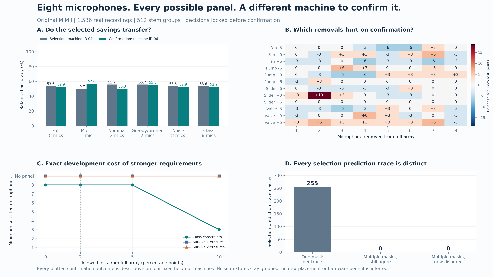
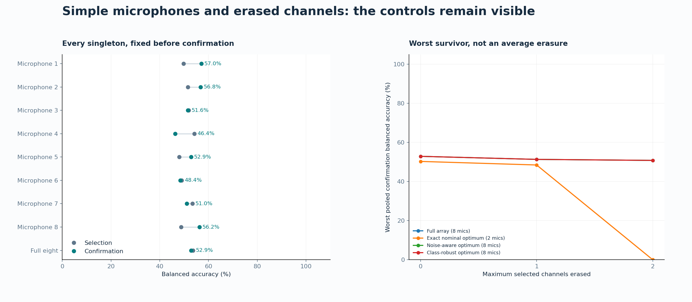

# 17. Microphone-array selection under machine and noise changes

## 17.1 The advantage is complete knowledge of the declared design space

An exact design method can do something useful even when its smallest development panel fails on a different machine. It can expose every admissible alternative, every declared robustness cost and every ambiguity that a single chosen panel conceals. With eight synchronized microphones, the complete nonempty design space has only \(2^8-1=255\) members. This chapter evaluates that entire space on real industrial recordings, freezes the design decisions before confirmation, and separates a finite optimization certificate from evidence about physical transfer. The resulting advantage is a complete, independently replayable audit of the stated measurement problem. An empirical saving in microphones, if present, is a further claim with its own held-out conditions.

The immediate motivation is the preceding MAFAULDA replay. Its development-optimal single accelerometer achieved perfect selection accuracy and only two correct classifications among six locked test recordings. A separately frozen two-channel confirmation reached fifteen correct classifications among eighteen recordings, compared with sixteen for the full panel and microphone alone. Exact optimization had correctly solved the development problem; the development problem had not supplied a reliable transfer guarantee. Those original experiments remain unchanged. The present study changes the source corpus, the holdout unit and the robustness questions, while retaining the existing protocol, provenance, nearest-reference and exact-selection architecture.

The [original MIMII release](https://zenodo.org/records/3384388), DOI `10.5281/zenodo.3384388`, supplies eight-channel, sixteen-bit, 16 kHz industrial sound from fans, pumps, slide rails and valves. Public version 1.0 includes machine IDs 00, 02, 04 and 06 for each type. Its binary conditions are normal and abnormal, with factory background-noise mixtures in nominal archive conditions labeled -6, 0 and +6 dB. The primary paper scales noise using model-average signal power; these archive labels are not guarantees of measured per-recording SNR. The [primary dataset paper](https://arxiv.org/html/1909.09347v1) describes the recording apparatus and mixture construction. The release is attributed to Harsh Purohit and colleagues at Hitachi, Ltd., under CC BY-SA 4.0. This chapter's supervised identity-transfer task differs from the original per-machine, normal-only anomaly-detection baseline. Its scores are not a reproduction of that published benchmark.

## 17.2 A bounded physical population and an externally frozen protocol

For each machine type, machine ID and binary condition, the acquisition plan intersects the WAV basenames available in all three noise archives. It orders these basenames by SHA-256 of the fixed namespace, type, ID, condition and basename, with the basename breaking a hash tie, and retains the first sixteen. Every retained basename contributes all three noise mixtures. No recording is substituted on the basis of its features or predictions. The result is a balanced case-control panel of 512 recording-stem groups and 1,536 complete ten-second recordings. These groups should not be mistaken for 512 independent machines, nor should the mixtures be counted as independent acquisition sessions.

Within each machine type, IDs 00 and 02 supply training, ID 04 supplies sensor selection, and ID 06 supplies protected confirmation. Thus training contains 256 stem groups and 768 recordings, while selection and confirmation each contain 128 groups and 384 recordings. Each confirmation type contains one machine identity and thirty-two selected stems, each represented by three mixtures. All windows, channels and known mixtures from a stem stay together, and the entire machine identity stays in one split. There is no random window split and no training example from the confirmation machine.

The official description does not expose the identities of the underlying factory-noise segments. Conservatively grouping matching stems across SNR avoids a known route for leakage; it cannot establish that unrelated filenames contain independent background noise. Temporal session boundaries are also unavailable. Consequently the conditional stem bootstrap below is not a confidence interval for a population of industrial machines or factory sessions. Machine identity and noise provenance are different grouping problems, and the available metadata resolve only part of the second.

The complete protocol was frozen before signal-member acquisition and published through the authorized repository controls in commit `30132a5f7e332c832dc7ad471937a97b3483aa6f`. Its protocol hash is `8d7e1e7284a6cad3f72dcdc1ad6022870088ab382d806af95251edf5c321feab`. The archive inventory and deterministic member plan precede model outcomes. A second lock binds the selection predictions, exhaustive table and chosen panels before confirmation predictions are computed. These two checkpoints answer different questions: the first protects the analysis plan, and the second prevents confirmation outcomes from changing the selected design.

The official Zenodo endpoint supports HTTP byte ranges. ZIP64 directory inspection makes it possible to identify member offsets without downloading all twelve archives, whose published total is about 100 GB. The selected compressed audio members total 2,852,963,714 bytes; their uncompressed WAV members total 3,932,282,880 bytes. Strict range responses, local ZIP headers, member names, lengths, decompression, CRC32 and individual compressed and raw SHA-256 hashes bind the selected measurements to the source archives. Published whole-archive MD5 values are retained as source metadata; partial retrieval does not verify those whole-archive checksums. A source hash supplies byte identity, while the independent numerical replay supplies a separate correctness check. A second raw-feature route uses Python WAV decoding and an explicit NumPy FFT implementation of Welch rather than the production SciPy feature path. It verifies every selected compressed member and WAV and reproduces all 159,744 descriptor values with maximum absolute discrepancy \(1.4433\times10^{-15}\), within the declared absolute and relative tolerance of \(2\times10^{-11}\). This is source-to-feature numerical evidence, separate from exact optimization and physical transfer.

## 17.3 The fixed numerical observation map

Write \(x_{rj}\in\mathbb R^{160000}\) for microphone \(j\) in recording \(r\). The sixteen-bit PCM values are divided by 32,768, and each complete channel is centered. Thirteen fixed descriptors are calculated: log RMS, log mean absolute amplitude, kurtosis, crest factor, zero-crossing rate, normalized spectral centroid, and seven log Welch band powers. The fixed bands partition 0--8 kHz at 125, 250, 500, 1000, 2000 and 4000 Hz. Welch uses a Hann window of 1,024 samples, overlap 512 and constant detrending. The logarithm floor is \(10^{-20}\). There is no feature search using the confirmation data.

Let \(F_{rjk}\) be descriptor \(k\). For each machine type \(t\), training-only mean \(\mu_{tjk}\) and population standard deviation \(\sigma_{tjk}\), floored at \(10^{-9}\), define

\[
Z_{rjk}=\frac{F_{rjk}-\mu_{tjk}}{\max(\sigma_{tjk},10^{-9})}.
\]

The model is the existing additive nearest-reference observation rule, applied separately within each known machine type. For a nonempty microphone set \(S\), training reference \(a\) and query \(r\), put

\[
d_S(r,a)=\frac1{13|S|}\sum_{j\in S}\sum_{k=1}^{13}(Z_{rjk}-Z_{ajk})^2,
\qquad
\widehat y_S(r)=y_{a^*(r,S)},
\]

where \(a^*\) is the first minimizing training reference in deterministic manifest order. Type is declared known context, not inferred by the model. Normalization and references use only training identities. The output is a binary condition prediction; the public labels do not justify assigning individual fault subtypes to a recording.

This rule is deliberately fixed rather than tuned into a new state-of-the-art anomaly detector. Its purpose is to make the sensor-selection assumptions inspectable and the saved predictions independently reproducible. It uses per-channel descriptors, not phase-preserving beamforming. A selected digital stream is therefore not a new microphone placement, and a change in stored channel count is not a measured power, price or latency benefit.

For any nonempty evaluation cell \(A\), class recall and balanced accuracy are rational functions of the saved discrete predictions:

\[
R_c(S;A)=\frac{\#\{r\in A:y_r=c,\widehat y_S(r)=c\}}{\#\{r\in A:y_r=c\}},
\qquad B(S;A)=\frac{R_0(S;A)+R_1(S;A)}2.
\]

Floating-point feature extraction and distance comparisons precede this exact arithmetic. The finite certificate does not turn the observation map into an exact physical law. Once predictions are fixed, however, comparisons against the two-percentage-point margin \(\delta=1/50\) need no floating-point tolerance.

## 17.4 Five design contracts and a complete optimum certificate

Let \(M=\{1,\ldots,8\}\) be the intact array. The nominal contract requires pooled balanced accuracy and every type-specific balanced accuracy to satisfy

\[
B(S;A)\ge B(M;A)-\delta.
\]

The nuisance-aware contract additionally imposes the same inequality for every type-by-SNR cell. The class-robust contract also requires every type-by-SNR-by-class recall to remain within \(\delta\) of the corresponding intact-array recall. These requirements prevent an improved aggregate score from concealing an additional class failure at one noise level. They do not require the intact array itself to be accurate: relative preservation and an absolute recall floor are reported separately.

Every selected type-by-SNR cell has sixteen normal and sixteen abnormal examples. One additional mistake changes balanced accuracy by \(1/32=3.125\) percentage points and a class recall by \(1/16=6.25\) points. Consequently a two-point cell margin permits no additional error in those cells. This is a discrete sampling consequence of the frozen panel, rather than evidence for a finely calibrated two-point physical tolerance.

Cost is \(c(S)=|S|\), with integer mask breaking ties. Each retained channel represents 160,000 scalar observations per recording, so channel count and raw scalar count have the same ordering here. No measured hardware prices enter the objective. Greedy starts empty and repeatedly adds the channel minimizing the sum of positive exact constraint deficits, with mask as the tie break, until it first reaches feasibility or exhausts the array. Optimally pruned greedy enumerates every nonempty submask of the terminal greedy mask under the same contract. This stronger comparator matters when a greedy path contains redundant channels.

**Proposition SNG-M01 (complete finite optimum).** Fix the training data, numerical prediction table, evaluation cells, exact margin and a Boolean feasibility predicate \(\Phi(S)\) on nonempty subsets of \(M\). If \(\mathcal F=\{S\subseteq M:S\ne\varnothing,\Phi(S)\}\) is nonempty, exhaustive evaluation of all 255 masks and minimization of \((|S|,\operatorname{mask}(S))\) returns the unique declared optimum. If \(\mathcal F\) is empty, the same table certifies infeasibility over the declared design space.

*Proof.* Each nonempty subset has one integer mask in \(1,\ldots,255\), and every such mask represents one subset. The enumeration is therefore exhaustive and has no duplicate designs. Exact recall fractions determine \(\Phi\) without rounding. A finite nonempty set has a least element in the stated total order, and no smaller element can be feasible if every table entry has been checked. If every entry fails, no declared design remains. The proof concerns this finite observation table; it contains no inference about a different recording population. \(\square\)

This is the methodological advantage the study can establish without a favorable transfer outcome. It yields the whole feasible set and sensitivity frontier together with the selected panel. It can also establish that exact and optimally pruned greedy tie. Such a tie is a result that narrows the method's practical advantage on this task; it is not suppressed by presenting ordinary greedy as the only comparison.

## 17.5 Erasures and the limits of monotone coverage

For a class-robust predicate \(\Phi\), the one- and two-erasure contracts require

\[
\Phi_f(S)=\bigwedge_{L\subseteq S,\,|L|\le f}\Phi(S\setminus L),
\qquad f\in\{1,2\},
\]

where an empty survivor is infeasible and every survivor is compared with the original intact-array thresholds. The reference threshold does not become easier when a channel is erased. All surviving masks are explicitly tested, including the intact panel. A two-channel survivor can behave differently from either channel alone because the nearest-reference decision changes after distances are combined.

**Proposition SNG-M02 (exact deletion criterion).** A panel satisfies the stated \(f\)-erasure contract if and only if every nonempty surviving subset obtained by deleting at most \(f\) selected channels satisfies the original robust predicate, and no permitted deletion leaves an empty survivor.

*Proof.* These are precisely the possible losses of at most \(f\) channels from that panel. If every listed survivor passes, every permitted loss passes. Conversely any failing survivor supplies its deleted set as an explicit counterexample to the contract. An empty survivor supplies no input to the declared classifier and fails by definition. \(\square\)

The survivor operator also produces a useful exact frontier. For a margin \(\delta\), let \(\mathcal F_f(\delta)\) be the family satisfying the \(f\)-erasure contract and let

\[
K_f(\delta)=\min_{S\in\mathcal F_f(\delta)}|S|,
\qquad \min\varnothing=+\infty.
\]

**Proposition SNG-M04 (robustness frontier without sensor monotonicity).** If \(f'\ge f\) and \(\delta'\ge\delta\), then

\[
\mathcal F_{f'}(\delta)\subseteq\mathcal F_f(\delta),\qquad
\mathcal F_f(\delta)\subseteq\mathcal F_f(\delta'),\qquad
K_{f'}(\delta)\ge K_f(\delta)\ge K_f(\delta').
\]

Every feasible \(f\)-erasure panel has at least \(f+1\) members. These statements require no assertion that adding a microphone improves classification.

*Proof.* Increasing the erasure budget adds survivor tests, so a panel passing all of the larger collection passes the smaller collection. Increasing the margin weakens each fixed full-array comparison and therefore cannot invalidate any survivor that previously passed. Taking minima over nested feasible families gives the cost inequalities, including the empty-family convention. A panel with at most \(f\) members permits deletion of all its members, leaving the explicitly forbidden empty survivor. \(\square\)

This frontier separates two forms of monotonicity that are easy to confuse. Requirement strength is monotone, even though classifier quality as a function of the microphone set is not. A downward step in recorded minimum cost when the allowed loss increases is consistent; a downward step when the erasure requirement increases signals a calculation or presentation error. These are independently checkable structural identities of the complete finite table.

This elementary criterion is worth stating because an apparently similar multicover theorem answers a different question. In the existing `singularity.robust_coverage` engine, a microphone may independently separate a declared distinction. A panel survives \(f\) erasures exactly when each distinction has at least \(f+1\) independently separating members: deleting at most \(f\) leaves one, while deleting all at most \(f\) separators defeats an undercovered distinction. That argument relies on a fixed per-channel separation relation. Additive nearest-reference classification is nonmonotone in its channels, so counting individually successful microphones cannot replace the explicit survivor checks above.

The study nevertheless reuses the multicover engine in an appropriate separate diagnostic. For each type and SNR, normal and abnormal descriptor boxes are the coordinatewise development minima and maxima over training plus selection. A microphone separates a distinction only when at least one of its descriptor intervals is strictly disjoint between the two boxes. The core exact solver and an independent exhaustive solver compare multiplicities one, two and three. A successful result is conditional on those empirical boxes. Overlapping boxes indicate failure of this sufficient certificate; they neither establish physical indistinguishability nor supply a universal noise envelope.

## 17.6 Observational equivalence as a measurable warning

For the frozen selection recordings \(D_s\), define the prediction trace

\[
T_s(S)=(\widehat y_S(r))_{r\in D_s},\qquad
S\sim_s S'\iff T_s(S)=T_s(S').
\]

This is an equivalence relation on the 255 masks. Its classes preserve every observed selection decision, not merely aggregate accuracy. All masks in a class satisfy exactly the same selection accuracy constraints, although their channel costs may differ. The selected masks and these classes are locked before confirmation.

**Proposition SNG-M03 (finite traces do not determine transfer).** Equality of finite selection traces implies equality of every score computed solely from those traces and fixed labels. Without an additional hypothesis on the observation map or data-generating population, it does not imply equality on an unobserved recording.

*Proof.* A score computed from equal vectors has equal inputs and therefore equal output. For the second statement, take two binary functions equal on the finite set \(D_s\) and differing at one point outside it. They meet the premise and fail the asserted extension. The finite premise imposes no condition at that new point. For the fixed physical pipeline, a confirmation trace split is a concrete empirical witness of the same logical limitation. \(\square\)

Confirmation records how many selection-equivalence classes split into multiple confirmation traces, their score ranges, and the behavior of every development-optimal minimum-cost alternative. This is descriptive investigation after the lock, never a license to replace the chosen panel with the best confirmation member. Equal singleton prediction traces do not make two microphones interchangeable inside a fused distance calculation, and equality on the retained recordings does not prove physical equivalence.

Sensitivity analysis repeats the finite feasibility calculation at margins zero, two, five and ten percentage points and erasure budgets zero, one and two. The predeclared paired bootstrap resamples complete stems within type and binary class, carrying the three mixtures together, for 2,000 replicates with seed 20261020. Its percentile score-difference intervals are conditional on the four fixed confirmation machines and this sampling plan. They do not establish noninferiority across a machine population. The absolute diagnostic asks separately whether every type-by-SNR-by-class recall reaches one half; passing a relative margin against a weak reference does not settle that question.

## 17.7 Retained physical results: a useful audit, unsuccessful transfer

**The clear demonstrated advantage is the complete, source-to-feature, independently replayable design audit.** It establishes the exact cost of each declared requirement and exposes a proposed reduction that fails protected confirmation. It establishes no exact-over-greedy advantage, hardware saving or population-level transfer guarantee. A bounded recorded-stream reduction does survive for the predeclared greedy comparator, as detailed below. Selective access also makes this bounded all-type, all-ID, all-noise-condition investigation practical with 2.85 GB of compressed signal members, without requiring the entire roughly 100 GB release. That access saving applies to the declared subset; it is not equivalent to evaluating every recording in MIMII.

At the primary two-point margin, thirty of 255 panels meet nominal selection feasibility. The minimum channel count is two, with three minimizing masks: 36 (microphones 3 and 6), 65 (1 and 7), and 72 (4 and 7). The integer-mask tie break chooses 36. Its selection balanced accuracy is 55.73%, compared with 53.65% for all eight channels. On the protected machine IDs it gets 193/384 correct, balanced accuracy \(193/384=50.26%\), versus 203/384, \(203/384=52.86%\), for the full array. The difference is exactly \(-5/192\), or -2.6042 percentage points. Thus even the pooled two-point preservation margin fails, and the type-specific nominal contract also fails.

The paired, type-and-class-stratified stem bootstrap gives a conditional 95% percentile difference interval from -5.99 to 0.78 percentage points. This interval includes zero. It neither proves that the selected panel is inferior in a machine population nor establishes noninferiority. The descriptive protected-panel margin test has already failed, and the weak absolute diagnostic scores deserve equal attention.

The exact certificate does not identify a unique minimum-cardinality physical design. Ordinary greedy and optimally pruned greedy both return mask 65, another cost-two minimizer. They agree with exact optimization on minimum channel count while choosing a different tie. Their confirmation score is 213/384 = 55.47%, above the deterministic exact tie choice. This predeclared greedy pair passes the complete nominal confirmation contract, including every type-specific margin, while retaining two of eight recorded streams: a 75% reduction in the stated digital observation count on this protected panel. That is a concrete bounded advantage of the retained candidate. It belongs to an equally cheap greedy solution, and its 55.47% balanced accuracy and failed absolute class-recall floor prevent interpreting it as a reliable fault detector or a general hardware reduction. The third development minimizer, mask 72, reaches only 187/384 = 48.70%. This 6.77-point spread among equally cheap development-feasible minima shows selection ambiguity without making a post-confirmation replacement. The primary exact mask remains the reported choice. The zero-margin sensitivity also selects mask 65 from development alone; it is retained as sensitivity, not substituted for the primary two-point result.

| Selection requirement | Feasible masks | Minimum microphones | Exact microphones | Greedy cost / status | Pruned-greedy cost |
|---|---:|---:|---|---|---:|
| Pooled and type balanced accuracy | 30 | 2 | 3, 6 | 2 / feasible | 2 |
| Also every type by SNR | 1 | 8 | 1, 2, 3, 4, 5, 6, 7, 8 | 8 / feasible | 8 |
| Also each binary-class recall | 1 | 8 | 1, 2, 3, 4, 5, 6, 7, 8 | 8 / feasible | 8 |
| Class robust after any one erasure | 0 | infeasible | none | 8 / infeasible terminal | infeasible |
| Class robust after any two erasures | 0 | infeasible | none | 8 / infeasible terminal | infeasible |

Nuisance-aware selection and class-robust selection each admit exactly one panel: all eight microphones. Their relative confirmation requirements pass because their chosen mask is the reference mask itself. This is not independent evidence of good fault detection: full-array confirmation balanced accuracy is only 52.86%, and the full array fails the predeclared simultaneous requirement that each type-by-SNR-by-class recall reach one half. The exact nominal panel and every reported comparator also fail that simultaneous absolute-floor requirement. No panel satisfies either erasure requirement at the primary margin, and even relaxing the margin to ten points does not produce an erasure-feasible panel in this frozen development table.

## 17.8 Class-specific failures and the single-microphone controls

The protected nominal panel is close to chance in aggregate, with materially different class errors. Its mean normal recall for pumps is 41.67%; its abnormal recall for valves is 39.58%. For slide rails, normal and abnormal recall are 47.92% and 41.67%. A fixed reference that transfers poorly cannot establish that the raw microphone signals themselves lack diagnostic information. It establishes a limit of this particular source-bound observation map under the declared identity shift. The nominal-noise breakdown keeps the binary failures visible.

| Protected type / nominal SNR | Full-array BA | Exact nominal BA | Exact normal recall | Exact abnormal recall |
|---|---:|---:|---:|---:|
| fan / -6 dB | 56.25% | 53.12% | 62.50% | 43.75% |
| fan / +0 dB | 59.38% | 62.50% | 43.75% | 81.25% |
| fan / +6 dB | 37.50% | 40.62% | 43.75% | 37.50% |
| pump / -6 dB | 68.75% | 68.75% | 56.25% | 81.25% |
| pump / +0 dB | 50.00% | 46.88% | 37.50% | 56.25% |
| pump / +6 dB | 43.75% | 46.88% | 31.25% | 62.50% |
| slider / -6 dB | 40.62% | 40.62% | 25.00% | 56.25% |
| slider / +0 dB | 59.38% | 43.75% | 18.75% | 68.75% |
| slider / +6 dB | 50.00% | 50.00% | 100.00% | 0.00% |
| valve / -6 dB | 62.50% | 53.12% | 68.75% | 37.50% |
| valve / +0 dB | 56.25% | 50.00% | 56.25% | 43.75% |
| valve / +6 dB | 50.00% | 46.88% | 56.25% | 37.50% |

Mic 1, the single-microphone reference fixed before confirmation, gets 219/384 correct, or 57.03%, exceeding the full array by 4.17 percentage points and the selected exact pair by 6.77 points. It still fails the nominal type-specific preservation contract and the simultaneous absolute class-recall floor. It is therefore a valuable control and a warning about this classifier, not a validated replacement sensor design. All eight singleton results remain in the retained comparison rather than selecting the best microphone after confirmation.

| Microphone | Selection balanced accuracy | Protected balanced accuracy |
|---|---:|---:|
| 1 | 49.74% | 57.03% |
| 2 | 51.56% | 56.77% |
| 3 | 51.82% | 51.56% |
| 4 | 54.17% | 46.35% |
| 5 | 47.92% | 52.86% |
| 6 | 48.96% | 48.44% |
| 7 | 53.39% | 51.04% |
| 8 | 48.70% | 56.25% |

## 17.9 Sensitivity, observational equivalence and empirical boxes

| Margin from the full-array selection score | Nominal minimum | Nuisance-aware minimum | Class-robust minimum | One-erasure minimum | Two-erasure minimum |
|---|---:|---:|---:|---:|---:|
| 0 points | 2 | 8 | 8 | infeasible | infeasible |
| 2 points | 2 | 8 | 8 | infeasible | infeasible |
| 5 points | 2 | 3 | 8 | infeasible | infeasible |
| 10 points | 1 | 2 | 3 | infeasible | infeasible |

At five points, nuisance-aware cost falls to three microphones, while class robustness still needs eight because a single recall error costs 6.25 points in a sixteen-example class cell. At ten points, the nominal, nuisance-aware and class-robust costs are one, two and three. These are different tolerated-loss contracts, not confirmation-driven improvements to the primary result. The monotone frontier identities in SNG-M04 hold, including the persistent infeasibility of both erasure budgets.

Every one of the 255 nonempty masks has a distinct complete selection prediction trace. Thus no nontrivial exact trace-equivalence class occurs, and no such class splits on confirmation in this experiment. SNG-M03 remains a general limitation, but this dataset does not supply its empirical alias-splitting witness. The three minimum-cost feasible alternatives are ambiguity under the nominal performance constraints, not equality of their complete observations. This distinction prevents an attractive theoretical possibility from being reported as an observed discovery.

The empirical-box diagnostic is wholly negative: none of the twelve type-by-SNR normal-versus-abnormal distinctions has an individually separating microphone coordinate. Both the existing branch-and-bound core and the exhaustive oracle therefore report infeasibility for multiplicities one, two and three. All observed development class boxes overlap on every channel under this strict coordinate-separation criterion. This failure does not certify that normal and abnormal sound are physically equivalent; it shows that these conservative empirical envelopes cannot support the desired sufficient robustness argument. The box certificate and the fused-classifier results fail in different, explicitly retained ways.

## 17.10 What this experiment adds to the methodology

The result is a rigorous negative physical-transfer study with a complete finite design frontier. It makes three limits concrete: a smallest panel for type-averaged development scores need not preserve a protected margin; protecting observed noise and class cells may remove every apparent channel saving; and an empirical min/max uncertainty model may be too coarse to certify even zero-erasure separation. Exact optimization addresses the declared finite optimization problem correctly while leaving the observation model and its transfer assumptions open to challenge.

The next justified mathematical question is how to construct an observation and nuisance envelope that preserves actual cross-machine fault information, with more independent identities available for validating that envelope. The present confirmation cannot be reused as fresh protection for a redesigned classifier. A future method may use it as development evidence only if it labels that change and obtains a new protected evaluation. No new placement, procurement, field reliability or hardware-efficiency conclusion follows from these prerecorded streams. The original MAFAULDA experiments remain unchanged, and this MIMII failure is retained alongside their failures rather than being absorbed into a favorable aggregate.

The executable evidence is [the frozen protocol](../../applications/sensor_replay/mimii_v1/protocol.json), [selection certificate](../../applications/sensor_replay/mimii_v1/selection_snapshot.json), [protected results](../../applications/sensor_replay/mimii_v1/results.json), [raw-feature replay](../../applications/sensor_replay/mimii_v1/raw_feature_verification.json), and [illustrated report](../../applications/sensor_replay/mimii_v1/MIMII_Array_Research.html). The independent verifier recomputes predictions and finite constraints without importing the production selector. These records separate source integrity, numerical observation replay, finite exact optimization and physical transfer, so each conclusion can be inspected at the level its evidence supports.
