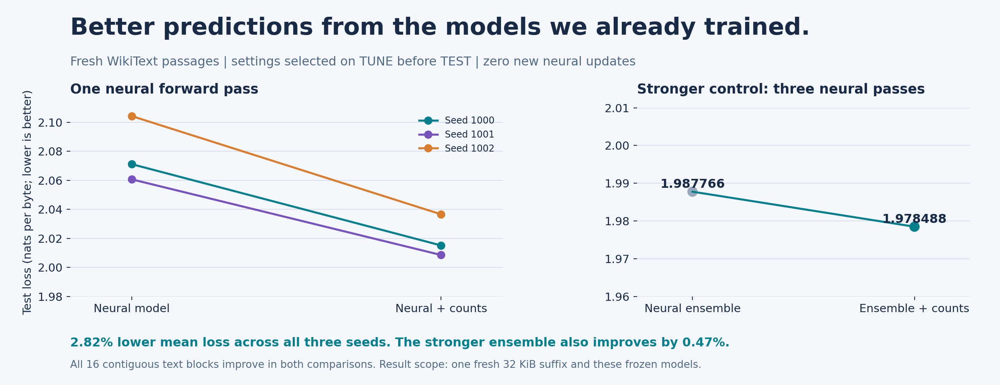
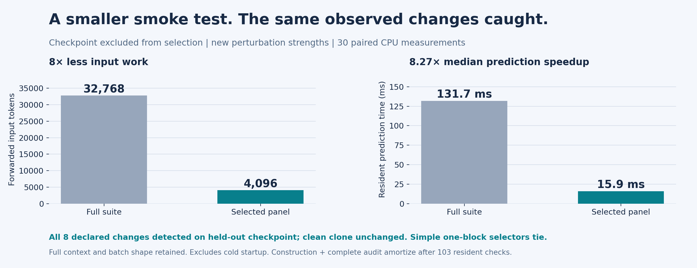

# What we can now stand behind

This revision establishes three practical advantages using the neural models already trained in Singularity. A tuning-selected neural/count blend improves fresh-text prediction. An online blend removes the need to calibrate the blend weight and carries a finite cumulative log-loss guarantee. An exact finite observation panel reduces the cost of a repeatable behavioral smoke test, including on a checkpoint and perturbation strengths excluded from selection.

The fixed blend reduces mean next-byte TEST loss by **2.8186%** across all three frozen neural checkpoints, from 2.078696 to 2.020105 nats per byte. Every seed improves, and the mean loss difference favors blending in all sixteen contiguous text blocks. Accuracy rises from 41.3546% to 42.2030%. A stronger three-model ensemble also improves when blended: loss falls by **0.4668%**, from 1.987766 to 1.978488 nats per byte. This comparison uses three neural forwards per input, not one.

On a separate fresh passage, causal online blending reduces loss by **2.8731%** relative to the neural models alone. Its distinct mathematical benefit is the guarantee of staying within $\log21=3.044522438$ cumulative nats of the best member of a declared fixed blend grid. The blending weight uses only previously observed targets. Count smoothing still comes from earlier TUNE selection; the entire system is not free of prior tuning.

The behavioral panel uses 4,096 input tokens instead of 32,768, in four rather than thirty-two full-context model calls. Thirty randomized paired CPU measurements yield median resident prediction times of **15.923 ms versus 131.657 ms**, an **8.268-fold speedup**. All eight declared nonclean changes are detected on the held-out checkpoint. An unchanged clone remains unchanged. Including both construction and the complete development audit, the measured resident prediction savings repay setup after **103 checks**.

These are confirmed outcomes for stated finite workloads, backed by frozen protocols, saved predictions, per-target losses, and an independent numerical audit. The new work performs no neural training updates. Its benefit comes from using complementary predictors and choosing economical observations, rather than hoping another undirected training run will create an advantage.

# The data boundary

All studies use the original official WikiText-2 raw splits at Salesforce dataset revision `b08601e04326c79dfdd32d625aee71d232d685c3`. The three retained byte transformers, seeds 1000-1002, each have 84,544 parameters and were trained on the first 262,144 bytes of the TRAIN stream. Source streams join nonempty rows with newlines, encode as UTF-8, and retain a terminal newline. Original training receipts and the source manifest remain intact.

The new studies use disjoint evaluation intervals. Offsets below are zero-based and half-open. TUNE and TEST refer to separate official splits, even where their byte offsets agree.

| Study | Construction or selection | Confirmation |
| --- | --- | --- |
| Fixed predictive blend | TUNE [32768, 65536) | TEST [32768, 65536) |
| Behavioral panel | TUNE [65536, 98304), seeds 1000-1001 | TEST [65536, 98304); seed 1002 held out from selection |
| Causal online blend | Grid and prior fixed prospectively | TEST [98304, 131072) |

The predictive studies score every byte except the first exactly once: 32,767 targets per suffix. Causal neural contexts reset every 64 input bytes; count histories use the same boundaries. Padding targets do not enter metrics. These are byte-level prefix/suffix experiments, not published full-corpus word-token WikiText perplexity benchmarks. The fresh passages are from the same source dataset, not independent corpora or architectures.

Study definitions and selection rules were frozen before confirmation outputs. The fixed-mixture study persisted all TUNE choices before opening its new TEST suffix. The diagnostic protocol hashed TEST source bytes before construction but did not evaluate TEST model outputs before panel freezing. The online study explicitly adapts to past targets during its declared prequential evaluation. Calling all three protocols a single untouched static TEST would obscure these different contracts.

# Better predictions without retraining the transformer

Let $p_N(y\mid h)$ be the frozen neural next-byte distribution and $p_C(y\mid h)$ a smoothed TRAIN-only trigram distribution. The combined predictor is

$$p_\alpha(y\mid h)=(1-\alpha)p_N(y\mid h)+\alpha p_C(y\mid h),\qquad 0\leq\alpha\leq1.$$

Both experts are normalized. The public scoring API combines probabilities in log space, preserves causal target alignment, and never updates the model tensors or count tables during scoring. The count model backs off only when insufficient input history exists at a window boundary. An available but unseen context receives its declared smoothed distribution rather than a new frequency-dependent backoff policy.

Smoothing was selected on fresh TUNE from the fixed grid 0.01, 0.1, and 1.0. The selected value was 0.01. Each neural model then selected its count weight from $\{0,0.05,\ldots,1\}$ by minimum fresh-TUNE loss, with smaller weights winning exact ties. Selected count weights were 0.35, 0.35, and 0.40 for seeds 1000, 1001, and 1002. Every checkpoint was retained; none was selected for a favorable TEST result.

| Predictor | Nats/byte | Accuracy | Neural forwards |
| --- | ---: | ---: | ---: |
| Trigram | 2.159995 | 39.1888% | 0 |
| Neural | 2.078696 | 41.3546% | 1 |
| Neural + counts | 2.020105 | 42.2030% | 1 |
| Neural ensemble | 1.987766 | 43.4584% | 3 |
| Ensemble + counts | 1.978488 | 43.5774% | 3 |

Individual loss reductions are 2.703%, 2.529%, and 3.216%. Relative to the count expert, the individual blends reduce mean loss by 6.4764%. The neural probability ensemble was the strongest unblended reference selected on TUNE; its additional 0.4668% improvement therefore goes beyond comparing only against an especially weak baseline.



For uncertainty, we average the repeated-model losses for each byte, then resample sixteen contiguous blocks, rather than pretending that three predictions of the same text are independent documents. The descriptive 95% interval for blend-minus-neural mean loss is [-0.06633, -0.05157] nats per byte. For the ensemble comparison it is [-0.01244, -0.00663]. All sixteen block means favor blending in both comparisons. These are conditional finite-text summaries, not guarantees of an effect across datasets, model sizes, or future deployments.

The primary extension took 8.12 inclusive shared-host seconds, including source loading, count fitting, selection, scoring, and reporting. Individual neural suffix inference took approximately 0.26-0.35 seconds. Mixing and count prediction add computation; this study establishes a predictive advantage, not a prediction speedup. Exporting the reusable count artifact and verifying the public API are separately recorded engineering work outside that primary timing.

# A blend-weight guarantee instead of another calibration search

A second predictor maintains Bayesian weights over the same 21 fixed blend weights. This is established expert aggregation, not a new optimizer or a newly invented regret theorem. Its value here is a reusable causal implementation, a self-contained proof, and confirmation using actual frozen neural probabilities.

Write the fixed-grid experts as $p_{t,k}$ and initialize $w_{1,k}=1/K$, where $K=21$. Before seeing the current target, predict

$$q_t(y)=\sum_{k=1}^{K}w_{t,k}p_{t,k}(y).$$

After observing $y_t$, and only then, update

$$w_{t+1,k}=\frac{w_{t,k}p_{t,k}(y_t)}{q_t(y_t)}.$$

For $Z_n=K^{-1}\sum_k\prod_{t=1}^{n}p_{t,k}(y_t)$, the update implies $q_t(y_t)=Z_t/Z_{t-1}$. The product telescopes. If $L_k=-\sum_t\log p_{t,k}(y_t)$, then

$$L_{\rm online}=-\log\left(K^{-1}\sum_k e^{-L_k}\right)\leq \min_k L_k+\log K.$$

This holds for every sequence under the declared experts, without a stochastic assumption on that sequence. The positive smoothed count expert makes a finite-likelihood grid member available. The comparator is the best fixed member of this finite grid, not every continuous weight, arbitrary changing weights, top-1 accuracy, or a different model. The retrospectively computed minimum audits the guarantee and never chooses a prediction.

The forecast uses the posterior mean count weight, so all grid members share one neural forward pass; twenty-one neural models are not required. Posterior bookkeeping still costs time. The neural and count conditional predictions reset their input contexts every 64 bytes, while the blend posterior persists across the declared stream. A future-target mutation test verifies that a changed later target cannot alter earlier emitted weights.

On fresh TEST bytes [98304, 131072), mean loss falls from 2.088537520 for the neural experts to 2.028531539 for online blending. Accuracy rises from 40.3017% to 40.9904%. All sixteen text blocks favor online blending over the neural expert. Observed cumulative regrets are 3.032207876, 3.044516986, and 3.042725414 nats; each is below $\log21$. The marginal-likelihood identity agrees within $7\times10^{-10}$ nats. Over 32,767 targets, the guaranteed penalty is at most 0.0000929143 nats per target.

Previously calibrated fixed blends score 2.028732600 nats on this same passage. The difference from online blending is tiny and its descriptive interval crosses zero. We therefore establish removal of the blend-weight calibration requirement and the cumulative bound, rather than superiority over calibrated blending. Smoothing remains inherited from the prior TUNE choice. Online evaluation observes past TEST targets causally; it does not train neural parameters.

The Python online bookkeeping and scoring took about 0.97 seconds per seed, compared with about 0.042 seconds for fixed blending and scoring; neural inference itself took 0.30-0.37 seconds. The complete online study took 6.05 seconds. The guarantee is an option for users who value avoiding blend-weight calibration and bounding cumulative loss; it is not the faster inference option.

# Testing executed behavior with fewer model calls

The diagnostic study uses real trained byte transformers and declared synthetic deployment changes: weight-only fake quantization, a removed layer, suppressed positional embeddings, a stale checkpoint, and an unchanged clone. Fake quantization retains float32 computation, so no quantized-kernel speedup is claimed. A detected change means different byte argmax outputs, not necessarily worse predictive quality.

Eight disjoint blocks cover all 512 complete 64-byte contexts in the new passage. Each block costs 4,096 forwarded input tokens. The readout keeps the complete argmax output sequence, an exact byte string. On seeds 1000 and 1001, fourteen named states produce twelve distinct full-language classes. Exact selection chooses block zero, the deterministic first minimum, preserving all 89 distinctions between different classes.

An independent enumeration checks all 256 subsets. All eight singleton blocks achieve the same minimum. Greedy, the first block, and all one hundred fixed random one-block panels tie. The exact certificate establishes minimum cost within the supplied finite pool; this experiment supplies no performance advantage of exact search over those alternatives.

The panel was frozen before confirmation. On new TEST text it preserves all 89 distinguishable known-state pairs. On seed 1002, held out from panel selection, it preserves all 44 distinguishable pairs on both construction-split and fresh TEST text. All eight declared nonclean variants are detected, including seven-bit and five-bit quantization strengths excluded from construction. The clean clone produces no drift. This is finite transfer across the retained model and mutant catalogue; an unknown fault can remain invisible to the panel.



| Resident prediction workload | Full suite | Selected panel |
| --- | ---: | ---: |
| Complete contexts | 512 | 64 |
| Forwarded input tokens | 32,768 | 4,096 |
| Model calls, batch 16 x context 64 | 32 | 4 |
| Median prediction time | 131.657 ms | 15.923 ms |
| P90 prediction time | 165.159 ms | 21.216 ms |

The benchmark uses one resident healthy held-out model, two CPU threads, five warmup pairs, and thirty randomly ordered full/selected pairs. Prediction outputs repeat identically. The clock includes resident forward, argmax, and concatenation; source reading, model loading, output comparison and setup are outside that interval. The machine is shared, so this is a measured workload ratio rather than a hardware-independent throughput claim.

Construction cost 5.221 seconds, 448 model calls, and 458,752 forwarded tokens. Median prediction savings repay construction after 46 checks. The complete development audit adds 6.671 seconds and 1,088 calls; charging it too gives 103 checks. A verified cold CLI invocation took 2.386 seconds, dominated by setup. The 8.268-fold resident prediction advantage must not be presented as an eightfold cold-command startup gain.

A separate engineering demonstration explains why output testing adds value beyond a file checksum. A runtime hook suppresses positional outputs without changing the checkpoint file or any of its thirty state tensors. The selected panel detects 2,583 changed predictions out of 4,096, exactly matching the previously declared positional-suppression outputs. Tensor values, mutation versions, and file identity remain unchanged; the hook is removed afterward. This is implementation equivalence and a concrete deployment check, not an additional independent statistical confirmation.

# Ready to use, with evidence attached

The release contains the portable TRAIN-only count expert, selected-weight recipes, frozen checkpoints, standalone scoring commands, a causal online API, cached golden outputs, and a behavioral smoke-test consumer. The public fixed-blend API reproduces every selected TUNE metric exactly across all three neural seeds. The independent auditor reconstructs all new numerical claims from saved losses and output sequences without another neural inference pass.

For seed 1000, the frozen neural weight is 0.65 and the count weight is 0.35. The scoring command accepts the neural weight, so the two conventions must not be interchanged. From an installed source checkout, a new corpus can be scored with the retained count expert:

```sh
R=applications/training_lab/results
MODEL="$R/confirmation/wikitext_byte/baseline/seed_1000"
COUNTS="$R/predictive_mixture/count_expert.json"
PYTHONPATH=src python scripts/score_byte_mixture.py score \
  --checkpoint "$MODEL/checkpoint.pt" --counts "$COUNTS" \
  --neural-weight .65 --corpus new-corpus.txt --output score.json
```

The command has no TEST-fitting branch. It checks model/count TRAIN identity, vocabulary and window compatibility, and emits model, corpus, count and source hashes. The inference checkpoints use PyTorch's full format and must come from a trusted source. The [training guide](../../applications/training_lab/README.md) supplies installation and source preparation; the [confirmation guide](../../applications/training_lab/CONFIRMED_ADVANTAGES.md) gives the new commands and result-specific contracts.

A behavioral check forwards only selected contexts and compares against cached golden outputs, avoiding a second reference-model forward. An unchanged result means selected predictions agree; it does not prove full functional equality, unchanged probabilities, general quality, or coverage of every possible deployment fault. A file checksum remains the cheaper tool for file identity itself.

# Evidence, scope, and continuity

The [predictive protocol and results](../../applications/training_lab/results/predictive_mixture/results.json), [online study](../../applications/training_lab/results/online_blend/results.json), [diagnostic timing](../../applications/training_lab/results/checkpoint_confirmation/timing.json), [runtime demonstration](../../applications/training_lab/results/checkpoint_confirmation/runtime_pipeline_check.json), and [independent audit](../../applications/training_lab/results/confirmed_advantages_audit.json) preserve the new evidence. The [release validation receipt](../../applications/training_lab/results/advantage_validation.json) records actual checks. The earlier [training companion](training_observation.md) and all original successes and failures remain historical evidence; they have not been relabeled or discarded.

For established background, see Vladimir Vovk's [Aggregating strategies](https://pure.royalholloway.ac.uk/en/publications/aggregating-strategies/) (1990) and Marcus Hutter's [Convergence and Loss Bounds for Bayesian Sequence Prediction](https://www.hutter1.net/ai/spupper.htm) (2003). The finite-mixture proof above is self-contained. Our contribution here is the implementation, integration, explicit finite observation contract, and measured source-bound confirmations, rather than a priority claim for convex blending or Bayesian prediction.
