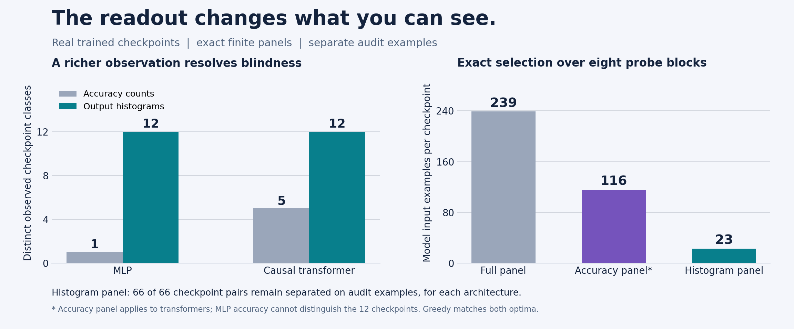
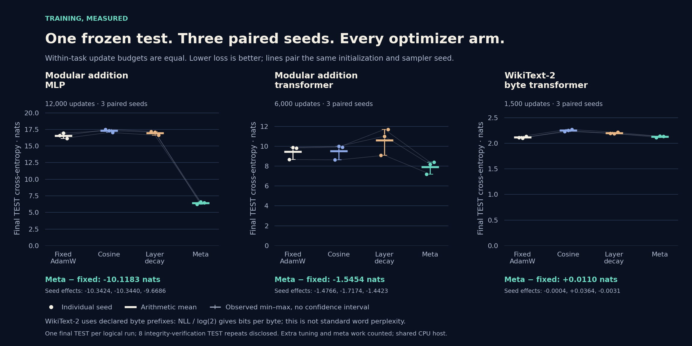

# A question that survived contact with training

Singularity asks how much of a hidden structure an observation can reveal. This revision brings that question into a real neural training laboratory. We trained models, retained their weights and optimizer states, measured their failures, and asked which observations distinguish the resulting checkpoints. The most useful result is a change in what we observe: a richer readout distinguishes models whose accuracy readings coincide.

The release contains 63 planned training runs, totaling 557,700 optimizer updates. These comprise an original discovery and confirmation study, a separately declared stronger-decay follow-up, and a paired coordinate-change experiment. Three seeds support each confirmation comparison. The total is a count of runs across conditions, not 63 independent replications of one effect. Integrity verification required a further 24,100 updates, transparently recorded rather than treated as new evidence.

On fixed small WikiText-2 prefixes, an 84,544-parameter transformer trained from scratch achieves mean test cross-entropy 2.115960 nats per byte and next-byte accuracy 39.729%. A tuned trigram reference reaches 2.218284 nats and 37.220% accuracy. On the byte task, our local AdamW hyperparameter tuner does not beat selected fixed AdamW on mean test loss. No modular-addition model reaches the declared grokking criterion within its allotted steps.

The observation result is sharper. Accuracy-count signatures merge all 12 original MLP checkpoints into a single class. Predicted-class histograms distinguish all 12. For each architecture, a unique cheapest block of 23 construction examples separates its entire 12-checkpoint catalogue. A separate audit block preserves all 66 pairwise distinctions. The selection is exact for the declared finite tables and example costs. It is neither a proof about unseen checkpoints nor an improvement in prediction accuracy.

# From polynomial coordinates to an experiment

A polynomial $p(x)=2-x+3x^2$ has coordinates $(2,-1,3)$ in the basis $(1,x,x^2)$. Addition and differentiation become linear operations on coefficients. Evaluation at $t$ is the pairing of the coefficient vector with $(1,t,t^2)$. The useful lesson is that a representation determines which operations become easy to express. An inner product on functions need not coincide with the Euclidean dot product on monomial coefficients; its Gram matrix records the chosen pairing.

That observation suggested two different experiments here. First, a complete change of coordinates can preserve a neural network's initial function while changing the behavior of a coordinatewise optimizer. Second, a readout can discard information even when the underlying model has not changed. We tested these separately. Neither experiment claims that neural training is linear, or that identifying a polynomial with its coordinates automatically makes an optimizer better.

The finite observation formulation is simple. Let $M$ be a finite catalogue of checkpoints, $E$ a finite collection of allowed probe blocks, and $s_e(m)$ an exact signature computed from checkpoint $m$ on block $e$. Declare

$$m\sim_E m'\quad\Longleftrightarrow\quad s_e(m)=s_e(m')\text{ for every }e\in E.$$

A panel $P\subseteq E$ preserves the distinctions of the full language when its signatures separate every pair of different $E$-classes. With nonnegative costs $c(e)$, the task is to minimize $\sum_{e\in P}c(e)$. This is an optimization over a finite observation language, not a guarantee that the language captures every meaningful property of a model. An empty optimum after all candidates collapse to one class indicates blindness.

This is the concrete bridge to Singularity's existing exact mathematics: preserve the observable quotient, retain witnesses for distinctions, and state precisely what remains invisible. The earlier graph, interface, thermal, and arithmetic results remain separate mathematical and application results. This neural application does not turn an empirical training trajectory into a theorem about generalization.

# What was trained, and what was held apart

All neural runs used PyTorch 2.14.1+cpu on a shared CPU host, one Torch thread per run. Models started from random initialization. Each checkpoint retains model and optimizer state together with Python, Torch, and sampler RNG states. Receipts include initial and final tensor hashes, configuration and split hashes, code fingerprints, per-step metrics, and final summaries. The exact core remains usable without PyTorch; the optional training extra installs the scientific dependencies.

For modular addition, the task is $y=(a+b)\bmod31$. We split unordered input orbits $\{a,b\}$ within each label, allocating eight orbits to TRAIN, four to TUNE, and four to TEST. A reversed input pair therefore cannot cross splits. The original split has 483 ordered training examples and 239 examples in each held-out split. Orbit leakage checks and the complete split enumeration are retained. Classifier features contain input symbols only; output labels are not supplied as input features.

The MLP has one 128-unit GELU hidden layer and 12,063 trainable parameters. The modular transformer has width 32, four heads, and one causal block; it reads the input symbols followed by an equality marker and predicts at that final position. The byte transformer has width 48, four heads, two causal blocks, and 84,544 parameters. Explicit causal masks and a future-token perturbation test check the direction of information flow.

Text comes from the original train, validation, and test splits of Salesforce's WikiText-2 raw dataset, pinned to revision `b08601e04326c79dfdd32d625aee71d232d685c3`. We join nonempty rows with newlines and take fixed prefixes: 262,144 training bytes and 32,768 bytes in each evaluation split. This is a small raw-byte experiment, not standard full-corpus word-level WikiText perplexity and not a fine-tuned Hugging Face model. Dataset provenance, hashes, and licensing attribution are retained; the download script retrieves the pinned source rather than substituting generated text.

The vocabulary contains all 256 byte values. Inputs are divided into windows of length 64, targets are shifted exactly once, and padding targets are ignored. Every evaluation weights loss by the number of valid targets; each held-out prefix contributes 32,767 next-byte targets. Byte entropy in bits is cross-entropy in nats divided by $\log2$. We do not compare byte perplexity directly with published word-token perplexities.

# The declared optimizer comparison

The original discovery phase evaluated three fixed AdamW settings on seed 9000 for each architecture. The candidates varied learning rate, weight decay, and the second moment coefficient. The lowest final TUNE cross-entropy at a fixed short cap selected each architecture's setting. Discovery performed no TEST scoring. The frozen confirmation matrix crossed seeds 1000, 1001, and 1002 with fixed AdamW, cosine learning-rate decay, layerwise learning-rate decay, and a local meta tuner.

Confirmation caps were 12,000 updates for the MLP, 6,000 for the modular transformer, and 1,500 for the byte transformer. Bias and normalization parameters receive no weight decay. Layerwise decay changes the layer learning-rate ratios, not just a label in the configuration. Equal update counts do not imply equal compute: the meta arm additionally uses gradients and repeated checks on a fixed TUNE probe.

For a parameter receiving decoupled weight decay, write a prospective AdamW step as

$$\theta^+(\eta,\lambda)=(1-\eta\lambda)\theta-\eta\,\frac{\widehat m^+}{\sqrt{\widehat v^+}+\epsilon}.$$

The implementation uses the actual stored moments, prospective step count, bias corrections, and epsilon placement. It holds the current TRAIN gradient fixed while differentiating the one-step TUNE loss through this functional update with respect to learning rate and weight decay. A bounded proposal is backtracked on the same fixed TUNE probe before updating the real optimizer settings. Groups excluded from decay remain excluded. The functional evaluation does not mutate live model or optimizer state.

This is a local hyperparameter adaptation method. It supplies no long-horizon stability guarantee, no global optimum, and no promise that repeated use of one TUNE probe will generalize. The probe is a uniformly shuffled fixed subset chosen with a separate random generator; its exact indices are retained. An independent TEST score is withheld from policy feedback. Finite-difference, state-mutation, and AdamW-step agreement tests check the implementation contracts.

Telemetry sketches actual parameter updates. Centered covariance and uncentered second moments are reported separately. Effective rank, entropy, and the recovered always-nonpositive Delta expression are diagnostics, not success criteria or generalization certificates. A zero trace yields an explicitly missing spectral statistic. No optimizer is selected because a decorative spectral curve looks favorable.

# Language learning: a positive, limited result

The table reports arithmetic means across the three confirmation seeds. Cross-entropy is nats per next byte; accuracy is the fraction of correct byte argmax predictions. Each arm used the same source prefixes and training cap.

| Neural arm | Nats / byte | Bits / byte | Accuracy |
| --- | --- | --- | --- |
| Fixed AdamW | 2.115960 | 3.052685 | 39.729% |
| Cosine | 2.249804 | 3.245781 | 35.783% |
| Layer decay | 2.197695 | 3.170603 | 37.440% |
| Local meta tuner | 2.126936 | 3.068520 | 39.418% |

The primary paired meta-minus-fixed cross-entropy effects were -0.000365, +0.036432, and -0.003139 nats per byte. Their mean is +0.010976 nats, about 0.52% worse than fixed AdamW. The observed range spans both signs. Three seeds do not justify a confidence interval, a significance claim, or a universal ranking of optimizers. Cosine and layerwise schedules also underperformed the selected fixed setting under these particular short budgets.

We added inexpensive count references after neural training as an explicitly post-training comparison. Counts use TRAIN only. For each order, smoothing is selected from the fixed grid 0.01, 0.1, and 1.0 by TUNE loss before TEST scoring. The causal history resets at the same 64-byte window boundaries as the neural model. Short histories use the appropriate lower-order table when there are insufficient preceding bytes. An unseen available context uses the declared smoothed distribution.

| Reference | Nats / byte | Bits / byte | Accuracy |
| --- | --- | --- | --- |
| Unigram | 3.181009 | 4.589226 | 19.617% |
| Bigram | 2.503305 | 3.611505 | 28.694% |
| Trigram | 2.218284 | 3.200308 | 37.220% |

The trigram has the best TUNE loss among these references. Relative to it, selected fixed AdamW reduces mean TEST cross-entropy by about 4.61% and improves accuracy by 2.509 percentage points. These results establish learning beyond the retained short-memory references on the declared prefixes. They do not establish state-of-the-art language modeling, a full-corpus result, or favorable total compute economics. All count references together took about 0.81 inclusive job seconds; neural training was much more expensive.

# Grokking: the useful negative result

The declared memorization threshold is TRAIN accuracy at least 99% for three consecutive scheduled evaluations. The generalization threshold is TUNE accuracy at least 95% for three consecutive scheduled evaluations. Delayed generalization requires a delay between the confirmed crossings. An uncrossed threshold is right-censored at the declared cap; it is not assigned an invented crossing time.

No modular run met the generalization threshold. The original fixed and scheduled MLP arms memorized; the meta arm did not confirm the memorization threshold. Every MLP arm achieved zero TEST accuracy. The modular transformer achieved only about one to two percent TEST accuracy, near or below the uniform random-guess rate of $1/31$. The table retains all original arms, averaged over three seeds.

| Model | Arm | TEST loss | TEST accuracy |
| --- | --- | --- | --- |
| MLP | baseline | 16.5470 | 0.000% |
| MLP | cosine | 17.2925 | 0.000% |
| MLP | layer_decay | 16.9664 | 0.000% |
| MLP | meta | 6.4287 | 0.000% |
| TRANSFORMER | baseline | 9.4583 | 1.116% |
| TRANSFORMER | cosine | 9.5026 | 0.558% |
| TRANSFORMER | layer_decay | 10.5945 | 0.697% |
| TRANSFORMER | meta | 7.9129 | 1.534% |

After observing the original TUNE failure, we declared a separate follow-up rather than silently replacing the original settings. On a new split and discovery seed, three stronger-decay settings competed at 6,000 updates; weight decay 3.0 was selected. New confirmation seeds 2000-2002 compared the original fixed setting, the retuned fixed setting, and the retuned meta arm for 20,000 updates each.

Stronger decay reduced mean TEST cross-entropy from 16.801487 to 3.950794 nats. This large numerical reduction chiefly corrects severe overconfidence: TEST accuracy remained zero, and the retuned loss still exceeds the uniform predictor's $\log31=3.433987$ nats. The meta arm's mean loss was 3.949232, also with zero accuracy. Training accuracy under stronger decay was low, so this is not a successful grokking recipe. Its value is a constrained failure report with a complete trajectory, not a claim that addition was learned.

# Equal initial functions, different optimizer coordinates

The basis study uses a complete real orthonormal Fourier basis on the 31 input symbols. Its rows are the constant $1/\sqrt{31}$ and the sine and cosine modes $\sqrt{2/31}\cos(2\pi ka/31)$ and $\sqrt{2/31}\sin(2\pi ka/31)$ for $k=1,\ldots,15$. This is a full invertible input-coordinate change. It is not a low-rank truncation, feature selection using labels, or an engineered answer to the addition task.

Let $Q$ denote this basis matrix. We map each one-hot input $e_a$ to $Qe_a$ and transport the first layer to $W\operatorname{diag}(Q^T,Q^T)$. In exact arithmetic the preactivations, and hence the entire nonlinear initial function, are unchanged. With float32 storage, all 961 input-pair logits agree within $5.96\times10^{-8}$. Both representations retain the same 12,063 trainable parameters.

A one-step control separates coordinate behavior from an initialization advantage. SGD agrees after Fourier transport within $5.96\times10^{-8}$ in outputs. AdamW agrees exactly under a permutation of coordinates, while the dense Fourier rotation produces a one-step maximum output difference of 0.002708. Coordinatewise squared-gradient scaling is therefore observably sensitive to this rotation in the retained numerical experiment. This control alone says nothing about eventual accuracy.

Three new paired seeds then trained one-hot and Fourier versions for 20,000 updates each on a third split, using fixed AdamW settings. Mean TEST loss was 5.778690 nats for one-hot coordinates and 5.453815 for Fourier coordinates, a paired mean reduction of 0.324875. Every final TEST accuracy was zero; both losses exceed the uniform reference. The coordinate effect is measurable, but this experiment did not solve generalization or grokking.

# The readout changes the observable quotient

For the original 12 frozen MLP checkpoints and 12 frozen modular-transformer checkpoints, we formed eight probe blocks by the known arithmetic label modulo eight. Labels determine this declared probe partition; they are not model input features. Each block costs the number of input examples evaluated once per checkpoint. Construction uses TUNE examples; a separate TEST partition audits the frozen selection without reselection.

The initial readout keeps only the correct-prediction count per block. The 12 MLP checkpoints all produce zero correct predictions and therefore one full-language class. No panel can recover distinctions discarded by this language. Its empty optimal panel is a negative identifiability result. Among the transformer checkpoints, the full accuracy language produces five classes, leaving 22 pairs unresolved. A cheapest panel uses four blocks and 116 of the 239 construction examples. On the separate audit table, it preserves 39 of the 44 pairs that were distinct during construction; five distinctions do not transfer.

We then introduced a richer output language in an explicitly exploratory continuation. For each block we retain the complete predicted-class histogram. On a block of size $N$, with class counts $n_0,\ldots,n_{30}$, the integer

$$H=\sum_{c=0}^{30}n_c(N+1)^c$$

encodes the histogram injectively because each digit is at most $N$. The code verifies decoding, stores large integers as decimal strings in JSON, and charges each input only once regardless of the number of output classes. These signatures are exact integer summaries of saved argmax predictions; the underlying neural computations remain floating point. A prediction histogram does not determine accuracy in general because it discards which prediction belongs to which target. The present result compares alternative readouts on this catalogue, rather than asserting a universal refinement relationship.

The richer full language distinguishes all 12 checkpoints for each architecture. The unique cheapest construction panel is the block with label congruent to seven modulo eight, containing 23 of 239 examples. All 256 subsets of the eight blocks are independently enumerated to verify the optimum. Greedy also chooses this optimum, so there is no greedy-versus-exact performance advantage in this example.

The corresponding audit block contains 22 examples and preserves all 66 construction distinctions for each architecture. This is empirical transfer on a second finite table, not a probability bound for future probes or unseen models. The audit checks pairwise separation; it does not train a decoder on construction histogram values and demonstrate that decoder on TEST. The histograms capture patterns of mistakes as well as successes; checkpoint identification does not imply task competence.

The 90.38% reduction concerns the construction panel size relative to all 239 examples under this cost model. Constructing the table already used 2,868 checkpoint-example slots per architecture, and the full audit table used another 2,868. We reused those saved predictions for the histogram study with no extra neural inference. The quoted saving is a potential later probing cost for this catalogue, not recovered training compute or a measured end-to-end service speedup.

# Integrity, compute, and reproducibility

A final audit found that some streamed metric logs retained only a prefix even though training and checkpoint saving had completed. A matching hash alone could not detect a faithfully hashed incomplete prefix, so the audit checks step coverage as well as bytes. Nine logical runs were deterministically replayed; one replay itself needed another attempt. The original artifacts and the failed attempt remain preserved. Successful replays reproduced the complete model tensors, optimizer state, and TUNE and TEST scores exactly.

Those executions add 24,100 optimizer updates, 495.856 inclusive job seconds, and eight physical TEST re-evaluations. They are integrity verification, not additional independent seeds or model-selection trials. Thus the planned policy was one final TEST scoring per confirmation run, with the documented replay deviation. Claims of a single physical access to TEST across the whole project would be false.

The frozen historical numerical engine is retained in `engine_source_snapshot`, tied to commit `407a449`. The current runner improves persistence by resealing the complete in-memory metric sequence into a fresh temporary file, flushing and synchronizing it, atomically replacing the append stream, and verifying the bytes before issuing completion receipts. This changes log persistence and elapsed time, not the optimizer equations. A fault-injection test checks recovery from dropped progress writes.

Across the 63 initial neural runs and all integrity repeats, 581,800 optimizer updates were executed. The analysis accounts for approximately 2,209.61 inclusive job seconds for neural work, controls, and replays. This is a sum of job durations on a shared host, not elapsed user waiting time, exclusive CPU consumption, or a dedicated-hardware speed benchmark. Count-reference fitting and scoring are reported separately. Source preparation, analysis, tests, figure production, and packaging are additional work outside the neural timing total.

Every canonical run has complete retained step coverage and verified checkpoint and metric hashes. Compressed logs preserve the original uncompressed bytes; receipts hash the decompressed stream. Historical absolute corpus paths are provenance, not portable configuration paths. Reproduction creates new configurations pointing to a freshly downloaded corpus directory and retains the original records unchanged. Exact bitwise replay across other Torch releases or hardware is not promised.

# A tool people can build on

The practical result is an optional training lab connected to a dependency-free exact observation core. It provides actual causal models, honest optimizer comparisons, complete states, a finite probe-table adapter, exact minimum panels, greedy and exhaustive cross-checks, and explicit audit transfer. The repository's existing graph and thermal examples continue to supply other observation languages and stronger mathematical guarantees within their stated models.

The next valuable extension is a larger independent checkpoint catalogue with a probe budget declared before construction, measured wall-clock inference costs, and an audit set of unseen models. A useful optimizer claim would require broader tasks, more seeds, separate adaptation and selection data, and compute-matched references. A useful noisy diagnostic would need uncertainty in the signature language and a repeated-observation budget. These are proposed next experiments, not results already established here.

For creators and AI researchers, the immediate invitation is concrete: supply a candidate catalogue, a finite set of meaningful probes, exact signatures or bounded uncertainty, and honest costs. Singularity can expose which candidates are distinguishable, explain where a readout loses information, and choose an economical panel within that declared experiment.

# Evidence and execution

The runnable [training-lab guide](../../applications/training_lab/README.md) gives the installation, source preparation, training, analysis, and exact-panel commands. The original [protocol](../../applications/training_lab/results/protocol.json), [confirmation plan](../../applications/training_lab/results/confirmation_plan.json), and [analysis](../../applications/training_lab/results/analysis.json) bind the original study. Separate directories retain the [stronger-decay follow-up](../../applications/training_lab/results/grokking_followup/protocol.json) and [basis study](../../applications/training_lab/results/basis_study/protocol.json).

The [count-reference receipt](../../applications/training_lab/results/byte_reference_baselines.json), [accuracy-panel receipts](../../applications/training_lab/results/diagnostic_panels/modular_transformer_panel_report.json), [MLP histogram receipt](../../applications/training_lab/results/output_language/modular_mlp_output_language_report.json), and [transformer histogram receipt](../../applications/training_lab/results/output_language/modular_transformer_output_language_report.json) retain the application evidence. The [integrity manifest](../../applications/training_lab/results/integrity_replays.json) discloses all verification repeats. The [local validation receipt](../../applications/training_lab/results/validation.json) states what was actually checked; it does not assert remote CI success.

The text source is [Salesforce/WikiText](https://huggingface.co/datasets/Salesforce/wikitext/tree/b08601e04326c79dfdd32d625aee71d232d685c3/wikitext-2-raw-v1). Framework semantics are documented by [PyTorch AdamW](https://docs.pytorch.org/docs/2.14/generated/torch.optim.AdamW.html) and [TransformerEncoderLayer](https://docs.pytorch.org/docs/2.14/generated/torch.nn.TransformerEncoderLayer.html). These references supply dataset and framework provenance; the numerical findings in this companion come from the retained local experiments.

## Original byte-model loss by seed

| Arm | Seed 1000 | Seed 1001 | Seed 1002 |
| --- | --- | --- | --- |
| baseline | 2.110717 | 2.100985 | 2.136178 |
| cosine | 2.229581 | 2.248712 | 2.271119 |
| layer_decay | 2.191755 | 2.185842 | 2.215487 |
| meta | 2.110352 | 2.137417 | 2.133039 |

Each entry is final TEST cross-entropy in nats per byte. Individual observations, means, observed ranges, paired differences, threshold censoring, and full compute accounting remain available in the machine-readable analysis. The release reports observed outcomes rather than assigning evidential weight to the ambition of the original plan.
