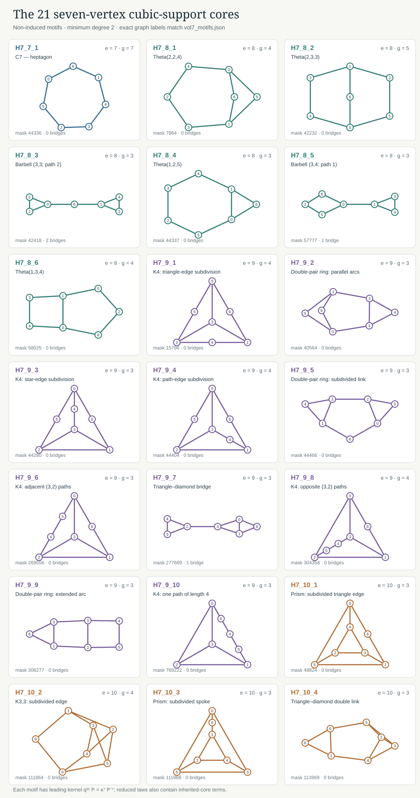

# Volume seven: exact correction and delayed motif observability
**Dependency.** This contribution is stacked on PR #7 at commit
`517d6cf1d2fdd2f5369011db55a1e4bb2b51c7fd`. The volume-four,
volume-five and volume-six files are preserved byte for byte. The new
connected-support derivation also proves its input identities directly.

**Result.** The seventh-order correction is proved by exact symbolic
inversion, a terminating cubic-core recurrence, and rational rowspace
certificates. Constructed cubic graph pairs force every displayed motif
coefficient. A second all-order theorem computes the first off-diagonal
connected-subgraph coefficient explicitly.

The seventh coefficient exposes a structural feature that is invisible at
orders four through six: **a motif supported on five vertices can first
become individually observable at volume seven**. The relevant motif is
the house, or theta graph $\Theta(1,2,3)$. Its count and the count of
$K_{2,3}$ enter the fifth coefficient only through their sum. The sixth
coefficient still does not separate them. The seventh coefficient does.

This distinction matters when stating the correction theorem. Equality
of height-series coefficients through a specified volume means equality
of polynomials in $q$. It does not automatically mean equality of every
motif count appearing in a displayed formula. The earlier vector $I_5$
records the two five-vertex theta counts separately and is therefore a
stronger matching condition. The formulas proved under that stronger
condition remain available. The law below treats literal agreement of
the height series through volume six.

## The exact law

Let $G$ be a finite simple cubic graph, with no connectivity hypothesis,
and set

$$
L_G(x,q)=\sum_{h:V(G)\to\mathbb Z_{\ge0}}
 x^{\sum_vh_v}q^{\sum_{uv\in E(G)}(h_u-h_v)^2},\qquad
\ell_G=\log L_G,\qquad L_{G,r}=[x^r]L_G,
$$

$$
f=q^{-2}-1,\qquad \kappa=q(1-q^2).
$$

For each connected simple graph $H$, let $N_H(G)$ be its ordinary,
not necessarily induced, subgraph count. Define the cubic-core sum

$$
S_{k,e}(G)=\sum_{\substack{|V(H)|=k,\ |E(H)|=e\\
 H\text{ connected},\ 2\le\deg_H(v)\le3}}
 N_H(G).
$$

Graphs are counted once per unlabelled isomorphism type. On seven
vertices the four edge classes have **1, 6, 10, and 4** types,
respectively. Thus $S_{7,7}=N_{C_7}$, while the other three sums involve
six bicyclic, ten tricyclic, and four tetracyclic cores.

**Seventh-order theorem.** If cubic graphs $A,B$ have equal height-series
coefficients through volume six, then, writing $\Delta F=F(A)-F(B)$,

$$
\boxed{\begin{aligned}
\Delta[x^7]L={}&\kappa^7\big[
 \Delta S_{7,7}+f\Delta S_{7,8}
 +f^2\Delta S_{7,9}+f^3\Delta S_{7,10}\\
&\hspace{33mm}
 +q^2(q^4+3q^2+3)\Delta N_{\Theta(1,2,3)}\big].
\end{aligned}}
$$

All quantities are exact. Products involving $f$ are understood as
Laurent expressions whose multiplication by $\kappa^7$ gives ordinary
polynomials in $q$. Under the additional condition
$\Delta N_{\Theta(1,2,3)}=0$, the theorem reduces to the four seven-core
sums alone.

The lower-support term is neither a numerical remainder nor a fit. Its
coefficient is the polynomial

$$
q^9(1-q^2)^7(q^4+3q^2+3)
=3q^9-18q^{11}+43q^{13}-49q^{15}+21q^{17}
 +7q^{19}-7q^{21}-3q^{23}+4q^{25}-q^{27}.
$$

The exact coefficient and the complete elimination certificate are
stored in `vol7_law.json`; `vol7_law_check.py` replays the rational
identities independently of the cumulant computation.

## What agreement through volume six actually records

Define

$$
\begin{aligned}
J_6(G)=(&n,N_{C_3},N_{C_4},N_{\rm diamond},N_{K_4},
 N_{C_5},N_{K_{2,3}}+N_{\Theta(1,2,3)},N_{K_{2,3}+e},\\
 &S_{6,6},S_{6,7},S_{6,8},S_{6,9}).
\end{aligned}
$$

**Determination theorem.** Two finite simple cubic graphs have equal
height series through volume six if and only if their twelve entries of
$J_6$ agree.

This is a polynomial statement, including disconnected cubic graphs and
saturated $K_4$, $K_{3,3}$, and prism components. It follows from exact
rational rowspace equality: the coefficient rows of
$\ell_1,\ldots,\ell_6$, expressed in the twenty available core counts,
have rank twelve, and their reduced rowspace is precisely the rowspace
of $J_6$. The forward and reverse implications therefore both have
explicit linear certificates. Passing between $L$ and $\ell$ uses the
formal exponential recurrence, so the statement does not depend on a
choice of numerical $q$.

Through volume seven the analogous coefficient-row rank is seventeen
on forty-one core coordinates. The successive ranks are

| Maximum volume | 1 | 2 | 3 | 4 | 5 | 6 | 7 |
|---|---:|---:|---:|---:|---:|---:|---:|
| Exact coefficient-row rank | 1 | 1 | 2 | 5 | 8 | 12 | 17 |

The five new scalar observables at volume seven are the four seven-core
sums and the separated house count. Their coefficient functions are
linearly independent over the rationals: after division by
$\kappa^7$, the first four are $1,f,f^2,f^3$, while the fifth is
$q^2(q^4+3q^2+3)$. As functions of $t=q^2$, a nontrivial polynomial in
$t^{-1}-1$ of positive degree has a pole at zero, whereas the fifth
function is $t^3+3t^2+3t$. The remaining constant cannot cancel that
nonconstant polynomial.

## The seven-vertex motif catalogue

The unrestricted exact enumeration has **1,044** simple seven-vertex
graph types, **853** connected. A cubic host excludes the **789** connected
types containing a vertex of degree at least four. The remaining **64**
connected subcubic types have the following census.

| Edges | Connected subcubic supports | Leafless cores | Reduction |
|---:|---:|---:|---|
| 6 | 6 | 0 | All six trees reduce to lower cores |
| 7 | 17 | 1 | The new core is $C_7$ |
| 8 | 22 | 6 | Four theta graphs and two barbell configurations |
| 9 | 15 | 10 | Ten tricyclic cores |
| 10 | 4 | 4 | Four tetracyclic cores |
| **Total** | **64** | **21** | **43 leaf-bearing supports are eliminated** |

The four bicyclic theta cores are $\Theta(1,2,5)$,
$\Theta(1,3,4)$, $\Theta(2,2,4)$ and $\Theta(2,3,3)$.
The other two are a triangle and square joined by an edge, and two
triangles joined by a path of length two. The exact edge lists, stable
identifiers, girths and bridge counts of all twenty-one cores are in
[`vol7_motifs.json`](vol7_motifs.json).



For graphs of girth at least five, only $C_7$ and
$\Theta(2,3,3)$ survive, giving

$$
\Delta L_7=\kappa^7\big[\Delta N_{C_7}
 +f\Delta N_{\Theta(2,3,3)}\big].
$$

At girth at least six this becomes $\Delta L_7=\kappa^7\Delta N_{C_7}$.
Both specialisations retain the theorem's agreement-through-six
hypothesis. The motif catalogue checks these girth claims directly.

## A universal leaf-elimination identity

The reduction of sixty-four connected seven-vertex subcubic patterns to
twenty-one new cores rests on one elementary identity. It replaces
individual motif-specific determination arguments with a recurrence.

For a pattern $H$, write
$E_H(G)=|\mathrm{Aut}(H)|N_H(G)$ for the number of injective,
edge-preserving labelled maps into $G$. Choose a vertex $v\in H$
of degree $d<3$, and let $Y$ be obtained by attaching a new leaf at
$v$. Then

$$
\boxed{E_Y(G)=(3-d)E_H(G)
 -\sum_{w\in V(H)\setminus(\{v\}\cup N_H(v))}E_{H+vw}(G).}
$$

Terms with degree exceeding three vanish. To prove the identity, take
an embedding of $H$. The image of $v$ has exactly $3-d$ neighbours
that are not images of its pattern neighbours. A selected neighbour
either lies outside the image of $H$, giving an embedding of $Y$, or
is the image of a unique non-neighbour $w$, giving an embedding of
$H+vw$. These alternatives are disjoint and exhaustive.

Dividing by automorphism counts gives an exact rational identity for
ordinary subgraph counts. To reduce a connected graph with a leaf,
delete that leaf and apply the identity. Every term on the right has
one fewer vertex. Repetition therefore terminates. The terminal
patterns are $K_1$ and connected graphs with minimum degree at least
two. This proves at every order:

**Cubic-core reduction theorem.** Every connected-pattern count on at
most $r$ vertices is an explicit rational linear combination of
$n$ and the counts of connected subcubic cores on at most $r$
vertices. The coefficients are obtained by a terminating recurrence.

For example the recurrence reproduces

$$
N_{P_6}=24n-24N_{C_3}-12N_{C_4}
 +6N_{\rm diamond}-5N_{C_5},
$$

$$
N_{\rm diamond+two\ leaves}
 =N_{\rm diamond}-N_{K_{2,3}+e}-6N_{K_4}.
$$

Thus the component corrections found in the volume-six work arise
automatically. No connected-host assumption can remove a term without
being visible in the recurrence. The implementation in
`vol7_reduction.py` is independent of the cumulant library, including a
different canonical-mask convention. Its results are translated by
isomorphism before the two computations are combined.

## The all-order connected-support recurrence

For each induced vertex set $S$, form the local series

$$
Z_S=\sum_{h:S\to\mathbb Z_{\ge0}}
 x^{\sum h_v}q^{3\sum h_v^2-2\sum_{uv\in E(G[S])}h_uh_v},
$$

and define

$$
\Phi_S=\sum_{T\subseteq S}(-1)^{|S|-|T|}\log Z_T.
$$

Boolean inversion gives $\ell_G=\sum_{S\subseteq V(G)}\Phi_S$.
If $G[S]$ is disconnected, its logarithm splits over components and
the alternating sum vanishes. A monomial of volume less than $|S|$
uses fewer than $|S|$ vertices, so the same alternating sum kills it.
Consequently only connected supports of size at most $r$ contribute
to $\ell_r$. These are formal coefficient identities; no convergence
assumption is required.

The local logarithm itself has the exact recurrence

$$
b_r=a_r-\frac1r\sum_{j=1}^{r-1}j b_j a_{r-j},
\qquad Z=1+\sum_{r\ge1}a_rx^r,\quad\log Z=\sum_{r\ge1}b_rx^r.
$$

Edge-set inversion converts induced counts to ordinary counts. For a
connected pattern $H$, define

$$
\beta_{H,r}=\sum_{F\subseteq E(H)}(-1)^{|E(H)|-|F|}
 [x^r]\Phi_{(V(H),F)}.
$$

Then

$$
\ell_r(G)=\sum_{\substack{H\text{ connected subcubic}\\|V(H)|\le r}}
 \beta_{H,r}N_H(G).
$$

Disconnected edge sets contribute zero. Combining this equation with
leaf elimination produces a finite universal algorithm for each
$r$, with all arithmetic in $\mathbb Q[q]$.

At the first possible volume of a support, the familiar connected
spanning-subgraph identity gives

$$
[x^k]\Phi_H=q^{3k}
 \sum_{\substack{F\subseteq E(H)\\(V(H),F)\text{ connected}}}f^{|F|}.
$$

A second edge inversion therefore gives the universal top coefficient

$$
\boxed{\beta_{H,k}=q^{3k}f^{|E(H)|}.}
$$

For $k=7$, this proves the coefficient of each seven-vertex core
without regression or coefficient fitting. Leaf elimination handles all
forty-three other connected seven-vertex subcubic patterns. The remaining
calculation projects the lower-support contribution modulo the twelve
coefficient constraints through volume six. The certified remainder is
exactly the house polynomial displayed above.

The result is a reusable structural method: connected-support
inversion supplies coefficients, the cubic leaf recurrence removes
forced extensions, and exact rowspace projection identifies which
previously hidden observables become visible at the next volume. The
seventh-order delayed house term is the first explicit instance of that
last mechanism in this sequence.


## Deterministic witnesses and independence of the core counts

The coefficient law is accompanied by graph constructions that isolate
its terms. These constructions establish that the forty core counts
through seven vertices are linearly independent as functions on cubic
graphs, independently of the statistical graph pools.

Let $Q$ be the 30-vertex duad-syntheme incidence graph: its left vertices
are the fifteen pairs from a six-element set; its right vertices are the
fifteen perfect matchings; a pair is adjacent to the three matchings that
contain it. Direct breadth-first enumeration verifies that $Q$ is simple,
cubic and has girth eight. Subdivide one edge of $Q$. The resulting
31-vertex cap has a unique degree-two vertex and girth at least eight.

For a connected subcubic core $H$, attach a fresh cap by a bridge at each
missing cubic half-edge. This gives a simple connected cubic completion
$C(H)$ of order

$$
|C(H)|=|H|+31(3|H|-2|E(H)|)=94|H|-62|E(H)|.
$$

**Completion lemma.** For every leafless connected pattern $J$ on at most
seven vertices,

$$N_J(C(H))=N_J(H).$$

A copy contained in a cap would contain a cycle of length at least eight.
If a copy crosses an attachment bridge, its part on the cap side has
minimum degree at least two except possibly at the bridge endpoint,
where the internal degree is at least one. Such a graph cannot be a
forest: a nontrivial finite tree has at least two leaves. It must again
contain a cap cycle of length at least eight. Both alternatives are
impossible on seven vertices. Thus every copy lies entirely in $H$.
This proves the lemma, including patterns that themselves have bridges.

Order the forty cores by vertex count, then edge count. The matrix
$M_{H,J}=N_J(C(H))$ is lower triangular with diagonal one. Hence it has
an integer inverse. Signed integer unions of the completed graphs
therefore isolate each individual core count. Multiplying a signed union
by at most thirty and adding copies of $Q$ to the shorter side equalises
the vertex orders while preserving all core differences. The resulting
objects are actual finite simple cubic graph pairs.

`vol7_completion_certificate.json` records the entire matrix and every
signed isolation construction. Its determinant is exactly one. The
replay independently enumerates every small connected support in all
forty completed hosts, rather than merely assuming the completion lemma.
`vol7_observation.json` gives twenty-one pairs isolating the twenty-one
seven-vertex cores. Each pair agrees through volume six, so its nonzero
seventh difference forces the coefficient of its isolated motif.

The construction generalises: given any cubic graph of girth greater
than $r$, subdividing an edge supplies a cap for the same argument through
order $r$. The connected-support recurrence, cubic leaf reduction and
unitriangular completion matrix form a reusable procedure beyond seven.

## The house term is necessary

A particularly small signed completion relation is

$$
A=C(\Theta(1,2,3))\sqcup 2C(C_4),\qquad
B=C(C_3)\sqcup C(C_5)\sqcup C(K_{2,3}).
$$

Both graphs have **354 vertices**. Their core differences, for
$\Delta=A-B$, are exactly

$$
\Delta N_{\Theta(1,2,3)}=1,\qquad
\Delta N_{K_{2,3}}=-1,
$$

with every other core count through seven equal. Consequently

$$
L_{A,r}=L_{B,r}\quad(r\le6),\qquad
\boxed{L_{A,7}-L_{B,7}
 =\kappa^7\big((1+q^2)^3-1\big)\ne0.}
$$

This is an explicit proof that the additional lower-support term cannot
be omitted from a theorem stated for literal height-series agreement.
It also refutes the interpretation that agreement through volume five
or six determines the two five-vertex theta counts separately. The
identities established under equality of the stronger $I_5$ vector are
preserved; the present result supplies the precise weaker hypothesis.

The completion certificate verifies this relation structurally. The
independent checker additionally counts all forty core patterns in its
five actual completion hosts by injective embeddings, obtaining the
same difference vector and the same coefficient polynomial.

## Compact connected witnesses and weld rings

Two connected **14-vertex** pairs are stored with their complete edge
lists in `vol7_witnesses.json`. For each pair, direct weak-composition
enumeration gives equality of the full $q$-polynomials through volume
six and, with the certificate orientation $B-A$,

$$
L_{B,7}-L_{A,7}=2q^5(1-q^2)^7=2\kappa^7(1+f).
$$

A separate positive-support enumeration reproduces the seventh
coefficient. The independent checker repeats the direct heights and
injective motif counts. These examples make the correction visible
without the larger isolation constructions.

A second construction extends the weld-ring method. Take four two-port
six-vertex units: $A$ is the prism with a spoke removed, $B$ is
$K_{3,3}-e$, and $C$ is the prism with a triangle edge removed. Join their
ports into the rings $ABCC$ and $ACBC$. These connected 24-vertex graphs
have identical height coefficients through seven, while their two
seven-vertex barbell counts differ oppositely by one. One is the
triangle-square barbell; the other is the two-triangle configuration
with a length-two joining path. Both lie in $S_{7,8}$, so their
contributions cancel exactly.

This weld pair establishes the distinction between independent motif
coordinates and coefficient observables. The twenty-one motif counts
are independent graph functions, but the seventh coefficient reads
four edge-class sums together with the delayed house count.
`vol7_weld_aggregate.py` proves the equality by exact finite transfer over
unit boundary heights; it checks every coefficient total and validates
the transfer against full direct enumeration on a two-unit ring.

## First off-diagonal theorem and scope beyond seven

There is also an explicit coefficient formula before leaf reduction.
For a connected subcubic $H$ on $k$ vertices and $e$ edges, let $c_v$ be
the number of components of $H-v$ and set $c_v=0$ for a singleton. Then

$$
\boxed{\beta_{H,k+1}
=q^{3k+9}f^e\sum_v(f+2)^{d_H(v)}
-q^{3k+3}f^e\sum_v2^{c_v-1}.}
$$

The two terms count a height-two occupied site and a repeated height-one
site in the connected expansion. The latter is controlled by the
components after deleting that site. The proof in
[`VOLUME7_OFFDIAGONAL.md`](VOLUME7_OFFDIAGONAL.md) establishes this for
every order. It replaces symbolic expansion of the entire
support-size-$(r-1)$ contribution at volume $r$ by a formula in degrees
and vertex-deletion component counts.

The seven-order correction, leaf recurrence, completion lemma and
first off-diagonal formula are proved identities. No candidate
coefficient is used in the theorem. A full eighth-order law is not
asserted; its exact connected-support and determination algorithms are
now specified by the structural results above.

## Replay and dependency preservation

From the repository root, run

```bash
python independent_checks/height_series/vol7_verify.py
```

Everything uses Python's standard library and exact integers or
`fractions.Fraction`. The SVG layout uses floating coordinates only for
drawing. The replay covers unrestricted and subcubic catalogues, all
113 connected subcubic kernels through seven, independent Boolean and
edge inversions, the rational lower-order elimination certificate,
791 direct leaf-reduction identities, all forty cubic completions,
the twenty-one isolated-core pairs, the 354-vertex delayed-house pair,
the two direct 14-vertex pairs and the weld-ring transfer calculation.

All files present at the PR #7 dependency commit remain unchanged.
The new work is additive and the GitHub pull request is based on
`muse/volume6-correction-proof`, so the seventh-order changes can be
reviewed separately from their volume-six dependency.
