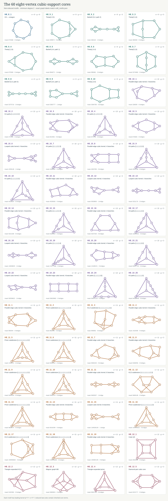

# Volume eight: delayed six-vertex observables and corrected core sums
**Dependency.** This is an additive continuation of PR #8 at commit
`facb4506d1e9b1667b877815777566296572a4fb`, itself dependent on PR #7.
The established volume-four through volume-seven files remain unchanged.

**Main contributions.** An exact eighth-order correction law; a complete
twenty-four-coordinate observation theorem; deterministic witnesses for
all sixty new core motifs and all seven new observable coordinates; a
second off-diagonal formula valid at every order; and a weld-ring transfer
commutator that constructs graph pairs with controlled observation delay.

The eighth coefficient has a complete exact correction law. Its sixty
new eight-vertex core motifs occur through five edge-count sums. Two
additional observations resolve information that the sixth and seventh
coefficients leave hidden among six-vertex motifs. **The observation rank
rises from seventeen to twenty-four.**

The matching hypothesis is literal equality of the height-series
polynomials through volume seven. This distinction is essential: matching
individual motif counts is a stronger condition. The theorem accounts
for all information that can remain hidden under the actual hypothesis.

## Setting and exact correction

For a finite simple cubic graph define

$$
L_G(x,q)=\sum_{h:V(G)\to\mathbb Z_{\ge0}}
 x^{\sum_vh_v}q^{\sum_{uv\in E(G)}(h_u-h_v)^2},
\qquad \ell_G=\log L_G,\qquad L_{G,r}=[x^r]L_G,
$$

$$
f=q^{-2}-1,\qquad \kappa=q(1-q^2),\qquad
 a=q^2(q^4+3q^2+3)=(1+q^2)^3-1.
$$

Let $N_H$ count ordinary, possibly non-induced, subgraphs. Define

$$
S_{k,e}=\sum_{\substack{H\text{ connected},\ |V(H)|=k,\ |E(H)|=e\\
                  2\le\deg_H(v)\le3}}N_H.
$$

Each unlabelled type is included once. We use four named six-vertex
motifs:

| Symbol | Motif | Canonical mask |
|---|---|---:|
| $T$ | $\Theta(2,2,3)$ | 956 |
| $B$ | Two triangles joined by one bridge | 6355 |
| $P$ | Triangular prism with one spoke removed | 5941 |
| $D$ | Diamond whose two degree-two vertices are joined by an additional length-three path | 17142 |

The masks use the decreasing-degree convention of `vol8_lib.py`.
Introduce the corrected core sums

$$Q_0=S_{8,8}+N_B,\qquad Q_1=S_{8,9}-2N_P+N_D.$$

**Theorem.** If finite simple cubic graphs $A,B$ have equal height-series
coefficients through volume seven, then, for $\Delta F=F(A)-F(B)$,

$$
\boxed{\begin{aligned}
\Delta[x^8]L={}&\kappa^8\big[
 \Delta Q_0+f\Delta Q_1+f^2\Delta S_{8,10}
 +f^3\Delta S_{8,11}+f^4\Delta S_{8,12}\\
 &\hspace{29mm}-a\Delta N_T+fa\Delta N_D\big].
\end{aligned}}
$$

This is an identity of polynomials in $q$; the displayed Laurent factors
are multiplied out by $\kappa^8$. Under agreement of all individual
lower core counts, the correction reduces to

$$\Delta[x^8]L=\kappa^8\sum_{j=0}^{4}f^j\Delta S_{8,8+j}.$$

The sixty eight-vertex core types split by edge count as follows.

| Edges | 8 | 9 | 10 | 11 | 12 |
|---|---:|---:|---:|---:|---:|
| Leafless connected subcubic types | 1 | 10 | 25 | 19 | 5 |

There are 194 connected subcubic eight-vertex supports. Exactly 134 have
leaves and reduce to lower core counts by the universal cubic leaf
recurrence. The full computation uses 307 connected subcubic types
through eight vertices, preserving all 113 types through seven.

## The delayed six-vertex information

The exact eighth-order lower-support residual, before grouping by the
known seventh-order constraints, is

$$
\begin{aligned}
\kappa^8\big[&a(\Delta N_{\Theta(1,2,4)}+
                    \Delta N_{\Theta(1,3,3)})
 +(a+1)\Delta N_B\\
 &-2f\Delta N_P+f(a+1)\Delta N_D\big].
\end{aligned}
$$

There is no residual seven-vertex motif term. Because agreement through
seven fixes

$$S_{6,7}=N_{\Theta(1,2,4)}+N_{\Theta(2,2,3)}
          +N_{\Theta(1,3,3)}+N_B,$$

its difference gives

$$\Delta N_{\Theta(1,2,4)}+\Delta N_{\Theta(1,3,3)}
 +\Delta N_B=-\Delta N_T.$$

Substituting this relation gives the boxed theorem. The correction
therefore separates two delayed coordinates, $N_T$ and $N_D$, while
allowing the two lowest eight-vertex edge sums to mix with lower motifs.
A count can influence a coefficient without being separately observed:
the distinction is made explicit by $Q_0$ and $Q_1$.

The residual factors are independently checked as exact polynomials:

| Residual motif | Eighth coefficient divided by $\kappa^8$ |
|---|---|
| $\Theta(1,2,4)$ | $a$ |
| $\Theta(1,3,3)$ | $a$ |
| $B$ | $a+1$ |
| $P$ | $-2f$ |
| $D$ | $f(a+1)$ |

## Direct recovery from two energy sectors

The two delayed six-vertex counts can be read from two coefficients of
one eighth-order difference. Let $c_j=[q^j]\Delta L_8$. Under agreement
through seven,

$$c_{30}=-\Delta N_T-\Delta N_D,\qquad
c_{28}=5\Delta N_T+6\Delta N_D.$$

Consequently

$$\boxed{\Delta N_T=-c_{28}-6c_{30},\qquad
\Delta N_D=c_{28}+5c_{30}.}$$

The five corrected top-size terms have $q$ degree at most 24 after
multiplication by $\kappa^8$. The only contributions to degrees 28 and
30 therefore come from $-\kappa^8a\Delta N_T$ and
$\kappa^8fa\Delta N_D$. Expanding their two highest coefficients gives
the displayed system with determinant $-1$. The inverse requires no numerical
fit or choice of a particular $q$.

This makes the observation theorem directly usable: two energy sectors
of the eighth height coefficient recover the two previously hidden
motif differences. After subtracting those terms, the five remaining
independent coefficient functions recover the corrected eight-core sums.
The exact source-row identities for this extraction are replayed in
`vol8_tail_check.py`.

## Exact observation coordinates

A convenient complete vector for agreement through volume seven is

$$
J_7=\big(n,\ (N_H)_{\substack{H\text{ a connected subcubic core}\\
3\le |V(H)|\le5}},\ S_{6,6},S_{6,7},S_{6,8},S_{6,9},
S_{7,7},S_{7,8},S_{7,9},S_{7,10}\big).
$$

There are eight individual cores on three through five vertices, so
$J_7$ has seventeen entries. In particular, the house and $K_{2,3}$
counts are now separate entries, as established at volume seven.

**Determination theorem.** Equality of the height series through volume
eight is equivalent to equality of the twenty-four entries

$$
J_8=\big(J_7,Q_0,Q_1,S_{8,10},S_{8,11},S_{8,12},N_T,N_D\big).
$$

The proof has two parts. First, the exact rational coefficient rowspace
of $\ell_1,\ldots,\ell_8$ equals the rowspace of these twenty-four
coordinates. Every named coordinate comes with an explicit rational
combination of source rows $[q^e]\ell_r$. These combinations are stored
in `vol8_law.json` and replayed by `vol8_law_check.py`. Conversely, each
coefficient row is verified to lie in the named coordinate space.

Second, the seven coefficient functions

$$1,f,f^2,f^3,f^4,-a,fa$$

are linearly independent over the rationals. Put $t=q^2$. Positive
powers of $f=t^{-1}-1$ are eliminated successively by their pole orders
at $t=0$. The remaining functions are $1$,
$a=t^3+3t^2+3t$, and $fa=3-2t^2-t^3$. Their coefficients of $t$ and
$t^3$ force both nonconstant multipliers to vanish. Thus the eighth
coefficient separates exactly the seven displayed additions to $J_7$.
Passing between $L$ and $\ell$ is justified by the formal exponential
recurrence: equality of lower coefficients makes the eighth difference
identical in the two series.

| Maximum volume | 1 | 2 | 3 | 4 | 5 | 6 | 7 | 8 |
|---|---:|---:|---:|---:|---:|---:|---:|---:|
| Exact observation rank | 1 | 1 | 2 | 5 | 8 | 12 | 17 | 24 |

These are coefficient ranks in the full core coordinates. The cubic
completion construction supplies actual graph witnesses for their
independence, rather than inferring independence from sampled graphs.

## Proof machinery and exact certificates

The proof is an extension of the established connected-support method.
For an induced vertex set $S$, Boolean inversion of its local logarithm
gives the connected-support kernel $\Phi_S$. It vanishes for disconnected
supports and below volume $|S|$. Edge inversion then yields universal
ordinary-subgraph coefficients

$$
\beta_{H,r}=\sum_{F\subseteq E(H)}(-1)^{|E(H)|-|F|}
 [x^r]\Phi_{(V(H),F)}.
$$

The top-size identity remains

$$\beta_{H,|H|}=q^{3|H|}f^{|E(H)|}.$$

It fixes every new eight-vertex motif coefficient directly. All lower
support coefficients are computed by exact integer and rational series
operations. No coefficient fitting enters the calculation.

The leaf reduction is also exact. If $Y$ is obtained by attaching a new
leaf to a vertex $v$ of a connected pattern $H$ of degree $d<3$, then,
in labelled embedding counts $E_H=|\mathrm{Aut}(H)|N_H$,

$$E_Y=(3-d)E_H-
 \sum_{w\in V(H)\setminus(\{v\}\cup N_H(v))}E_{H+vw}.$$

An unused host neighbour of the image of $v$ either lies outside the
embedded pattern or is the image of exactly one pattern non-neighbour.
This proves the identity and makes the reduction terminate by decreasing
the number of vertices at each step. The implementation uses independent
degree-block canonicalisation and automorphism enumeration, reducing
194 eight-vertex patterns without unrestricted factorial work for every
leaf configuration. All 113 lower normal forms are checked against the
preserved volume-seven implementation.

The certificate pipeline performs three algebraically separate steps:

1. Compute and leaf-reduce all connected-subgraph coefficients through
   eight.
2. Express equality through seven as a rank-seventeen rational rowspace
   on forty-one lower core coordinates.
3. Reduce the eighth lower-support vector modulo that rowspace. The
   remainder consists exactly of the five factors listed above.

The resulting full coefficient space has 101 core coordinates: the
vertex count, forty cores through seven, and sixty new cores at eight.
Its rank is exactly twenty-four.

`vol8_law_check.py` replays every source-row witness, every polynomial
elimination identity, all five residual factorizations, the sixty
universal top coefficients, and the complete $J_7/J_8$ rowspace
equivalences. It also checks **3,684** leaf-reduction identities by direct
injective subgraph enumeration on twelve cubic hosts. These include all
five connected cubic graphs on eight vertices, the Petersen graph,
$K_4$, $K_{3,3}$, the triangular prism, and component-rich unions.
The seven earlier coefficient tables are compared exactly with
`vol7_law.json`. The replay uses only the Python standard library and
exact integers or `fractions.Fraction`.

The recurrent structure is unchanged beyond eight: connected-support
inversion generates the finite coefficient table, the cubic leaf
identity removes forced extensions, and rational projection identifies
which previously hidden observables become newly visible. At volume
eight this procedure yields a complete law, an explicit natural
observation vector, and exact certificates for every reduction.


## Complete support census and high-girth consequences

The unrestricted enumeration produces **12,346** simple eight-vertex
types, of which **11,117** are connected. Exactly **10,923** connected
types have a vertex of degree at least four and are impossible in a
cubic host. Filtering the unrestricted catalogue by degree agrees
exactly with the independently generated subcubic catalogue.

| Edges | Connected subcubic supports | Leafless cores | Eliminated leaf-bearing supports |
|---:|---:|---:|---:|
| 7 | 11 | 0 | 11 |
| 8 | 38 | 1 | 37 |
| 9 | 63 | 10 | 53 |
| 10 | 54 | 25 | 29 |
| 11 | 23 | 19 | 4 |
| 12 | 5 | 5 | 0 |
| **Total** | **194** | **60** | **134** |

The precise edge lists, girths, bridges and degree-two suppression paths
are supplied by [`vol8_motifs.json`](vol8_motifs.json). Every core has a
stable identifier in the labelled atlas below. The five twelve-edge
cores are the five connected cubic graphs on eight vertices.



For girth at least five, every delayed lower-support term vanishes.
Only five eighth-order cores survive: $C_8$; the three theta graphs
$\Theta(1,4,4)$, $\Theta(2,3,4)$ and $\Theta(3,3,3)$; and the
tricyclic graph $K_4^\square$ obtained by subdividing each of the four
edges of a four-cycle in $K_4$ once, leaving the two opposite chords
unsubdivided. Thus, under agreement through seven,

$$
\Delta L_8=\kappa^8\left[\Delta N_{C_8}
+f\big(\Delta N_{\Theta(1,4,4)}+\Delta N_{\Theta(2,3,4)}
+\Delta N_{\Theta(3,3,3)}\big)+f^2\Delta N_{K_4^\square}\right].
$$

For girth at least six this reduces further to

$$\Delta L_8=\kappa^8\left[\Delta N_{C_8}
+f\Delta N_{\Theta(3,3,3)}\right],$$

and for girth at least seven it is simply
$\Delta L_8=\kappa^8\Delta N_{C_8}$. These are exact catalogue
consequences, with the same agreement-through-seven hypothesis.

## Deterministic isolation through a girth-twelve completion

The independence statements are realised by actual cubic graph pairs.
Define a graph $Q$ on the residues $0,\ldots,125$ by the cycle edges
$i(i+1)$ and chords $i(i+s_i)$, with arithmetic modulo 126, where

$$
(s_i)=
(17,27,-13,-59,-35,35,-11,13,-53,53,-27,21,57,11,-21,-57,59,-17)^7.
$$

The replay verifies directly that this edge set defines a simple cubic
graph on 126 vertices with 189 edges and girth twelve. Subdivide one
specified edge. The resulting 127-vertex cap has a unique degree-two
vertex and girth at least twelve. For a connected subcubic core $H$,
attach a fresh cap by a bridge to each missing cubic half-edge. The
completed graph $C(H)$ is simple, connected and cubic, with

$$|C(H)|=|H|+127(3|H|-2|E(H)|)=382|H|-254|E(H)|.$$

**Transparency lemma.** For every connected leafless pattern $J$ on at
most eleven vertices,

$$N_J(C(H))=N_J(H).$$

A copy wholly inside a cap would contain a cycle of length at least
twelve. A copy crossing an attachment bridge has a cap-side portion
with all degrees at least two except possibly one vertex of degree one.
Such a finite graph cannot be a forest: a nontrivial tree has at least
two leaves. It must again contain a cycle of length at least twelve.
Both possibilities are excluded on at most eleven vertices. This
argument includes motifs with bridges, such as barbells.

There are exactly one hundred leafless core types on three through
eight vertices. Their completion count matrix

$$M_{H,J}=N_J(C(H))=N_J(H)$$

is lower triangular with diagonal one when types are ordered by vertex
count and then edge count. Its inverse is integral. Signed unions of
completed graphs isolate any prescribed integral vector of core counts;
multiplying by at most 126 and adding copies of $Q$ makes the two vertex
orders equal. The padding graph has no core on at most eight vertices.
This proves linear independence of all one hundred core-count functions
on cubic graphs, separately from the vertex count.

`vol8_completion_certificate.json` supplies the entire determinant-one
matrix and its exact isolation relations. In addition to checking every
completed host's cubicity, the replay enumerates every connected support
through eight that meets its original core. A support contained entirely
in a cap has no leafless subgraph through eight by the independently
checked girth. These boundary-support counts therefore verify every
entry of the full core matrix without enumerating irrelevant tree
supports throughout every cap.

`vol8_observation.json` then constructs sixty pairs isolating individual
eighth-order core counts and seven pairs isolating the new coordinates
of $J_8$. Each pair agrees through seven. Their eighth differences force
the sixty top-size coefficients and prove that all seven new observation
coordinates are necessary.

## Isolating the two delayed coordinates

The completion construction gives a direct separation of the two
newly observed six-vertex quantities.

For the first relation, prescribe the core difference vector

$$\Delta N_T=1,\qquad \Delta N_{\Theta(1,2,4)}=-1,$$

with every other core difference through eight zero. The exact signed
completion relation yields two cubic graphs with **1,666 vertices on
each side**. Their corrected eight-core sums agree, their lower
observations agree through seven, and

$$\Delta L_8=-\kappa^8a.$$

Thus a theorem retaining only the eight-vertex core counts cannot
recover the eighth coefficient under literal agreement through seven.

For the second relation, prescribe $\Delta N_D=1$,
$\Delta N_P=-1$, and a difference of $-3$ in one nine-edge eight-vertex
core, with all other core differences zero. Then $\Delta Q_1=0$ and
all other new coordinates except $N_D$ are zero. The completed pair
has **694,260 vertices on each side** and exact eighth difference

$$\Delta L_8=\kappa^8fa.$$

The pair is stored as a compact, finite signed component recipe; its
verification uses the explicit component graphs and their count vectors,
so it does not require allocating the large disjoint unions. Together
with the five top-size edge-class isolation pairs, these two relations
produce a diagonal difference matrix in the seven new observation
coordinates, up to explicit nonzero integer scales.

## Compact connected witnesses

The delayed information is also visible in a connected **12-vertex**
pair, with complete edge lists in `vol8_witnesses.json`. Using the
certificate's orientation $B-A$,

$$L_{A,r}=L_{B,r}\quad(r\le7),\qquad
L_{B,8}-L_{A,8}=-\kappa^8(1+q^2)^3.$$

The difference has a nonzero $q^{30}$ coefficient. Every pure top-size
term $q^{24}f^e$ has maximum $q$ exponent 24. This makes the presence
of lower-support information explicit without any large completion.
Independent direct weak-composition and positive-support enumerations
verify the equality through seven and the displayed eighth polynomial.

The companion **20-vertex** pair has a different purpose. Let $A$ be a
prism with a spoke removed and $D_0$ a diamond, each considered as a
two-port unit. The rings $AA D_0D_0$ and $AD_0AD_0$ use the same units. Every individual
lower core count through seven agrees between them. In the orientation alternating
minus grouped, their eighth difference is

$$\Delta L_8=-\kappa^8f(f+3)^2.$$

The affected eight-vertex edge sums are exactly $-9,-6,-1$ for nine,
ten and eleven edges. The sum gives
$-\kappa^8(9f+6f^2+f^3)$, agreeing with a separate enumeration of every
height assignment through eight on both complete graphs.

The ring-order comparison has an all-order form. For two-port unit
kernels $F_U$ and bridge matrix $J(b,c)=q^{-2bc}$, set $T_U=F_UJ$.
Then

$$L_{\mathcal R(U_1\cdots U_m)}=\mathrm{tr}(T_{U_1}\cdots T_{U_m}),$$

and

$$\boxed{L_{\mathcal R(AD_0AD_0)}-L_{\mathcal R(AAD_0D_0)}
=\tfrac12\mathrm{tr}([T_A,T_{D_0}]^2).}$$

At volume $R$ these are ordinary finite $(R+1)$-square matrices over
$\mathbb Q[q,q^{-1}][x]/(x^{R+1})$. The full proof and the completely
specified units appear in
[`VOLUME8_WELD_COMMUTATOR.md`](VOLUME8_WELD_COMMUTATOR.md). This turns
unit ordering into an exact source of graph-observation witnesses at
arbitrary volume.

## Two explicit off-diagonals at every order

There is a second structural extension beyond the eighth law. For a
connected $k$-vertex pattern, the coefficients at volumes $k$, $k+1$
and $k+2$ now have closed formulas. The first depends on the edge count;
the second adds degrees and one-vertex deletion components; the third
adds boundary sizes and two-vertex deletion components.

For a $d$-regular ambient graph, the second off-diagonal is

$$\boxed{\beta_{H,k+2}=f^e\left[
q^{d(k+8)}U_3+q^{d(k+6)}U_{22}
-q^{d(k+4)}M+q^{d(k+2)}D_2\right].}$$

The four explicit finite polynomials $U_3,U_{22},M,D_2$ are defined and
derived from the particle-partition formula in
[`VOLUME8_OFFDIAGONAL.md`](VOLUME8_OFFDIAGONAL.md). The formula is
implemented in `vol8_offdiagonal.py` without calling the height or
cumulant enumerators. At volume eight it supplies the entire
six-vertex-support row, while the first off-diagonal supplies the
seven-vertex row. The independent verifier compares both expressions
against the full edge-inverted exact kernels.

These all-order identities, the cubic leaf recurrence, the
high-girth completion lemma and the transfer commutator are proved
structural results. They give reusable constructions and coefficient
formulas beyond the specific eighth-order census.

## Complete exact replay

From the repository root:

```bash
python independent_checks/height_series/vol8_verify.py
```

The replay uses Python's standard library. All scientific coefficients
are integers or `fractions.Fraction`; only the SVG layout uses floating
coordinates. It verifies the full and restricted catalogues, all 307
connected kernels, preservation of every seventh-order kernel and
reduced coefficient table, source-row and quotient certificates,
3,684 direct leaf identities, all one hundred completed core hosts,
sixty top-core isolation pairs, seven new-coordinate isolation pairs,
the two analytic off-diagonals, the direct 12-vertex witness and both
full 20-vertex weld graphs. Committed exact certificates must reproduce
byte for byte. A source manifest binds the proof, programs, motif atlas
and receipts to the dependency commit.

The eighth-order law and all displayed structural theorems are proved;
no candidate formula is used in their statements.
